# MINOS-CORE 数据模型设计

> MINOS-CORE 以总成图纸为入口，联合 BOM、技术要求、历史模板与规则库的 APQP/PFMEA/控制计划智能生成与审核系统数据模型

## 1. 核心实体 ER 图

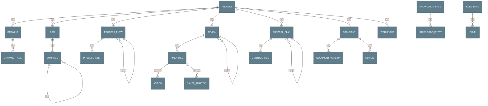

---

## 2. 实体详细设计

### 2.1 Project - 项目实体

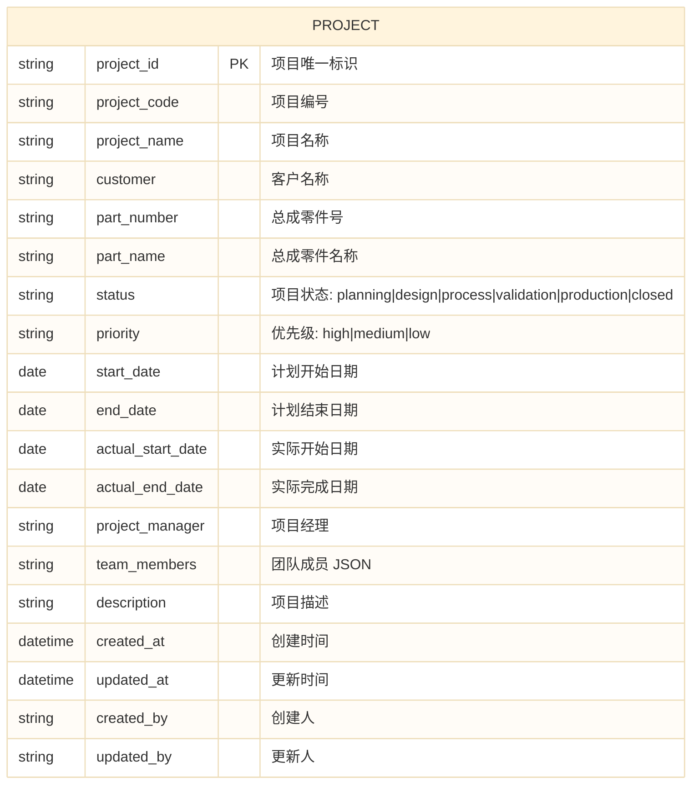

**关键字段说明**:
- `project_id`: UUID 或自增 ID，作为所有关联表的外键
- `status`: 项目生命周期状态，遵循 APQP 五阶段
- `team_members`: JSON 数组，存储团队成员及其角色

---

### 2.2 Drawing - 图纸实体

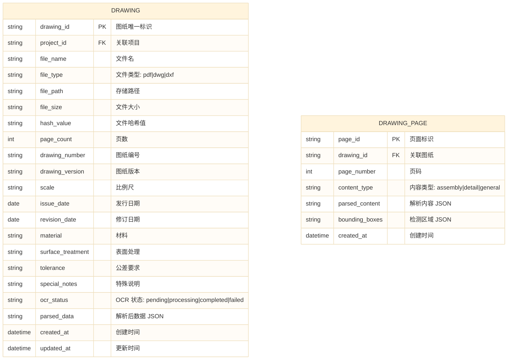

---

### 2.3 BOM - 物料清单实体

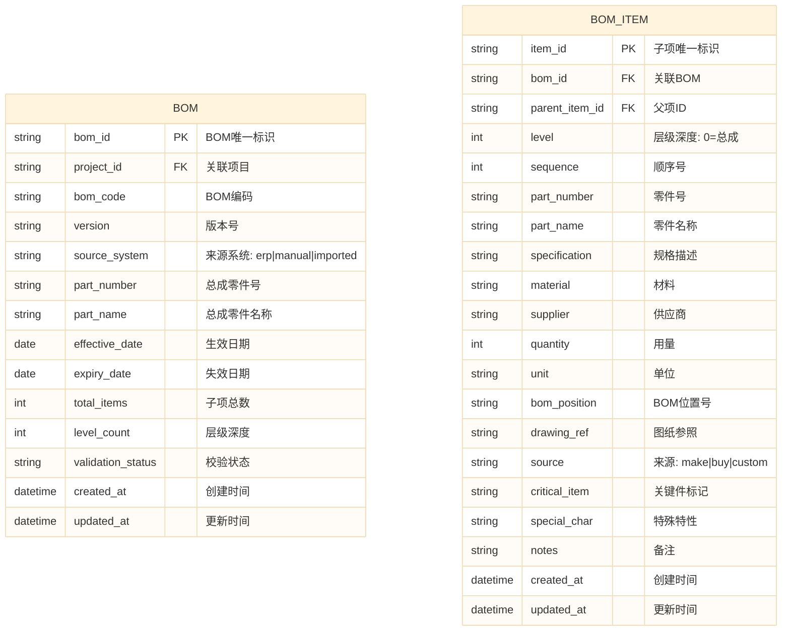

---

### 2.4 Process Flow - 过程流程图实体

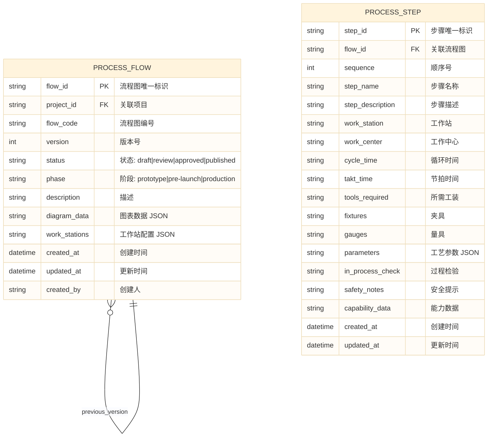

---

### 2.5 PFMEA - FMEA 实体 (AIAG-VDA 七步法)

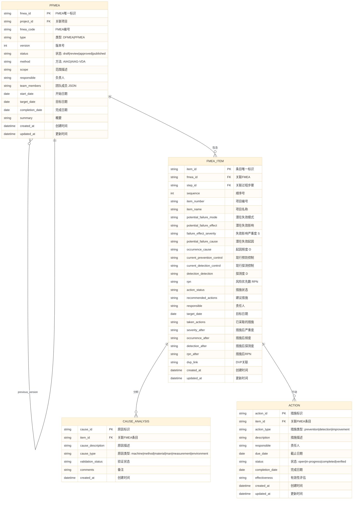

---

### 2.6 Control Plan - 控制计划实体 (三阶段)

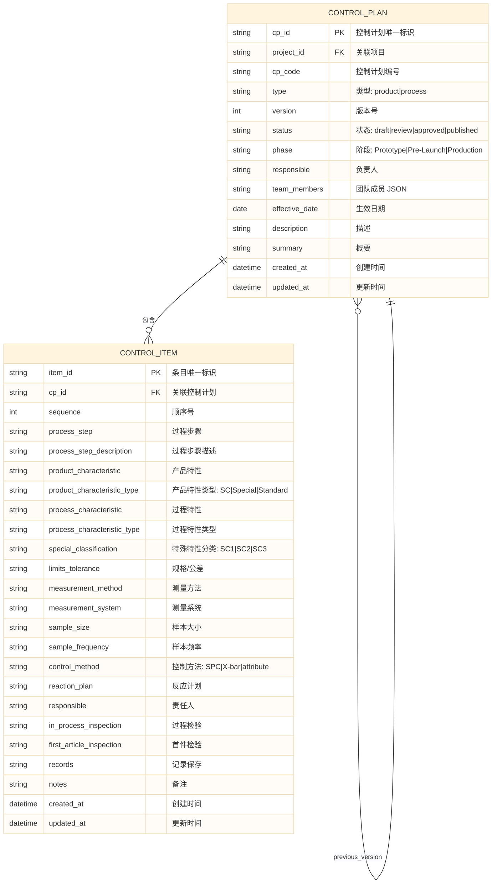

---

### 2.7 Document & Review - 文档与审核实体

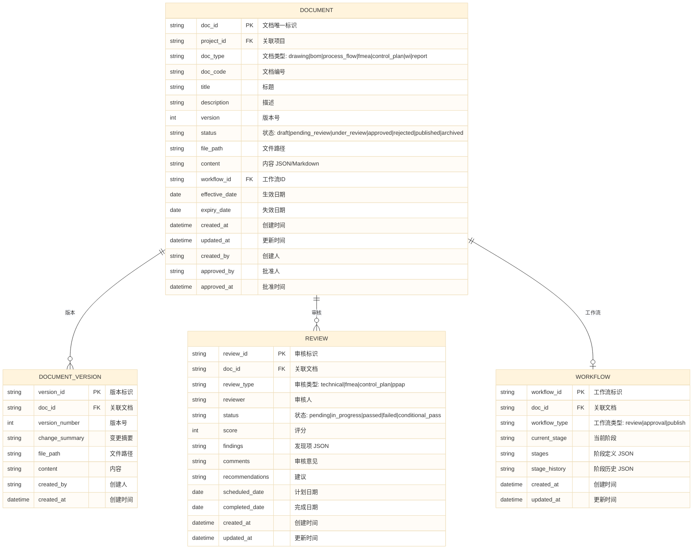

---

### 2.8 Knowledge Base & Rule Base - 知识库与规则库

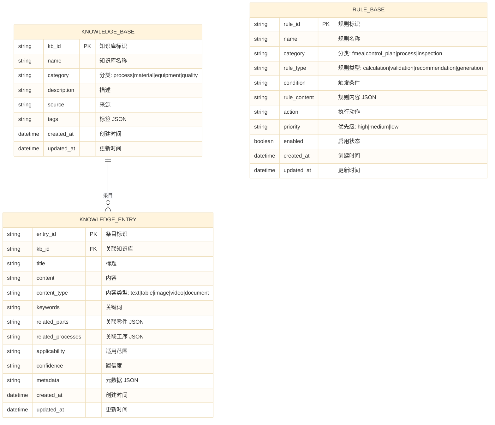

---

## 3. 追溯链设计

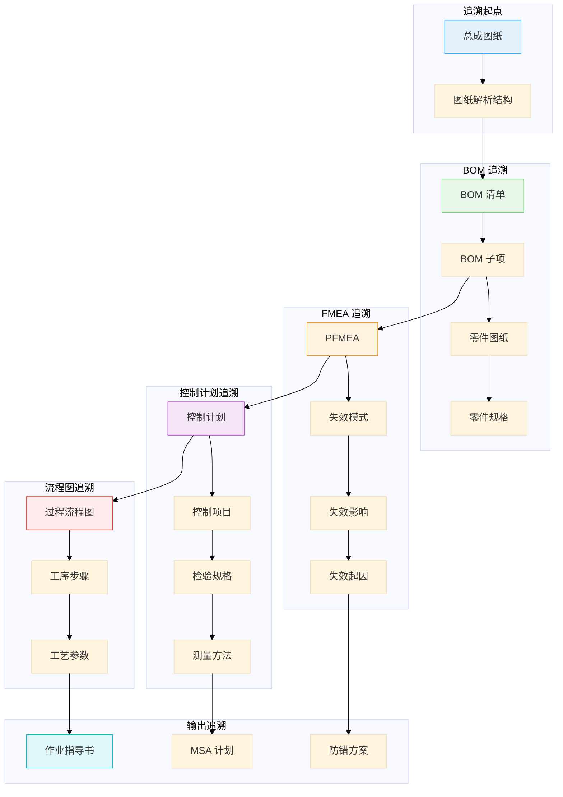

---

## 4. 追溯关系表

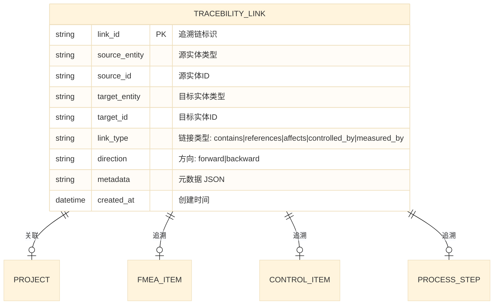

---

## 5. 字段命名规范

| 类别 | 前缀/后缀 | 示例 | 说明 |
|------|-----------|------|------|
| 主键 | `_id` | `project_id` | UUID 或雪花ID |
| 外键 | `_id` | `fmea_id` | 关联到其他表 |
| 时间 | `_at` | `created_at` | 时间戳字段 |
| 日期 | `_date` | `start_date` | 日期字段 |
| 状态 | `status` | `review_status` | 枚举值 |
| 版本 | `version` | `doc_version` | 整数递增 |
| 数量 | `count` | `total_items` | 整数 |
| 布尔 | `is_`/`has_`/`can_` | `is_active` | 布尔值 |
| JSON | 无 | `team_members` | JSON 字符串 |
| 枚举 | 无 | `phase` | 固定选项 |

---

## 6. Mermaid 配置说明

```yaml
# 推荐 Mermaid ER 配置
theme: base
themeVariables:
  primaryColor: "#607D8B"
  primaryTextColor: "#fff"
  primaryBorderColor: "#455A64"
  fontFamily: "Microsoft YaHei, SimHei, Arial, sans-serif"
```

> **使用建议**: 在支持 Mermaid 的 Markdown 渲染器（如 GitHub、GitLab、Typora、VS Code Mermaid 插件）中查看此文档以获得最佳可视化效果。
