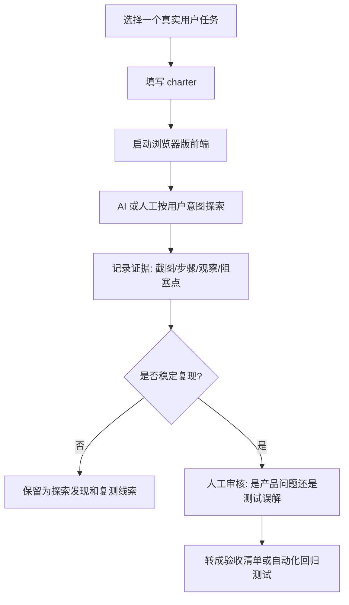

# MINOS AI 开放式软件测试轻量方案

## 测试目标

AI 开放式测试不是让 AI 直接替代自动化测试，也不是默认 AI 已经能稳定操作 MINOS。它的目标是让 AI 扮演一个带任务的真实用户，在有限时间内探索前端工作流，记录“用户想做但找不到入口、状态看不懂、操作后不知道是否成功”这类可用性问题。

本方案优先发现这类问题：

- 用户想在 PFD 增加一行，但找不到新增入口。
- 用户编辑 PFD 后，不知道 PFMEA/CP 是否会同步更新。
- 用户确认 PFD 后，看不懂后台生成是否还在运行、失败还是完成。
- 用户想撤销、软删除、恢复 AI 生成内容，但入口不清楚。
- 用户能看到数据，但不知道下一步该点哪里。

成功标准：每次探索都产出一份可人工复核的证据记录，并把稳定复现的问题转成后续自动化回归测试或产品验收清单。

## 当前项目基础

截至 2026-05-10，本仓库已有 Python 测试基础：

- `pytest.ini` 指向 `tests`。
- `pyproject.toml` 提供 `python -m unittest discover -s tests -v` 作为 unittest 发现命令。
- `apps/desktop-tauri/package.json` 提供 `dev`、`build`、`preview`、`tauri`、`release:nsis`。

当前未看到 Playwright 或 Vitest 脚本。因此本次先文档化流程，不新增依赖，也不声称已经具备 AI 自动操作能力。下一步若要跑浏览器级探索测试，再单独引入 Playwright 并评估 trace、截图、视频产物目录。

## 推荐运行路线

第一阶段推荐使用浏览器版前端：

1. 启动前端：在 `apps/desktop-tauri` 运行 `npm run dev`。
2. 由人工或后续 runner 打开 Vite 地址。
3. 按任务卡探索真实工作流。
4. 记录截图、失败步骤、用户意图、实际阻塞点。
5. 后续引入 Playwright 后，优先开启 trace 与 screenshot，保留每一步证据。

推荐 Playwright 方向：

```text
浏览器前端 + Playwright trace/screenshot
```

暂不把 Tauri 桌面作为第一阶段入口。Tauri 桌面测试更接近真实发布形态，但调试、启动、截图、系统权限和 sidecar 状态更复杂，适合作为第二阶段高级路线。

## 最小流程图



## 适用场景

适合：

- 新 UI 或改版后的可用性探索。
- 三表工作台这类路径长、状态多、领域词重的功能。
- 检查用户是否能从“我想做什么”自然找到“该点哪里”。
- 找到自动化测试不容易覆盖的体验断点。

不适合：

- 替代单元测试、契约测试、导出格式测试。
- 验证算法准确率。
- 直接判断 AI 生成的 PFMEA 专业内容是否正确。
- 在没有人工审核的情况下自动创建缺陷结论。

## 测试任务卡模板

```markdown
## Charter: <任务名>

目标用户：
<例如：质量工程师，第一次打开三表工作台，需要修正 AI 生成的 PFD。>

用户意图：
<用用户自己的话描述，不写实现细节。>

起始状态：
<页面、数据、运行状态、登录/项目状态。>

允许动作：
<可以点击、搜索、编辑、刷新、撤销、查看帮助等。>

限制：
<不能看源码，不能问开发，不能直接调用 API，不能假设隐藏快捷键。>

成功判定：
<用户完成任务后，界面上应该出现什么可见结果。>

失败判定：
<卡住超过多久、找不到入口、状态不确定、误操作、数据丢失等。>

证据要求：
<截图、步骤、页面文案、控制台错误、网络错误、trace 链接等。>

时间盒：
<建议 10-20 分钟。>
```

## 具体任务卡：PFD 新增一行

```markdown
## Charter: PFD 想加一行但找不到办法

目标用户：
质量工程师，正在审核 AI 生成的 PFD，发现缺少一个中间工序。

用户意图：
我想在当前 PFD 表里新增一行工序，并让它能进入后续 PFMEA/CP 的关联流程。

起始状态：
浏览器版三表工作台已打开，已有一组 PFD、PFMEA、CP 数据。当前处在 PFD 或三表工作台页面。

允许动作：
可以点击表格、行菜单、顶部工具栏、右键菜单、快捷操作、搜索按钮、确认按钮、撤销入口和帮助入口。

限制：
不能看源码，不能直接改 JSON，不能调用后端 API，不能假设只有开发者知道的隐藏快捷键。

成功判定：
用户能在 PFD 中新增一行，填写至少一个工序编号或工序名称，并能看到新增行处于未保存、已保存或待确认的明确状态。

失败判定：
- 3 分钟内找不到任何新增入口。
- 找到疑似入口，但不知道是新增 PFD 行、导入数据还是新增项目。
- 新增后页面没有反馈，不知道是否成功。
- 新增行无法编辑必要字段。
- 新增行保存后不知道是否会影响 PFMEA/CP。
- 误点删除、确认、生成等高风险动作且页面没有充分提示。

证据要求：
- 起始页面截图。
- 每次尝试点击的元素名称或位置。
- 卡住时的页面截图。
- 如果成功，新增行前后截图。
- 记录用户预期入口在哪里，例如表格上方、行 hover、右键菜单、空白行、快捷键。

时间盒：
15 分钟。
```

## AI 需要记录的证据

每次探索至少记录：

- 任务卡名称和日期。
- 运行入口：浏览器前端、Tauri 桌面或其他。
- 前端启动命令和访问地址。
- 测试数据来源。
- 用户目标。
- 实际步骤，按时间顺序写。
- 每一步观察到的关键 UI 文案。
- 卡住点或误导点。
- 截图路径或后续 Playwright trace 路径。
- 是否稳定复现。
- AI 的判断和不确定点分开写。

建议证据格式：

```markdown
## Evidence: <日期>-<charter>

结论：
<一句话。>

环境：
- 入口：
- 命令：
- 数据：

步骤：
1. <动作> -> <观察>
2. <动作> -> <观察>

证据：
- 截图：
- trace：
- 控制台错误：

问题判断：
<产品问题、文案问题、测试误解、数据问题或不确定。>

不确定点：
<需要人工确认的地方。>

建议下一步：
<改 UI、补文案、补测试、补任务卡。>
```

## 人工审核标准

人工审核时不要只看 AI 的结论，要看证据是否支持结论。

可以判为真实问题：

- 用户目标合理，且入口确实不可见或语义不清。
- 多次探索都在同一位置卡住。
- 截图能证明页面没有明确反馈。
- 误操作风险来自界面表达，而不是测试者故意乱点。
- 问题会影响核心工作流，例如 PFD 修正、确认、PFMEA 生成、CP 关联。

暂不判为真实问题：

- 起始数据不完整导致入口不可用。
- 测试者跳过了页面上清楚的主按钮。
- 任务卡目标超出当前产品范围。
- 只有 AI 推测，没有截图或步骤证据。
- 需要专业流程判断，但没有领域人员确认。

审核输出分三类：

- 立刻修：入口缺失、状态不明、保存反馈缺失、高风险误操作。
- 进入设计讨论：交互路径存在，但不符合真实用户习惯。
- 暂存线索：证据不足或需要更多用户样本。

## 如何转成自动化回归测试

开放式测试发现问题后，按这个顺序落地：

1. 先写一句可验证的用户行为：
   `在 PFD 表格中，用户能发现新增行入口并创建一条未保存的新 PFD 行。`
2. 再拆成页面断言：
   `PFD 页存在可访问名称包含“新增”或“添加工序”的控件。`
3. 再拆成交互断言：
   `点击新增后，表格出现一条可编辑的新行。`
4. 再拆成状态断言：
   `新行显示未保存或待确认状态。`
5. 最后补链路断言：
   `保存或确认后，PFMEA/CP 的同步影响有明确提示。`

若后续引入 Playwright，可形成类似测试：

```ts
test("PFD can add a visible editable row", async ({ page }) => {
  await page.goto("/");
  await page.getByRole("tab", { name: /PFD|过程流程/ }).click();
  await page.getByRole("button", { name: /新增|添加工序|添加行/ }).click();
  await expect(page.getByRole("row", { name: /未保存|待确认|新工序/ })).toBeVisible();
});
```

如果当前 UI 暂时没有明确新增入口，不要先写死具体按钮名。先把开放式测试证据转成产品验收项，再由 Worker A 或前端负责人确认交互方案。

## 后续 runner 骨架建议

当前不新增 runner，因为仓库没有 Playwright/Vitest 基础，直接加入会扩大依赖和维护面。

推荐下一步单独做一个轻量 runner：

- 新增 `apps/desktop-tauri/e2e/charters/pfd-add-row.md` 保存任务卡。
- 新增 Playwright 配置，只针对浏览器版 Vite 前端。
- 开启 `trace: "on-first-retry"`、失败截图和视频。
- runner 不调用外部 AI 服务，只负责打开页面、保存证据目录、执行人工或脚本化步骤。
- AI 探索层如果后续要接入，应作为单独适配层，不和 Playwright 基础 runner 绑死。

建议第一条自动化回归不要追求“AI 会自己找按钮”，而是验证最终确认过的 UI 合同：新增入口可见、可点击、新行可编辑、状态可见。
