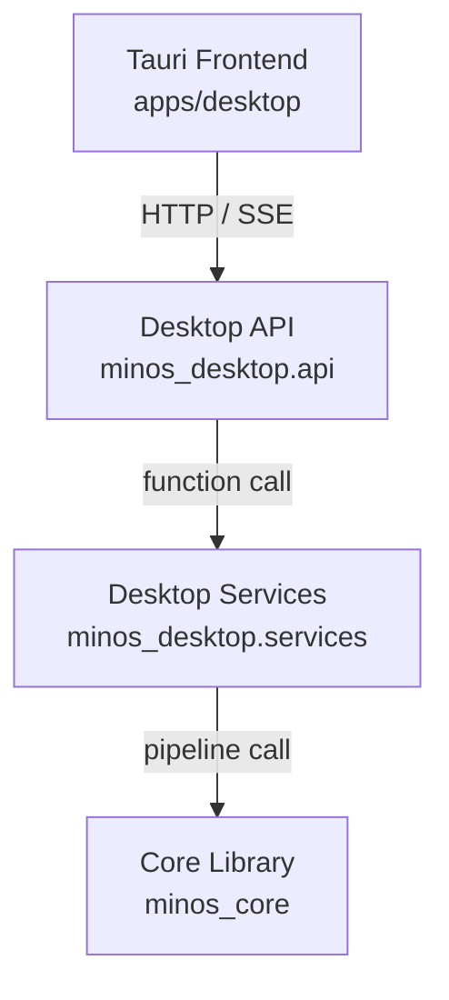

# MINOS-CORE 架构总览

本目录是 MINOS-CORE v3.8 架构的入口文档。它给出系统分层视图、核心调用链以及指向各类设计决策记录（ADR）的索引。

## 分层结构

MINOS-CORE 是一个 **Python 核心库 + 本地桌面应用**。下面 4 层关系，从上到下：

```text
+-----------------------------------------------------+
| 1. Tauri Frontend (apps/desktop)                    |
|    - 桌面 UI、文件选择、进度展示                    |
|    - 通过 HTTP/SSE 与 Desktop API 通信              |
+--------------------------+--------------------------+
                           |
                           v
+-----------------------------------------------------+
| 2. Desktop API (FastAPI sidecar)                    |
|    minos_desktop.api                                |
|    - app.py / routes_*.py / sse.py                  |
|    - Bearer Token 鉴权（MINOS_DESKTOP_API_TOKEN）   |
+--------------------------+--------------------------+
                           |
                           v
+-----------------------------------------------------+
| 3. Desktop Services (UI-neutral business layer)     |
|    minos_desktop.services                           |
|    - SQLite 数据访问、项目/运行/知识库              |
|    - DesktopRunService 调度 Core pipeline           |
+--------------------------+--------------------------+
                           |
                           v
+-----------------------------------------------------+
| 4. Core Library (UI-agnostic pipeline)              |
|    minos_core                                       |
|    - pipeline/: drawing analysis -> PFD -> PFMEA    |
|      -> CP -> review export                         |
|    - quality_gates/: 阶段质量闸门                    |
|    - ai_resilience/: circuit breaker, retry,        |
|      service pool, fallback                         |
|    - plugins/: OCR / 知识源 注册与发现               |
|    - special_characteristic_*: SC/CC 检测           |
|    - edit_patch / review_*: 复核与变更流程           |
|    - commands/: CLI 命令处理器                       |
|    - observability / exporters / adapters           |
+-----------------------------------------------------+
```

调用方向是单向自上而下；底层的 `minos_core` 不应当 import 任何 `minos_desktop.*` 或前端模块。



## ADR 索引

| ADR | 主题 | Track | 状态 |
| --- | --- | --- | --- |
| [001](../adr/001-module-restructuring.md) | 大模块拆分（quality_gates / pipeline / services） | 1 | Accepted |
| [002](../adr/002-ai-resilience.md) | AI 服务韧性（service pool、retry、circuit breaker、fallback） | 2 | Accepted |
| [003](../adr/003-security-validation.md) | 输入校验、SecretStr、API Bearer 鉴权 | 3 | Accepted |
| [004](../adr/004-observability.md) | structlog、MinosError、资源管理、配置诊断 | 4 | Accepted |
| [005](../adr/005-extensibility.md) | OCR / 知识源插件扩展点 | 5 | Accepted |

## 进一步阅读

- [模块地图](modules.md)：每个顶层包的职责与公共入口。
- [数据流](data-flow.md)：从图纸输入到三表导出的核心链路与函数。
- [插件文档](../plugins.md)：如何通过 entry points 接入自定义 OCR / 知识源。
- [迁移指南](../MIGRATION.md)：v3.0 → v3.8 的影响面与排查清单。
