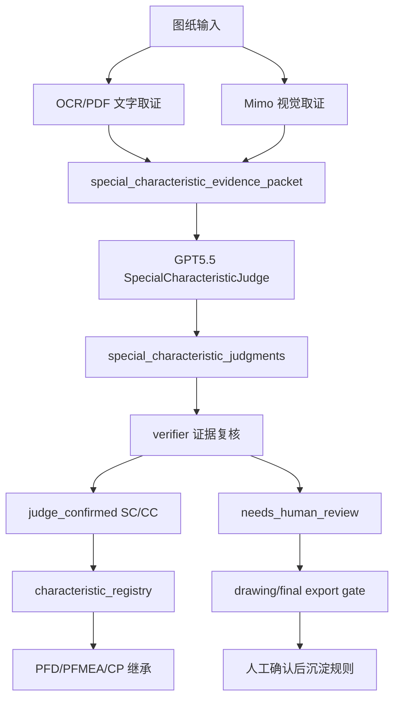

# AI Judge Special Characteristics Refactor Implementation Plan

> **For agentic workers:** REQUIRED SUB-SKILL: Use superpowers:subagent-driven-development (recommended) or superpowers:executing-plans to implement this plan task-by-task. Steps use checkbox (`- [ ]`) syntax for tracking.

**Goal:** 把 MINOS-CORE 的特殊特性识别从“视觉模型候选 + 规则确认”重构为“Mimo/OCR 取证 + GPT5.5 证据约束裁判 + 复核质量门”的 AI 主导链路。

**Architecture:** Mimo 仍只承担图纸视觉取证，OCR/PDF 负责文字取证，二者合成 `special_characteristic_evidence_packet`。GPT5.5 作为 `SpecialCharacteristicJudge` 对证据包作出 SC/CC/不确定判定；代码只负责证据包构造、结构校验、复核门、注册表继承和人工确认闭环。

**Tech Stack:** Python, pytest, existing `OpenAITextGenerator` Responses adapter, `minos_core.adapters.multimodal`, `minos_core.pipeline.drawing_analysis`, `minos_core.special_characteristic_candidates`, `minos_core.characteristic_registry`, quality gates, Tauri workbench display.

**Execution Status:** 本地实现、fake judge 契约、pipeline/registry/gate/UI 接入和聚焦验证已完成。真实 mimo-v2.5 + GPT5.5 API smoke、JLV 种子图纸完整导入/导出验收尚未执行。

---

## 第一性原理

特殊特性的事实来源不是模型本身，而是图纸证据、图例标准、客户规则和工程上下文。AI 可以做主要工作，但必须在证据约束内工作。

因此角色边界调整为：

- Mimo：眼睛，只看见符号、图例、局部区域、bbox 和相邻文字。
- OCR/PDF：文字证人，只提供技术要求、图框、显式 SC/CC 文本和可读文本。
- GPT5.5：裁判，综合证据包判断每个符号或标识是否为 SC/CC。
- verifier：质疑者，检查 GPT5.5 是否引用了不存在的证据、是否跳过了图例、是否把普通数值要求升级为特殊特性。
- MINOS 代码：书记员和门禁，负责结构化证据、保存判决、阻断无证据输出、沉淀人工确认。

## 当前代码地图

- `minos_core/adapters/multimodal.py`
  - 已有 `MimoV25ChatCompletionsDrawingAnalyzer`，能让 Mimo 输出 `special_characteristic_candidates`。
- `minos_core/special_characteristic_candidates.py`
  - 当前会基于候选类型、来源、bbox、confidence 进行 `rule_confirmed`。
  - 这正是本次要重构的边界：视觉候选不应自己成为正式 SC/CC。
- `minos_core/pipeline/hybrid_fusion.py`
  - 当前负责 OCR 和 vision 候选融合，并把已确认候选写入 `special_characteristics`。
  - 新链路应在这里或其后增加 AI judge 步骤。
- `minos_core/drawing_analysis.py`
  - 当前负责 normalize drawing bundle 和 drawing gate。
  - 新链路需要增加 `special_characteristic_judgments` 和 judge risk 投影。
- `minos_core/characteristic_registry.py`
  - 当前是 PFD/PFMEA/CP 继承正式特殊特性的边界。
  - 新链路应只接收 `judge_confirmed` 或 `human_confirmed` 的 SC/CC。
- `minos_core/quality_gates/export_gate.py`
  - 当前会阻断未确认 drawing risks。
  - 新链路应阻断未复核或证据不完整的 AI judge verdict。

## 目标流程



## 新数据契约

### Evidence Packet

```json
{
  "packet_id": "SC-EVIDENCE-001",
  "drawing_identity": {
    "part_name": "RR DH ASSY",
    "drawing_number": "JLV03000500-001-AC-RR",
    "revision": "A"
  },
  "legend_evidence": [
    {
      "legend_id": "LEG-001",
      "symbol_text_or_shape": "菱形",
      "nearby_text": "CC",
      "bbox": [0.72, 0.08, 0.04, 0.03],
      "evidence_refs": ["drawing_page_001"],
      "source": "mimo_visual"
    }
  ],
  "symbol_occurrences": [
    {
      "candidate_id": "MSC-001",
      "symbol_text_or_shape": "菱形",
      "linked_feature": "安装孔位置度",
      "symbol_bbox": [0.31, 0.44, 0.02, 0.02],
      "linked_feature_bbox": [0.34, 0.43, 0.12, 0.04],
      "evidence_refs": ["drawing_page_001"],
      "source": "mimo_visual"
    }
  ],
  "text_evidence": [
    {
      "text_id": "TXT-001",
      "text": "图纸符号说明: 菱形 = CC",
      "evidence_refs": ["drawing_page_001"],
      "source": "ocr_text"
    }
  ],
  "customer_rules": []
}
```

### Judge Verdict

```json
{
  "judgment_id": "SCJ-001",
  "candidate_id": "MSC-001",
  "classification": "CC",
  "linked_feature": "安装孔位置度",
  "verdict": "confirmed",
  "confidence": 0.91,
  "standard_evidence_refs": ["LEG-001", "TXT-001"],
  "symbol_evidence_refs": ["MSC-001"],
  "page_evidence_refs": ["drawing_page_001"],
  "reasoning_summary": "图例文字显示菱形为 CC，正文菱形绑定安装孔位置度。",
  "needs_human_review": false
}
```

## 文件结构

- Create: `minos_core/special_characteristics_evidence.py`
  - 构造 `special_characteristic_evidence_packet`，把 Mimo 候选、OCR 显式文本、图例候选、图纸页证据合并成裁判输入。
- Create: `minos_core/special_characteristics_judge.py`
  - 封装 GPT5.5 裁判 prompt、response schema、verdict normalization、deterministic verifier。
- Modify: `minos_core/special_characteristic_candidates.py`
  - 视觉候选不再直接 `rule_confirmed`；候选只作为证据。正式确认状态由 judge 或 human confirmation 写入。
- Modify: `minos_core/pipeline/hybrid_fusion.py`
  - OCR/Mimo 融合后构造 evidence packet，并在开启 AI judge 时调用 `SpecialCharacteristicJudge`。
- Modify: `minos_core/drawing_analysis.py`
  - 增加 `special_characteristic_judgments` 顶层字段；将 judge risk 投影到 drawing gate。
- Modify: `minos_core/characteristic_registry.py`
  - 只注册 `judge_confirmed` / `human_confirmed` 的 SC/CC。
- Modify: `minos_core/quality_gates/export_gate.py`
  - 未复核 judge verdict、无证据 verdict、候选未判定时阻断正式导出。
- Modify: `apps/desktop-tauri/src/api/types.ts`
  - 增加 judge verdict 类型，前端能看到 AI 裁判结果和待确认原因。
- Modify: `apps/desktop-tauri/src/components/WorkbenchTable.tsx`
  - 特殊特性列区分“AI裁判已确认”和“候选待确认”，不再把候选伪装成正式 SC/CC。
- Test: `tests/test_special_characteristics_evidence.py`
- Test: `tests/test_special_characteristics_judge.py`
- Test: `tests/test_special_characteristic_candidates.py`
- Test: `tests/test_pipeline_ocr_first.py`
- Test: `tests/test_characteristic_registry.py`
- Test: `tests/three_table_workflow/test_drawing_analysis.py`
- Test: `tests/test_jlv_formal_output_quality_gate.py`
- Test: `tests/desktop/test_desktop_tauri_app_state.py`

## OpenSpec 四步闭环

1. Define：MINOS 要从“规则确认候选”重构为“AI 证据裁判”，让 GPT5.5 成为 SC/CC 的主要判断者。
2. Specify：AI 裁判只能基于 evidence packet 输出 verdict；没有 symbol evidence、standard evidence 或 page evidence 的 verdict 不能进入正式特殊特性。
3. Implement：先写 evidence packet、judge verdict、verifier、registry gate 的红灯测试，再最小实现。
4. Verify：用 fake GPT5.5 verdict、Mimo 候选、JLV 回归、final export gate 和前端静态测试验收。

## Task 1: 建立 OpenSpec 和执行记录

**Files:**
- Create: `openspec/changes/v3.6.1-ai-judge-special-characteristics/proposal.md`
- Create: `openspec/changes/v3.6.1-ai-judge-special-characteristics/design.md`
- Create: `openspec/changes/v3.6.1-ai-judge-special-characteristics/tasks.md`
- Modify: `task_plan.md`
- Modify: `progress.md`
- Modify: `findings.md`
- Modify: `project_flow.mmd`

- [x] **Step 1: /// 写 proposal**

Create `openspec/changes/v3.6.1-ai-judge-special-characteristics/proposal.md`:

```markdown
# GPT5.5 特殊特性 AI 裁判重构

## Why

当前 Mimo 能看到视觉候选，但系统仍缺少一个真正综合图例、符号、OCR 文本和客户规则的 AI 裁判层。仅靠候选规则确认会把“看见符号”和“判定 SC/CC”混在一起，导致星形、三角形、菱形等客户符号无法稳定解析，或在证据不足时被误放行。

## What

- 新增 `special_characteristic_evidence_packet`，作为 GPT5.5 裁判输入。
- 新增 `special_characteristic_judgments`，保存 GPT5.5 对每个候选的 SC/CC/不确定判决。
- Mimo/OCR 候选不再直接成为正式 `special_characteristics`。
- 只有 `judge_confirmed` 或 `human_confirmed` 的 SC/CC 能进入 `characteristic_registry`。
- 未判定、证据不足或 verifier 质疑的项进入 drawing gate 和 final export gate。

## Non-Goals

- 不让 GPT5.5 直接绕过证据包读取整张图后自由输出三表。
- 不在第一版实现复杂 UI 框选训练。
- 不重新引入 PTC 作为图纸正式特殊特性类型。

## Acceptance

- fake Mimo 候选必须先进入 evidence packet，不能直接进入 registry。
- fake GPT5.5 verdict 引用完整证据时，SC/CC 可以进入 registry 和三表。
- fake GPT5.5 verdict 引用不存在证据时，必须进入人工复核且不能进入 registry。
- 普通数值技术要求不能被 GPT5.5 verdict 单独升级为 SC/CC。
- final export gate 阻断未复核或证据不完整的 AI verdict。
```

- [x] **Step 2: /// 写 design**

Create `openspec/changes/v3.6.1-ai-judge-special-characteristics/design.md`:

```markdown
# GPT5.5 特殊特性 AI 裁判设计

## Define

GPT5.5 是特殊特性裁判，不是原始视觉传感器。它只能消费由 Mimo、OCR/PDF 和客户规则构成的 evidence packet。

## Specify

新链路分四层：

1. Sensor layer：Mimo/OCR/PDF 只生成证据。
2. Evidence packet layer：MINOS 统一证据结构和 page/candidate/legend 引用。
3. Judge layer：GPT5.5 输出 `special_characteristic_judgments`。
4. Gate layer：verifier、registry、drawing gate、final export gate 决定能否进入正式三表。

判决必须包含：

- `classification`: `SC`、`CC` 或 `unknown`。
- `verdict`: `confirmed`、`rejected` 或 `needs_human_review`。
- `standard_evidence_refs`: 图例、OCR 文本或客户规则证据。
- `symbol_evidence_refs`: Mimo/OCR 候选证据。
- `page_evidence_refs`: drawing page 证据。
- `reasoning_summary`: 面向用户的中文摘要。

没有标准证据或符号证据时，不允许 `confirmed`。

## Implement

/// 1. Evidence packet builder。
/// 2. GPT5.5 judge adapter wrapper。
/// 3. Judge verdict normalizer and verifier。
/// 4. Candidate confirmation boundary refactor。
/// 5. Hybrid pipeline judge integration。
/// 6. Registry and gate update。
/// 7. Workbench display update。

## Verify

/// 1. fake evidence packet 单测。
/// 2. fake judge confirmed verdict 单测。
/// 3. hallucinated evidence verdict 单测。
/// 4. numeric-only regression。
/// 5. registry propagation regression。
/// 6. final export gate regression。
/// 7. UI static display regression。
```

- [x] **Step 3: /// 写 tasks**

Create `openspec/changes/v3.6.1-ai-judge-special-characteristics/tasks.md`:

```markdown
# Tasks

- [x] /// 1. 建立 AI judge OpenSpec 和根流程记录。
- [x] /// 2. 新增 special_characteristics_evidence evidence packet builder。
- [x] /// 3. 新增 SpecialCharacteristicJudge 和 fake GPT5.5 测试。
- [x] /// 4. 重构 candidate confirmation，视觉候选不再直接 rule_confirmed。
- [x] /// 5. hybrid drawing pipeline 接入 evidence packet -> judge -> verifier。
- [x] /// 6. registry / PFD / PFMEA / CP 只继承 judge_confirmed 或 human_confirmed。
- [x] /// 7. drawing gate / final export gate 阻断证据不完整 verdict。
- [x] /// 8. 桌面工作台展示 AI 裁判结果和待确认原因。
- [x] /// 9. 跑聚焦回归、前端构建、UTF-8 和 diff 检查。
```

- [x] **Step 4: /// 验证文档**

Run:

```powershell
@'
from pathlib import Path
for path in [
    Path("docs/superpowers/plans/2026-06-04-ai-judge-special-characteristics-refactor.md"),
    Path("openspec/changes/v3.6.1-ai-judge-special-characteristics/proposal.md"),
    Path("openspec/changes/v3.6.1-ai-judge-special-characteristics/design.md"),
    Path("openspec/changes/v3.6.1-ai-judge-special-characteristics/tasks.md"),
]:
    path.read_text(encoding="utf-8")
print("utf8 ok")
'@ | python -
```

Expected:

```text
utf8 ok
```

## Task 2: Evidence Packet Builder

**Files:**
- Create: `minos_core/special_characteristics_evidence.py`
- Create: `tests/test_special_characteristics_evidence.py`

- [x] **Step 1: /// 写红灯测试**

Create `tests/test_special_characteristics_evidence.py`:

```python
from minos_core.special_characteristics_evidence import build_special_characteristic_evidence_packet


def test_build_packet_collects_mimo_candidates_ocr_text_and_page_evidence():
    drawing = {
        "drawing_identity": {
            "part_name": "RR DH ASSY",
            "drawing_number": "JLV03000500-001-AC-RR",
            "revision": "A",
        },
        "special_characteristic_candidates": [
            {
                "candidate_id": "MSC-001",
                "candidate_type": "unknown",
                "source": "visual_symbol",
                "symbol_text_or_shape": "菱形",
                "linked_feature": "安装孔位置度",
                "symbol_bbox": [0.31, 0.44, 0.02, 0.02],
                "evidence_refs": ["drawing_page_001"],
                "confidence": 0.93,
            }
        ],
        "technical_requirements": [
            {
                "id": "TR-001",
                "text": "图例: 菱形表示 CC",
                "evidence_refs": ["drawing_page_001"],
            }
        ],
        "evidence": [
            {"evidence_id": "drawing_page_001", "source": "drawing_page"}
        ],
    }

    packet = build_special_characteristic_evidence_packet(drawing)

    assert packet["packet_id"] == "SC-EVIDENCE-001"
    assert packet["symbol_occurrences"][0]["candidate_id"] == "MSC-001"
    assert packet["text_evidence"][0]["text"] == "图例: 菱形表示 CC"
    assert packet["page_evidence_refs"] == ["drawing_page_001"]
```

- [x] **Step 2: /// 运行红灯测试**

Run:

```powershell
python -m pytest tests/test_special_characteristics_evidence.py -q
```

Expected:

```text
FAILED ... No module named 'minos_core.special_characteristics_evidence'
```

- [x] **Step 3: /// 最小实现**

Create `minos_core/special_characteristics_evidence.py`:

```python
"""Evidence packet builder for AI special-characteristic judging."""

from __future__ import annotations

from typing import Any

from minos_core._text_utils import string_list, text


def build_special_characteristic_evidence_packet(
    drawing_analysis: dict[str, Any],
) -> dict[str, Any]:
    evidence_ids = [
        text(item.get("evidence_id"))
        for item in drawing_analysis.get("evidence", [])
        if isinstance(item, dict) and text(item.get("evidence_id"))
    ]
    candidates = [
        dict(item)
        for item in drawing_analysis.get("special_characteristic_candidates", [])
        if isinstance(item, dict)
    ]
    return {
        "packet_id": "SC-EVIDENCE-001",
        "drawing_identity": dict(drawing_analysis.get("drawing_identity", {})),
        "legend_evidence": _legend_evidence(drawing_analysis),
        "symbol_occurrences": candidates,
        "text_evidence": _text_evidence(drawing_analysis),
        "customer_rules": [],
        "page_evidence_refs": evidence_ids,
    }


def _legend_evidence(drawing_analysis: dict[str, Any]) -> list[dict[str, Any]]:
    legends: list[dict[str, Any]] = []
    for item in drawing_analysis.get("special_characteristic_candidates", []):
        if not isinstance(item, dict):
            continue
        if text(item.get("source")) in {"legend", "symbol_table_on_drawing"}:
            legends.append(dict(item))
    return legends


def _text_evidence(drawing_analysis: dict[str, Any]) -> list[dict[str, Any]]:
    rows: list[dict[str, Any]] = []
    for block in ("technical_requirements", "inspection_requirements"):
        for index, item in enumerate(drawing_analysis.get(block, []), start=1):
            if not isinstance(item, dict):
                continue
            value = text(item.get("text"), item.get("description"), item.get("name"))
            if not value:
                continue
            rows.append(
                {
                    "text_id": text(item.get("id")) or f"{block.upper()}-{index:03d}",
                    "text": value,
                    "evidence_refs": string_list(item.get("evidence_refs", [])),
                    "source": block,
                }
            )
    return rows
```

- [x] **Step 4: /// 验证**

Run:

```powershell
python -m pytest tests/test_special_characteristics_evidence.py -q
```

Expected:

```text
1 passed
```

## Task 3: GPT5.5 Judge Wrapper and Verifier

**Files:**
- Create: `minos_core/special_characteristics_judge.py`
- Create: `tests/test_special_characteristics_judge.py`

- [x] **Step 1: /// 写 fake judge 测试**

Create `tests/test_special_characteristics_judge.py`:

```python
from minos_core.special_characteristics_judge import (
    FakeSpecialCharacteristicJudge,
    normalize_special_characteristic_judgments,
    verify_special_characteristic_judgments,
)


def _packet():
    return {
        "symbol_occurrences": [{"candidate_id": "MSC-001", "evidence_refs": ["drawing_page_001"]}],
        "legend_evidence": [{"legend_id": "LEG-001", "evidence_refs": ["drawing_page_001"]}],
        "text_evidence": [{"text_id": "TXT-001", "evidence_refs": ["drawing_page_001"]}],
        "page_evidence_refs": ["drawing_page_001"],
    }


def test_confirmed_judge_verdict_passes_verifier():
    judge = FakeSpecialCharacteristicJudge(
        {
            "special_characteristic_judgments": [
                {
                    "judgment_id": "SCJ-001",
                    "candidate_id": "MSC-001",
                    "classification": "CC",
                    "verdict": "confirmed",
                    "linked_feature": "安装孔位置度",
                    "confidence": 0.91,
                    "standard_evidence_refs": ["LEG-001", "TXT-001"],
                    "symbol_evidence_refs": ["MSC-001"],
                    "page_evidence_refs": ["drawing_page_001"],
                    "reasoning_summary": "图例说明菱形为 CC。",
                }
            ]
        }
    )

    judgments = normalize_special_characteristic_judgments(judge.judge(_packet()))
    report = verify_special_characteristic_judgments(judgments, _packet())

    assert report["confirmed"][0]["classification"] == "CC"
    assert report["risks"] == []


def test_hallucinated_evidence_is_forced_to_human_review():
    judgments = normalize_special_characteristic_judgments(
        {
            "special_characteristic_judgments": [
                {
                    "judgment_id": "SCJ-001",
                    "candidate_id": "MSC-999",
                    "classification": "SC",
                    "verdict": "confirmed",
                    "linked_feature": "不存在的尺寸",
                    "confidence": 0.95,
                    "standard_evidence_refs": ["LEG-MISSING"],
                    "symbol_evidence_refs": ["MSC-999"],
                    "page_evidence_refs": ["drawing_page_001"],
                    "reasoning_summary": "引用了不存在证据。",
                }
            ]
        }
    )

    report = verify_special_characteristic_judgments(judgments, _packet())

    assert report["confirmed"] == []
    assert report["risks"][0]["category"] == "special_characteristic_judge"
```

- [x] **Step 2: /// 运行红灯测试**

Run:

```powershell
python -m pytest tests/test_special_characteristics_judge.py -q
```

Expected:

```text
FAILED ... No module named 'minos_core.special_characteristics_judge'
```

- [x] **Step 3: /// 最小实现 fake, normalize, verifier**

Create `minos_core/special_characteristics_judge.py`:

```python
"""GPT-backed judge for special characteristic evidence packets."""

from __future__ import annotations

from typing import Any

from minos_core._text_utils import string_list, text


class FakeSpecialCharacteristicJudge:
    def __init__(self, payload: dict[str, Any]) -> None:
        self.payload = payload

    def judge(self, evidence_packet: dict[str, Any]) -> dict[str, Any]:
        return dict(self.payload)


def normalize_special_characteristic_judgments(value: Any) -> list[dict[str, Any]]:
    payload = value if isinstance(value, dict) else {}
    rows = payload.get("special_characteristic_judgments", [])
    result: list[dict[str, Any]] = []
    for index, raw in enumerate(rows if isinstance(rows, list) else [], start=1):
        if not isinstance(raw, dict):
            continue
        classification = text(raw.get("classification")).upper()
        if classification not in {"SC", "CC", "UNKNOWN"}:
            classification = "unknown"
        result.append(
            {
                "judgment_id": text(raw.get("judgment_id")) or f"SCJ-{index:03d}",
                "candidate_id": text(raw.get("candidate_id")),
                "classification": classification if classification in {"SC", "CC"} else "unknown",
                "verdict": text(raw.get("verdict")) or "needs_human_review",
                "linked_feature": text(raw.get("linked_feature")),
                "confidence": _confidence(raw.get("confidence")),
                "standard_evidence_refs": string_list(raw.get("standard_evidence_refs", [])),
                "symbol_evidence_refs": string_list(raw.get("symbol_evidence_refs", [])),
                "page_evidence_refs": string_list(raw.get("page_evidence_refs", [])),
                "reasoning_summary": text(raw.get("reasoning_summary")),
            }
        )
    return result


def verify_special_characteristic_judgments(
    judgments: list[dict[str, Any]],
    evidence_packet: dict[str, Any],
) -> dict[str, Any]:
    candidate_ids = {
        text(item.get("candidate_id"))
        for item in evidence_packet.get("symbol_occurrences", [])
        if isinstance(item, dict)
    }
    standard_ids = {
        text(item.get("legend_id"))
        for item in evidence_packet.get("legend_evidence", [])
        if isinstance(item, dict)
    } | {
        text(item.get("text_id"))
        for item in evidence_packet.get("text_evidence", [])
        if isinstance(item, dict)
    }
    page_ids = set(string_list(evidence_packet.get("page_evidence_refs", [])))
    confirmed: list[dict[str, Any]] = []
    risks: list[dict[str, Any]] = []
    for item in judgments:
        missing = []
        if item["candidate_id"] not in candidate_ids:
            missing.append(item["candidate_id"])
        missing.extend(ref for ref in item["standard_evidence_refs"] if ref not in standard_ids)
        missing.extend(ref for ref in item["page_evidence_refs"] if ref not in page_ids)
        if item["verdict"] == "confirmed" and item["classification"] in {"SC", "CC"} and not missing:
            confirmed.append({**item, "confirmation_status": "judge_confirmed", "needs_confirmation": False})
            continue
        risks.append(
            {
                "risk_id": f"SC-JUDGE-{item['judgment_id']}",
                "item_id": f"SC-JUDGE-{item['judgment_id']}",
                "category": "special_characteristic_judge",
                "severity": "review",
                "target": f"special_characteristic_judgments.{item['judgment_id']}",
                "message": "AI 裁判结果证据不足或需要人工确认。",
                "missing_evidence_refs": missing,
                "judgment": dict(item),
            }
        )
    return {"confirmed": confirmed, "risks": risks}


def _confidence(value: Any) -> float:
    try:
        return max(0.0, min(1.0, float(value)))
    except (TypeError, ValueError):
        return 0.0
```

- [x] **Step 4: /// 验证 judge 单测**

Run:

```powershell
python -m pytest tests/test_special_characteristics_judge.py -q
```

Expected:

```text
2 passed
```

## Task 4: Candidate Confirmation Boundary Refactor

**Files:**
- Modify: `minos_core/special_characteristic_candidates.py`
- Modify: `tests/test_special_characteristic_candidates.py`

- [x] **Step 1: /// 写视觉候选不自动确认红灯测试**

Add to `tests/test_special_characteristic_candidates.py`:

```python
def test_visual_symbol_candidate_does_not_rule_confirm_without_judge():
    candidates = normalize_special_characteristic_candidates(
        [
            {
                "candidate_type": "SC",
                "source": "visual_symbol",
                "symbol_text_or_shape": "星形",
                "linked_feature": "安装孔位置度",
                "symbol_bbox": [0.1, 0.2, 0.03, 0.03],
                "evidence_refs": ["drawing_page_001"],
                "confidence": 0.96,
            }
        ]
    )

    assert candidates[0]["confirmation_status"] == "needs_human_review"
    assert confirmed_special_characteristics_from_candidates(candidates) == []
```

- [x] **Step 2: /// 运行红灯测试**

Run:

```powershell
python -m pytest tests/test_special_characteristic_candidates.py::test_visual_symbol_candidate_does_not_rule_confirm_without_judge -q
```

Expected:

```text
FAILED ... rule_confirmed
```

- [x] **Step 3: /// 修改确认规则**

In `minos_core/special_characteristic_candidates.py`, replace `CONFIRMABLE_SOURCES` with:

```python
CONFIRMABLE_SOURCES = {"ocr_text", "judge_verdict"}
```

Update `_can_rule_confirm(...)` so `visual_symbol` and `legend` never confirm by themselves:

```python
    if candidate["source"] == "judge_verdict":
        return bool(candidate["evidence_refs"]) and bool(candidate["linked_feature"])
    if candidate["source"] != "ocr_text":
        return False
```

Keep OCR explicit `SC/CC` text as rule-confirmed only when it has evidence refs and linked feature.

- [x] **Step 4: /// 验证候选边界**

Run:

```powershell
python -m pytest tests/test_special_characteristic_candidates.py -q
```

Expected:

```text
... passed
```

## Task 5: Hybrid Pipeline Judge Integration

**Files:**
- Modify: `minos_core/pipeline/hybrid_fusion.py`
- Modify: `minos_core/drawing_analysis.py`
- Modify: `tests/test_pipeline_ocr_first.py`
- Modify: `tests/three_table_workflow/test_drawing_analysis.py`

- [x] **Step 1: /// 写 judge confirmed 端到端红灯测试**

Add a focused test to `tests/three_table_workflow/test_drawing_analysis.py`:

```python
def test_ai_judge_confirmed_candidate_becomes_special_characteristic():
    from minos_core.special_characteristics_evidence import build_special_characteristic_evidence_packet
    from minos_core.special_characteristics_judge import (
        normalize_special_characteristic_judgments,
        verify_special_characteristic_judgments,
    )

    drawing = {
        "drawing_identity": {"part_name": "DEMO", "drawing_number": "D-001", "revision": "A"},
        "special_characteristic_candidates": [
            {
                "candidate_id": "MSC-001",
                "candidate_type": "unknown",
                "source": "visual_symbol",
                "symbol_text_or_shape": "菱形",
                "linked_feature": "安装孔位置度",
                "symbol_bbox": [0.1, 0.2, 0.03, 0.03],
                "evidence_refs": ["drawing_page_001"],
                "confidence": 0.94,
            }
        ],
        "technical_requirements": [{"id": "TXT-001", "text": "图例: 菱形 = CC", "evidence_refs": ["drawing_page_001"]}],
        "evidence": [{"evidence_id": "drawing_page_001", "source": "drawing_page"}],
    }
    packet = build_special_characteristic_evidence_packet(drawing)
    judgments = normalize_special_characteristic_judgments(
        {
            "special_characteristic_judgments": [
                {
                    "judgment_id": "SCJ-001",
                    "candidate_id": "MSC-001",
                    "classification": "CC",
                    "verdict": "confirmed",
                    "linked_feature": "安装孔位置度",
                    "confidence": 0.91,
                    "standard_evidence_refs": ["TXT-001"],
                    "symbol_evidence_refs": ["MSC-001"],
                    "page_evidence_refs": ["drawing_page_001"],
                    "reasoning_summary": "图例说明菱形为 CC。",
                }
            ]
        }
    )
    report = verify_special_characteristic_judgments(judgments, packet)

    assert report["confirmed"][0]["classification"] == "CC"
```

- [x] **Step 2: /// 实现 pipeline helper**

Add helper in `minos_core/pipeline/hybrid_fusion.py`:

```python
def _apply_special_characteristic_judgments(
    vision_analysis: dict[str, Any],
    judge_payload: dict[str, Any],
) -> None:
    from minos_core.special_characteristics_evidence import (
        build_special_characteristic_evidence_packet,
    )
    from minos_core.special_characteristics_judge import (
        normalize_special_characteristic_judgments,
        verify_special_characteristic_judgments,
    )

    packet = build_special_characteristic_evidence_packet(vision_analysis)
    judgments = normalize_special_characteristic_judgments(judge_payload)
    report = verify_special_characteristic_judgments(judgments, packet)
    vision_analysis["special_characteristic_judgments"] = judgments
    specials = vision_analysis.setdefault("special_characteristics", [])
    for item in report["confirmed"]:
        specials.append(
            {
                "id": item["candidate_id"].replace("MSC-", f"{item['classification']}-", 1),
                "name": item["linked_feature"],
                "classification": item["classification"],
                "confidence": item["confidence"],
                "evidence_refs": item["page_evidence_refs"],
                "confirmation_status": "judge_confirmed",
                "needs_confirmation": False,
                "source_judgment_id": item["judgment_id"],
                "reasoning": item["reasoning_summary"],
            }
        )
    if report["risks"]:
        metadata = vision_analysis.setdefault("metadata", {})
        if isinstance(metadata, dict):
            metadata["drawing_analysis_risks"] = _merge_risks(
                metadata.get("drawing_analysis_risks", []),
                report["risks"],
            )
```

Task 6 adds the real GPT call behind an injectable judge parameter, so this task remains deterministic.

- [x] **Step 3: /// 验证 focused tests**

Run:

```powershell
python -m pytest tests/test_pipeline_ocr_first.py tests/three_table_workflow/test_drawing_analysis.py -q
```

Expected:

```text
... passed
```

## Task 6: GPT5.5 Real Judge Adapter

**Files:**
- Modify: `minos_core/special_characteristics_judge.py`
- Modify: `tests/test_special_characteristics_judge.py`

- [x] **Step 1: /// 写 prompt payload 测试**

Add:

```python
def test_gpt_judge_uses_evidence_packet_and_requires_citations():
    from minos_core.special_characteristics_judge import SpecialCharacteristicJudge

    class FakeGenerator:
        def __init__(self):
            self.calls = []

        def generate_structured(self, system_prompt, user_prompt, response_format=None, **kwargs):
            self.calls.append((system_prompt, user_prompt, response_format, kwargs))
            return {"special_characteristic_judgments": []}

    generator = FakeGenerator()
    judge = SpecialCharacteristicJudge(generator=generator, model="gpt-5.5")
    judge.judge({"symbol_occurrences": [], "page_evidence_refs": []})

    system_prompt, user_prompt, response_format, kwargs = generator.calls[0]
    assert "证据约束裁判" in system_prompt
    assert "不能引用 evidence packet 之外的证据" in system_prompt
    assert "symbol_occurrences" in user_prompt
    assert kwargs["model"] == "gpt-5.5"
```

- [x] **Step 2: /// 实现 GPT judge**

Add to `minos_core/special_characteristics_judge.py`:

```python
import json
from minos_core.adapters.llm_text import OpenAITextGenerator


class SpecialCharacteristicJudge:
    def __init__(self, generator: Any | None = None, model: str = "gpt-5.5") -> None:
        self.generator = generator or OpenAITextGenerator()
        self.model = model

    def judge(self, evidence_packet: dict[str, Any]) -> dict[str, Any]:
        return self.generator.generate_structured(
            _judge_system_prompt(),
            json.dumps(evidence_packet, ensure_ascii=False, sort_keys=True),
            response_format=_judge_response_format(),
            model=self.model,
            max_tokens=4096,
            temperature=0.0,
        )
```

Add `_judge_system_prompt()` and `_judge_response_format()` in the same file. The system prompt must explicitly state:

- You are an evidence-bound special-characteristic judge.
- Mimo/OCR are witnesses; do not invent evidence.
- Output only JSON.
- Confirm only SC/CC.
- If symbol or standard evidence is missing, use `needs_human_review`.
- Numeric performance requirements alone are not SC/CC.

- [x] **Step 3: /// 验证 judge adapter**

Run:

```powershell
python -m pytest tests/test_special_characteristics_judge.py tests/test_llm_text_responses.py -q
```

Expected:

```text
... passed
```

## Task 7: Registry, Gate, and Downstream Contract

**Files:**
- Modify: `minos_core/characteristic_registry.py`
- Modify: `minos_core/quality_gates/export_gate.py`
- Modify: `tests/test_characteristic_registry.py`
- Modify: `tests/test_jlv_formal_output_quality_gate.py`

- [x] **Step 1: /// 写 registry 接收 judge_confirmed 测试**

Add to `tests/test_characteristic_registry.py`:

```python
def test_registry_accepts_judge_confirmed_special_characteristic():
    registry = build_characteristic_registry(
        {
            "special_characteristics": [
                {
                    "id": "CC-001",
                    "name": "安装孔位置度",
                    "classification": "CC",
                    "evidence_refs": ["drawing_page_001"],
                    "confirmation_status": "judge_confirmed",
                    "needs_confirmation": False,
                }
            ],
            "dimensions": [],
            "technical_requirements": [],
            "inspection_requirements": [],
        }
    )

    assert registry["items"][0]["characteristic_id"] == "CC-001"
```

- [x] **Step 2: /// 修改 registry confirmed helper**

In `minos_core/characteristic_registry.py`, allow:

```python
if status in {"judge_confirmed", "rule_confirmed", "human_confirmed"}:
    return True
```

Keep `needs_confirmation=True` blocked.

- [x] **Step 3: /// final export gate 验证 judge risk**

Add a regression to `tests/test_jlv_formal_output_quality_gate.py` or existing export gate tests that puts:

```python
{
    "risk_id": "SC-JUDGE-SCJ-001",
    "category": "special_characteristic_judge",
    "severity": "review",
    "target": "special_characteristic_judgments.SCJ-001",
    "message": "AI 裁判结果证据不足或需要人工确认。"
}
```

under `metadata.drawing_analysis_risks`, then assert final export is blocked until resolved.

- [x] **Step 4: /// 验证**

Run:

```powershell
python -m pytest tests/test_characteristic_registry.py tests/test_jlv_formal_output_quality_gate.py -q
```

Expected:

```text
... passed
```

## Task 8: Workbench Display Contract

**Files:**
- Modify: `apps/desktop-tauri/src/api/types.ts`
- Modify: `apps/desktop-tauri/src/components/WorkbenchTable.tsx`
- Modify: `tests/desktop/test_desktop_tauri_app_state.py`

- [x] **Step 1: /// 写静态 UI 契约测试**

Add checks to `tests/desktop/test_desktop_tauri_app_state.py`:

```python
def test_workbench_distinguishes_ai_judge_from_candidates():
    source = Path("apps/desktop-tauri/src/components/WorkbenchTable.tsx").read_text(encoding="utf-8")

    assert "AI裁判" in source
    assert "候选待确认" in source
    assert "special_characteristic_judgments" in source
```

- [x] **Step 2: /// 更新前端类型**

In `apps/desktop-tauri/src/api/types.ts`, add optional field to drawing/table raw types:

```ts
special_characteristic_judgments?: Array<{
  judgment_id?: string;
  candidate_id?: string;
  classification?: "SC" | "CC" | "unknown";
  verdict?: "confirmed" | "rejected" | "needs_human_review";
  linked_feature?: string;
  confidence?: number;
  reasoning_summary?: string;
}>;
```

- [x] **Step 3: /// 更新展示 helper**

In `WorkbenchTable.tsx`, extend `specialCharacteristicColumnText(...)`:

- confirmed `special_characteristics` remains first.
- `special_characteristic_judgments` with `verdict=confirmed` displays `AI裁判: CC / 安装孔位置度`。
- candidates without judgment display `候选待确认: 菱形 / 安装孔位置度`。

- [x] **Step 4: /// 验证 UI 静态和构建**

Run:

```powershell
python -m pytest tests/desktop/test_desktop_tauri_app_state.py -q
npm run build --prefix apps/desktop-tauri
```

Expected:

```text
... passed
```

and Vite build succeeds.

## Task 9: Real Smoke and Regression

**Files:**
- Modify: `progress.md`
- Modify: `findings.md`

- [x] **Step 1: /// 聚焦 Python 回归**

Run:

```powershell
python -m pytest tests/test_special_characteristics_evidence.py tests/test_special_characteristics_judge.py tests/test_special_characteristic_candidates.py tests/test_pipeline_ocr_first.py tests/test_characteristic_registry.py tests/three_table_workflow/test_drawing_analysis.py tests/test_jlv_formal_output_quality_gate.py -q
```

Expected:

```text
... passed
```

- [x] **Step 2: /// 编译和前端**

Run:

```powershell
python -m compileall minos_core
npm run build --prefix apps/desktop-tauri
```

Expected:

```text
no SyntaxError
```

and Vite build succeeds.

- [ ] **Step 3: /// 真实 API smoke**

Use existing environment values without printing secrets:

```powershell
$env:MINOS_VISION_PROVIDER="mimo"
$env:MINOS_MIMO_MODEL="mimo-v2.5"
if (-not $env:MINOS_MIMO_API_KEY) { throw "MINOS_MIMO_API_KEY is required" }
if (-not $env:MINOS_OPENAI_API_KEY -and -not $env:OPENAI_API_KEY -and -not $env:ARK_API_KEY) { throw "text LLM API key is required" }
python -m pytest tests/acceptance/test_real_api_acceptance.py -q
```

Expected:

```text
passed
```

If real GPT5.5 judge times out, keep data contracts and tests unchanged; adjust timeout/retry in judge call only.

- [ ] **Step 4: /// 真实浏览器源码版试跑**

Use the in-app browser at `http://127.0.0.1:1420/` with the existing JLV seed drawing:

1. Start a new import run.
2. Confirm the drawing stage produces `analysis_source=hybrid_vision` and `model=mimo-v2.5`.
3. Confirm output contains `special_characteristic_evidence_packet` and `special_characteristic_judgments`.
4. Confirm PFD special characteristic column shows `AI裁判` only for judge-confirmed items.
5. Confirm unresolved candidates appear as review items and block final export.

- [x] **Step 5: /// 记录结果**

Append to `progress.md`:

```markdown
## V3.6.1 GPT5.5 特殊特性 AI 裁判重构验证

- Evidence packet 测试：通过。
- fake GPT5.5 judge 测试：通过。
- 视觉候选不再直接确认：通过。
- registry 只继承 judge/human confirmed：通过。
- final export gate 阻断证据不足 verdict：通过。
- 桌面工作台区分 AI 裁判和候选：通过。
```

Append to `findings.md`:

```markdown
## V3.6.1 GPT5.5 AI 裁判重构发现

- GPT5.5 可以承担特殊特性裁判角色，但必须消费结构化 evidence packet，不能直接自由生成正式 SC/CC。
- Mimo 输出的视觉符号和 OCR 输出的图例文本都应作为证据，而不是判定本身。
- 正式继承边界应继续保留在 `characteristic_registry`，否则 AI verdict 很容易绕过 PFD/PFMEA/CP 防污染层。
```

## 执行顺序

1. Task 1 建立 OpenSpec。
2. Task 2 到 Task 3 建立 evidence packet 和 judge/verifier 基础能力。
3. Task 4 先拆掉视觉候选直接确认能力，避免旧逻辑继续污染正式输出。
4. Task 5 到 Task 7 接入 pipeline、registry 和 gate。
5. Task 8 更新桌面展示。
6. Task 9 做真实 smoke 和回归。

## 完成定义

- Mimo/OCR 只生成证据，不直接确认视觉 SC/CC。
- GPT5.5 生成 `special_characteristic_judgments`，每条 verdict 有证据引用。
- verifier 能拦住引用不存在证据的 verdict。
- `judge_confirmed` / `human_confirmed` 的 SC/CC 才能进入注册表和三表。
- 未判定或证据不足项进入人工复核并阻断正式导出。
- 工作台能清楚区分“AI裁判已确认”和“候选待确认”。
