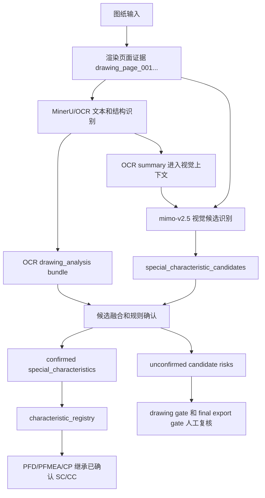

# Mimo V2.5 Vision Special Characteristics Implementation Plan

> **For agentic workers:** REQUIRED SUB-SKILL: Use superpowers:subagent-driven-development (recommended) or superpowers:executing-plans to implement this plan task-by-task. Steps use checkbox (`- [ ]`) syntax for tracking.

**Goal:** 将 `mimo-v2.5` 接入 MINOS-CORE 图纸识别链路，用它补足 OCR 对 CC/SC 图纸符号、图例和符号-尺寸绑定的识别能力，同时保证未经确认的候选项不会污染 PFD/PFMEA/CP。

**Architecture:** 保留现有 OCR-first/hybrid 管线：MinerU/OCR 负责文本和标题栏，mimo-v2.5 只作为视觉证据生成器输出 `special_characteristic_candidates`，规则层再按证据、客户符号词典和人工确认状态决定是否进入正式 `special_characteristics`。三表下游只继承特性注册表里已确认的 SC/CC，不直接继承模型原始标签。

**Tech Stack:** Python, pytest, existing `minos_core.adapters.multimodal` protocol, Xiaomi mimo OpenAI-compatible Chat Completions API (`/v1/chat/completions`), `minos_core.pipeline.drawing_analysis`, `minos_core.drawing_analysis`, `minos_core.characteristic_registry`, OpenSpec docs.

---

## 关键判断

当前代码已经有适合接入 mimo 的边界：

- `minos_core/adapters/multimodal.py` 已经把图纸页渲染成 base64 image，并定义了 `MultimodalDrawingAnalyzer` 协议；但现有实现走的是 Responses `/responses`，小米 mimo 官方文档使用 Chat Completions `/v1/chat/completions`，因此 mimo 需要独立 analyzer，不能继承现有 Responses analyzer。
- `minos_core/pipeline/drawing_analysis.py` 已经支持 `hybrid / ocr_only / vision_only`，hybrid 中先跑 OCR，再把 OCR 摘要传给视觉模型。
- `minos_core/drawing_analysis.py` 已经统一规范化 AI 图纸识别结果，并把低置信和证据缺失投影为质量门人工复核项。
- `minos_core/characteristic_registry.py` 已经是 PFD/PFMEA/CP 继承特性的中心点，适合加入“只继承已确认 SC/CC”的边界。

所以接入方式不应该是在 PFD、PFMEA 或 CP prompt 里直接问 mimo “哪些是 SC/CC”。正确做法是：

1. OCR 先抽文字、标题栏、技术要求和明确 SC/CC 文本。
2. mimo-v2.5 看图找可能的特殊特性符号、图例、框选区域、符号关联尺寸。
3. 规则层把 OCR 和 mimo 的证据合并成候选项。
4. 只有明确符号/明确文本/客户词典命中且证据完整的项，才能变成已确认 SC/CC。
5. 未确认候选进入人工复核和正式导出阻断，不进入三表特殊特性字段。

## 假设和边界

- 根据小米 mimo 官方 quick start 和图片理解文档，`mimo-v2.5` 图像理解通过 OpenAI-compatible Chat Completions 调用：`POST https://api.xiaomimimo.com/v1/chat/completions`，请求体使用 `messages[].content`，图片字段是 `{"type":"image_url","image_url":{"url":"data:image/png;base64,..."}}`。本计划按这个 wire API 实现，不使用 Responses `/responses`。
- 第一版只做环境变量配置，不做桌面设置页 UI。原因是现有 `ai_config.py` 已经是 env/db 配置优先，先把核心链路接稳更短。
- 不把“数值要求”“性能要求”“孔径/位置度/盐雾小时数”自动升级为 SC/CC；这些仍然进入尺寸、技术要求或检验要求。
- 不要求 mimo 一次识别“全部最终特殊特性”。mimo 的职责是尽量召回候选和证据，最终确认由规则和人工闭环控制。
- 不改历史已生成文件。

## 实施流程图



## 文件结构

- Modify: `minos_core/ai_config.py`
  - 增加视觉专用配置读取，避免为了 mimo 改 `MINOS_OPENAI_MODEL` 后影响文本生成模型。
- Modify: `minos_core/adapters/multimodal.py`
  - 保留现有 Responses adapter 给 OpenAI-compatible provider 使用。
  - 增加 `MimoV25ChatCompletionsDrawingAnalyzer` 和默认视觉 analyzer factory。
- Modify: `minos_core/pipeline/drawing_analysis.py`
  - 默认 analyzer factory 从硬编码 OpenAI adapter 改成 factory，按配置选择 mimo/openai。
  - hybrid 继续 OCR-first，并保留失败回退。
- Create: `minos_core/special_characteristic_candidates.py`
  - 负责候选项规范化、候选确认规则、候选风险投影、未确认引用清理。
- Modify: `minos_core/drawing_analysis.py`
  - 新增顶层 `special_characteristic_candidates` 规范化。
  - drawing gate 展示未确认候选风险。
- Modify: `minos_core/pipeline/hybrid_fusion.py`
  - hybrid 时把 OCR 中明确 SC/CC 文本转换为候选项并与 mimo 候选合并。
- Modify: `minos_core/characteristic_registry.py`
  - 注册表只接收已确认 SC/CC。
  - 提供清理下游未确认特殊特性引用的 helper。
- Modify: `minos_core/drawing_to_pfd.py`
  - `characteristics` 只由已确认特殊特性生成。
  - 清理 manufacturing clues 中模型直接塞入的未确认 `special_characteristics`。
- Modify: `minos_core/pipeline/orchestration.py`
  - 在 PFD/PFMEA/CP 阶段之间执行未确认引用清理。
  - 把候选风险带入 chain metadata，交给正式导出 gate。
- Modify: `minos_core/quality_gates/export_gate.py`
  - 保证未确认 SC/CC 候选会阻断正式导出。
- Test: `tests/test_ai_config.py`
- Test: `tests/test_openai_multimodal_adapter.py`
- Test: `tests/test_special_characteristic_candidates.py`
- Test: `tests/three_table_workflow/test_drawing_analysis.py`
- Test: `tests/test_characteristic_registry.py`
- Test: `tests/test_drawing_to_pfd.py`
- Test: `tests/test_pipeline_ocr_first.py`

## OpenSpec 四步闭环

1. Define：MINOS 需要把“特殊特性候选识别”和“正式 SC/CC 确认”分开，解决 OCR 看不全、视觉模型会幻觉、下游会继承错误标签三个问题。
2. Specify：mimo-v2.5 输出 `special_characteristic_candidates`，候选必须有类型、来源、符号、关联特征、bbox/evidence、置信度和确认状态；未确认候选必须可复核、可阻断正式导出。
3. Implement：先写 adapter/config/normalizer/registry/downstream 的红灯测试，再逐步最小实现。
4. Verify：聚焦 pytest、fake mimo response、hybrid OCR fallback 回归、最终导出 gate 回归、UTF-8 和 `git diff --check`。

## Task 1: 建立 OpenSpec 和执行记录

**Files:**
- Create: `openspec/changes/v3.3.2-mimo-v25-special-characteristic-candidates/proposal.md`
- Create: `openspec/changes/v3.3.2-mimo-v25-special-characteristic-candidates/design.md`
- Create: `openspec/changes/v3.3.2-mimo-v25-special-characteristic-candidates/tasks.md`
- Modify: `task_plan.md`
- Modify: `progress.md`
- Modify: `findings.md`
- Modify: `project_flow.mmd`

- [ ] **Step 1: /// 写 proposal**

Create `openspec/changes/v3.3.2-mimo-v25-special-characteristic-candidates/proposal.md`:

```markdown
# Mimo V2.5 特殊特性候选识别

## Why

MINOS 当前 OCR-first 能避免一部分标题栏和技术要求误读，但对图纸中的客户符号、局部符号、图例和符号-尺寸绑定仍然不稳定。单靠 OCR 不能保证 CC/SC 召回；单靠视觉模型又可能把数值要求误判为特殊特性。

## What

- 增加 `mimo-v2.5` 作为图纸视觉候选识别 provider，调用方式为小米官方 OpenAI-compatible Chat Completions：`POST https://api.xiaomimimo.com/v1/chat/completions`。
- 新增 `special_characteristic_candidates` 顶层字段，保存 SC/CC/PTC/unknown 候选和证据区域。
- OCR 明确 SC/CC 文本和 mimo 视觉符号统一进入候选融合。
- 只有已确认候选进入正式 `special_characteristics` 和 `characteristic_registry`。
- 未确认候选进入 drawing gate、chain metadata 和 final export gate。

## Non-Goals

- 不把数值阈值自动升级为特殊特性。
- 不要求第一版 UI 支持在线框选确认。
- 不改变已生成历史文件。

## Acceptance

- 配置 `MINOS_VISION_PROVIDER=mimo` 且 `MINOS_MIMO_MODEL=mimo-v2.5` 时，默认 hybrid 图纸识别使用 mimo analyzer。
- fake mimo response 中的视觉符号候选被规范化并保留 bbox/evidence。
- 普通数值要求不会进入 `special_characteristics`。
- 未确认候选不会传给 PFD/PFMEA/CP 的 `special_characteristics`。
- 未确认候选会阻断正式导出，但不阻断草案继续生成。
```

- [ ] **Step 2: /// 写 design**

Create `openspec/changes/v3.3.2-mimo-v25-special-characteristic-candidates/design.md`:

```markdown
# Mimo V2.5 特殊特性候选设计

## Define

特殊特性识别分两层：候选识别和正式确认。mimo-v2.5 只负责候选识别，不负责最终放行。

## Specify

官方 API 边界：

1. `base_url=https://api.xiaomimimo.com/v1`。
2. `endpoint=chat/completions`。
3. 鉴权头优先使用 quick start 中的 `api-key`。
4. 图片通过 `messages[0].content[]` 的 `image_url.url` 传入，可使用本地渲染页转成的 base64 data URL。

候选 schema：

```json
{
  "candidate_id": "MSC-001",
  "candidate_type": "SC",
  "source": "visual_symbol",
  "symbol_text_or_shape": "SC",
  "linked_feature": "孔径 10.0 +0.05/0 mm",
  "symbol_bbox": [0.12, 0.20, 0.04, 0.03],
  "linked_feature_bbox": [0.18, 0.20, 0.18, 0.05],
  "evidence_refs": ["drawing_page_001"],
  "evidence_regions": [
    {
      "evidence_ref": "drawing_page_001",
      "bbox": [0.12, 0.20, 0.04, 0.03],
      "text": "SC",
      "confidence": 0.91
    }
  ],
  "confidence": 0.91,
  "needs_confirmation": false,
  "confirmation_status": "rule_confirmed",
  "reasoning": "图纸上明确 SC 标识绑定到孔径尺寸。"
}
```

确认规则：

1. `candidate_type` 必须是 `SC` 或 `CC`。
2. `source` 必须是 `visual_symbol`、`legend` 或 `ocr_text`。
3. 必须有 `evidence_refs`。
4. 必须有非零 `symbol_bbox` 或明确 OCR 文本证据。
5. 必须有 `linked_feature`。
6. `confidence >= 0.85` 时可 `rule_confirmed`；否则 `needs_confirmation=true`。
7. `source=knowledge` 只能生成候选，不能自动确认。
8. 没有明确图纸符号、图例或 SC/CC 文本时，数值要求不能成为特殊特性候选。

## Implement

/// 1. 配置层增加 vision provider。
/// 2. adapter 层增加 mimo prompt 和 analyzer factory。
/// 3. drawing analysis 层规范化候选 schema。
/// 4. fusion 层合并 OCR 明确文本候选和 mimo 视觉候选。
/// 5. registry 层只注册已确认 SC/CC。
/// 6. orchestration 层清理未确认下游引用。
/// 7. gate 层把未确认候选投影为正式导出阻断。

## Verify

/// 1. fake mimo response 单测。
/// 2. numeric-only 回归。
/// 3. explicit SC/CC 文本回归。
/// 4. unknown visual symbol 进入人工复核。
/// 5. unconfirmed candidate 不下游继承。
/// 6. final export 被未确认候选阻断。
```

- [ ] **Step 3: /// 写 tasks**

Create `openspec/changes/v3.3.2-mimo-v25-special-characteristic-candidates/tasks.md`:

```markdown
# Tasks

- [ ] /// 1. 配置：增加 vision provider 配置读取和测试。
- [ ] /// 2. 适配器：增加 mimo-v2.5 analyzer factory、prompt 和 payload 测试。
- [ ] /// 3. schema：增加 special_characteristic_candidates 规范化和风险投影。
- [ ] /// 4. fusion：合并 OCR 明确文本候选和 mimo 视觉候选。
- [ ] /// 5. registry：只注册已确认 SC/CC，跳过未确认候选。
- [ ] /// 6. downstream：PFD/PFMEA/CP 清理未确认特殊特性引用。
- [ ] /// 7. gate：未确认候选阻断正式导出。
- [ ] /// 8. 验证：运行聚焦测试、UTF-8 检查和 diff 检查。
```

- [ ] **Step 4: /// 更新根记录**

Append to `task_plan.md`:

```markdown
## v3.3.2 Mimo V2.5 特殊特性候选识别

- 目标：接入 mimo-v2.5 作为图纸视觉候选识别 provider。
- 边界：mimo 只输出候选证据，正式 SC/CC 由规则和人工确认控制。
- 验证：候选 schema、未确认 gate、下游只继承已确认注册表。
```

Append to `progress.md`:

```markdown
## v3.3.2 Mimo V2.5 特殊特性候选识别

- 计划已建立：`docs/superpowers/plans/2026-06-04-mimo-v25-vision-special-characteristics.md`
- OpenSpec 变更：`openspec/changes/v3.3.2-mimo-v25-special-characteristic-candidates/`
```

Append to `findings.md`:

```markdown
## v3.3.2 Mimo 接入判断

- 现有 `minos_core/adapters/multimodal.py` 已具备图像页转 base64 和多模态协议边界；mimo 接入应复用协议和 `_image_data_url(...)`，但请求实现必须使用 Chat Completions。
- 现有三表继承中心是 `minos_core/characteristic_registry.py`，SC/CC 防污染边界应放在注册表和 orchestration 清理层。
- 不能让 mimo 的原始 `special_characteristics` 直接进入 PFD/PFMEA/CP。
```

- [ ] **Step 5: /// 验证文档可读**

Run:

```powershell
@'
from pathlib import Path
paths = [
    Path("openspec/changes/v3.3.2-mimo-v25-special-characteristic-candidates/proposal.md"),
    Path("openspec/changes/v3.3.2-mimo-v25-special-characteristic-candidates/design.md"),
    Path("openspec/changes/v3.3.2-mimo-v25-special-characteristic-candidates/tasks.md"),
]
for path in paths:
    path.read_text(encoding="utf-8")
print("utf8 ok")
'@ | python -
```

Expected:

```text
utf8 ok
```

## Task 2: 增加视觉 provider 配置

**Files:**
- Modify: `minos_core/ai_config.py`
- Modify: `tests/test_ai_config.py`

- [ ] **Step 1: /// 写配置红灯测试**

Append to `tests/test_ai_config.py`:

```python
def test_load_vision_config_prefers_mimo_env(self):
    with patch.dict(
        os.environ,
        {
            "MINOS_DISABLE_CODEX_CONFIG": "1",
            "MINOS_VISION_PROVIDER": "mimo",
            "MINOS_MIMO_API_KEY": "mimo-secret",
            "MINOS_MIMO_BASE_URL": "https://api.xiaomimimo.com/v1",
            "MINOS_MIMO_MODEL": "mimo-v2.5",
        },
        clear=True,
    ):
        from minos_core.ai_config import load_vision_config

        config = load_vision_config(allow_codex_config=False)

    assert config.provider == "mimo"
    assert config.model == "mimo-v2.5"
    assert config.base_url == "https://api.xiaomimimo.com/v1"
    assert config.api_key_configured is True
    assert config.api_key_env_name == "MINOS_MIMO_API_KEY"
    assert config.wire_api == "chat_completions"
    assert config.responses_path == "chat/completions"
```

- [ ] **Step 2: /// 运行红灯测试**

Run:

```powershell
python -m pytest tests/test_ai_config.py::test_load_vision_config_prefers_mimo_env -q
```

Expected:

```text
FAILED ... cannot import name 'load_vision_config'
```

- [ ] **Step 3: /// 实现视觉配置函数**

Add to `minos_core/ai_config.py` after `DEFAULT_OPENAI_RESPONSES_BASE_URL`:

```python
DEFAULT_MIMO_CHAT_COMPLETIONS_BASE_URL = "https://api.xiaomimimo.com/v1"
```

Add to `minos_core/ai_config.py` after `load_openai_responses_config(...)`:

```python
def load_vision_config(
    *,
    codex_home: str | Path | None = None,
    allow_codex_config: bool | None = None,
    db_overrides: dict[str, Any] | None = None,
) -> AIProviderConfig:
    """Load drawing-vision provider config without affecting text LLM config."""

    provider = (os.getenv("MINOS_VISION_PROVIDER") or "").strip().lower()
    if provider == "mimo":
        key_name = _first_set_env_name(("MINOS_MIMO_API_KEY", "MINOS_VISION_API_KEY"))
        key_value = os.getenv(key_name, "") if key_name else ""
        model = os.getenv("MINOS_MIMO_MODEL") or os.getenv("MINOS_VISION_MODEL") or "mimo-v2.5"
        base_url = (
            os.getenv("MINOS_MIMO_BASE_URL")
            or os.getenv("MINOS_VISION_BASE_URL")
            or DEFAULT_MIMO_CHAT_COMPLETIONS_BASE_URL
        )
        return AIProviderConfig(
            provider="mimo",
            model=model,
            base_url=base_url.rstrip("/"),
            api_key_configured=bool(key_value),
            api_key_env_name=key_name or "",
            api_key_source="environment" if key_value else "",
            wire_api="chat_completions",
            responses_path="chat/completions",
            user_agent="minos-core",
        )
    return load_openai_responses_config(
        codex_home=codex_home,
        allow_codex_config=allow_codex_config,
        db_overrides=db_overrides,
    )
```

Add after `load_openai_api_key(...)`:

```python
def load_vision_api_key(
    *,
    codex_home: str | Path | None = None,
    allow_codex_config: bool | None = None,
    db_overrides: dict[str, Any] | None = None,
) -> str:
    provider = (os.getenv("MINOS_VISION_PROVIDER") or "").strip().lower()
    if provider == "mimo":
        return os.getenv("MINOS_MIMO_API_KEY") or os.getenv("MINOS_VISION_API_KEY") or ""
    return load_openai_api_key(
        codex_home=codex_home,
        allow_codex_config=allow_codex_config,
        db_overrides=db_overrides,
    )
```

- [ ] **Step 4: /// 验证配置测试通过**

Run:

```powershell
python -m pytest tests/test_ai_config.py -q
```

Expected:

```text
... passed
```

## Task 3: 增加 mimo-v2.5 Chat Completions adapter 和 prompt

**Files:**
- Modify: `minos_core/adapters/multimodal.py`
- Modify: `minos_core/pipeline/drawing_analysis.py`
- Modify: `tests/test_openai_multimodal_adapter.py`
- Modify: `tests/test_pipeline_ocr_first.py`

- [ ] **Step 1: /// 写 Chat Completions payload 测试**

Add inside `OpenAIResponsesMultimodalDrawingAnalyzerTests` in `tests/test_openai_multimodal_adapter.py`:

```python
    def test_mimo_v25_chat_payload_uses_messages_image_url_and_candidate_prompt(self):
        with tempfile.TemporaryDirectory() as tmpdir:
            image_path = Path(tmpdir) / "drawing.png"
            Image.new("RGB", (10, 8), color="white").save(image_path)
            pages = render_drawing_pages(load_drawing_source(image_path))

            from minos_core.adapters.multimodal import MimoV25ChatCompletionsDrawingAnalyzer

            analyzer = MimoV25ChatCompletionsDrawingAnalyzer(
                api_key="test-key",
                base_url="https://mimo.example/v1",
                model="mimo-v2.5",
            )
            payload = analyzer._request_payload(
                pages,
                {
                    "ocr_analysis_summary": {
                        "technical_requirements": ["红锈出现时间不低于120h"],
                        "special_characteristics": [],
                    }
                },
            )

        self.assertEqual(payload["model"], "mimo-v2.5")
        self.assertFalse(payload["stream"])
        content = payload["messages"][0]["content"]
        self.assertEqual(content[0]["type"], "text")
        self.assertEqual(content[1]["type"], "image_url")
        self.assertTrue(content[1]["image_url"]["url"].startswith("data:image/png;base64,"))
        prompt = content[0]["text"]
        self.assertIn("special_characteristic_candidates", prompt)
        self.assertIn("不得把数值要求", prompt)
        self.assertIn("不要直接把候选写成最终 special_characteristics", prompt)
        self.assertEqual(
            analyzer._chat_completions_url(),
            "https://mimo.example/v1/chat/completions",
        )
```

- [ ] **Step 2: /// 运行 payload 红灯测试**

Run:

```powershell
python -m pytest tests/test_openai_multimodal_adapter.py::OpenAIResponsesMultimodalDrawingAnalyzerTests::test_mimo_v25_chat_payload_uses_messages_image_url_and_candidate_prompt -q
```

Expected:

```text
FAILED ... cannot import name 'MimoV25ChatCompletionsDrawingAnalyzer'
```

- [ ] **Step 3: /// 写 Chat Completions 响应解析红灯测试**

Add inside `OpenAIResponsesMultimodalDrawingAnalyzerTests` in `tests/test_openai_multimodal_adapter.py`:

```python
    def test_mimo_chat_completion_extracts_message_content(self):
        from minos_core.adapters.multimodal import _extract_chat_completion_text

        parsed = _extract_chat_completion_text(
            {
                "choices": [
                    {
                        "message": {
                            "content": "{\"document_type\":\"drawing_analysis_bundle\"}",
                            "reasoning_content": "识别图纸候选。",
                        }
                    }
                ]
            }
        )

        self.assertEqual(parsed, "{\"document_type\":\"drawing_analysis_bundle\"}")
```

- [ ] **Step 4: /// 运行响应解析红灯测试**

Run:

```powershell
python -m pytest tests/test_openai_multimodal_adapter.py::OpenAIResponsesMultimodalDrawingAnalyzerTests::test_mimo_chat_completion_extracts_message_content -q
```

Expected:

```text
FAILED ... cannot import name '_extract_chat_completion_text'
```

- [ ] **Step 5: /// 实现 mimo Chat Completions analyzer**

In `minos_core/adapters/multimodal.py`, update imports:

```python
from minos_core.ai_config import (
    load_openai_api_key,
    load_openai_responses_config,
    load_vision_api_key,
    load_vision_config,
)
```

Add to `minos_core/adapters/multimodal.py` after `OpenAIResponsesMultimodalDrawingAnalyzer`:

```python
class MimoV25ChatCompletionsDrawingAnalyzer:
    """mimo-v2.5 Chat Completions analyzer focused on visual SC/CC candidates."""

    def __init__(
        self,
        *,
        api_key: str | None = None,
        base_url: str | None = None,
        model: str | None = None,
        timeout: int = 120,
        max_retries: int = 2,
        retry_delay: float = 1.0,
    ) -> None:
        config = load_vision_config()
        self.api_key = api_key if api_key is not None else load_vision_api_key()
        base_url_value = (base_url or config.base_url).rstrip("/")
        parsed = urlparse(base_url_value)
        if parsed.scheme != "https":
            if parsed.scheme == "http" and parsed.hostname in {"127.0.0.1", "localhost", "::1"}:
                self._ssl_context = None
            else:
                raise OpenAIMultimodalError(
                    f"base_url must use HTTPS to protect API key, got: {base_url_value}"
                )
        else:
            self._ssl_context = _create_ssl_context()
        self.base_url = base_url_value
        self.model = model or config.model
        self.chat_path = config.responses_path or "chat/completions"
        self.timeout = timeout
        self.max_retries = max(0, int(max_retries))
        self.retry_delay = max(0.0, float(retry_delay))

    def analyze_drawing_pages(
        self,
        pages: list[DrawingPageEvidence],
        context: dict[str, Any] | None = None,
    ) -> MultimodalDrawingResult:
        if not self.api_key:
            raise OpenAIMultimodalError(
                "mimo API key is not configured. Set MINOS_MIMO_API_KEY."
            )
        if not pages:
            raise OpenAIMultimodalError("drawing analysis requires at least one page")
        payload = self._request_payload(pages, context or {})
        response = self._post_json(self._chat_completions_url(), payload)
        content = _extract_chat_completion_text(response)
        if not content:
            raise OpenAIMultimodalError("mimo chat completion did not contain message content")
        return MultimodalDrawingResult(
            content=content,
            model=str(response.get("model", self.model)),
            metadata={
                "response_id": response.get("id"),
                "usage": response.get("usage", {}),
                "page_count": len(pages),
                "wire_api": "chat_completions",
            },
        )

    def _chat_completions_url(self) -> str:
        return f"{self.base_url}/{self.chat_path.strip('/')}"

    def _request_payload(
        self, pages: list[DrawingPageEvidence], context: dict[str, Any]
    ) -> dict[str, Any]:
        prompt_context = dict(context)
        prompt_context.setdefault(
            "available_drawing_page_evidence_ids",
            [page.evidence_id for page in pages],
        )
        content: list[dict[str, Any]] = [
            {
                "type": "text",
                "text": _mimo_v25_drawing_analysis_prompt(prompt_context),
            }
        ]
        for page in pages:
            content.append(
                {
                    "type": "image_url",
                    "image_url": {"url": _image_data_url(page.image_path)},
                }
            )
        return {
            "model": self.model,
            "messages": [{"role": "user", "content": content}],
            "stream": False,
        }

    def _post_json(self, url: str, payload: dict[str, Any]) -> dict[str, Any]:
        request_body = json.dumps(payload).encode("utf-8")
        attempts = self.max_retries + 1
        raw = ""
        for attempt in range(1, attempts + 1):
            request = urllib.request.Request(
                url,
                data=request_body,
                headers={
                    "api-key": self.api_key,
                    "Content-Type": "application/json",
                    "User-Agent": "minos-core",
                },
                method="POST",
            )
            try:
                if self._ssl_context:
                    with urllib.request.urlopen(request, timeout=self.timeout, context=self._ssl_context) as response:
                        raw = response.read().decode("utf-8")
                else:
                    with urllib.request.urlopen(request, timeout=self.timeout) as response:
                        raw = response.read().decode("utf-8")
                break
            except urllib.error.HTTPError as exc:
                exc.read()
                if attempt < attempts and _should_retry_http_status(exc.code):
                    time.sleep(self.retry_delay * attempt)
                    continue
                raise OpenAIMultimodalError(
                    f"mimo Chat Completions API failed after {attempt} attempt(s): HTTP {exc.code}"
                ) from exc
            except (urllib.error.URLError, TimeoutError) as exc:
                if attempt < attempts:
                    time.sleep(self.retry_delay * attempt)
                    continue
                raise OpenAIMultimodalError(
                    f"mimo Chat Completions API connection failed after {attempt} attempt(s): {exc}"
                ) from exc
        try:
            parsed = json.loads(raw)
        except json.JSONDecodeError as exc:
            raise OpenAIMultimodalError(f"mimo Chat Completions API returned invalid JSON: {exc}") from exc
        if not isinstance(parsed, dict):
            raise OpenAIMultimodalError("mimo Chat Completions API returned non-object JSON")
        return parsed
```

Add near `_extract_output_text(...)`:

```python
def _extract_chat_completion_text(response: dict[str, Any]) -> str:
    choices = response.get("choices", [])
    if not isinstance(choices, list):
        return ""
    for choice in choices:
        if not isinstance(choice, dict):
            continue
        message = choice.get("message", {})
        if not isinstance(message, dict):
            continue
        content = message.get("content")
        if isinstance(content, str) and content.strip():
            return content.strip()
    return ""
```

Add factory after the class:

```python
def create_default_multimodal_drawing_analyzer() -> MultimodalDrawingAnalyzer:
    config = load_vision_config()
    if config.provider == "mimo":
        return MimoV25ChatCompletionsDrawingAnalyzer()
    return OpenAIResponsesMultimodalDrawingAnalyzer()
```

Add prompt function near `_drawing_analysis_prompt(...)`:

```python
def _mimo_v25_drawing_analysis_prompt(context: dict[str, Any]) -> str:
    context_text = json.dumps(context, ensure_ascii=False, sort_keys=True)
    return (
        "你是汽车 APQP/PPAP 图纸视觉识别助手。请只返回合法 JSON，不要输出 Markdown。"
        "你的重点任务是发现所有可能的特殊特性候选，而不是最终确认 SC/CC。"
        "必需顶层 JSON 键包括：drawing_identity, materials, surface_treatments, "
        "dimensions, tolerances, special_characteristics, special_characteristic_candidates, "
        "technical_requirements, inspection_requirements, manufacturing_clues, uncertainties。"
        "special_characteristic_candidates 中只写候选证据，字段包括 candidate_id, "
        "candidate_type, source, symbol_text_or_shape, linked_feature, symbol_bbox, "
        "linked_feature_bbox, evidence_refs, evidence_regions, confidence, needs_confirmation, "
        "confirmation_status, reasoning。候选类型只允许 SC、CC、PTC、unknown。"
        "如果看到星形、三角形、菱形、盾牌、客户自定义符号、图例说明、SC/CC/PTC 文本，"
        "必须输出候选并给出 bbox。没有图纸符号、图例或明确 SC/CC/PTC 文本时，"
        "不得把数值要求、性能要求、孔径、位置度、盐雾小时数、膜厚、扭矩自动判为 SC/CC。"
        "不要直接把候选写成最终 special_characteristics；除非图纸上明确写出 SC 或 CC 并且"
        "候选证据完整。所有业务内容使用中文，标准缩写 SC、CC、PTC、PFD、PFMEA、CP 可保留。"
        "上下文："
        f"{context_text}"
    )
```

- [ ] **Step 6: /// pipeline 默认 factory 改为配置选择**

In `minos_core/pipeline/drawing_analysis.py`, replace import inside `analyze_drawing_for_three_table_chain(...)`:

```python
from ..adapters.multimodal import OpenAIResponsesMultimodalDrawingAnalyzer
```

with:

```python
from ..adapters.multimodal import create_default_multimodal_drawing_analyzer
```

Replace:

```python
default_analyzer_factory=OpenAIResponsesMultimodalDrawingAnalyzer,
```

with:

```python
default_analyzer_factory=create_default_multimodal_drawing_analyzer,
```

- [ ] **Step 7: /// 验证 adapter 和 pipeline**

Run:

```powershell
python -m pytest tests/test_openai_multimodal_adapter.py tests/test_pipeline_ocr_first.py -q
```

Expected:

```text
... passed
```

## Task 4: 增加特殊特性候选 schema 和规则

**Files:**
- Create: `minos_core/special_characteristic_candidates.py`
- Create: `tests/test_special_characteristic_candidates.py`

- [ ] **Step 1: /// 写候选规范化测试**

Create `tests/test_special_characteristic_candidates.py`:

```python
from minos_core.special_characteristic_candidates import (
    confirmed_special_characteristics_from_candidates,
    normalize_special_characteristic_candidates,
    risks_from_special_characteristic_candidates,
)


def test_visual_symbol_candidate_is_normalized_with_evidence_regions():
    candidates = normalize_special_characteristic_candidates(
        [
            {
                "candidate_type": "sc",
                "source": "visual_symbol",
                "symbol_text_or_shape": "triangle",
                "linked_feature": "孔径 10.0 +0.05/0 mm",
                "symbol_bbox": [0.1, 0.2, 0.05, 0.04],
                "linked_feature_bbox": [0.2, 0.2, 0.2, 0.05],
                "evidence_refs": ["drawing_page_001"],
                "confidence": 0.91,
                "needs_confirmation": False,
            }
        ]
    )

    assert candidates[0]["candidate_id"] == "MSC-001"
    assert candidates[0]["candidate_type"] == "SC"
    assert candidates[0]["confirmation_status"] == "rule_confirmed"
    assert candidates[0]["evidence_regions"][0]["evidence_ref"] == "drawing_page_001"


def test_numeric_only_candidate_is_not_confirmed():
    candidates = normalize_special_characteristic_candidates(
        [
            {
                "candidate_type": "SC",
                "source": "knowledge",
                "linked_feature": "红锈出现时间不低于120h",
                "evidence_refs": ["drawing_page_001"],
                "confidence": 0.96,
            }
        ]
    )

    assert candidates[0]["confirmation_status"] == "needs_human_review"
    assert candidates[0]["needs_confirmation"] is True
    assert confirmed_special_characteristics_from_candidates(candidates) == []


def test_unconfirmed_candidate_projects_review_risk():
    candidates = normalize_special_characteristic_candidates(
        [
            {
                "candidate_type": "unknown",
                "source": "visual_symbol",
                "symbol_text_or_shape": "customer_star",
                "linked_feature": "位置度 0.2 A B",
                "evidence_refs": ["drawing_page_001"],
                "confidence": 0.72,
            }
        ]
    )

    risks = risks_from_special_characteristic_candidates(candidates)

    assert risks[0]["risk_id"] == "SC-CANDIDATE-MSC-001"
    assert risks[0]["severity"] == "review"
    assert risks[0]["target"] == "special_characteristic_candidates.MSC-001"
```

- [ ] **Step 2: /// 运行红灯测试**

Run:

```powershell
python -m pytest tests/test_special_characteristic_candidates.py -q
```

Expected:

```text
FAILED ... No module named 'minos_core.special_characteristic_candidates'
```

- [ ] **Step 3: /// 实现候选模块**

Create `minos_core/special_characteristic_candidates.py`:

```python
"""Special characteristic candidate normalization and confirmation rules."""

from __future__ import annotations

from typing import Any

from minos_core._text_utils import string_list, text

CONFIRMABLE_TYPES = {"SC", "CC"}
CONFIRMABLE_SOURCES = {"visual_symbol", "legend", "ocr_text"}
CONFIRMATION_CONFIDENCE = 0.85


def normalize_special_characteristic_candidates(value: Any) -> list[dict[str, Any]]:
    raw_items = value if isinstance(value, list) else []
    normalized: list[dict[str, Any]] = []
    for index, raw in enumerate(raw_items, start=1):
        if not isinstance(raw, dict):
            continue
        candidate = _normalize_candidate(raw, index)
        normalized.append(candidate)
    return normalized


def confirmed_special_characteristics_from_candidates(
    candidates: list[dict[str, Any]],
) -> list[dict[str, Any]]:
    confirmed: list[dict[str, Any]] = []
    for candidate in candidates:
        if not _is_confirmed(candidate):
            continue
        confirmed.append(
            {
                "id": candidate["candidate_id"].replace("MSC-", f"{candidate['candidate_type']}-"),
                "name": candidate.get("linked_feature", ""),
                "classification": candidate.get("candidate_type", ""),
                "symbol": candidate.get("symbol_text_or_shape", ""),
                "source_ref": ",".join(string_list(candidate.get("evidence_refs", []))),
                "evidence_refs": string_list(candidate.get("evidence_refs", [])),
                "evidence_regions": candidate.get("evidence_regions", []),
                "confidence": candidate.get("confidence", 0.0),
                "ai_inferred": True,
                "needs_confirmation": False,
                "source_candidate_id": candidate.get("candidate_id", ""),
            }
        )
    return confirmed


def risks_from_special_characteristic_candidates(
    candidates: list[dict[str, Any]],
) -> list[dict[str, Any]]:
    risks: list[dict[str, Any]] = []
    for candidate in candidates:
        if _is_confirmed(candidate):
            continue
        candidate_id = text(candidate.get("candidate_id"))
        if not candidate_id:
            continue
        risks.append(
            {
                "risk_id": f"SC-CANDIDATE-{candidate_id}",
                "category": "special_characteristic_candidate",
                "severity": "review",
                "target": f"special_characteristic_candidates.{candidate_id}",
                "message": "图纸存在未确认的特殊特性候选，正式输出前必须人工确认。",
                "candidate": dict(candidate),
            }
        )
    return risks


def confirmed_special_characteristic_ids(registry: dict[str, Any]) -> set[str]:
    ids: set[str] = set()
    for item in registry.get("items", []):
        if not isinstance(item, dict):
            continue
        if text(item.get("classification")) == "special_characteristic":
            cid = text(item.get("characteristic_id"))
            if cid:
                ids.add(cid)
    return ids


def strip_unconfirmed_special_characteristic_refs(
    payload: dict[str, Any],
    registry: dict[str, Any],
) -> dict[str, Any]:
    allowed = confirmed_special_characteristic_ids(registry)
    if not allowed:
        _strip_payload_specials(payload)
        return payload
    for key in ("steps", "process_steps", "rows", "failure_modes", "controls"):
        rows = payload.get(key, [])
        if not isinstance(rows, list):
            continue
        for row in rows:
            if not isinstance(row, dict):
                continue
            for field in ("special_characteristics", "source_special_characteristics"):
                refs = [ref for ref in string_list(row.get(field, [])) if ref in allowed]
                if refs:
                    row[field] = refs
                elif field in row:
                    row[field] = []
    return payload


def _normalize_candidate(raw: dict[str, Any], index: int) -> dict[str, Any]:
    candidate_type = text(raw.get("candidate_type"), raw.get("classification")).upper()
    if candidate_type not in {"SC", "CC", "PTC", "UNKNOWN"}:
        candidate_type = "unknown" if not candidate_type else candidate_type
    if candidate_type == "UNKNOWN":
        candidate_type = "unknown"
    candidate_id = text(raw.get("candidate_id"), raw.get("id")) or f"MSC-{index:03d}"
    evidence_refs = string_list(raw.get("evidence_refs", []))
    symbol_bbox = _bbox(raw.get("symbol_bbox", raw.get("bbox")))
    linked_feature_bbox = _bbox(raw.get("linked_feature_bbox"))
    confidence = _confidence(raw.get("confidence"))
    candidate = {
        "candidate_id": candidate_id,
        "candidate_type": candidate_type,
        "source": text(raw.get("source")) or "unknown",
        "symbol_text_or_shape": text(raw.get("symbol_text_or_shape"), raw.get("symbol"), raw.get("marker")),
        "linked_feature": text(raw.get("linked_feature"), raw.get("feature"), raw.get("characteristic")),
        "symbol_bbox": symbol_bbox,
        "linked_feature_bbox": linked_feature_bbox,
        "evidence_refs": evidence_refs,
        "evidence_regions": _evidence_regions(raw, evidence_refs, symbol_bbox),
        "confidence": confidence,
        "needs_confirmation": bool(raw.get("needs_confirmation", False)),
        "reasoning": text(raw.get("reasoning"), raw.get("rationale")),
    }
    if _can_rule_confirm(candidate):
        candidate["confirmation_status"] = "rule_confirmed"
        candidate["needs_confirmation"] = False
    else:
        candidate["confirmation_status"] = text(raw.get("confirmation_status")) or "needs_human_review"
        candidate["needs_confirmation"] = True
    return candidate


def _can_rule_confirm(candidate: dict[str, Any]) -> bool:
    if candidate["candidate_type"] not in CONFIRMABLE_TYPES:
        return False
    if candidate["source"] not in CONFIRMABLE_SOURCES:
        return False
    if not candidate["evidence_refs"]:
        return False
    if not candidate["linked_feature"]:
        return False
    if candidate["confidence"] < CONFIRMATION_CONFIDENCE:
        return False
    if candidate["source"] != "ocr_text" and not _has_nonzero_bbox(candidate["symbol_bbox"]):
        return False
    return True


def _is_confirmed(candidate: dict[str, Any]) -> bool:
    return text(candidate.get("confirmation_status")) in {"rule_confirmed", "human_confirmed"}


def _bbox(value: Any) -> list[float]:
    if not isinstance(value, list) or len(value) < 4:
        return [0.0, 0.0, 0.0, 0.0]
    result: list[float] = []
    for item in value[:4]:
        try:
            result.append(max(0.0, float(item)))
        except (TypeError, ValueError):
            result.append(0.0)
    return result


def _has_nonzero_bbox(value: list[float]) -> bool:
    return len(value) >= 4 and value[2] > 0.0 and value[3] > 0.0


def _confidence(value: Any) -> float:
    try:
        return max(0.0, min(1.0, float(value)))
    except (TypeError, ValueError):
        return 0.0


def _evidence_regions(
    raw: dict[str, Any],
    evidence_refs: list[str],
    symbol_bbox: list[float],
) -> list[dict[str, Any]]:
    regions = raw.get("evidence_regions")
    if isinstance(regions, list) and regions:
        return [region for region in regions if isinstance(region, dict)]
    if evidence_refs:
        return [
            {
                "evidence_ref": evidence_refs[0],
                "bbox": symbol_bbox,
                "text": text(raw.get("symbol_text_or_shape"), raw.get("symbol")),
                "confidence": _confidence(raw.get("confidence")),
            }
        ]
    return []


def _strip_payload_specials(payload: dict[str, Any]) -> None:
    for key in ("steps", "process_steps", "rows", "failure_modes", "controls"):
        rows = payload.get(key, [])
        if not isinstance(rows, list):
            continue
        for row in rows:
            if isinstance(row, dict):
                row["special_characteristics"] = []
                if "source_special_characteristics" in row:
                    row["source_special_characteristics"] = []
```

- [ ] **Step 4: /// 验证候选模块**

Run:

```powershell
python -m pytest tests/test_special_characteristic_candidates.py -q
```

Expected:

```text
3 passed
```

## Task 5: drawing_analysis 规范化候选并投影风险

**Files:**
- Modify: `minos_core/drawing_analysis.py`
- Modify: `tests/three_table_workflow/test_drawing_analysis.py`

- [ ] **Step 1: /// 写 drawing gate 测试**

Append to `tests/three_table_workflow/test_drawing_analysis.py`:

```python
    def test_drawing_analysis_preserves_unconfirmed_sc_candidate_as_review_risk(self):
        bundle = {
            "drawing_identity": {
                "part_name": "DEMO BRACKET",
                "drawing_number": "D-001",
                "revision": "A",
            },
            "materials": [{"name": "SPCC", "evidence_refs": ["drawing_page_001"]}],
            "manufacturing_clues": [{"operation": "冲孔", "evidence_refs": ["drawing_page_001"]}],
            "special_characteristic_candidates": [
                {
                    "candidate_type": "unknown",
                    "source": "visual_symbol",
                    "symbol_text_or_shape": "customer_star",
                    "linked_feature": "孔径 10.0 mm",
                    "evidence_refs": ["drawing_page_001"],
                    "confidence": 0.70,
                }
            ],
            "evidence": [{"evidence_id": "drawing_page_001", "source": "drawing_page"}],
        }

        gate = evaluate_drawing_recognition_gate(bundle)
        dump = gate.model_dump()

        self.assertTrue(gate.can_continue)
        self.assertTrue(
            any(
                item.get("item_id") == "SC-CANDIDATE-MSC-001"
                for item in dump["manual_review_items"]
            )
        )
```

- [ ] **Step 2: /// 运行红灯测试**

Run:

```powershell
python -m pytest tests/three_table_workflow/test_drawing_analysis.py::DrawingAnalysisTests::test_drawing_analysis_preserves_unconfirmed_sc_candidate_as_review_risk -q
```

Expected:

```text
FAILED ... SC-CANDIDATE-MSC-001
```

- [ ] **Step 3: /// 修改 normalization**

In `minos_core/drawing_analysis.py`, add import:

```python
from minos_core.special_characteristic_candidates import (
    confirmed_special_characteristics_from_candidates,
    normalize_special_characteristic_candidates,
    risks_from_special_characteristic_candidates,
)
```

In `_normalize_drawing_analysis_payload(...)`, before `normalized = { ... }`:

```python
    special_characteristic_candidates = normalize_special_characteristic_candidates(
        payload.get("special_characteristic_candidates", [])
    )
    confirmed_specials = confirmed_special_characteristics_from_candidates(
        special_characteristic_candidates
    )
```

In `normalized = { ... }`, add:

```python
        "special_characteristic_candidates": special_characteristic_candidates,
```

Replace the existing `special_characteristics` line with:

```python
        "special_characteristics": _normalize_analysis_items(
            payload.get("special_characteristics")
        ) + confirmed_specials,
```

After normalized metadata is created, add:

```python
    candidate_risks = risks_from_special_characteristic_candidates(
        special_characteristic_candidates
    )
    if candidate_risks:
        normalized["metadata"]["drawing_analysis_risks"] = candidate_risks
```

In `_drawing_analysis_report(...)`, include the new block in the loop:

```python
        "special_characteristic_candidates",
```

In `_validate_all_refs_exist(...)` and `_repair_page_evidence_refs(...)`, include:

```python
        "special_characteristic_candidates",
```

- [ ] **Step 4: /// 验证 drawing analysis**

Run:

```powershell
python -m pytest tests/three_table_workflow/test_drawing_analysis.py tests/test_special_characteristic_candidates.py -q
```

Expected:

```text
... passed
```

## Task 6: hybrid 融合 OCR 明确 SC/CC 与 mimo 候选

**Files:**
- Modify: `minos_core/pipeline/hybrid_fusion.py`
- Modify: `minos_core/pipeline/drawing_analysis.py`
- Modify: `tests/test_pipeline_ocr_first.py`

- [ ] **Step 1: /// 写融合测试**

Append to `tests/test_pipeline_ocr_first.py`:

```python
def test_hybrid_preserves_explicit_ocr_sc_as_candidate_when_vision_misses_it():
    vision = {
        "drawing_identity": {"part_name": "BRACKET"},
        "materials": [],
        "manufacturing_clues": [],
        "special_characteristic_candidates": [],
        "metadata": {},
    }
    ocr = {
        "special_characteristics": [
            {
                "classification": "SC",
                "name": "孔径 10.0 +/- 0.1 mm",
                "evidence_refs": ["drawing_page_001"],
                "confidence": 0.93,
            }
        ]
    }

    from minos_core.pipeline.hybrid_fusion import _merge_special_characteristic_candidates

    _merge_special_characteristic_candidates(vision, ocr)

    assert vision["special_characteristic_candidates"][0]["candidate_type"] == "SC"
    assert vision["special_characteristic_candidates"][0]["source"] == "ocr_text"
    assert vision["special_characteristics"][0]["classification"] == "SC"
```

- [ ] **Step 2: /// 运行红灯测试**

Run:

```powershell
python -m pytest tests/test_pipeline_ocr_first.py::test_hybrid_preserves_explicit_ocr_sc_as_candidate_when_vision_misses_it -q
```

Expected:

```text
FAILED ... cannot import name '_merge_special_characteristic_candidates'
```

- [ ] **Step 3: /// 实现融合 helper**

Add to `minos_core/pipeline/hybrid_fusion.py`:

```python
def _merge_special_characteristic_candidates(
    vision_analysis: dict[str, Any],
    ocr_analysis: dict[str, Any],
) -> None:
    from minos_core.special_characteristic_candidates import (
        confirmed_special_characteristics_from_candidates,
        normalize_special_characteristic_candidates,
        risks_from_special_characteristic_candidates,
    )

    raw_candidates = list(vision_analysis.get("special_characteristic_candidates", []))
    for item in ocr_analysis.get("special_characteristics", []):
        if not isinstance(item, dict):
            continue
        classification = _clean_text(item.get("classification")).upper()
        if classification not in {"SC", "CC"}:
            continue
        raw_candidates.append(
            {
                "candidate_type": classification,
                "source": "ocr_text",
                "symbol_text_or_shape": classification,
                "linked_feature": _clean_text(
                    item.get("name")
                    or item.get("characteristic")
                    or item.get("description")
                ),
                "evidence_refs": string_list(item.get("evidence_refs", [])),
                "confidence": _float_value(item.get("confidence"), 0.0),
                "reasoning": "OCR 文本明确包含 SC/CC 标识。",
            }
        )
    candidates = normalize_special_characteristic_candidates(raw_candidates)
    vision_analysis["special_characteristic_candidates"] = candidates
    confirmed = confirmed_special_characteristics_from_candidates(candidates)
    if confirmed:
        existing = vision_analysis.setdefault("special_characteristics", [])
        if not isinstance(existing, list):
            existing = []
            vision_analysis["special_characteristics"] = existing
        seen = {
            str(item.get("source_candidate_id", item.get("id", ""))).strip()
            for item in existing
            if isinstance(item, dict)
        }
        for item in confirmed:
            candidate_id = str(item.get("source_candidate_id", "")).strip()
            if candidate_id and candidate_id not in seen:
                existing.append(item)
                seen.add(candidate_id)
    risks = risks_from_special_characteristic_candidates(candidates)
    if risks:
        metadata = vision_analysis.setdefault("metadata", {})
        if isinstance(metadata, dict):
            metadata["drawing_analysis_risks"] = risks
```

In `_analyze_drawing_pages_for_mode(...)` in `minos_core/pipeline/drawing_analysis.py`, after `_lock_hybrid_identity_from_ocr(vision_analysis, ocr_analysis)` add:

```python
        from .hybrid_fusion import _merge_special_characteristic_candidates

        _merge_special_characteristic_candidates(vision_analysis, ocr_analysis)
```

- [ ] **Step 4: /// 验证 hybrid 融合**

Run:

```powershell
python -m pytest tests/test_pipeline_ocr_first.py tests/test_drawing_ocr_analysis.py -q
```

Expected:

```text
... passed
```

## Task 7: 注册表只接收已确认 SC/CC

**Files:**
- Modify: `minos_core/characteristic_registry.py`
- Modify: `minos_core/drawing_to_pfd.py`
- Modify: `tests/test_characteristic_registry.py`
- Modify: `tests/test_drawing_to_pfd.py`

- [ ] **Step 1: /// 写注册表过滤测试**

Append to `tests/test_characteristic_registry.py`:

```python
def test_registry_skips_unconfirmed_special_characteristics():
    drawing_analysis = {
        "special_characteristics": [
            {
                "id": "SC-001",
                "name": "孔径 10.0 mm",
                "classification": "SC",
                "evidence_refs": ["drawing_page_001"],
                "needs_confirmation": True,
            }
        ],
        "dimensions": [],
        "technical_requirements": [],
        "inspection_requirements": [],
    }

    registry = build_characteristic_registry(drawing_analysis)

    assert registry["items"] == []


def test_registry_accepts_rule_confirmed_special_characteristic():
    drawing_analysis = {
        "special_characteristics": [
            {
                "id": "SC-001",
                "name": "孔径 10.0 mm",
                "classification": "SC",
                "evidence_refs": ["drawing_page_001"],
                "needs_confirmation": False,
                "confirmation_status": "rule_confirmed",
            }
        ],
        "dimensions": [],
        "technical_requirements": [],
        "inspection_requirements": [],
    }

    registry = build_characteristic_registry(drawing_analysis)

    assert registry["items"][0]["characteristic_id"] == "SC-001"
    assert registry["items"][0]["classification"] == "special_characteristic"
```

- [ ] **Step 2: /// 运行红灯测试**

Run:

```powershell
python -m pytest tests/test_characteristic_registry.py::test_registry_skips_unconfirmed_special_characteristics tests/test_characteristic_registry.py::test_registry_accepts_rule_confirmed_special_characteristic -q
```

Expected:

```text
FAILED ... registry["items"]
```

- [ ] **Step 3: /// 修改 registry 特殊特性接收条件**

In `minos_core/characteristic_registry.py`, inside `build_characteristic_registry(...)`, after `if not name: continue`, add:

```python
            if block_key == "special_characteristics" and not _confirmed_special_characteristic(raw):
                continue
```

Add helper near `_confidence(...)`:

```python
def _confirmed_special_characteristic(raw: dict[str, Any]) -> bool:
    status = text(raw.get("confirmation_status"))
    if status in {"rule_confirmed", "human_confirmed"}:
        return True
    if bool(raw.get("needs_confirmation", False)):
        return False
    classification = text(raw.get("classification"), raw.get("category")).upper()
    return classification in {"SC", "CC"}
```

- [ ] **Step 4: /// 防止 drawing_to_pfd 直接输出未确认 characteristics**

In `minos_core/drawing_to_pfd.py`, update `_characteristics_from_drawing(...)` loop:

```python
        if item.get("needs_confirmation"):
            continue
        status = row_text(item, "confirmation_status", default="")
        classification = row_text(item, "classification", "category", default="").upper()
        if status not in {"rule_confirmed", "human_confirmed"} and classification not in {"SC", "CC"}:
            continue
```

- [ ] **Step 5: /// 验证注册表和 PFD**

Run:

```powershell
python -m pytest tests/test_characteristic_registry.py tests/test_drawing_to_pfd.py -q
```

Expected:

```text
... passed
```

## Task 8: 下游清理未确认 SC/CC 引用并阻断正式导出

**Files:**
- Modify: `minos_core/pipeline/orchestration.py`
- Modify: `minos_core/quality_gates/export_gate.py`
- Modify: `tests/three_table_workflow/test_drawing_analysis.py`

- [ ] **Step 1: /// 写端到端防污染测试**

Append to `tests/three_table_workflow/test_drawing_analysis.py`:

```python
    def test_unconfirmed_sc_candidate_does_not_propagate_to_three_tables(self):
        drawing_analysis = {
            "drawing_identity": {
                "part_name": "DEMO BRACKET",
                "drawing_number": "D-001",
                "revision": "A",
            },
            "materials": [{"name": "SPCC", "evidence_refs": ["drawing_page_001"]}],
            "manufacturing_clues": [
                {
                    "operation": "冲孔",
                    "special_characteristics": ["SC-001"],
                    "evidence_refs": ["drawing_page_001"],
                }
            ],
            "special_characteristic_candidates": [
                {
                    "candidate_id": "MSC-001",
                    "candidate_type": "unknown",
                    "source": "visual_symbol",
                    "linked_feature": "孔径 10.0 mm",
                    "evidence_refs": ["drawing_page_001"],
                    "needs_confirmation": True,
                    "confirmation_status": "needs_human_review",
                }
            ],
            "special_characteristics": [],
            "evidence": [{"evidence_id": "drawing_page_001", "source": "drawing_page"}],
            "metadata": {
                "drawing_analysis_risks": [
                    {
                        "risk_id": "SC-CANDIDATE-MSC-001",
                        "severity": "review",
                        "target": "special_characteristic_candidates.MSC-001",
                        "message": "图纸存在未确认的特殊特性候选。",
                    }
                ]
            },
        }

        process_flow = infer_process_flow_from_drawing(drawing_analysis)
        registry = build_characteristic_registry(drawing_analysis)
        attached = attach_characteristics_to_three_tables(
            {"process_flow": process_flow},
            registry,
        )["process_flow"]

        from minos_core.special_characteristic_candidates import strip_unconfirmed_special_characteristic_refs

        strip_unconfirmed_special_characteristic_refs(attached, registry)

        assert attached["steps"][0]["special_characteristics"] == []
```

- [ ] **Step 2: /// 运行红灯测试**

Run:

```powershell
python -m pytest tests/three_table_workflow/test_drawing_analysis.py::DrawingAnalysisTests::test_unconfirmed_sc_candidate_does_not_propagate_to_three_tables -q
```

Expected before orchestration cleanup:

```text
FAILED ... ['SC-001'] != []
```

- [ ] **Step 3: /// orchestration 调用清理 helper**

In `minos_core/pipeline/orchestration.py`, import inside `generate_three_tables_from_drawing(...)`:

```python
    from ..special_characteristic_candidates import strip_unconfirmed_special_characteristic_refs
```

After each `attach_characteristics_to_three_tables(...)` stage result, add:

```python
    strip_unconfirmed_special_characteristic_refs(process_flow, registry)
```

After PFMEA attachment:

```python
    strip_unconfirmed_special_characteristic_refs(process_flow, registry)
    strip_unconfirmed_special_characteristic_refs(pfmea, registry)
```

After CP attachment:

```python
    strip_unconfirmed_special_characteristic_refs(process_flow, registry)
    strip_unconfirmed_special_characteristic_refs(pfmea, registry)
    strip_unconfirmed_special_characteristic_refs(control_plan, registry)
```

- [ ] **Step 4: /// final export gate 覆盖候选风险**

Existing `evaluate_export_gate(chain)` already blocks `metadata.drawing_analysis_risks` in current tests. Add this focused regression to `tests/three_table_workflow/test_drawing_analysis.py`:

```python
    def test_final_export_gate_blocks_unconfirmed_sc_candidate_risk(self):
        chain = {
            "document_type": "apqp_chain",
            "schema_version": "minos-core.generated.v1",
            "product": {},
            "process_steps": [],
            "failure_modes": [],
            "controls": [],
            "evidence": [],
            "metadata": {
                "drawing_analysis_risks": [
                    {
                        "risk_id": "SC-CANDIDATE-MSC-001",
                        "category": "special_characteristic_candidate",
                        "severity": "review",
                        "target": "special_characteristic_candidates.MSC-001",
                        "message": "图纸存在未确认的特殊特性候选。",
                    }
                ]
            },
        }

        gate = evaluate_export_gate(chain)

        self.assertFalse(gate.allow_user_export)
        self.assertTrue(
            any(
                item.item_id == "SC-CANDIDATE-MSC-001"
                for item in gate.manual_review_items
            )
        )
```

- [ ] **Step 5: /// 验证下游防污染**

Run:

```powershell
python -m pytest tests/three_table_workflow/test_drawing_analysis.py tests/test_characteristic_registry.py -q
```

Expected:

```text
... passed
```

## Task 9: 增加 fake mimo 全链路回归

**Files:**
- Modify: `tests/three_table_workflow/test_drawing_analysis.py`

- [ ] **Step 1: /// 写 fake mimo response 用例**

Append to `tests/three_table_workflow/test_drawing_analysis.py`:

```python
    def test_fake_mimo_confirmed_sc_candidate_propagates_by_registry_only(self):
        with tempfile.TemporaryDirectory() as tmpdir:
            pages = render_drawing_pages(
                load_drawing_source(SharedTestHelpers.write_png(Path(tmpdir) / "drawing.png"))
            )
            payload = {
                "drawing_identity": {
                    "part_name": "DEMO BRACKET",
                    "drawing_number": "D-001",
                    "revision": "A",
                },
                "materials": [{"name": "SPCC", "evidence_refs": ["drawing_page_001"], "confidence": 0.95}],
                "manufacturing_clues": [{"operation": "冲孔", "evidence_refs": ["drawing_page_001"], "confidence": 0.91}],
                "special_characteristic_candidates": [
                    {
                        "candidate_type": "SC",
                        "source": "visual_symbol",
                        "symbol_text_or_shape": "SC",
                        "linked_feature": "孔径 10.0 +0.05/0 mm",
                        "symbol_bbox": [0.1, 0.2, 0.05, 0.04],
                        "linked_feature_bbox": [0.2, 0.2, 0.2, 0.05],
                        "evidence_refs": ["drawing_page_001"],
                        "confidence": 0.93,
                    }
                ],
                "special_characteristics": [],
                "technical_requirements": [],
                "inspection_requirements": [],
                "uncertainties": [],
            }

            bundle = analyze_drawing_pages(
                pages,
                FakeMultimodalDrawingAnalyzer(json.dumps(payload, ensure_ascii=False)),
            )

        registry = build_characteristic_registry(bundle)
        pfd = infer_process_flow_from_drawing(bundle)
        attached = attach_characteristics_to_three_tables({"process_flow": pfd}, registry)["process_flow"]

        sc_items = [
            item for item in registry["items"]
            if item["classification"] == "special_characteristic"
        ]
        self.assertEqual(sc_items[0]["characteristic_id"], "SC-001")
        self.assertIn("SC-001", attached["steps"][0]["special_characteristics"])
```

- [ ] **Step 2: /// 验证 fake mimo 全链路**

Run:

```powershell
python -m pytest tests/three_table_workflow/test_drawing_analysis.py::DrawingAnalysisTests::test_fake_mimo_confirmed_sc_candidate_propagates_by_registry_only -q
```

Expected:

```text
1 passed
```

## Task 10: 实物接入验收和回归命令

**Files:**
- Modify: `progress.md`
- Modify: `findings.md`

- [ ] **Step 1: /// 运行聚焦回归**

Run:

```powershell
python -m pytest tests/test_ai_config.py tests/test_openai_multimodal_adapter.py tests/test_special_characteristic_candidates.py tests/test_drawing_ocr_analysis.py tests/test_characteristic_registry.py tests/test_drawing_to_pfd.py tests/test_pipeline_ocr_first.py tests/three_table_workflow/test_drawing_analysis.py -q
```

Expected:

```text
... passed
```

- [ ] **Step 2: /// 运行真实 mimo smoke test**

Use an existing non-sensitive sample drawing and preconfigured environment values:

```powershell
$env:MINOS_VISION_PROVIDER="mimo"
$env:MINOS_MIMO_MODEL="mimo-v2.5"
if (-not $env:MINOS_MIMO_BASE_URL) { throw "MINOS_MIMO_BASE_URL is required for real mimo smoke test" }
if (-not $env:MINOS_MIMO_API_KEY) { throw "MINOS_MIMO_API_KEY is required for real mimo smoke test" }
python -m pytest tests/acceptance/test_real_api_acceptance.py -q
```

Expected:

```text
passed
```

If the real endpoint rejects the Chat Completions request, expected failure shape is:

```text
mimo Chat Completions API failed ... HTTP ...
```

Then keep all candidate/schema/downstream code unchanged and adjust only `MimoV25ChatCompletionsDrawingAnalyzer._post_json(...)` or `_request_payload(...)` to match the real API error.

- [ ] **Step 3: /// 完整 Python 语法检查**

Run:

```powershell
python -m compileall minos_core
```

Expected:

```text
... no SyntaxError
```

- [ ] **Step 4: /// 文档和空白检查**

Run:

```powershell
@'
from pathlib import Path
for path in [
    Path("docs/superpowers/plans/2026-06-04-mimo-v25-vision-special-characteristics.md"),
    Path("openspec/changes/v3.3.2-mimo-v25-special-characteristic-candidates/proposal.md"),
    Path("openspec/changes/v3.3.2-mimo-v25-special-characteristic-candidates/design.md"),
    Path("openspec/changes/v3.3.2-mimo-v25-special-characteristic-candidates/tasks.md"),
]:
    path.read_text(encoding="utf-8")
print("utf8 ok")
'@ | python -
git diff --check
```

Expected:

```text
utf8 ok
```

`git diff --check` may show existing CRLF warnings; it must not show newly introduced whitespace errors.

- [ ] **Step 5: /// 更新实施记录**

Append to `progress.md`:

```markdown
## v3.3.2 Mimo V2.5 接入验证结果

- 配置/provider 测试：通过。
- fake mimo 候选识别链路：通过。
- numeric-only 不升级特殊特性回归：通过。
- 未确认候选不下游继承：通过。
- final export gate 阻断未确认候选：通过。
```

Append to `findings.md`:

```markdown
## v3.3.2 Mimo V2.5 接入结论

- mimo-v2.5 应作为图纸视觉证据生成器接入，不能作为最终 SC/CC 判定器。
- 特殊特性正式继承边界必须在 `characteristic_registry` 和 orchestration 清理层。
- 真实 API 若返回鉴权、图片格式或请求字段错误，只修改 mimo adapter 的请求头、payload 或响应解析，不改变候选 schema 和下游规则。
```

## 执行顺序建议

1. 先做 Task 1 到 Task 3，确认 mimo 可以被配置并被调用。
2. 再做 Task 4 到 Task 6，建立候选 schema 和 OCR/vision 融合。
3. 最后做 Task 7 到 Task 9，锁住下游防污染和正式导出阻断。
4. Task 10 做验收，不通过不进入下一批真实项目图纸测试。

## 风险和处理

- 如果 mimo-v2.5 的实际返回字段和文档不一致：只在 `MimoV25ChatCompletionsDrawingAnalyzer` 内调整 `_post_json(...)` 或 `_extract_chat_completion_text(...)`，保持外部 `MultimodalDrawingAnalyzer` 协议不变。
- 如果 mimo 召回高但误报多：调低自动 `rule_confirmed` 范围，只让明确 SC/CC 文本和客户符号词典命中的项确认，其余走人工复核。
- 如果 OCR 和 mimo 对同一候选给出不同类型：按 `CC > SC > PTC > unknown` 的风险顺序保留候选，但 `needs_confirmation=true`。
- 如果真实图纸有客户自定义符号：第一版先识别为 `unknown` 候选；客户符号词典单独作为下一次小变更加入，不把未知符号自动确认。

## 完成定义

- `MINOS_VISION_PROVIDER=mimo` 能让 hybrid 默认使用 `mimo-v2.5`。
- fake mimo 输出的视觉符号候选能进入 `special_characteristic_candidates`。
- 明确 SC/CC 且证据完整的候选能进入 `special_characteristics` 和注册表。
- 未确认候选能进入 drawing/final gate 人工复核。
- PFD/PFMEA/CP 只继承注册表里已确认的 SC/CC。
- 普通数值要求继续只作为技术/检验/数值规格，不自动变成 SC/CC。
