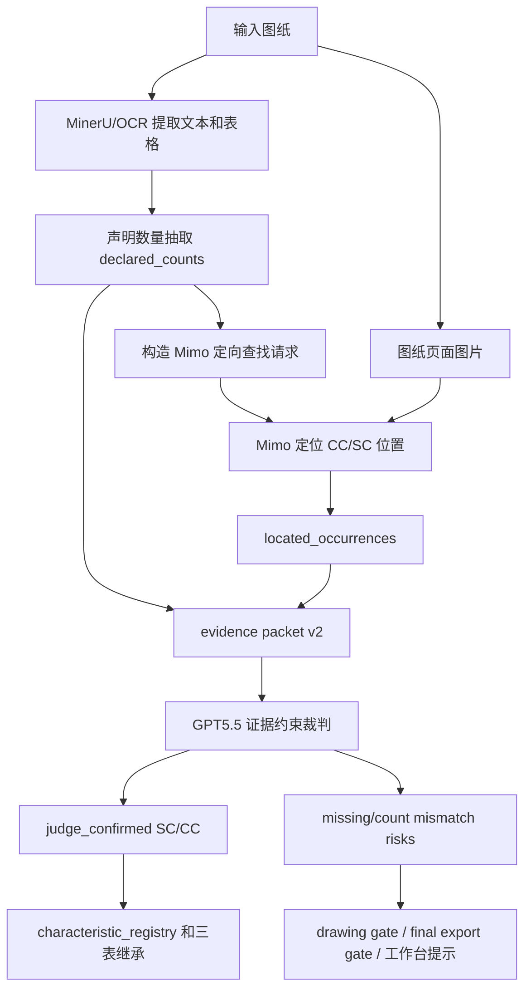

# Declared-Count Special Characteristics Discovery Implementation Plan

> **For agentic workers:** REQUIRED SUB-SKILL: Use superpowers:subagent-driven-development (recommended) or superpowers:executing-plans to implement this plan task-by-task. Steps use checkbox (`- [ ]`) syntax for tracking.

**Goal:** 让 MINOS-CORE 先识别图纸中声明的 CC/SC 数量，再让 Mimo 按数量定向找位置，最后由 GPT5.5 按证据和数量一致性裁判，避免真实图纸出现“声明有 CC/SC 但系统输出为空”。

**Architecture:** MinerU/OCR 是声明数量和文字证据来源，Mimo 是视觉定位证人，GPT5.5 是证据约束裁判，代码是结构化记录和质量门。新链路不让 Mimo 自由判断“有没有特殊特性”，而是把 `CC=2, SC=1` 这类声明变成硬约束：声明数量、视觉定位数量、裁判确认数量必须能对上，否则进入人工复核并阻断正式导出。

**Tech Stack:** Python, pytest, MinerU/OCR adapter, existing `MimoV25ChatCompletionsDrawingAnalyzer`, `special_characteristics_evidence`, `special_characteristics_judge`, `pipeline.hybrid_fusion`, drawing/export quality gates, Tauri workbench display.

---

## 第一性原理

图纸特殊特性的事实来源有三层：

1. 图纸标准区或标题栏声明：例如 `关键特性 CC` 数量为 `2`，`重要特性 SC` 数量为 `1`。
2. 图纸视图、技术要求、图例中的实际位置：例如被圆圈、序号、黑点、符号或文字绑定的尺寸/技术要求。
3. 工程裁判：确认某个视觉位置是否真的对应声明的 CC/SC。

现有问题不是单纯“模型不够聪明”，而是系统没有把第 1 层声明数量变成约束。只问 Mimo “找特殊特性”会得到不稳定结果；正确问题应是：“图纸声明 CC 有 2 个、SC 有 1 个，请你在图上逐个找到它们，并说明找不到哪些。”

## 目标流程



## 文件结构

- Create: `minos_core/special_characteristic_declarations.py`
  - 从 OCR/MinerU 文本、标题栏、产品特殊特性表中抽取 `declared_counts` 和 `declared_totals`。
- Create: `minos_core/special_characteristic_discovery.py`
  - 生成 Mimo 定向查找上下文，规范化 `special_characteristic_locations`，计算 `missing_counts` 和数量不一致风险。
- Modify: `minos_core/drawing_ocr_analysis.py`
  - OCR bundle 生成后立即挂载声明数量，让 hybrid 调视觉前就能使用。
- Modify: `minos_core/adapters/multimodal.py`
  - Mimo prompt 增加“按 declared_counts 定向查找”的输出要求，明确只允许 CC/SC。
- Modify: `minos_core/drawing_analysis.py`
  - 规范化并保留 `declared_special_characteristics`、`special_characteristic_locations`。
- Modify: `minos_core/pipeline/drawing_analysis.py`
  - OCR 后把声明数量放入 `context_payload["special_characteristic_discovery_request"]`，再调用 Mimo。
- Modify: `minos_core/pipeline/hybrid_fusion.py`
  - 在候选融合和 judge 前执行声明数量校验，声明大于 0 且视觉为 0 时产生风险。
- Modify: `minos_core/special_characteristics_evidence.py`
  - evidence packet 增加 `declared_counts`、`located_occurrences`、`missing_counts`、`search_coverage`。
- Modify: `minos_core/special_characteristics_judge.py`
  - GPT5.5 verifier 增加数量一致性校验：确认数不能超过声明数，少于声明数必须进入风险。
- Modify: `apps/desktop-tauri/src/api/types.ts`
  - 增加声明数量、定位结果、缺失数量类型。
- Modify: `apps/desktop-tauri/src/components/WorkbenchTable.tsx`
  - 特殊特性列和复核提示能显示“声明 CC=2/SC=1，但当前定位不足”。
- Test: `tests/test_special_characteristic_declarations.py`
- Test: `tests/test_special_characteristic_discovery.py`
- Test: `tests/test_special_characteristics_evidence.py`
- Test: `tests/test_special_characteristics_judge.py`
- Test: `tests/test_openai_multimodal_adapter.py`
- Test: `tests/test_pipeline_ocr_first.py`
- Test: `tests/three_table_workflow/test_drawing_analysis.py`
- Test: `tests/test_jlv_formal_output_quality_gate.py`
- Test: `tests/test_desktop_tauri_app_state.py`

## OpenSpec 四步闭环

1. Define：特殊特性识别从“开放式找候选”改成“先读声明数量，再按数量找证据，再裁判一致性”。
2. Specify：声明数量、视觉定位、裁判确认、质量门必须形成同一个数据闭环。
3. Implement：先写声明数量和数量不一致的红灯测试，再最小实现 OCR、Mimo prompt、evidence packet、judge verifier、gate 和 UI。
4. Verify：用 fake OCR/Mimo/GPT 测试固定契约，再用 JLV 真实图纸验收 `CC=2, SC=1` 不再静默为空。

## Task 1: 建立 OpenSpec 和流程记录

**Files:**
- Create: `openspec/changes/v3.6.2-declared-count-special-characteristics/proposal.md`
- Create: `openspec/changes/v3.6.2-declared-count-special-characteristics/design.md`
- Create: `openspec/changes/v3.6.2-declared-count-special-characteristics/tasks.md`
- Modify: `task_plan.md`
- Modify: `progress.md`
- Modify: `findings.md`
- Modify: `project_flow.mmd`

- [ ] **Step 1: 写 proposal**

Create `openspec/changes/v3.6.2-declared-count-special-characteristics/proposal.md`:

```markdown
# 声明数量驱动的 CC/SC 识别

## Why

真实 JLV 图纸在标题栏/产品特殊特性表中声明了关键特性 CC 数量和重要特性 SC 数量，但当前 Mimo 开放式视觉识别可能返回 0 个候选，导致 GPT5.5 没有可裁判对象，最终桌面版仍显示没有 SC/CC。

## What

- 从 MinerU/OCR 文字和表格中抽取 `declared_special_characteristics`。
- 将声明数量放入 Mimo 上下文，要求 Mimo 按 `CC expected_count` 和 `SC expected_count` 定向定位。
- 新增 `special_characteristic_locations` 保存 Mimo 定位结果。
- evidence packet 增加声明、定位、缺失数量和覆盖范围。
- GPT5.5 裁判必须同时核对声明数量、视觉位置和证据引用。
- 声明数量大于 0 但定位或确认数量为 0 时，必须进入 drawing/final export gate。

## Non-Goals

- 不把 PTC 作为正式图纸特殊特性类型。
- 不让 GPT5.5 绕过证据包直接自由重读整张图。
- 不在本变更中做人工框选训练界面。
- 不改变已经确认的 registry 继承边界。

## Acceptance

- OCR 文本包含 `关键特性 CC ... 2` 和 `重要特性 SC ... 1` 时，系统输出 `declared_totals={"CC":2,"SC":1}`。
- Mimo prompt 收到声明数量后必须包含“找到 2 个 CC 和 1 个 SC”的定向要求。
- fake Mimo 返回 2 个 CC、1 个 SC 位置时，GPT5.5 fake verdict 能确认 3 个正式特殊特性。
- fake Mimo 返回 0 个位置时，结果不能静默通过，必须生成数量缺失风险。
- JLV 种子图纸验收时，至少能在结果中看到声明数量 `CC=2, SC=1`；若定位未完成，工作台和 gate 必须明确显示缺失数量。
```

- [ ] **Step 2: 写 design**

Create `openspec/changes/v3.6.2-declared-count-special-characteristics/design.md`:

```markdown
# 声明数量驱动的 CC/SC 识别设计

## Define

图纸中声明的特殊特性数量是硬约束，不是提示词里的背景信息。系统必须先识别声明数量，再要求视觉模型按数量找具体位置。

## Specify

新字段：

- `declared_special_characteristics`: OCR/MinerU 抽取出的声明行。
- `declared_totals`: 按分类汇总的声明数量，例如 `{"CC": 2, "SC": 1}`。
- `special_characteristic_locations`: Mimo 按声明数量找到的位置。
- `special_characteristic_discovery`: 覆盖率、缺失数量和数量不一致风险。

确认规则：

1. 没有声明数量时，Mimo 找到的 CC/SC 只能作为候选，仍需 GPT5.5 或人工确认。
2. 有声明数量时，Mimo 必须尝试找到精确数量。
3. 找到数量少于声明数量时，不能正式放行。
4. 找到数量多于声明数量时，多出的只作为候选，不能直接进入 registry。
5. GPT5.5 confirmed 必须引用声明证据、视觉定位证据和页面证据。

## Implement

/// 1. 新增声明数量抽取模块。
/// 2. OCR bundle 挂载声明数量。
/// 3. Mimo prompt 接收声明数量并输出定位结果。
/// 4. 新增 discovery normalizer 和数量风险。
/// 5. evidence packet v2 合并声明和定位。
/// 6. GPT5.5 verifier 增加数量一致性检查。
/// 7. hybrid/fallback/gate/UI 接入。

## Verify

/// 1. OCR 声明数量单测。
/// 2. Mimo prompt 定向查找单测。
/// 3. fake Mimo 定位数量单测。
/// 4. fake GPT5.5 裁判数量一致性单测。
/// 5. hybrid fallback 仍保留声明数量单测。
/// 6. final export gate 阻断缺失数量单测。
/// 7. JLV 真实图纸浏览器验收。
```

- [ ] **Step 3: 写 tasks**

Create `openspec/changes/v3.6.2-declared-count-special-characteristics/tasks.md`:

```markdown
# Tasks

- [ ] /// 1. 建立声明数量驱动 OpenSpec 和根流程记录。
- [ ] /// 2. 新增 `special_characteristic_declarations` 并通过 OCR 声明数量测试。
- [ ] /// 3. OCR bundle 和 hybrid context 挂载 `declared_totals`。
- [ ] /// 4. Mimo prompt 增加按数量定位输出。
- [ ] /// 5. 新增 `special_characteristic_discovery` 规范化定位结果和数量风险。
- [ ] /// 6. evidence packet v2 和 GPT5.5 verifier 接入声明/定位/缺失数量。
- [ ] /// 7. drawing gate、final export gate 和桌面工作台展示缺失数量风险。
- [ ] /// 8. 用 JLV 真实图纸完成源码版浏览器验收。
```

- [ ] **Step 4: 更新根记录**

Append to `task_plan.md`:

```markdown
## v3.6.2 声明数量驱动的 CC/SC 识别

- 目标：先识别图纸声明的 CC/SC 数量，再让 Mimo 按数量定位，最后由 GPT5.5 裁判。
- 成功标准：JLV 图纸至少稳定输出声明数量 `CC=2, SC=1`；视觉定位不足时必须显示缺失风险，不能静默为空。
- 验证：声明抽取、Mimo prompt、discovery 风险、judge verifier、gate/UI、真实浏览器试跑。
```

Append to `progress.md`:

```markdown
## v3.6.2 声明数量驱动的 CC/SC 识别

- 计划已建立：`docs/superpowers/plans/2026-06-05-declared-count-special-characteristics-discovery.md`
- OpenSpec：`openspec/changes/v3.6.2-declared-count-special-characteristics/`
```

Append to `findings.md`:

```markdown
## v3.6.2 特殊特性识别方案判断

- Mimo 不能承担最终定义 CC/SC 的职责；它应按 OCR/MinerU 提供的声明数量做视觉定位。
- 声明数量是图纸标准的一部分，必须进入 evidence packet 和 GPT5.5 裁判条件。
- 当声明数量存在但定位结果为 0 时，这是识别失败，不是“没有特殊特性”。
```

- [ ] **Step 5: 验证文档可读**

Run:

```powershell
@'
from pathlib import Path
paths = [
    Path("openspec/changes/v3.6.2-declared-count-special-characteristics/proposal.md"),
    Path("openspec/changes/v3.6.2-declared-count-special-characteristics/design.md"),
    Path("openspec/changes/v3.6.2-declared-count-special-characteristics/tasks.md"),
]
for path in paths:
    path.read_text(encoding="utf-8")
print("utf8 ok")
'@ | python -
```

Expected:

```text
utf8 ok
```

## Task 2: 声明数量抽取模块

**Files:**
- Create: `minos_core/special_characteristic_declarations.py`
- Create: `tests/test_special_characteristic_declarations.py`

- [ ] **Step 1: 写红灯测试**

Create `tests/test_special_characteristic_declarations.py`:

```python
from minos_core.special_characteristic_declarations import (
    attach_declared_special_characteristics,
    extract_declared_special_characteristics,
)


def test_extracts_declared_cc_sc_counts_from_title_block_text():
    bundle = {
        "evidence": [
            {
                "evidence_id": "ocr_page_001_block_0001",
                "source": "ocr_block",
                "content": "关键特性 CC (Critical Characteristic) 2",
                "confidence": 0.91,
            },
            {
                "evidence_id": "ocr_page_001_block_0002",
                "source": "ocr_block",
                "content": "重要特性 SC (Special Characteristic) 1",
                "confidence": 0.89,
            },
        ],
        "technical_requirements": [],
        "inspection_requirements": [],
    }

    result = extract_declared_special_characteristics(bundle)

    assert result["declared_totals"] == {"CC": 2, "SC": 1}
    assert result["declared_counts"][0]["classification"] == "CC"
    assert result["declared_counts"][0]["expected_count"] == 2
    assert result["declared_counts"][0]["evidence_refs"] == ["ocr_page_001_block_0001"]
    assert result["declared_counts"][1]["classification"] == "SC"
    assert result["declared_counts"][1]["expected_count"] == 1


def test_attach_declared_counts_is_idempotent_and_keeps_zero_absent():
    bundle = {
        "evidence": [
            {
                "evidence_id": "ocr_page_001",
                "content": "材料 SPCC; 技术要求: 去毛刺",
                "confidence": 0.9,
            }
        ]
    }

    attach_declared_special_characteristics(bundle)
    attach_declared_special_characteristics(bundle)

    assert bundle["declared_special_characteristics"] == []
    assert bundle["declared_totals"] == {"CC": 0, "SC": 0}
```

- [ ] **Step 2: 运行红灯测试**

Run:

```powershell
python -m pytest tests/test_special_characteristic_declarations.py -q
```

Expected:

```text
FAILED ... No module named 'minos_core.special_characteristic_declarations'
```

- [ ] **Step 3: 最小实现**

Create `minos_core/special_characteristic_declarations.py`:

```python
"""Declared CC/SC count extraction from OCR/MinerU drawing text."""

from __future__ import annotations

import re
from typing import Any

from minos_core._text_utils import string_list, text


_DECLARATION_HINTS = {
    "CC": ("关键特性", "critical characteristic", "critical characteristics", " cc "),
    "SC": ("重要特性", "special characteristic", "special characteristics", " sc "),
}


def extract_declared_special_characteristics(
    drawing_analysis: dict[str, Any],
) -> dict[str, Any]:
    rows: list[dict[str, Any]] = []
    seen: set[tuple[str, str]] = set()
    for index, source in enumerate(_text_sources(drawing_analysis), start=1):
        source_text = text(source.get("text"))
        classification = _classification_from_text(source_text)
        if classification not in {"CC", "SC"}:
            continue
        expected_count = _count_from_text(source_text)
        if expected_count is None:
            continue
        key = (classification, source_text.lower())
        if key in seen:
            continue
        seen.add(key)
        rows.append(
            {
                "declaration_id": f"SCD-{classification}-{len(rows) + 1:03d}",
                "classification": classification,
                "label": "关键特性" if classification == "CC" else "重要特性",
                "expected_count": expected_count,
                "source": text(source.get("source")) or "ocr_text",
                "source_text": source_text,
                "evidence_refs": string_list(source.get("evidence_refs", [])),
                "confidence": _confidence(source.get("confidence")),
            }
        )
    totals = {"CC": 0, "SC": 0}
    for row in rows:
        classification = row["classification"]
        totals[classification] = max(totals[classification], int(row["expected_count"]))
    return {"declared_counts": rows, "declared_totals": totals}


def attach_declared_special_characteristics(drawing_analysis: dict[str, Any]) -> None:
    result = extract_declared_special_characteristics(drawing_analysis)
    drawing_analysis["declared_special_characteristics"] = result["declared_counts"]
    drawing_analysis["declared_totals"] = result["declared_totals"]


def _text_sources(drawing_analysis: dict[str, Any]) -> list[dict[str, Any]]:
    sources: list[dict[str, Any]] = []
    for item in drawing_analysis.get("evidence", []):
        if not isinstance(item, dict):
            continue
        value = text(item.get("content"), item.get("text"))
        if value:
            sources.append(
                {
                    "text": value,
                    "source": text(item.get("source")),
                    "evidence_refs": [text(item.get("evidence_id"), item.get("id"))],
                    "confidence": item.get("confidence"),
                }
            )
    for block_name in ("text_evidence", "technical_requirements", "inspection_requirements"):
        for item in drawing_analysis.get(block_name, []):
            if not isinstance(item, dict):
                continue
            value = text(item.get("text"), item.get("description"), item.get("name"))
            if value:
                sources.append(
                    {
                        "text": value,
                        "source": block_name,
                        "evidence_refs": string_list(item.get("evidence_refs", [])),
                        "confidence": item.get("confidence"),
                    }
                )
    return sources


def _classification_from_text(value: str) -> str:
    padded = f" {value.lower()} "
    for classification, hints in _DECLARATION_HINTS.items():
        if any(hint in padded for hint in hints):
            return classification
    return ""


def _count_from_text(value: str) -> int | None:
    numbers = [int(match.group(1)) for match in re.finditer(r"(?<![A-Z0-9])(\d{1,2})(?![A-Z0-9])", value, re.I)]
    if not numbers:
        return None
    return numbers[-1]


def _confidence(value: Any) -> float:
    try:
        return round(max(0.0, min(1.0, float(value))), 3)
    except (TypeError, ValueError):
        return 0.7
```

- [ ] **Step 4: 验证**

Run:

```powershell
python -m pytest tests/test_special_characteristic_declarations.py -q
```

Expected:

```text
2 passed
```

## Task 3: OCR Bundle 和 Hybrid Context 挂载声明数量

**Files:**
- Modify: `minos_core/drawing_ocr_analysis.py`
- Modify: `minos_core/pipeline/hybrid_fusion.py`
- Modify: `tests/test_drawing_ocr_analysis.py`
- Modify: `tests/test_pipeline_ocr_first.py`

- [ ] **Step 1: 写 OCR bundle 测试**

Append to `tests/test_drawing_ocr_analysis.py`:

```python
def test_ocr_bundle_attaches_declared_special_characteristic_counts():
    from minos_core.adapters.ocr import OCRPageText, OCRResult
    from minos_core.drawing_ocr_analysis import build_drawing_analysis_bundle_from_ocr

    result = OCRResult(
        text="关键特性 CC (Critical Characteristic) 2\n重要特性 SC (Special Characteristic) 1",
        pages=[
            OCRPageText(
                page_number=1,
                text="关键特性 CC (Critical Characteristic) 2\n重要特性 SC (Special Characteristic) 1",
                confidence=0.92,
                blocks=[],
                engine="fake",
                source_ref="demo.pdf",
            )
        ],
        source_ref="demo.pdf",
    )

    bundle = build_drawing_analysis_bundle_from_ocr([], result, {})

    assert bundle["declared_totals"] == {"CC": 2, "SC": 1}
    assert bundle["declared_special_characteristics"][0]["classification"] == "CC"
```

- [ ] **Step 2: 写 hybrid context 测试**

Append to `tests/test_pipeline_ocr_first.py`:

```python
def test_ocr_summary_for_context_includes_declared_special_counts():
    from minos_core.pipeline.hybrid_fusion import _ocr_summary_for_context

    summary = _ocr_summary_for_context(
        {
            "drawing_identity": {"drawing_number": "D-001"},
            "materials": [],
            "dimensions": [],
            "special_characteristics": [],
            "technical_requirements": [],
            "manufacturing_clues": [],
            "declared_special_characteristics": [
                {"classification": "CC", "expected_count": 2, "evidence_refs": ["ocr_page_001"]},
                {"classification": "SC", "expected_count": 1, "evidence_refs": ["ocr_page_001"]},
            ],
            "declared_totals": {"CC": 2, "SC": 1},
        }
    )

    assert summary["declared_totals"] == {"CC": 2, "SC": 1}
    assert summary["declared_special_characteristics"][1]["classification"] == "SC"
```

- [ ] **Step 3: 运行红灯测试**

Run:

```powershell
python -m pytest tests/test_drawing_ocr_analysis.py::test_ocr_bundle_attaches_declared_special_characteristic_counts tests/test_pipeline_ocr_first.py::test_ocr_summary_for_context_includes_declared_special_counts -q
```

Expected:

```text
FAILED ... KeyError: 'declared_totals'
```

- [ ] **Step 4: 接入 OCR bundle**

In `minos_core/drawing_ocr_analysis.py`, add import:

```python
from minos_core.special_characteristic_declarations import attach_declared_special_characteristics
```

Then in `build_drawing_analysis_bundle_from_ocr(...)`, after `bundle = {...}` and before `return bundle`, add:

```python
    attach_declared_special_characteristics(bundle)
```

- [ ] **Step 5: 接入 hybrid context summary**

In `minos_core/pipeline/hybrid_fusion.py`, update `_ocr_summary_for_context(...)` return value:

```python
    return {
        "drawing_identity": drawing_analysis.get("drawing_identity", {}),
        "materials": _summary_items(drawing_analysis.get("materials", [])),
        "dimensions": _summary_items(drawing_analysis.get("dimensions", [])),
        "special_characteristics": _summary_items(
            drawing_analysis.get("special_characteristics", [])
        ),
        "declared_special_characteristics": [
            dict(item)
            for item in drawing_analysis.get("declared_special_characteristics", [])
            if isinstance(item, dict)
        ],
        "declared_totals": dict(drawing_analysis.get("declared_totals", {})),
        "technical_requirements": _summary_items(
            drawing_analysis.get("technical_requirements", [])
        ),
        "manufacturing_clues": _summary_items(
            drawing_analysis.get("manufacturing_clues", [])
        ),
    }
```

- [ ] **Step 6: 验证**

Run:

```powershell
python -m pytest tests/test_drawing_ocr_analysis.py tests/test_pipeline_ocr_first.py -q
```

Expected:

```text
... passed
```

## Task 4: Mimo Prompt 按声明数量定向定位

**Files:**
- Modify: `minos_core/adapters/multimodal.py`
- Modify: `tests/test_openai_multimodal_adapter.py`

- [ ] **Step 1: 写 prompt 契约测试**

Append to `tests/test_openai_multimodal_adapter.py`:

```python
def test_mimo_prompt_uses_declared_counts_as_targeted_search_constraints():
    from minos_core.adapters.multimodal import _mimo_v25_drawing_analysis_prompt

    prompt = _mimo_v25_drawing_analysis_prompt(
        {
            "ocr_analysis_summary": {
                "declared_totals": {"CC": 2, "SC": 1},
                "declared_special_characteristics": [
                    {
                        "declaration_id": "SCD-CC-001",
                        "classification": "CC",
                        "expected_count": 2,
                        "source_text": "关键特性 CC (Critical Characteristic) 2",
                    },
                    {
                        "declaration_id": "SCD-SC-001",
                        "classification": "SC",
                        "expected_count": 1,
                        "source_text": "重要特性 SC (Special Characteristic) 1",
                    },
                ],
            }
        }
    )

    assert "declared_totals" in prompt
    assert "CC=2" in prompt
    assert "SC=1" in prompt
    assert "special_characteristic_locations" in prompt
    assert "找不到也必须返回 missing_counts" in prompt
    assert "PTC" not in prompt
```

- [ ] **Step 2: 运行红灯测试**

Run:

```powershell
python -m pytest tests/test_openai_multimodal_adapter.py::test_mimo_prompt_uses_declared_counts_as_targeted_search_constraints -q
```

Expected:

```text
FAILED ... AssertionError: 'CC=2' not found
```

- [ ] **Step 3: 修改 Mimo prompt**

In `minos_core/adapters/multimodal.py`, add helper near `_mimo_v25_drawing_analysis_prompt(...)`:

```python
def _declared_count_instruction(context: dict[str, Any]) -> str:
    summary = context.get("ocr_analysis_summary")
    if not isinstance(summary, dict):
        return ""
    totals = summary.get("declared_totals")
    if not isinstance(totals, dict):
        return ""
    cc_count = int(totals.get("CC", 0) or 0)
    sc_count = int(totals.get("SC", 0) or 0)
    if cc_count <= 0 and sc_count <= 0:
        return ""
    return (
        f"图纸 OCR/MinerU 已声明特殊特性数量：CC={cc_count}，SC={sc_count}。"
        "你必须按这个数量逐个在图纸页面中寻找位置，输出 special_characteristic_locations。"
        "每个 location 必须包含 location_id, classification, linked_feature, "
        "symbol_text_or_shape, bbox, evidence_refs, confidence, reasoning。"
        "找不到也必须返回 missing_counts，写明每类缺少几个，不能因为找不到就省略。"
    )
```

Then in `_mimo_v25_drawing_analysis_prompt(...)`, before `context_text = ...`, add:

```python
    declared_instruction = _declared_count_instruction(context)
```

Then include `special_characteristic_locations` in required top-level keys and append:

```python
        f"{declared_instruction}"
```

- [ ] **Step 4: 验证 prompt**

Run:

```powershell
python -m pytest tests/test_openai_multimodal_adapter.py -q
```

Expected:

```text
... passed
```

## Task 5: Discovery Normalizer 和数量风险

**Files:**
- Create: `minos_core/special_characteristic_discovery.py`
- Create: `tests/test_special_characteristic_discovery.py`
- Modify: `minos_core/drawing_analysis.py`
- Modify: `tests/three_table_workflow/test_drawing_analysis.py`

- [ ] **Step 1: 写定位和缺失数量测试**

Create `tests/test_special_characteristic_discovery.py`:

```python
from minos_core.special_characteristic_discovery import (
    build_special_characteristic_discovery_report,
    normalize_special_characteristic_locations,
)


def test_normalizes_locations_and_reports_missing_count():
    drawing = {
        "declared_totals": {"CC": 2, "SC": 1},
        "special_characteristic_locations": [
            {
                "classification": "CC",
                "linked_feature": "技术要求 1",
                "symbol_text_or_shape": "①",
                "bbox": [0.70, 0.62, 0.03, 0.03],
                "evidence_refs": ["drawing_page_001"],
                "confidence": 0.88,
            }
        ],
    }

    locations = normalize_special_characteristic_locations(
        drawing["special_characteristic_locations"]
    )
    report = build_special_characteristic_discovery_report(
        declared_totals=drawing["declared_totals"],
        locations=locations,
    )

    assert locations[0]["location_id"] == "SCL-001"
    assert report["found_counts"] == {"CC": 1, "SC": 0}
    assert report["missing_counts"] == {"CC": 1, "SC": 1}
    assert report["risks"][0]["risk_id"] == "SC-DISCOVERY-MISSING-CC"
    assert report["risks"][1]["risk_id"] == "SC-DISCOVERY-MISSING-SC"


def test_no_declared_counts_does_not_raise_missing_risk():
    report = build_special_characteristic_discovery_report(
        declared_totals={"CC": 0, "SC": 0},
        locations=[],
    )

    assert report["missing_counts"] == {"CC": 0, "SC": 0}
    assert report["risks"] == []
```

- [ ] **Step 2: 运行红灯测试**

Run:

```powershell
python -m pytest tests/test_special_characteristic_discovery.py -q
```

Expected:

```text
FAILED ... No module named 'minos_core.special_characteristic_discovery'
```

- [ ] **Step 3: 最小实现 discovery 模块**

Create `minos_core/special_characteristic_discovery.py`:

```python
"""Count-bound special-characteristic visual discovery helpers."""

from __future__ import annotations

from typing import Any

from minos_core._text_utils import string_list, text


def normalize_special_characteristic_locations(value: Any) -> list[dict[str, Any]]:
    rows = value if isinstance(value, list) else []
    normalized: list[dict[str, Any]] = []
    for index, raw in enumerate(rows, start=1):
        if not isinstance(raw, dict):
            continue
        classification = text(raw.get("classification")).upper()
        if classification not in {"CC", "SC"}:
            classification = "unknown"
        normalized.append(
            {
                "location_id": text(raw.get("location_id")) or f"SCL-{index:03d}",
                "classification": classification,
                "linked_feature": text(raw.get("linked_feature"), raw.get("name")),
                "symbol_text_or_shape": text(raw.get("symbol_text_or_shape"), raw.get("symbol")),
                "bbox": _bbox(raw.get("bbox", raw.get("symbol_bbox"))),
                "evidence_refs": string_list(raw.get("evidence_refs", [])),
                "confidence": _confidence(raw.get("confidence")),
                "reasoning": text(raw.get("reasoning"), raw.get("reasoning_summary")),
            }
        )
    return normalized


def build_special_characteristic_discovery_report(
    *,
    declared_totals: dict[str, Any],
    locations: list[dict[str, Any]],
) -> dict[str, Any]:
    expected = {
        "CC": _count(declared_totals.get("CC")),
        "SC": _count(declared_totals.get("SC")),
    }
    found = {"CC": 0, "SC": 0}
    for item in locations:
        classification = text(item.get("classification")).upper()
        if classification in found:
            found[classification] += 1
    missing = {
        classification: max(0, expected[classification] - found[classification])
        for classification in ("CC", "SC")
    }
    extra = {
        classification: max(0, found[classification] - expected[classification])
        for classification in ("CC", "SC")
    }
    risks = _risks(expected, found, missing, extra)
    return {
        "declared_totals": expected,
        "found_counts": found,
        "missing_counts": missing,
        "extra_counts": extra,
        "search_coverage": {
            classification: _coverage(found[classification], expected[classification])
            for classification in ("CC", "SC")
        },
        "risks": risks,
    }


def _risks(
    expected: dict[str, int],
    found: dict[str, int],
    missing: dict[str, int],
    extra: dict[str, int],
) -> list[dict[str, Any]]:
    risks: list[dict[str, Any]] = []
    for classification in ("CC", "SC"):
        if missing[classification] > 0:
            risks.append(
                {
                    "risk_id": f"SC-DISCOVERY-MISSING-{classification}",
                    "item_id": f"SC-DISCOVERY-MISSING-{classification}",
                    "category": "special_characteristic_discovery",
                    "severity": "review",
                    "target": f"declared_totals.{classification}",
                    "message": (
                        f"图纸声明 {classification} 有 {expected[classification]} 个，"
                        f"当前只定位到 {found[classification]} 个。"
                    ),
                    "classification": classification,
                    "expected_count": expected[classification],
                    "found_count": found[classification],
                    "missing_count": missing[classification],
                }
            )
        if extra[classification] > 0:
            risks.append(
                {
                    "risk_id": f"SC-DISCOVERY-EXTRA-{classification}",
                    "item_id": f"SC-DISCOVERY-EXTRA-{classification}",
                    "category": "special_characteristic_discovery",
                    "severity": "review",
                    "target": f"special_characteristic_locations.{classification}",
                    "message": (
                        f"图纸声明 {classification} 有 {expected[classification]} 个，"
                        f"当前定位到 {found[classification]} 个，多出的候选需要复核。"
                    ),
                    "classification": classification,
                    "expected_count": expected[classification],
                    "found_count": found[classification],
                    "extra_count": extra[classification],
                }
            )
    return risks


def _bbox(value: Any) -> list[float]:
    if not isinstance(value, list) or len(value) != 4:
        return []
    result: list[float] = []
    for item in value:
        try:
            result.append(round(float(item), 4))
        except (TypeError, ValueError):
            return []
    return result


def _confidence(value: Any) -> float:
    try:
        return round(max(0.0, min(1.0, float(value))), 3)
    except (TypeError, ValueError):
        return 0.0


def _count(value: Any) -> int:
    try:
        return max(0, int(value))
    except (TypeError, ValueError):
        return 0


def _coverage(found: int, expected: int) -> float:
    if expected <= 0:
        return 1.0
    return round(min(1.0, found / expected), 3)
```

- [ ] **Step 4: Drawing analysis 保留 locations**

In `minos_core/drawing_analysis.py`, import:

```python
from minos_core.special_characteristic_discovery import (
    build_special_characteristic_discovery_report,
    normalize_special_characteristic_locations,
)
```

In `_normalize_drawing_analysis_payload(...)`, after `special_characteristic_candidates = ...`, add:

```python
    special_characteristic_locations = normalize_special_characteristic_locations(
        payload.get("special_characteristic_locations", [])
    )
    declared_totals = dict(payload.get("declared_totals", {}))
    discovery_report = build_special_characteristic_discovery_report(
        declared_totals=declared_totals,
        locations=special_characteristic_locations,
    )
```

Then add to `normalized`:

```python
        "declared_special_characteristics": _normalize_analysis_items(
            payload.get("declared_special_characteristics")
        ),
        "declared_totals": declared_totals,
        "special_characteristic_locations": special_characteristic_locations,
        "special_characteristic_discovery": {
            key: value
            for key, value in discovery_report.items()
            if key != "risks"
        },
```

After candidate risks are merged, merge discovery risks:

```python
    discovery_risks = [
        item for item in discovery_report.get("risks", []) if isinstance(item, dict)
    ]
    if discovery_risks:
        normalized["metadata"]["drawing_analysis_risks"] = _merge_drawing_risks(
            normalized["metadata"].get("drawing_analysis_risks", []),
            discovery_risks,
        )
```

- [ ] **Step 5: 验证**

Run:

```powershell
python -m pytest tests/test_special_characteristic_discovery.py tests/three_table_workflow/test_drawing_analysis.py -q
```

Expected:

```text
... passed
```

## Task 6: Evidence Packet v2 和 GPT5.5 数量一致性

**Files:**
- Modify: `minos_core/special_characteristics_evidence.py`
- Modify: `minos_core/special_characteristics_judge.py`
- Modify: `tests/test_special_characteristics_evidence.py`
- Modify: `tests/test_special_characteristics_judge.py`

- [ ] **Step 1: 写 evidence packet v2 测试**

Append to `tests/test_special_characteristics_evidence.py`:

```python
def test_packet_includes_declared_counts_locations_and_missing_counts():
    from minos_core.special_characteristics_evidence import build_special_characteristic_evidence_packet

    packet = build_special_characteristic_evidence_packet(
        {
            "declared_special_characteristics": [
                {
                    "declaration_id": "SCD-CC-001",
                    "classification": "CC",
                    "expected_count": 2,
                    "evidence_refs": ["ocr_page_001"],
                }
            ],
            "declared_totals": {"CC": 2, "SC": 1},
            "special_characteristic_locations": [
                {
                    "location_id": "SCL-001",
                    "classification": "CC",
                    "linked_feature": "技术要求 1",
                    "evidence_refs": ["drawing_page_001"],
                }
            ],
            "special_characteristic_discovery": {
                "missing_counts": {"CC": 1, "SC": 1},
                "search_coverage": {"CC": 0.5, "SC": 0.0},
            },
            "evidence": [{"evidence_id": "drawing_page_001"}],
        }
    )

    assert packet["declared_counts"][0]["declaration_id"] == "SCD-CC-001"
    assert packet["declared_totals"] == {"CC": 2, "SC": 1}
    assert packet["located_occurrences"][0]["location_id"] == "SCL-001"
    assert packet["missing_counts"] == {"CC": 1, "SC": 1}
```

- [ ] **Step 2: 写 verifier 数量不足测试**

Append to `tests/test_special_characteristics_judge.py`:

```python
def test_judge_verifier_reports_count_mismatch_when_confirmed_less_than_declared():
    from minos_core.special_characteristics_judge import verify_special_characteristic_judgments

    packet = {
        "declared_totals": {"CC": 2, "SC": 1},
        "symbol_occurrences": [{"candidate_id": "MSC-001", "evidence_refs": ["drawing_page_001"]}],
        "legend_evidence": [],
        "text_evidence": [{"text_id": "TXT-001", "evidence_refs": ["ocr_page_001"]}],
        "customer_rules": [],
        "page_evidence_refs": ["drawing_page_001", "ocr_page_001"],
    }
    judgments = [
        {
            "judgment_id": "SCJ-001",
            "candidate_id": "MSC-001",
            "classification": "CC",
            "verdict": "confirmed",
            "linked_feature": "技术要求 1",
            "confidence": 0.9,
            "standard_evidence_refs": ["TXT-001"],
            "symbol_evidence_refs": ["MSC-001"],
            "page_evidence_refs": ["drawing_page_001"],
            "reasoning_summary": "证据完整。",
        }
    ]

    report = verify_special_characteristic_judgments(judgments, packet)

    assert report["confirmed"][0]["classification"] == "CC"
    risk_ids = {risk["risk_id"] for risk in report["risks"]}
    assert "SC-JUDGE-COUNT-MISMATCH-CC" in risk_ids
    assert "SC-JUDGE-COUNT-MISMATCH-SC" in risk_ids
```

- [ ] **Step 3: 运行红灯测试**

Run:

```powershell
python -m pytest tests/test_special_characteristics_evidence.py::test_packet_includes_declared_counts_locations_and_missing_counts tests/test_special_characteristics_judge.py::test_judge_verifier_reports_count_mismatch_when_confirmed_less_than_declared -q
```

Expected:

```text
FAILED ... KeyError: 'declared_counts'
```

- [ ] **Step 4: 扩展 evidence packet**

In `minos_core/special_characteristics_evidence.py`, add keys in `build_special_characteristic_evidence_packet(...)`:

```python
        "declared_counts": [
            dict(item)
            for item in drawing_analysis.get("declared_special_characteristics", [])
            if isinstance(item, dict)
        ],
        "declared_totals": dict(drawing_analysis.get("declared_totals", {})),
        "located_occurrences": [
            dict(item)
            for item in drawing_analysis.get("special_characteristic_locations", [])
            if isinstance(item, dict)
        ],
        "missing_counts": dict(
            _dict(drawing_analysis.get("special_characteristic_discovery")).get(
                "missing_counts", {}
            )
        ),
        "search_coverage": dict(
            _dict(drawing_analysis.get("special_characteristic_discovery")).get(
                "search_coverage", {}
            )
        ),
```

Add helper:

```python
def _dict(value: Any) -> dict[str, Any]:
    return dict(value) if isinstance(value, dict) else {}
```

- [ ] **Step 5: 扩展 judge verifier**

In `minos_core/special_characteristics_judge.py`, after the existing judgment loop in `verify_special_characteristic_judgments(...)`, add:

```python
    risks.extend(_count_mismatch_risks(confirmed, evidence_packet))
```

Add helper:

```python
def _count_mismatch_risks(
    confirmed: list[dict[str, Any]],
    evidence_packet: dict[str, Any],
) -> list[dict[str, Any]]:
    declared = evidence_packet.get("declared_totals")
    if not isinstance(declared, dict):
        return []
    confirmed_counts = {"CC": 0, "SC": 0}
    for item in confirmed:
        classification = text(item.get("classification")).upper()
        if classification in confirmed_counts:
            confirmed_counts[classification] += 1
    risks: list[dict[str, Any]] = []
    for classification in ("CC", "SC"):
        try:
            expected = int(declared.get(classification, 0) or 0)
        except (TypeError, ValueError):
            expected = 0
        found = confirmed_counts[classification]
        if expected > found:
            risks.append(
                {
                    "risk_id": f"SC-JUDGE-COUNT-MISMATCH-{classification}",
                    "item_id": f"SC-JUDGE-COUNT-MISMATCH-{classification}",
                    "category": "special_characteristic_judge",
                    "severity": "review",
                    "target": f"declared_totals.{classification}",
                    "message": (
                        f"图纸声明 {classification} 有 {expected} 个，"
                        f"GPT5.5 当前只确认 {found} 个。"
                    ),
                    "classification": classification,
                    "expected_count": expected,
                    "confirmed_count": found,
                }
            )
    return risks
```

- [ ] **Step 6: 验证**

Run:

```powershell
python -m pytest tests/test_special_characteristics_evidence.py tests/test_special_characteristics_judge.py -q
```

Expected:

```text
... passed
```

## Task 7: Hybrid 融合和 Gate 接入缺失数量风险

**Files:**
- Modify: `minos_core/pipeline/drawing_analysis.py`
- Modify: `minos_core/pipeline/hybrid_fusion.py`
- Modify: `tests/test_pipeline_ocr_first.py`
- Modify: `tests/test_jlv_formal_output_quality_gate.py`

- [ ] **Step 1: 写 hybrid fallback 保留声明数量测试**

Append to `tests/test_pipeline_ocr_first.py`:

```python
def test_hybrid_fallback_keeps_declared_counts_and_missing_risk_when_vision_fails():
    ocr_analysis = {
        "drawing_identity": {"part_name": "JLV DEMO", "drawing_number": "JLV03000500"},
        "materials": [{"name": "SPCC", "evidence_refs": ["ocr_page_001"]}],
        "manufacturing_clues": [{"operation": "装配", "evidence_refs": ["ocr_page_001"]}],
        "special_characteristics": [],
        "declared_special_characteristics": [
            {"classification": "CC", "expected_count": 2, "evidence_refs": ["ocr_page_001"]},
            {"classification": "SC", "expected_count": 1, "evidence_refs": ["ocr_page_001"]},
        ],
        "declared_totals": {"CC": 2, "SC": 1},
        "special_characteristic_candidates": [],
        "evidence": [{"evidence_id": "ocr_page_001", "source": "ocr_page"}],
        "metadata": {},
    }

    from minos_core.pipeline.hybrid_fusion import _merge_special_characteristic_candidates

    _merge_special_characteristic_candidates(ocr_analysis, ocr_analysis, context={})

    assert ocr_analysis["declared_totals"] == {"CC": 2, "SC": 1}
    risk_ids = {
        item["risk_id"]
        for item in ocr_analysis["metadata"]["drawing_analysis_risks"]
    }
    assert "SC-DISCOVERY-MISSING-CC" in risk_ids
    assert "SC-DISCOVERY-MISSING-SC" in risk_ids
```

- [ ] **Step 2: 写 final export gate 测试**

Append to `tests/test_jlv_formal_output_quality_gate.py`:

```python
def test_final_export_gate_blocks_declared_special_count_missing_risk():
    from minos_core.quality_gates.export_gate import evaluate_export_gate

    chain = {
        "document_type": "apqp_chain",
        "schema_version": "minos-core.generated.v1",
        "product": {},
        "process_steps": [],
        "failure_modes": [],
        "controls": [],
        "evidence": [],
        "metadata": {
            "drawing_analysis_risks": [
                {
                    "risk_id": "SC-DISCOVERY-MISSING-CC",
                    "item_id": "SC-DISCOVERY-MISSING-CC",
                    "category": "special_characteristic_discovery",
                    "severity": "review",
                    "target": "declared_totals.CC",
                    "message": "图纸声明 CC 有 2 个，当前只定位到 0 个。",
                }
            ]
        },
    }

    gate = evaluate_export_gate(chain)

    assert gate.allow_user_export is False
    assert any(
        item.item_id == "SC-DISCOVERY-MISSING-CC"
        for item in gate.manual_review_items
    )
```

- [ ] **Step 3: 运行红灯测试**

Run:

```powershell
python -m pytest tests/test_pipeline_ocr_first.py::test_hybrid_fallback_keeps_declared_counts_and_missing_risk_when_vision_fails tests/test_jlv_formal_output_quality_gate.py::test_final_export_gate_blocks_declared_special_count_missing_risk -q
```

Expected:

```text
FAILED ... KeyError: 'drawing_analysis_risks'
```

- [ ] **Step 4: 在 hybrid_fusion 加声明数量风险**

In `minos_core/pipeline/hybrid_fusion.py`, import inside `_merge_special_characteristic_candidates(...)`:

```python
    from minos_core.special_characteristic_discovery import (
        build_special_characteristic_discovery_report,
        normalize_special_characteristic_locations,
    )
```

After judge logic and before candidate risks are stored, add:

```python
    locations = normalize_special_characteristic_locations(
        vision_analysis.get("special_characteristic_locations", [])
    )
    vision_analysis["special_characteristic_locations"] = locations
    discovery_report = build_special_characteristic_discovery_report(
        declared_totals=dict(vision_analysis.get("declared_totals", {})),
        locations=locations,
    )
    vision_analysis["special_characteristic_discovery"] = {
        key: value
        for key, value in discovery_report.items()
        if key != "risks"
    }
    discovery_risks = [
        item for item in discovery_report.get("risks", []) if isinstance(item, dict)
    ]
    if discovery_risks:
        metadata = vision_analysis.setdefault("metadata", {})
        if isinstance(metadata, dict):
            metadata["drawing_analysis_risks"] = _merge_risks(
                metadata.get("drawing_analysis_risks", []),
                discovery_risks,
            )
```

- [ ] **Step 5: 在 pipeline context 加定向请求**

In `minos_core/pipeline/drawing_analysis.py`, after:

```python
            context_payload["ocr_analysis_summary"] = _ocr_summary_for_context(
                ocr_analysis
            )
```

Add:

```python
            context_payload["special_characteristic_discovery_request"] = {
                "declared_totals": dict(ocr_analysis.get("declared_totals", {})),
                "declared_special_characteristics": [
                    dict(item)
                    for item in ocr_analysis.get("declared_special_characteristics", [])
                    if isinstance(item, dict)
                ],
            }
```

- [ ] **Step 6: 验证**

Run:

```powershell
python -m pytest tests/test_pipeline_ocr_first.py tests/test_jlv_formal_output_quality_gate.py -q
```

Expected:

```text
... passed
```

## Task 8: 桌面工作台展示声明/缺失数量

**Files:**
- Modify: `apps/desktop-tauri/src/api/types.ts`
- Modify: `apps/desktop-tauri/src/components/WorkbenchTable.tsx`
- Modify: `tests/test_desktop_tauri_app_state.py`

- [ ] **Step 1: 写静态 UI 契约测试**

Append to `tests/test_desktop_tauri_app_state.py`:

```python
def test_workbench_surfaces_declared_special_count_mismatch():
    source = Path("apps/desktop-tauri/src/components/WorkbenchTable.tsx").read_text(encoding="utf-8")
    types_source = Path("apps/desktop-tauri/src/api/types.ts").read_text(encoding="utf-8")

    assert "declared_totals" in types_source
    assert "special_characteristic_discovery" in types_source
    assert "声明CC" in source
    assert "缺少CC" in source
    assert "缺少SC" in source
```

- [ ] **Step 2: 运行红灯测试**

Run:

```powershell
python -m pytest tests/test_desktop_tauri_app_state.py::test_workbench_surfaces_declared_special_count_mismatch -q
```

Expected:

```text
FAILED ... AssertionError: 'declared_totals' not found
```

- [ ] **Step 3: 更新前端类型**

In `apps/desktop-tauri/src/api/types.ts`, add optional fields to drawing/table raw result type:

```ts
declared_special_characteristics?: Array<{
  declaration_id?: string;
  classification?: "SC" | "CC";
  expected_count?: number;
  source_text?: string;
  evidence_refs?: string[];
}>;
declared_totals?: {
  CC?: number;
  SC?: number;
};
special_characteristic_locations?: Array<{
  location_id?: string;
  classification?: "SC" | "CC" | "unknown";
  linked_feature?: string;
  symbol_text_or_shape?: string;
  confidence?: number;
  evidence_refs?: string[];
}>;
special_characteristic_discovery?: {
  found_counts?: { CC?: number; SC?: number };
  missing_counts?: { CC?: number; SC?: number };
  search_coverage?: { CC?: number; SC?: number };
};
```

- [ ] **Step 4: 更新 WorkbenchTable 展示 helper**

In `apps/desktop-tauri/src/components/WorkbenchTable.tsx`, add:

```ts
function formatDeclaredSpecialDiscovery(raw: Record<string, unknown>): string {
  const totals = asRecord(raw.declared_totals);
  const discovery = asRecord(raw.special_characteristic_discovery);
  if (!totals && !discovery) return "";
  const missing = asRecord(discovery?.missing_counts);
  const declaredCc = Number(totals?.CC ?? 0);
  const declaredSc = Number(totals?.SC ?? 0);
  const missingCc = Number(missing?.CC ?? 0);
  const missingSc = Number(missing?.SC ?? 0);
  const parts: string[] = [];
  if (declaredCc > 0 || declaredSc > 0) {
    parts.push(`声明CC=${declaredCc}/SC=${declaredSc}`);
  }
  if (missingCc > 0) parts.push(`缺少CC=${missingCc}`);
  if (missingSc > 0) parts.push(`缺少SC=${missingSc}`);
  return parts.join(", ");
}
```

Then in `specialCharacteristicColumnText(row)`, before fallback `classification`, add:

```ts
  const discovery = formatDeclaredSpecialDiscovery(row.raw);
  if (discovery) return discovery;
```

- [ ] **Step 5: 验证**

Run:

```powershell
python -m pytest tests/test_desktop_tauri_app_state.py -q
npm run build --prefix apps/desktop-tauri
```

Expected:

```text
... passed
```

and Vite build succeeds.

## Task 9: JLV 真实图纸源码版浏览器验收

**Files:**
- Modify: `progress.md`
- Modify: `findings.md`

- [ ] **Step 1: 跑聚焦 Python 回归**

Run:

```powershell
python -m pytest tests/test_special_characteristic_declarations.py tests/test_special_characteristic_discovery.py tests/test_special_characteristics_evidence.py tests/test_special_characteristics_judge.py tests/test_openai_multimodal_adapter.py tests/test_pipeline_ocr_first.py tests/three_table_workflow/test_drawing_analysis.py tests/test_jlv_formal_output_quality_gate.py -q
```

Expected:

```text
... passed
```

- [ ] **Step 2: 编译检查**

Run:

```powershell
python -m compileall minos_core
npm run build --prefix apps/desktop-tauri
```

Expected:

```text
no SyntaxError
```

and Vite build succeeds.

- [ ] **Step 3: 源码版真实图纸试跑**

Run from the active dev environment without printing API keys:

```powershell
$env:MINOS_VISION_PROVIDER="mimo"
$env:MINOS_MIMO_MODEL="mimo-v2.5"
$env:MINOS_SPECIAL_CHARACTERISTIC_JUDGE="1"
if (-not $env:MINOS_MIMO_API_KEY) { throw "MINOS_MIMO_API_KEY is required" }
if (-not $env:MINOS_OPENAI_API_KEY -and -not $env:OPENAI_API_KEY -and -not $env:ARK_API_KEY) { throw "text LLM API key is required" }
```

Then use the in-app browser at `http://127.0.0.1:1420/` and import:

```text
C:\Users\fgtan\Desktop\知识库种子\JLV03000500_001_AC_RR DH ASSY.pdf
```

Expected result:

```text
analysis_source = hybrid_vision
model = mimo-v2.5
declared_totals.CC = 2
declared_totals.SC = 1
special_characteristic_evidence_packet.declared_totals.CC = 2
special_characteristic_evidence_packet.declared_totals.SC = 1
```

If Mimo still cannot locate all instances, expected result is not pass/fail silence. The output must contain:

```text
metadata.drawing_analysis_risks includes SC-DISCOVERY-MISSING-CC or SC-DISCOVERY-MISSING-SC
final export gate blocks formal export
workbench special characteristic cell shows declared and missing counts
```

- [ ] **Step 4: 记录验收结果**

Append to `progress.md`:

```markdown
## v3.6.2 声明数量驱动 CC/SC 识别验证

- 声明数量抽取测试：通过。
- Mimo 定向 prompt 测试：通过。
- discovery 数量风险测试：通过。
- evidence packet v2 和 GPT5.5 verifier 测试：通过。
- final export gate 缺失数量阻断：通过。
- JLV 源码版浏览器试跑：记录 run id、declared_totals、located count、judge confirmed count 和 gate 结果。
```

Append to `findings.md`:

```markdown
## v3.6.2 JLV 特殊特性识别发现

- JLV 图纸标准区声明的目标数量是 `CC=2, SC=1`，这是系统判断“是否识别完整”的硬约束。
- Mimo 的输出如果没有定位到声明数量，系统应报告“定位不足”，不能报告“没有特殊特性”。
- GPT5.5 裁判的确认数量必须与声明数量对账，不一致时进入人工复核。
```

- [ ] **Step 5: 空白和编码检查**

Run:

```powershell
@'
from pathlib import Path
paths = [
    Path("docs/superpowers/plans/2026-06-05-declared-count-special-characteristics-discovery.md"),
    Path("openspec/changes/v3.6.2-declared-count-special-characteristics/proposal.md"),
    Path("openspec/changes/v3.6.2-declared-count-special-characteristics/design.md"),
    Path("openspec/changes/v3.6.2-declared-count-special-characteristics/tasks.md"),
]
for path in paths:
    path.read_text(encoding="utf-8")
print("utf8 ok")
'@ | python -
git diff --check
```

Expected:

```text
utf8 ok
```

`git diff --check` must not show whitespace errors in files touched by this plan execution.

## 执行顺序

1. Task 1 建立 OpenSpec 和流程记录。
2. Task 2 到 Task 3 先让 OCR/MinerU 稳定输出声明数量。
3. Task 4 到 Task 5 让 Mimo 收到数量约束并结构化返回定位结果。
4. Task 6 到 Task 7 把声明数量、定位数量和裁判确认数量接进证据包和质量门。
5. Task 8 显示给桌面用户看，避免用户误以为没有 SC/CC。
6. Task 9 用 JLV 真实图纸验收源码版，不封装安装包。

## 完成定义

- JLV 图纸 OCR/MinerU 结果稳定产生 `declared_totals={"CC":2,"SC":1}`。
- Mimo prompt 明确要求按声明数量找 CC/SC，并输出 `special_characteristic_locations`。
- evidence packet 包含 `declared_counts`、`located_occurrences`、`missing_counts`、`search_coverage`。
- GPT5.5 verifier 能拦住数量不一致和引用不存在证据的 verdict。
- 声明数量大于 0 且视觉/裁判数量不足时，drawing gate 和 final export gate 必须提示缺失数量。
- 桌面工作台能显示“声明CC=2/SC=1、缺少CC/缺少SC”，而不是显示空白。
