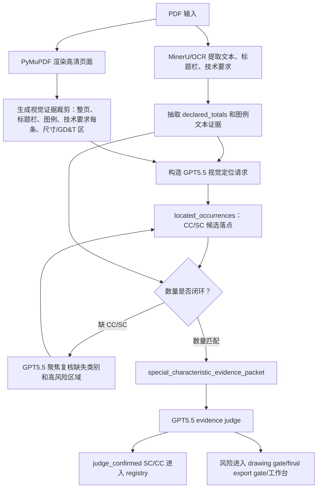

# Remove Mimo And Use GPT5.5 + MinerU Implementation Plan

> **For agentic workers:** REQUIRED SUB-SKILL: Use superpowers:subagent-driven-development (recommended) or superpowers:executing-plans to implement this plan task-by-task. Steps use checkbox (`- [ ]`) syntax for tracking.

**Goal:** 在 v3.8.0 中删除 Mimo 图纸视觉组件，改成 MinerU/OCR 负责文本和声明数量，GPT5.5 负责图纸视觉定位、缺失项聚焦复核和证据约束裁判。

**Architecture:** 特殊特性识别必须分成“读声明、找符号、裁判、数量闭环”四个职责。MinerU/OCR 是文字和表格来源，GPT5.5 vision 是唯一视觉定位模型，GPT5.5 evidence judge 是最终确认者；系统不再支持 `MINOS_VISION_PROVIDER=mimo`、`MimoV25ChatCompletionsDrawingAnalyzer` 或 Mimo 专用 API Key 配置。v3.8.0 的发布面同时升级所有产品版本来源。

**Tech Stack:** Python, pytest, PyMuPDF/Pillow rendered page crops, MinerU/OCR pipeline, OpenAI Responses GPT5.5 vision, `special_characteristic_declarations`, `special_characteristics_evidence`, `special_characteristics_judge`, hybrid drawing pipeline, Tauri desktop state, release version guard.

---

## 第一性原理

图纸上的 CC/SC 不是普通文本抽取问题，也不是单纯“谁看图更聪明”的问题。它有四个事实层级：

1. **声明层**：标题栏或产品特殊特性表声明 `CC=2, SC=1`，这是数量约束。
2. **符号层**：图例定义了哪个形状是 CC、哪个形状是 SC。
3. **落点层**：具体尺寸、技术要求或视图标注上出现了图例一致的符号。
4. **裁判层**：必须证明声明数量、图例、落点和页面证据相互匹配。

这次真实 JLV 图纸暴露的问题是：Mimo 召回候选不稳，bbox 坐标不可信，且把第 6 条误判成 SC，漏掉第 4 条第(2)项真正的 SC 胶囊标记。GPT5.5 整页识别更强，但第一次也漏掉了第 4 条 SC；只有在“声明 SC=1 但未定位”触发聚焦复核时，GPT5.5 才确认第 4 条第(2)项的 `转动力矩(0.5~2.5)Nm` 是 SC。所以 v3.8.0 的正确路径不是“直接整页问 GPT5.5 一次”，而是“声明数量驱动 + 局部裁剪 + 缺失项二次复核 + 裁判闭环”。

## 目标流程图



## Scope

- 删除 Mimo 运行组件和配置面，不保留 fallback。
- 保留 `MultimodalDrawingAnalyzer` 协议和 OpenAI Responses 图像输入能力。
- 新增 GPT5.5 专用特殊特性视觉定位器，不能复用 Mimo prompt。
- 保留 `special_characteristic_candidates` 数据结构，但候选来源改为 `gpt55_visual_locator`、`ocr_text` 或 `human_review`。
- 删除或改写 Mimo 相关测试，不把 Mimo 作为可配置 provider。
- 版本升级到 `3.8.0`，但实施计划要求先改识别链路，最后统一做 release/version sync。

## Non-Goals

- 不新增人工框选 UI。
- 不训练自定义模型。
- 不用 eDOCr、edocr2 或 deepseek-ocr-2 替代 MinerU。
- 不让 GPT5.5 直接生成 PFD/PFMEA/CP 的特殊特性结论；三表仍只继承已确认 registry。
- 不保留 `MINOS_MIMO_API_KEY`、`MINOS_MIMO_MODEL`、`MINOS_MIMO_BASE_URL` 兼容逻辑。

## File Structure

- Modify: `minos_core/ai_config.py`
  - 删除 Mimo 专用 provider、base URL、API key 读取和 `load_vision_api_key` 的 Mimo 分支。
- Modify: `minos_core/adapters/multimodal.py`
  - 删除 `MimoV25ChatCompletionsDrawingAnalyzer`、Mimo prompt、Mimo crop helper 和 chat completions payload。
  - 保留 `OpenAIResponsesMultimodalDrawingAnalyzer`。
- Create: `minos_core/special_characteristics_visual_locator.py`
  - GPT5.5 视觉定位器，输入页面图、OCR 摘要、声明数量和裁剪证据，输出定位候选和缺失复核请求。
- Create: `minos_core/drawing_visual_evidence.py`
  - 统一渲染和裁剪整页、图例、标题栏、技术要求、尺寸/GD&T 区域。
- Modify: `minos_core/pipeline/drawing_analysis.py`
  - 默认视觉定位从 provider factory 改为 GPT5.5 visual locator。
- Modify: `minos_core/pipeline/hybrid_fusion.py`
  - 融合 `gpt55_visual_locator` 候选并触发 evidence judge。
- Modify: `minos_core/special_characteristics_evidence.py`
  - evidence packet 增加视觉裁剪 evidence id、locator pass/focused pass metadata。
- Modify: `minos_core/drawing_analysis.py`
  - 删除 `model.startswith("mimo")` 或 chat completions wire API 特判。
- Modify: `tests/test_ai_config.py`
  - 删除 Mimo 配置测试，增加“vision config always OpenAI Responses/GPT5.5”测试。
- Modify: `tests/test_openai_multimodal_adapter.py`
  - 删除 Mimo payload/prompt/crop 测试，保留 OpenAI Responses 图像 payload 测试。
- Create: `tests/test_special_characteristics_visual_locator.py`
  - fake GPT5.5 locator 输出、缺失项聚焦复核和 JLV 第 4 条 SC 回归。
- Modify: `tests/test_special_characteristics_evidence.py`
  - 将 `mimo_candidates` 命名改成通用视觉候选。
- Modify: `tests/test_pipeline_ocr_first.py`
  - 删除 Mimo source 断言，增加 GPT5.5 locator source 断言。
- Modify: `tests/three_table_workflow/test_drawing_analysis.py`
  - 重命名 Mimo raw bypass 测试，保持“视觉原始 special_characteristics 不能绕过候选和裁判”行为。
- Modify: `tests/test_release_version_sync.py`
  - 将产品版本同步目标改为 `3.8.0`。
- Modify: release/version surfaces listed by `tests/test_release_version_sync.py`
  - `pyproject.toml`
  - `apps/desktop-tauri/package.json`
  - `apps/desktop-tauri/package-lock.json`
  - `apps/desktop-tauri/src-tauri/Cargo.toml`
  - `apps/desktop-tauri/src-tauri/Cargo.lock`
  - `apps/desktop-tauri/src-tauri/tauri.conf.json`
  - `apps/desktop-tauri/src-tauri/src/lib.rs`
  - `minos_desktop/api/app.py`
  - `minos_desktop/api/routes_health.py`
  - `apps/desktop-tauri/src/App.tsx`
  - `apps/desktop-tauri/src/pages/SettingsPage.tsx`

## OpenSpec 四步闭环

1. Define：v3.8.0 删除 Mimo，特殊特性识别改成 MinerU/OCR + GPT5.5 视觉定位 + GPT5.5 裁判。
2. Specify：系统不得读取 Mimo 配置，不得实例化 Mimo analyzer；声明数量缺失闭环必须触发 GPT5.5 聚焦复核。
3. Implement：先写删除 Mimo 的红灯测试，再最小删除 Mimo provider；再写 GPT5.5 locator 契约测试和实现。
4. Verify：fake unit tests、JLV 真实图纸回归、final export gate、desktop workbench、release version sync 和 installer smoke check。

## task_plan

### Task 1: OpenSpec 和计划落地

**Files:**
- Create: `openspec/changes/v3.8.0-remove-mimo-gpt55-mineru/proposal.md`
- Create: `openspec/changes/v3.8.0-remove-mimo-gpt55-mineru/design.md`
- Create: `openspec/changes/v3.8.0-remove-mimo-gpt55-mineru/tasks.md`
- Create: `docs/superpowers/plans/2026-06-06-v3.8.0-remove-mimo-gpt55-mineru.md`

- [ ] **Step 1: 写 OpenSpec proposal**

Run after writing:

```powershell
Get-Content -Raw .\openspec\changes\v3.8.0-remove-mimo-gpt55-mineru\proposal.md
```

Expected: UTF-8 readable Chinese text and explicit `Remove Mimo` / `GPT5.5 + MinerU` scope.

- [ ] **Step 2: 写 OpenSpec design**

Run after writing:

```powershell
Get-Content -Raw .\openspec\changes\v3.8.0-remove-mimo-gpt55-mineru\design.md
```

Expected: contains Define, Specify, Implement, Verify and no Mimo fallback.

- [ ] **Step 3: 写 OpenSpec tasks**

Run after writing:

```powershell
Get-Content -Raw .\openspec\changes\v3.8.0-remove-mimo-gpt55-mineru\tasks.md
```

Expected: each line starts with `- [ ] ///` and includes tests before implementation.

### Task 2: 删除 Mimo 配置和 adapter

**Files:**
- Modify: `minos_core/ai_config.py`
- Modify: `minos_core/adapters/multimodal.py`
- Modify: `tests/test_ai_config.py`
- Modify: `tests/test_openai_multimodal_adapter.py`

- [ ] **Step 1: 写失败测试，证明 Mimo provider 不再被支持**

Modify `tests/test_ai_config.py` by replacing Mimo provider tests with:

```python
def test_load_vision_config_ignores_removed_mimo_provider(self):
    with patch.dict(
        os.environ,
        {
            "MINOS_VISION_PROVIDER": "mimo",
            "MINOS_MIMO_API_KEY": "mimo-secret",
            "MINOS_OPENAI_API_KEY": "openai-secret",
            "MINOS_OPENAI_MODEL": "gpt-5.5",
        },
        clear=True,
    ):
        from minos_core.ai_config import load_vision_config

        config = load_vision_config(allow_codex_config=False)

    self.assertEqual(config.provider, "openai_responses")
    self.assertEqual(config.model, "gpt-5.5")
    self.assertEqual(config.api_key_env_name, "MINOS_OPENAI_API_KEY")
```

- [ ] **Step 2: Run failing config test**

```powershell
python -m pytest tests/test_ai_config.py::AIConfigTests::test_load_vision_config_ignores_removed_mimo_provider -q
```

Expected before implementation: FAIL because current code returns `provider == "mimo"`.

- [ ] **Step 3: Delete Mimo config branch**

In `minos_core/ai_config.py`:

```python
def load_vision_config(
    *,
    codex_home: str | Path | None = None,
    allow_codex_config: bool | None = None,
    db_overrides: dict[str, Any] | None = None,
) -> AIProviderConfig:
    """Load drawing-vision provider config.

    v3.8.0 removes Mimo; drawing vision uses the OpenAI-compatible Responses path.
    """

    return load_openai_responses_config(
        codex_home=codex_home,
        allow_codex_config=allow_codex_config,
        db_overrides=db_overrides,
    )
```

And:

```python
def load_vision_api_key(
    *,
    codex_home: str | Path | None = None,
    allow_codex_config: bool | None = None,
    db_overrides: dict[str, Any] | None = None,
) -> str:
    return load_openai_api_key(
        codex_home=codex_home,
        allow_codex_config=allow_codex_config,
        db_overrides=db_overrides,
    )
```

Also remove `DEFAULT_MIMO_CHAT_COMPLETIONS_BASE_URL`.

- [ ] **Step 4: Run config tests**

```powershell
python -m pytest tests/test_ai_config.py -q
```

Expected: PASS after Mimo tests are rewritten.

- [ ] **Step 5: Write import failure guard**

Modify `tests/test_openai_multimodal_adapter.py`:

```python
def test_mimo_analyzer_class_is_removed():
    import minos_core.adapters.multimodal as multimodal

    assert not hasattr(multimodal, "MimoV25ChatCompletionsDrawingAnalyzer")
    assert not hasattr(multimodal, "_mimo_v25_drawing_analysis_prompt")
```

- [ ] **Step 6: Delete Mimo adapter code**

In `minos_core/adapters/multimodal.py`, remove:

```python
class MimoV25ChatCompletionsDrawingAnalyzer:
    ...
```

Remove helpers:

```python
_MIMO_DECLARATION_DETAIL_REGIONS
_MIMO_CROP_TARGET_SIDE
_MIMO_CROP_MAX_SCALE
_declared_count_instruction
_declared_count_value
_mimo_v25_drawing_analysis_prompt
_mimo_page_visual_inputs
_cropped_image_data_url
_normalized_crop_box
_upscale_crop_for_readability
_image_data_url_from_bytes
_extract_chat_completion_text
```

Change factory:

```python
def create_default_multimodal_drawing_analyzer() -> MultimodalDrawingAnalyzer:
    return OpenAIResponsesMultimodalDrawingAnalyzer()
```

- [ ] **Step 7: Run adapter tests**

```powershell
python -m pytest tests/test_openai_multimodal_adapter.py -q
```

Expected: PASS with only OpenAI Responses payload tests remaining.

### Task 3: 新增 GPT5.5 视觉定位器和裁剪证据

**Files:**
- Create: `minos_core/drawing_visual_evidence.py`
- Create: `minos_core/special_characteristics_visual_locator.py`
- Create: `tests/test_drawing_visual_evidence.py`
- Create: `tests/test_special_characteristics_visual_locator.py`

- [ ] **Step 1: Write visual evidence crop test**

Create `tests/test_drawing_visual_evidence.py`:

```python
from pathlib import Path

from PIL import Image

from minos_core.drawing_visual_evidence import build_visual_evidence_regions


def test_build_visual_evidence_regions_includes_declared_and_requirement_regions(tmp_path):
    image_path = tmp_path / "page.png"
    Image.new("RGB", (2000, 1400), "white").save(image_path)

    regions = build_visual_evidence_regions(
        page_image_path=image_path,
        page_evidence_id="drawing_page_001",
        technical_requirements=[
            {"text": "4. 铰链应满足...", "evidence_refs": ["drawing_page_001"]},
            {"text": "5. 铰链应满足 GB 15086", "evidence_refs": ["drawing_page_001"]},
        ],
    )

    ids = {item["region_id"] for item in regions}
    assert "drawing_page_001_full_page" in ids
    assert "drawing_page_001_title_block_special_counts" in ids
    assert "drawing_page_001_key_product_characteristic_table" in ids
    assert "drawing_page_001_technical_requirement_001" in ids
    assert all(Path(item["image_path"]).exists() for item in regions)
```

- [ ] **Step 2: Implement visual evidence regions**

Create `minos_core/drawing_visual_evidence.py`:

```python
from __future__ import annotations

from pathlib import Path
from typing import Any

from PIL import Image


def build_visual_evidence_regions(
    *,
    page_image_path: str | Path,
    page_evidence_id: str,
    technical_requirements: list[dict[str, Any]],
    output_dir: str | Path | None = None,
) -> list[dict[str, Any]]:
    source_path = Path(page_image_path)
    target_dir = Path(output_dir) if output_dir else source_path.parent / "visual_evidence"
    target_dir.mkdir(parents=True, exist_ok=True)
    with Image.open(source_path) as image:
        source = image.convert("RGB")
    width, height = source.size
    specs = [
        ("full_page", (0.0, 0.0, 1.0, 1.0)),
        ("title_block_special_counts", (0.72, 0.72, 1.0, 1.0)),
        ("key_product_characteristic_table", (0.35, 0.0, 0.66, 0.12)),
        ("technical_requirements", (0.56, 0.45, 1.0, 0.72)),
    ]
    for index, _item in enumerate(technical_requirements, start=1):
        top = min(0.72, 0.45 + (index - 1) * 0.028)
        specs.append((f"technical_requirement_{index:03d}", (0.56, top, 1.0, min(0.78, top + 0.05))))
    regions: list[dict[str, Any]] = []
    for label, region in specs:
        box = _crop_box(width, height, region)
        crop = source.crop(box)
        path = target_dir / f"{page_evidence_id}_{label}.png"
        crop.save(path)
        regions.append(
            {
                "region_id": f"{page_evidence_id}_{label}",
                "page_evidence_id": page_evidence_id,
                "label": label,
                "bbox": list(box),
                "image_path": str(path),
                "evidence_refs": [page_evidence_id],
            }
        )
    return regions


def _crop_box(width: int, height: int, region: tuple[float, float, float, float]) -> tuple[int, int, int, int]:
    left, top, right, bottom = region
    return (
        max(0, min(width - 1, round(width * left))),
        max(0, min(height - 1, round(height * top))),
        max(1, min(width, round(width * right))),
        max(1, min(height, round(height * bottom))),
    )
```

- [ ] **Step 3: Write fake GPT5.5 locator test for JLV shape**

Create `tests/test_special_characteristics_visual_locator.py`:

```python
from minos_core.special_characteristics_visual_locator import (
    FakeGPT55VisualLocator,
    normalize_visual_locator_result,
)


def test_visual_locator_confirms_jlv_two_cc_and_one_sc():
    locator = FakeGPT55VisualLocator(
        {
            "located_occurrences": [
                {
                    "candidate_id": "SC-REQ4-TORQUE",
                    "candidate_type": "SC",
                    "source": "gpt55_visual_locator",
                    "symbol_text_or_shape": "水平圆角长框",
                    "linked_feature": "技术要求第4条第(2)项：转动力矩(0.5~2.5)Nm",
                    "symbol_bbox": [2050, 906, 2255, 929],
                    "evidence_refs": ["drawing_page_001"],
                    "confidence": 0.96,
                    "reasoning": "形状与右下 SC 图例一致。",
                },
                {
                    "candidate_id": "CC-REQ5-GB15086",
                    "candidate_type": "CC",
                    "source": "gpt55_visual_locator",
                    "symbol_text_or_shape": "圆内倒三角",
                    "linked_feature": "技术要求第5条：GB 15086",
                    "symbol_bbox": [1700, 932, 2370, 962],
                    "evidence_refs": ["drawing_page_001"],
                    "confidence": 0.90,
                    "reasoning": "第5条前标记与 CC 图例一致。",
                },
                {
                    "candidate_id": "CC-REQ6-M0102",
                    "candidate_type": "CC",
                    "source": "gpt55_visual_locator",
                    "symbol_text_or_shape": "圆内倒三角",
                    "linked_feature": "技术要求第6条：Q/BJORV M 0102",
                    "symbol_bbox": [1700, 962, 2370, 994],
                    "evidence_refs": ["drawing_page_001"],
                    "confidence": 0.82,
                    "reasoning": "第6条前标记与 CC 图例一致。",
                },
            ],
            "missing_counts": {"CC": 0, "SC": 0},
        }
    )

    result = normalize_visual_locator_result(locator.locate({}))

    assert [item["candidate_type"] for item in result["located_occurrences"]] == ["SC", "CC", "CC"]
    assert result["missing_counts"] == {"CC": 0, "SC": 0}
```

- [ ] **Step 4: Implement locator normalization and fake**

Create `minos_core/special_characteristics_visual_locator.py`:

```python
from __future__ import annotations

from typing import Any

from minos_core.special_characteristic_candidates import normalize_special_characteristic_candidates


class FakeGPT55VisualLocator:
    def __init__(self, payload: dict[str, Any]):
        self.payload = payload

    def locate(self, evidence_packet: dict[str, Any]) -> dict[str, Any]:
        return dict(self.payload)


def normalize_visual_locator_result(payload: Any) -> dict[str, Any]:
    raw = payload if isinstance(payload, dict) else {}
    occurrences = normalize_special_characteristic_candidates(raw.get("located_occurrences", []))
    missing = raw.get("missing_counts") if isinstance(raw.get("missing_counts"), dict) else {}
    return {
        "located_occurrences": occurrences,
        "missing_counts": {
            "CC": _count(missing.get("CC")),
            "SC": _count(missing.get("SC")),
        },
        "focused_review_requests": [
            item for item in raw.get("focused_review_requests", []) if isinstance(item, dict)
        ],
    }


def _count(value: Any) -> int:
    try:
        return max(0, int(value or 0))
    except (TypeError, ValueError):
        return 0
```

- [ ] **Step 5: Run locator tests**

```powershell
python -m pytest tests/test_drawing_visual_evidence.py tests/test_special_characteristics_visual_locator.py -q
```

Expected: PASS.

### Task 4: Pipeline 接入 GPT5.5 locator

**Files:**
- Modify: `minos_core/pipeline/drawing_analysis.py`
- Modify: `minos_core/pipeline/hybrid_fusion.py`
- Modify: `minos_core/special_characteristics_evidence.py`
- Modify: `tests/test_pipeline_ocr_first.py`
- Modify: `tests/test_special_characteristics_evidence.py`

- [ ] **Step 1: Write pipeline test for GPT55 locator source**

Modify `tests/test_pipeline_ocr_first.py` with a focused fake result:

```python
def test_hybrid_pipeline_uses_gpt55_visual_locator_candidates_for_declared_counts():
    drawing = {
        "declared_totals": {"CC": 2, "SC": 1},
        "special_characteristic_candidates": [
            {
                "candidate_id": "SC-REQ4-TORQUE",
                "candidate_type": "SC",
                "source": "gpt55_visual_locator",
                "symbol_text_or_shape": "水平圆角长框",
                "linked_feature": "技术要求第4条第(2)项：转动力矩(0.5~2.5)Nm",
                "symbol_bbox": [2050, 906, 2255, 929],
                "evidence_refs": ["drawing_page_001"],
                "confidence": 0.96,
            }
        ],
    }

    packet = build_special_characteristic_evidence_packet(drawing)

    assert packet["symbol_occurrences"][0]["source"] == "gpt55_visual_locator"
    assert packet["declared_totals"] == {"CC": 2, "SC": 1}
```

- [ ] **Step 2: Implement pipeline merge**

In `minos_core/pipeline/hybrid_fusion.py`, when vision analysis has `located_occurrences`, append them to `special_characteristic_candidates` before judge:

```python
located = vision_analysis.get("located_occurrences")
if isinstance(located, list) and located:
    raw_candidates.extend(item for item in located if isinstance(item, dict))
```

- [ ] **Step 3: Ensure evidence packet does not mention Mimo**

Rename tests in `tests/test_special_characteristics_evidence.py`:

```python
def test_build_packet_collects_visual_candidates_ocr_text_and_page_evidence():
    ...
```

Use `source: "gpt55_visual_locator"` in fixtures.

- [ ] **Step 4: Run focused pipeline tests**

```powershell
python -m pytest tests/test_pipeline_ocr_first.py tests/test_special_characteristics_evidence.py -q
```

Expected: PASS.

### Task 5: 删除 Mimo 语义残留和 UI/文档引用

**Files:**
- Modify: `minos_core/drawing_analysis.py`
- Modify: `tests/three_table_workflow/test_drawing_analysis.py`
- Modify: `tests/test_special_characteristic_candidates.py`
- Modify: `openspec/changes/v3.3.2-mimo-v25-special-characteristic-candidates/*` only if adding archive note is necessary

- [ ] **Step 1: Search Mimo residue**

```powershell
rg -n "Mimo|mimo|MINOS_MIMO|MINOS_VISION_PROVIDER|mimo-v2.5" -S minos_core tests apps openspec --glob "!**/target/**"
```

Expected after implementation: no runtime code or active tests require Mimo. Historical OpenSpec files may remain, but new v3.8.0 docs supersede them.

- [ ] **Step 2: Remove drawing_analysis Mimo special case**

In `minos_core/drawing_analysis.py`, replace Mimo-specific model detection:

```python
return metadata.get("wire_api") == "chat_completions" or model.startswith("mimo")
```

with source-based check:

```python
return any(
    str(item.get("source", "")).startswith("gpt55_visual")
    for item in bundle.get("special_characteristic_candidates", [])
    if isinstance(item, dict)
)
```

- [ ] **Step 3: Rename old tests**

Rename test names:

```python
def test_fake_visual_sc_candidate_stays_candidate_without_judge(self):
    ...

def test_visual_raw_special_characteristics_do_not_bypass_candidates(self):
    ...
```

Use `model="gpt-5.5"` and `source="gpt55_visual_locator"` in fixtures.

- [ ] **Step 4: Run residue tests**

```powershell
python -m pytest tests/three_table_workflow/test_drawing_analysis.py tests/test_special_characteristic_candidates.py -q
```

Expected: PASS.

### Task 6: 真实 JLV 图纸回归

**Files:**
- Test input: `C:\Users\fgtan\Desktop\知识库种子\JLV03000500_001_AC_RR DH ASSY.pdf`
- Output folder: `out\v3.8.0_gpt55_mineru_jlv_trial\`
- Modify tests only after manual evidence confirms expected output.

- [ ] **Step 1: Run source pipeline with GPT5.5 locator**

```powershell
$env:MINOS_ENABLE_WINDOWS_USER_ENV_FALLBACK='1'
$env:MINOS_SPECIAL_CHARACTERISTIC_JUDGE='1'
$env:MINOS_OPENAI_MODEL='gpt-5.5'
python -m minos_core.cli analyze-drawing "C:\Users\fgtan\Desktop\知识库种子\JLV03000500_001_AC_RR DH ASSY.pdf" --output out\v3.8.0_gpt55_mineru_jlv_trial
```

Expected:

```text
declared_totals.CC = 2
declared_totals.SC = 1
confirmed CC = 2
confirmed SC = 1
SC linked_feature includes 转动力矩(0.5~2.5)Nm
```

- [ ] **Step 2: Save annotated evidence image**

Use the generated visual evidence regions to create:

```text
out\v3.8.0_gpt55_mineru_jlv_trial\gpt55_sc_cc_locations_corrected_preview.png
```

Expected image labels:

```text
SC-1 -> 技术要求第4条第(2)项 转动力矩(0.5~2.5)Nm
CC-1 -> 技术要求第5条 GB 15086
CC-2 -> 技术要求第6条 Q/BJORV M 0102
```

- [ ] **Step 3: Add regression fixture**

After real run passes, add a deterministic fixture test in `tests/test_special_characteristics_visual_locator.py` that uses saved fake GPT55 output and asserts:

```python
assert result["missing_counts"] == {"CC": 0, "SC": 0}
assert {item["candidate_type"] for item in result["located_occurrences"]} == {"CC", "SC"}
assert any("转动力矩" in item["linked_feature"] for item in result["located_occurrences"])
```

### Task 7: v3.8.0 release version sync

**Files:**
- Modify: `tests/test_release_version_sync.py`
- Modify: all release surfaces covered by that test.

- [ ] **Step 1: Red test expected version**

Set expected version to `3.8.0` in `tests/test_release_version_sync.py`, then run:

```powershell
python -m pytest tests/test_release_version_sync.py -q
```

Expected before version edits: FAIL listing stale `3.6.5` surfaces.

- [ ] **Step 2: Update version surfaces**

Update the product version to `3.8.0` in every file reported by the release sync test.

- [ ] **Step 3: Pass release sync**

```powershell
python -m pytest tests/test_release_version_sync.py -q
```

Expected: PASS.

### Task 8: Final verification and release build

**Files:**
- No new code files beyond previous tasks.

- [ ] **Step 1: Run focused Python suite**

```powershell
python -m pytest tests/test_ai_config.py tests/test_openai_multimodal_adapter.py tests/test_drawing_visual_evidence.py tests/test_special_characteristics_visual_locator.py tests/test_special_characteristics_evidence.py tests/test_special_characteristics_judge.py tests/test_pipeline_ocr_first.py tests/three_table_workflow/test_drawing_analysis.py tests/test_release_version_sync.py -q
```

Expected: PASS.

- [ ] **Step 2: Run desktop build if UI state changed**

```powershell
Push-Location apps\desktop-tauri
npm run build
Pop-Location
```

Expected: build succeeds without TypeScript errors.

- [ ] **Step 3: Build v3.8.0 installer**

```powershell
powershell -ExecutionPolicy Bypass -File .\scripts\build_release.ps1
```

Expected:

```text
release/MINOS-CORE_3.8.0_x64-setup.exe exists
dist/build/out/MINOS-CORE_3.8.0_x64-setup.exe exists
```

- [ ] **Step 4: Smoke-check packaged sidecar**

Use the repo's existing packaged sidecar smoke check and verify `/api/health` returns:

```json
{"ok": true, "status": "ok", "service": "minos-desktop-api", "version": "3.8.0"}
```

## progress

- [x] /// 使用 `superpowers:using-superpowers` 和 `superpowers:writing-plans` 建立计划流程。
- [x] /// 从真实 JLV 图纸实验得到事实：Mimo 漏第 4 条 SC、误判第 6 条 SC；GPT5.5 聚焦复核确认第 4 条第(2)项 SC。
- [x] /// 明确 v3.8.0 决策：删除 Mimo 组件，不保留 fallback。
- [x] /// 执行 Task 1 建立 OpenSpec 文件。
- [x] /// 执行 Task 2 删除 Mimo 配置和 adapter。
- [x] /// 执行 Task 3 新增 GPT5.5 visual locator 和裁剪证据。
- [x] /// 执行 Task 4 接入 pipeline 和 evidence packet。
- [x] /// 执行 Task 5 清理 Mimo 语义残留。
- [ ] /// 执行 Task 6 做 JLV 真实图纸回归：fake/单测已固定第 4 条第(2)项 SC、第 5/6 条 CC；真实 GPT5.5 图纸试跑仍不稳定，不能作为完成项。
- [x] /// 执行 Task 7 做 3.8.0 版本同步。
- [ ] /// 执行 Task 8 做最终验证和 release build：聚焦 Python 测试、compileall、diff check、桌面 build、release build 和 packaged sidecar smoke 已通过；真实 JLV 完全验收仍未完成。
- [x] /// 当前验证：`python -m pytest tests/test_ai_config.py tests/test_openai_multimodal_adapter.py tests/test_drawing_visual_evidence.py tests/test_special_characteristics_visual_locator.py tests/test_special_characteristics_evidence.py tests/test_special_characteristics_judge.py tests/test_pipeline_ocr_first.py tests/three_table_workflow/test_drawing_analysis.py tests/test_special_characteristic_candidates.py tests/test_release_version_sync.py -q` -> `127 passed`。
- [x] /// 当前验证：`python -m compileall minos_core minos_desktop` 通过。
- [x] /// 当前验证：`git diff --check` 无空白错误，仅有 Git LF/CRLF 提示。
- [x] /// 当前验证：`npm run build --prefix apps/desktop-tauri` 通过；仍有既有 CSS minify warning `Expected identifier but found "-"`。
- [x] /// 当前验证：`powershell -ExecutionPolicy Bypass -File .\scripts\build_release.ps1` 通过，生成 `release/MINOS-CORE_3.8.0_x64-setup.exe`、`dist/build/out/MINOS-CORE_3.8.0_x64-setup.exe` 和 target NSIS 产物。
- [x] /// 当前验证：三处 `MINOS-CORE_3.8.0_x64-setup.exe` 大小均为 `94,047,578` bytes，SHA256 均为 `E96F60711DBF1B368E6B9BC611D1BC29EE877808EB32E9E8A0FE2BD2D1C335C7`，PE 头为 `MZ`。
- [x] /// 当前验证：packaged sidecar `/api/health` 返回 `{"ok":true,"status":"ok","service":"minos-desktop-api","version":"3.8.0"}`。
- [x] /// 当前 Mimo 残留扫描：active runtime 未发现 Mimo provider/adapter 调用；剩余命中为移除测试、v3.8.0 说明和历史计划/OpenSpec 记录。

## findings

- Mimo 的问题不是只差 prompt：它在本次 JLV 图纸上同时出现 bbox 偏移、CC/SC 分类错误和漏检。继续保留会让正式链路多一个不稳定证人。
- GPT5.5 整页识别强于 Mimo，但仍可能漏掉小区域符号；因此必须有缺失数量驱动的聚焦复核。
- MinerU/OCR 仍有价值：它稳定提供标题栏、技术要求、声明数量和上下文文本，不适合直接删除。
- `declared_totals` 是新链路的硬约束；没有数量闭环的结果不能正式导出。
- 历史 OpenSpec 中的 Mimo 方案应保留为历史记录，但 v3.8.0 变更必须明确 supersede。
- 真实 JLV 图纸当前不能声称完全验收通过：裁剪和 prompt 已改善第 5/6 条 CC 召回，但第 4 条第(2)项 `转动力矩(0.5~2.5)Nm` 的 SC 在真实 GPT5.5 跑法中仍不稳定；正式结论必须继续以 judge confirmed 或 human confirmed 为准。

## Self-Review

- Spec coverage：删除 Mimo、GPT5.5+MinerU、数量闭环、JLV 回归、版本 3.8.0、release build 都有任务覆盖。
- Red-flag wording scan：本计划没有使用空洞式任务描述；每个开发任务都有文件、测试命令和期望结果。
- Type consistency：候选来源统一为 `gpt55_visual_locator`，声明数量统一为 `declared_totals`，落点统一进入 `located_occurrences` 后再合并到 `special_characteristic_candidates`。

## Execution Choice

Plan complete and saved to `docs/superpowers/plans/2026-06-06-v3.8.0-remove-mimo-gpt55-mineru.md`. Two execution options:

1. Subagent-Driven (recommended) - dispatch a fresh subagent per task, review between tasks, fast iteration.
2. Inline Execution - execute tasks in this session using executing-plans, batch execution with checkpoints.
