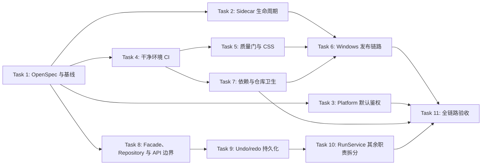

# MINOS-CORE Project Hardening Remediation Implementation Plan

> **For agentic workers:** REQUIRED SUB-SKILL: Use superpowers:subagent-driven-development (recommended) or superpowers:executing-plans to implement this plan task-by-task. Steps use checkbox (`- [ ]`) syntax for tracking.

**Goal:** 修复全仓审查发现的运行时、鉴权、CI、发布和架构问题，使当前版本达到可复现构建、可验证交付和可持续维护的状态。

**Architecture:** 采用四条相互隔离的整改工作流，每个任务对应一个可独立回滚的 PR。先处理 sidecar 生命周期和默认鉴权，再建立干净环境 CI 与质量门，随后补齐 Windows 发布链路，最后清理依赖和架构债务；不做一次性大重构。

**Tech Stack:** Python 3.11、pytest、ruff、mypy、FastAPI、SQLite、React 18、TypeScript、Vite、Tailwind CSS、Tauri 2、Rust、GitHub Actions、PowerShell、NSIS。

---

## Assumptions And Scope

- 当前目标是 Windows 桌面产品正式交付准备；`minos_platform` 暂时保留，但默认必须鉴权。
- 主产品链路仍是图纸 -> PFD -> 人工确认 -> PFMEA -> 人工确认 -> CP -> Excel，不改变业务算法。
- 不在同一个 PR 中同时修改 sidecar、数据库 schema 和三表生成逻辑。
- Ruff/mypy 采用“先自动修复，再按模块清零，最后启用全仓阻断”的策略；不通过永久 ignore 隐藏错误。
- 正式安装包必须签名；没有签名凭据时，CI 只能产出明确标记为 `internal-unsigned` 的内测包。
- 本计划不直接执行 `git gc`。Git 历史清理是本机维护动作，执行前必须备份并记录仓库大小。

## Success Criteria

- 连续调用两次 `get_bootstrap` 不会终止当前 sidecar，也不会杀掉其他实例。
- Platform 未配置 token 时默认返回 401；只有显式开发开关允许无鉴权运行。
- GitHub Actions 从干净 checkout 安装完整测试依赖，Python、前端和 Rust 检查均为阻断项。
- Ruff 和 mypy 最终为 0 error；覆盖率门槛为 80%。
- 前端构建不再出现 CSS `Expected identifier` 警告。
- Windows CI 能构建 sidecar 和 NSIS，验证安装、启动、health、关闭和卸载；正式发布验证签名。
- `requirements/all.txt` 的本机路径和无关依赖被移除，依赖只有一个声明源。
- 同名死 facade 被删除，undo/redo 跨进程重启可用，`DesktopRunService` 的职责被分离且行为不变。

## Dependency Graph



并行规则：Task 2、3、4 可并行；Task 7 可在 Task 4 后独立执行。Task 6 等待 Task 2、5、7；Task 8 先建立 repository/transaction 边界，Task 9 随后修复 undo/redo，Task 10 最后拆生成与导出职责。Platform 鉴权不阻塞桌面安装包构建，但必须在最终验收前完成。

---

### /// Task 1: 建立 OpenSpec 变更与可重复基线

**Files:**
- Create: `openspec/changes/v3.8.7-production-readiness/proposal.md`
- Create: `openspec/changes/v3.8.7-production-readiness/design.md`
- Create: `openspec/changes/v3.8.7-production-readiness/tasks.md`
- Modify: `project_flow.mmd`
- Modify: `docs/plans/task_plan.md`
- Modify: `docs/plans/progress.md`
- Modify: `docs/plans/findings.md`

- [ ] **Step 1: 写入 OpenSpec proposal**

  `proposal.md` 必须写明 Why、What、Non-goals 和本计划 Success Criteria；Non-goals 明确包含“不改三表业务算法、不扩展 PPAP 功能、不在本变更中重写平台”。

- [ ] **Step 2: 写入设计不变量**

  `design.md` 固定以下不变量：sidecar 只管理自己启动的子进程；Platform 默认拒绝未认证请求；CI 不允许静态检查软失败；正式 release 必须校验签名；SQLite migration 只能前进且可重复执行。

- [ ] **Step 3: 将执行任务写成 `///` 清单**

  `tasks.md` 中每一项使用：

  ```markdown
  - [ ] /// N. 动作；验证：准确命令与预期结果。
  ```

- [ ] **Step 4: 记录整改流程图**

  在 `project_flow.mmd` 增加一个 `v3.8.7-production-readiness` 子图，节点与本计划依赖图一致，不改已有历史节点。

- [ ] **Step 5: 记录基线并验证工作区**

  Run:

  ```powershell
  git status --short
  python -m pytest tests -q -m "not real_api"
  python -m unittest discover -s tests -v
  python -m pip check
  python scripts/check_repo_hygiene.py
  git diff --check
  ```

  Expected: Python 测试保持 `1499 passed` 量级且无失败；依赖、卫生和 diff 检查通过。测试数量允许因后续新增测试增加，不允许减少既有测试覆盖面。

- [ ] **Step 6: Commit**

  ```powershell
  git add openspec/changes/v3.8.7-production-readiness/proposal.md openspec/changes/v3.8.7-production-readiness/design.md openspec/changes/v3.8.7-production-readiness/tasks.md project_flow.mmd docs/plans/task_plan.md docs/plans/progress.md docs/plans/findings.md
  git diff --cached --check
  git commit -m "docs: plan production readiness remediation"
  ```

**Rollback:** 仅回滚本任务新增的 OpenSpec、流程节点和三份计划记录，不触碰历史计划内容。

---

### /// Task 2: 修复 Tauri sidecar 生命周期

**Files:**
- Modify: `apps/desktop-tauri/src-tauri/src/lib.rs:44-66`
- Modify: `apps/desktop-tauri/src-tauri/src/lib.rs:194-284`
- Modify: `tests/test_desktop_api_sidecar.py`
- Modify: `tests/test_desktop_tauri_app_state.py`

- [ ] **Step 1: 写入失败测试**

  在 `tests/test_desktop_tauri_app_state.py` 增加静态回归测试，要求 Rust 源码不再包含全局进程终止命令：

  ```python
  def test_tauri_sidecar_never_kills_processes_by_image_name() -> None:
      source = (ROOT / "apps/desktop-tauri/src-tauri/src/lib.rs").read_text(encoding="utf-8")
      assert 'Command::new("taskkill")' not in source
      assert 'Command::new("pkill")' not in source
      assert "kill_stale_sidecars" not in source
  ```

- [ ] **Step 2: 运行红灯测试**

  Run: `python -m pytest tests/test_desktop_tauri_app_state.py -q`

  Expected: 新测试因现有 `taskkill` / `pkill` 失败。

- [ ] **Step 3: 删除按进程名清理并串行化进程状态**

  删除 `kill_stale_sidecars()`。将“检查当前 child -> 选择端口 -> spawn -> 写入 slot”放在同一进程状态锁保护下，防止并发 bootstrap 启动两个 child。已有健康 child 时复用其端口；不可达时只 `take()` 并终止 slot 中自己持有的 child。禁止执行系统范围的进程名查杀。

- [ ] **Step 4: 抽出可测试的生命周期状态机并写 Rust 单测**

  将 child 外壳与纯状态分开，状态至少包含 `pid`、`port`、`starting/running/stopped`。spawn 和 readiness probe 通过可注入 closure 调用，使单测不启动真实 sidecar。至少实现以下单测：

  ```rust
  #[test]
  fn concurrent_bootstrap_spawns_once() { /* barrier + atomic spawn counter == 1 */ }

  #[test]
  fn stale_termination_does_not_clear_new_pid() { /* pid 10 event leaves pid 11 */ }

  #[test]
  fn readiness_timeout_rejects_bootstrap_and_clears_owned_child() { /* Err */ }
  ```

  另加源码契约测试，确认 close listener 只存在于 `.setup(...)`。Task 6 的 Windows E2E 再验证真实连续 bootstrap 的 PID/端口相同。

- [ ] **Step 5: 用 PID 保护异常退出清理**

  spawn 后保存 `child.pid()`。事件流收到 `CommandEvent::Terminated` 时调用 `clear_sidecar_if_pid(pid)`；只有 slot 当前 PID 等于退出 PID 才能清空，避免旧 child 的延迟事件清掉新 child。

- [ ] **Step 6: 让启动超时返回失败并只注册一次 close listener**

  将 `ensure_sidecar_running` 改为 `Result<u16, String>`，并将 `get_bootstrap` 改为 `Result<BootstrapPayload, String>`；managed sidecar 失败必须 reject，不能 fallback 到端口 8000。外部 `MINOS_DESKTOP_API_BASE_URL` 分支保持成功。30 次 readiness probe 仍失败时终止刚启动的 child、清空匹配 PID 的 slot 并返回 `Err`。readiness probe 使用 `std::net::TcpStream` 写入带 bearer token 的 HTTP 请求，并解析 HTTP status 与 MINOS health JSON body，不能只判断端口可连接；因此不新增 Rust HTTP crate。将 close listener 移到 `run().setup(...)`，生命周期只注册一次。

- [ ] **Step 7: 验证**

  ```powershell
  python -m pytest tests/test_desktop_api_sidecar.py tests/test_desktop_tauri_app_state.py -q
  Set-Location apps/desktop-tauri/src-tauri
  cargo test --locked
  cargo check --locked
  ```

  Expected: 聚焦测试和 Rust 检查通过；连续两次 bootstrap 复用同一端口；不存在 `taskkill` / `pkill`。

- [ ] **Step 8: Commit**

  ```powershell
  git add apps/desktop-tauri/src-tauri/src/lib.rs tests/test_desktop_api_sidecar.py tests/test_desktop_tauri_app_state.py
  git commit -m "fix: make sidecar lifecycle instance scoped"
  ```

**Rollback:** 回滚该 PR 即恢复旧行为；发布前必须重新跑 sidecar 启停测试，不能只恢复全局 kill。

---

### /// Task 3: 将 Platform 鉴权改成默认拒绝

**Files:**
- Modify: `minos_platform/config.py:26-42`
- Modify: `minos_platform/app.py:30-46`
- Modify: `tests/platform/conftest.py:16-39`
- Modify: `tests/platform/test_auth_cors.py`
- Modify: `.env.example`
- Modify: `README.md`

- [ ] **Step 1: 改写默认行为测试**

  将 `test_platform_default_dev_mode_still_allows_requests` 替换为：

  ```python
  async def test_platform_requires_auth_by_default(monkeypatch):
      monkeypatch.delenv("MINOS_PLATFORM_AUTH_REQUIRED", raising=False)
      monkeypatch.delenv("MINOS_PLATFORM_API_TOKEN", raising=False)
      tmpdir, client = await _client()
      try:
          async with client:
              response = await client.get("/api/projects")
      finally:
          await _cleanup(tmpdir)
      assert response.status_code == 401
  ```

- [ ] **Step 2: 为显式开发模式写测试**

  使用 `MINOS_PLATFORM_AUTH_REQUIRED=0`，验证无 token 时仅在显式关闭鉴权后返回 200；CORS 白名单行为保持不变。

- [ ] **Step 3: 实现默认鉴权**

  将配置函数改为默认 `True`：

  ```python
  def platform_auth_required() -> bool:
      value = os.getenv("MINOS_PLATFORM_AUTH_REQUIRED")
      if value is None:
          return True
      return value.strip().lower() not in {"0", "false", "no", "off"}
  ```

  `tests/platform/conftest.py` 必须显式设置 `MINOS_PLATFORM_AUTH_REQUIRED=0`，避免普通 CRUD fixture 隐式依赖不安全默认值。

- [ ] **Step 4: 更新运行说明**

  `.env.example` 和 README 写清楚：生产/交付必须提供 `MINOS_PLATFORM_API_TOKEN`；`MINOS_PLATFORM_AUTH_REQUIRED=0` 仅用于绑定 loopback 的本地开发进程。

- [ ] **Step 5: 验证**

  ```powershell
  python -m pytest tests/platform/test_auth_cors.py tests/platform -q
  python -m minos_platform.cli --help
  ```

  Expected: 默认无 token 为 401；正确 Bearer token 为 200；显式 `0` 才允许开发模式。

- [ ] **Step 6: Commit**

  ```powershell
  git add minos_platform/config.py minos_platform/app.py tests/platform/conftest.py tests/platform/test_auth_cors.py .env.example README.md
  git diff --cached --check
  git commit -m "fix: require platform authentication by default"
  ```

**Rollback:** 如本地工具受影响，只允许通过显式环境变量临时关闭；不回滚为默认开放。

---

### /// Task 4: 让 CI 在干净环境安装真实依赖

**Files:**
- Modify: `pyproject.toml:39-62`
- Modify: `.github/workflows/ci.yml:10-104`
- Modify: `.github/dependabot.yml`

- [ ] **Step 1: 补齐测试工具声明**

  新增独立 `test` extra，`dev` 保留工程工具并增加 mypy stubs；所有依赖保持上下界：

  ```toml
  test = [
      "pytest>=8,<10",
      "pytest-asyncio>=0.23,<2",
      "pytest-cov>=5,<7",
      "diff-cover>=9,<10",
  ]
  dev = [
      "ruff>=0.5,<1.0",
      "mypy>=1.10,<2.0",
      "pip-audit>=2.7,<3.0",
      "types-PyYAML>=6,<7",
  ]
  ```

- [ ] **Step 2: 拆分 Python CI job**

  创建 `python-quality` 和 `python-tests`：相关 checkout 使用 `fetch-depth: 0`，确保后续 diff-cover 能读取目标分支。质量 job 安装 `.[dev,test,desktop-api,platform]`；测试 job 安装 `.[dev,test,desktop-api,platform,ocr]`。`python-tests` 同时 setup Node 20，并在运行 pytest 前于 `apps/desktop-tauri` 执行 `npm ci`，因为现有 Python 契约测试直接调用本地 esbuild。删除重复的全量 unittest job，因为 pytest 已收集 unittest 测试；保留一条聚焦 unittest 兼容冒烟命令。`real-acceptance` 安装 `.[test,desktop-api,platform,ocr]`，不再只装 platform extra。

- [ ] **Step 3: 添加 import smoke**

  在测试 job 执行：

  ```bash
  python -c "import keyring, sse_starlette, fitz, rapidocr_onnxruntime; import minos_desktop.api.app, minos_platform.app"
  python -m pip check
  ```

- [ ] **Step 4: 固定 CI 阻断关系**

  所有测试和依赖检查不得使用 `continue-on-error`。`npm audit` 可以保留报告模式，但 high/critical 漏洞必须单独阻断。

- [ ] **Step 5: 本地干净 venv 验证**

  ```powershell
  New-Item -ItemType Directory -Force .tmp | Out-Null
  $ciRoot = (Resolve-Path .tmp).Path
  $ciVenv = Join-Path $ciRoot ("ci-clean-" + [guid]::NewGuid().ToString("N"))
  python -m venv $ciVenv
  & "$ciVenv\Scripts\python.exe" -m pip install --upgrade pip
  & "$ciVenv\Scripts\python.exe" -m pip install -e ".[dev,test,desktop-api,platform,ocr]"
  Push-Location apps/desktop-tauri
  npm ci
  Pop-Location
  & "$ciVenv\Scripts\python.exe" -c "import keyring, sse_starlette, fitz, rapidocr_onnxruntime"
  & "$ciVenv\Scripts\python.exe" -m pytest tests -q -m "not real_api"
  & "$ciVenv\Scripts\python.exe" -m pip check
  ```

  Expected: 唯一临时环境完成安装并通过测试，不读取开发机既有 site-packages。验证结束后仅删除 `$ciVenv` 这个已经确认位于 `$ciRoot` 下的目录。

- [ ] **Step 6: Commit**

  ```powershell
  git add pyproject.toml .github/workflows/ci.yml .github/dependabot.yml
  git commit -m "ci: test complete dependency surfaces"
  ```

**Rollback:** 可单独回滚 job 拆分，但不能恢复只安装 `.[platform]` 后运行全仓测试的状态。

---

### /// Task 5: 分批清零静态检查并建立覆盖率与前端构建门

**Files:**
- Modify: `pyproject.toml:1-16`
- Modify: `.github/workflows/ci.yml`
- Modify: `apps/desktop-tauri/src/state/special-characteristic-display.ts:37-84`
- Modify: `apps/desktop-tauri/tailwind.config.js`
- Modify: Ruff/mypy 输出中列出的源文件，仅修改与具体诊断对应的行
- Test: existing Python and frontend build suites

- [ ] **Step 1: 保存诊断清单，不提交缓存**

  ```powershell
  python -m ruff check minos_core minos_desktop minos_platform scripts --output-format concise
  python -m mypy minos_core minos_desktop minos_platform
  ```

  Expected baseline: Ruff 约 394 个源代码诊断，主要为 F401、E501、F405、B008；mypy 约 318 个诊断。实际输出只写入 `.tmp/`。

- [ ] **Step 2: PR 5A 先修行为风险诊断**

  ```powershell
  python -m ruff check . --select F821,F811,F841,E9,B904
  python -m ruff check . --fix --select F401,I001,UP035,SIM
  git diff --check
  python -m pytest tests -q -m "not real_api"
  ```

  先手工清零 F821、F811、F841、E9、B904，再审核每个 safe auto-fix；不得启用 `--unsafe-fixes`，不得用文件级 `# noqa` 隐藏整个模块。该 PR 合入后 CI 立即用上述高风险 select 阻断。

- [ ] **Step 3: PR 5B-5E 按模块清零 Ruff**

  顺序固定为：`minos_platform` -> `tests` -> `minos_desktop` -> `minos_core`。每个范围一个独立 PR；每清完一个范围就把完整 `ruff check <path>` 加入阻断 CI。F405 必须改为显式 import，B008 的 FastAPI `Depends` 例外只允许精准行级 ignore。最终命令统一为 `ruff check .`，不能只检查源目录而遗漏 tests。

- [ ] **Step 4: PR 5F-5I 按依赖方向清零 mypy**

  顺序固定为：`minos_core/observability + adapters + quality_gates` -> 其余 core -> `minos_desktop/security + api` -> `minos_desktop/services + table_editor` -> `minos_platform`。每个范围一个独立 PR，清完即加入阻断 CI。优先修返回类型、Optional narrowing、Pydantic model 和 envelope TypedDict；禁止把 `strict=true` 改成 false，禁止扩大 `ignore_missing_imports`、批量 Any 或新增全包 exclude。

- [ ] **Step 5: 修复 Tailwind CSS 警告**

  将会被 Tailwind 误识别为 arbitrary property 的字符类改成等价分支，避免源码中出现 `[-:：]`：

  ```typescript
  const ptcPrefix = /^PTC(?:$|-|:|\uFF1A)/i;
  const spccPrefix = /^SPCC(?:$|-|:|\uFF1A)/i;
  ```

  CSS 修复作为独立 PR 5J，保持 `sanitizeSpecialCharacteristicDisplay` 的输入输出不变。构建日志中不得再出现 `Expected identifier` 或 `css-syntax-error`。

- [ ] **Step 6: 建立覆盖率基线和只升不降棘轮**

  先在 Task 4 的干净环境生成真实 coverage，不使用当前旧 `.coverage`。将总覆盖率向下取整写入 `[tool.coverage.report].fail_under` 作为第一阶段基线，同时要求本 PR 改动行覆盖率 >=80%：

  ```bash
  python -m pytest tests -q -m "not real_api" \
    --cov=minos_core --cov=minos_desktop --cov=minos_platform \
    --cov-report=term-missing --cov-report=xml
  diff-cover coverage.xml --compare-branch=origin/main --fail-under=80
  ```

  后续每个静态检查/重构 PR 只允许上调 `fail_under`。为报告中低覆盖的真实业务分支补测试，直到总覆盖率达到 80%，再把最终 CI 固定为 `--cov-fail-under=80`。不能降低已登记阈值或使用 `# pragma: no cover` 绕过业务分支。

- [ ] **Step 7: 让所有质量检查阻断 CI**

  最终门禁使用独立 PR 5L：删除 Ruff/mypy 的 `continue-on-error`；前端 build 使用 `set -o pipefail` 保存日志并对 `Expected identifier|css-syntax-error` 返回失败。只有前述路径已经全部为 0 时才能合入。

- [ ] **Step 8: 验证**

  ```powershell
  python -m ruff check .
  python -m mypy minos_core minos_desktop minos_platform
  python -m pytest tests -q -m "not real_api" --cov=minos_core --cov=minos_desktop --cov=minos_platform --cov-report=xml --cov-fail-under=80
  diff-cover coverage.xml --compare-branch=origin/main --fail-under=80
  Set-Location apps/desktop-tauri
  npm ci
  npm run build 2>&1 | Tee-Object build.log
  if (Select-String -Path build.log -Pattern "Expected identifier") { exit 1 }
  ```

  Expected: Ruff 全仓 0、mypy 0、coverage 最终 >=80%、前端 build 0 syntax warning。

- [ ] **Step 9: Commit by module**

  每个模块和 CSS/coverage 都单独提交，最终门禁提交使用：

  ```powershell
  git add pyproject.toml .github/workflows/ci.yml apps/desktop-tauri/src/state/special-characteristic-display.ts apps/desktop-tauri/tailwind.config.js
  git diff --cached --check
  git commit -m "ci: enforce static analysis and coverage gates"
  ```

**Rollback:** 可回滚单个模块修复；质量门启用提交只能在诊断已经清零后合入，不能通过恢复软失败回滚。

---

### /// Task 6: 建立 Windows 安装包发布流水线

**Files:**
- Create: `.github/workflows/windows-release.yml`
- Create: `scripts/verify_installer.ps1`
- Modify: `scripts/build_release.ps1`
- Modify: `apps/desktop-tauri/package.json:6-12`
- Modify: `apps/desktop-tauri/src-tauri/tauri.conf.json`
- Modify: `apps/desktop-tauri/src-tauri/src/lib.rs`
- Modify: `docs/release-checklist.md`
- Test: `tests/test_desktop_installer_nsis.py`
- Test: `tests/test_release_version_sync.py`

- [ ] **Step 1: 区分内测包和正式包**

  将脚本拆成 `tauri:nsis:unsigned` 和 `tauri:nsis:signed`。unsigned 制品名必须包含 `internal-unsigned`。正式 job 从受保护的 GitHub Environment 读取 `WINDOWS_CERT_PFX_BASE64`、`WINDOWS_CERT_PASSWORD`，临时导入 CurrentUser certificate store，并通过 `tauri.conf.json` 的 Windows `certificateThumbprint`、SHA256 digest 和 RFC3161 `timestampUrl` 执行 Authenticode；缺少任一 secret 时 fail closed。Tauri updater key 不得代替 Authenticode 证书。

- [ ] **Step 2: 创建 Windows runner workflow**

  Workflow 触发改为 `workflow_dispatch` 和 `push tags: v*`，不在 `release: published` 后才开始构建。顺序：checkout -> Python 3.11 -> Node 20 -> Rust stable-msvc -> 安装 lock -> pytest 聚焦发布测试 -> build_sidecar -> Tauri NSIS -> Authenticode verify -> SHA256 -> 安装冒烟 -> 创建 draft release -> 上传 artifact -> 验证通过后 publish。删除现有 CI 中互不约束的 published-release 构建路径。

- [ ] **Step 3: 编写安装验证脚本**

  `verify_installer.ps1` 必须自己 `Resolve-Path` installer glob，要求恰好匹配一个文件并转为绝对路径；零个或多个都失败。脚本使用 NSIS `/S` 和显式 `/D=` 静默安装到临时目录，注入已知测试 token 后启动应用，通过 IPC/bootstrap 或已知 token 请求 sidecar health，另以无 token 请求确认 401；随后按 PID 关闭应用、卸载并确认进程和目录清理。使用有界轮询而不是固定 sleep，所有 native command 检查 `$LASTEXITCODE`。

- [ ] **Step 4: 提供可测试且不降低生产安全性的 token 注入**

  Tauri sidecar token 选择逻辑仅在显式 `MINOS_DESKTOP_API_TOKEN` 存在时使用该值，否则继续生成随机 token；Windows E2E 通过子进程环境注入已知 token，普通安装不设置该变量。增加 Rust/Python 契约测试，确认日志仍会脱敏该 token。

- [ ] **Step 5: 校验签名**

  正式 job 执行：

  ```powershell
  Get-AuthenticodeSignature $installer | ConvertTo-Json -Depth 4
  if ((Get-AuthenticodeSignature $installer).Status -ne 'Valid') { exit 1 }
  Get-FileHash $installer -Algorithm SHA256
  ```

- [ ] **Step 6: 验证 workflow 和本地包**

  ```powershell
  python -m pytest tests/test_desktop_installer_nsis.py tests/test_release_version_sync.py -q
  powershell -NoProfile -ExecutionPolicy Bypass -File scripts/build_release.ps1 -Channel internal
  powershell -NoProfile -ExecutionPolicy Bypass -File scripts/verify_installer.ps1 -Installer dist/build/out/*internal-unsigned*.exe
  ```

  Expected: 内测包明确标记 unsigned；正式包只有签名 Valid 才能发布。

- [ ] **Step 7: Commit**

  ```powershell
  git add .github/workflows/windows-release.yml scripts/verify_installer.ps1 scripts/build_release.ps1 apps/desktop-tauri/package.json apps/desktop-tauri/src-tauri/tauri.conf.json apps/desktop-tauri/src-tauri/src/lib.rs docs/release-checklist.md tests/test_desktop_installer_nsis.py tests/test_release_version_sync.py
  git diff --cached --check
  git commit -m "ci: build and verify Windows installers"
  ```

**Rollback:** 发布 workflow 可停用，但不得把 unsigned artifact 改名成正式包继续发布。

---

### /// Task 7: 收敛依赖来源和仓库卫生

**Files:**
- Delete: `requirements/all.txt`
- Delete: `requirements/minos-core.txt`
- Delete: `requirements/dev.txt`
- Create: `requirements/locks/linux-py311.txt`
- Create: `requirements/locks/windows-py311.txt`
- Modify: `pyproject.toml`
- Modify: `.gitignore`
- Modify: `scripts/check_repo_hygiene.py`
- Modify: `scripts/build_sidecar.ps1`
- Modify: `.github/workflows/ci.yml`
- Delete: `test-results/.last-run.json`
- Create: `scripts/clean_workspace.ps1`
- Modify: `README.md`

- [x] **Step 1: 证明旧 requirements 无调用方**

  Run: `rg -n "requirements/(all|minos-core)\.txt|requirements\\(all|minos-core)\.txt" . -g "!docs/plans/**"`

  Expected: 产品、CI 和构建脚本不依赖 `requirements/all.txt`。

- [x] **Step 2: 删除开发机快照**

  删除 `all.txt`、`minos-core.txt`、`dev.txt`。`pyproject.toml` 作为唯一抽象依赖源，新增：

  ```toml
  build = [
      "pip-tools>=7,<8",
      "pyinstaller>=6,<7",
  ]
  ```

  使用 `uv pip compile --python-version 3.11 --python-platform linux/windows` 显式解析目标平台；Windows 增加 `--extra build`。两种 lock 不跨平台复制 marker 结果，并由对应系统 runner 重生成校验。CI 和 sidecar 构建先安装对应 lock，再执行 `pip install -e . --no-deps`；lock 中不得包含本机绝对路径、PySide6、Streamlit 或 Shadowsocks。CI 重新生成 lock 后执行 `git diff --exit-code requirements/locks` 检查漂移。

- [x] **Step 3: 清理跟踪的测试产物**

  删除 `test-results/.last-run.json`，在 `.gitignore` 增加 `test-results/`，并让卫生脚本拒绝跟踪 `.last-run.json`、绝对 editable 路径和 `apps/**/binaries` 生成物。

- [x] **Step 4: 创建受限 clean 脚本**

  `clean_workspace.ps1` 仅接受仓库根下的 `build`、`dist`、`out`、`release`、`apps/desktop-tauri/dist`、`apps/desktop-tauri/src-tauri/target`。脚本先构造这些固定 allowlist 的规范化绝对路径，对输入做精确相等比较，不能只用字符串前缀；先 `Test-Path`，拒绝越界 reparse point/symlink。默认 `-WhatIf`，只有显式 `-Apply` 执行。

- [x] **Step 5: 只记录 Git 对象基线**

  ```powershell
  git count-objects -vH
  git fsck --full
  ```

  本计划不运行 `git gc` 或历史重写。历史中仍被引用的大对象另开需要人工批准的维护任务：先创建 bundle/镜像备份，再用 `git filter-repo` 统一重写 refs、强推并要求重新 clone；禁止混入普通整改 PR。

- [x] **Step 6: 验证**

  ```powershell
  python scripts/check_repo_hygiene.py
  python -m pip install -r requirements/locks/windows-py311.txt
  python -m pip install -e . --no-deps
  python -m pip check
  git ls-files test-results requirements apps/desktop-tauri/src-tauri/binaries
  ```

  Expected: 没有运行产物、绝对路径或二进制构建目录被跟踪。

- [x] **Step 7: Commit**

  ```powershell
  git add pyproject.toml requirements/locks/linux-py311.txt requirements/locks/windows-py311.txt .gitignore scripts/check_repo_hygiene.py scripts/clean_workspace.ps1 scripts/build_sidecar.ps1 .github/workflows/ci.yml README.md
  git rm test-results/.last-run.json requirements/all.txt requirements/minos-core.txt requirements/dev.txt
  git commit -m "chore: make dependency and workspace state reproducible"
  ```

**Rollback:** requirements/lock 变更可通过该 PR 回滚；本任务不执行 Git GC 或历史重写。后续历史维护必须从 bundle/镜像恢复，而不是依赖普通代码 revert。

---

### /// Task 8: 删除死 facade，建立 Repository 与 API 调用边界

**Files:**
- Delete: `minos_core/pipeline.py`
- Delete: `minos_desktop/services.py`
- Modify: `docs/MIGRATION.md:19-33`
- Modify: `minos_desktop/api/jobs.py`
- Modify: `minos_desktop/api/app.py`
- Create: `minos_desktop/api/dependencies.py`
- Modify: `minos_desktop/api/routes_runs.py`
- Modify: `minos_desktop/api/routes_closure.py`
- Modify: `minos_desktop/api/routes_exports.py`
- Modify: `minos_desktop/api/routes_tables.py`
- Create: `minos_desktop/services/run_repository.py`
- Modify: `minos_desktop/services/run_service.py`
- Modify: `minos_desktop/services/__init__.py`
- Test: `tests/test_public_api.py`
- Test: `tests/desktop/test_e2e_workflow.py`

- [ ] **Step 1: 为公共 import 写契约测试**

  ```python
  def test_pipeline_and_services_public_imports_resolve_to_packages() -> None:
      import minos_core.pipeline as pipeline
      import minos_desktop.services as services
      assert pipeline.__file__.endswith("pipeline\\__init__.py") or pipeline.__file__.endswith("pipeline/__init__.py")
      assert services.__file__.endswith("services\\__init__.py") or services.__file__.endswith("services/__init__.py")
      assert callable(pipeline.generate_three_tables_from_drawing)
      assert services.DesktopRunService is not None
  ```

- [ ] **Step 2: 删除不可达同名文件**

  删除两个 `.py` facade；公共符号继续由同名 package 的 `__init__.py` 导出。更新 Migration 文档，明确兼容入口由 package 提供。

- [ ] **Step 3: 先抽取 RunRepository 和 transaction API**

  将 run CRUD、JSON 序列化和参数化 SQL 移入 `RunRepository`。Repository 公开 request-scoped connection/transaction context，使 Task 9 能在同一连接内完成 history pop/push、run update 和 trim。此步骤不改变 schema 或 HTTP 返回结构。

- [ ] **Step 4: 使用 request-scoped service factory**

  app state 只保存不可变的 db path/repository factory。`api/dependencies.py` 提供 FastAPI dependency，在每个 request 内创建轻量 service，同一 request 内由依赖缓存复用；后台任务创建自己的 repository/service。将 `routes_runs`、`routes_closure`、`routes_exports`、`routes_tables` 中所有直接构造一并替换。测试验证同一数据库上的连续请求行为一致，不断言跨请求对象 identity。

- [ ] **Step 5: 统一 routes -> service 调用**

  `jobs.py` 只保留真正提交后台线程或发布 SSE 的函数。同步的 recommendation、action、undo/redo、chain state 直接通过 service dependency 调用，删除同名薄包装；不得把新的共享可变状态放进 app singleton。

- [ ] **Step 6: 验证**

  ```powershell
  python -m pytest tests/test_public_api.py tests/desktop/test_e2e_workflow.py tests/test_desktop_api_sidecar.py -q
  python -c "import minos_core.pipeline as p, minos_desktop.services as s; print(p.__file__); print(s.__file__)"
  rg -n "DesktopRunService\(" minos_desktop/api
  ```

  Expected: import 指向 package；route 不直接构造 service；repository transaction 可由 Task 9 复用；E2E 行为不变。

- [ ] **Step 7: Commit**

  ```powershell
  git add docs/MIGRATION.md minos_desktop/api/jobs.py minos_desktop/api/app.py minos_desktop/api/dependencies.py minos_desktop/api/routes_runs.py minos_desktop/api/routes_closure.py minos_desktop/api/routes_exports.py minos_desktop/api/routes_tables.py minos_desktop/services/run_repository.py minos_desktop/services/run_service.py minos_desktop/services/__init__.py tests/test_public_api.py tests/desktop/test_e2e_workflow.py
  git rm minos_core/pipeline.py minos_desktop/services.py
  git commit -m "refactor: remove unreachable facades and unify service access"
  ```

**Rollback:** package 公共 API 测试必须保持通过；如第三方存在文件路径级依赖，只恢复 shim 为不同名称，不能恢复同名模块冲突。

---

### /// Task 9: 将 undo/redo 历史持久化到 SQLite

**Files:**
- Create: `minos_desktop/services/history_store.py`
- Modify: `minos_desktop/services/sqlite_store.py:15-135`
- Modify: `minos_desktop/services/run_repository.py`
- Modify: `minos_desktop/services/data_management_service.py`
- Modify: `minos_desktop/services/run_service.py:71-90`
- Modify: `minos_desktop/services/run_service.py:1184-1253`
- Modify: `minos_desktop/services/__init__.py`
- Create: `tests/desktop/services/test_history_store.py`
- Modify: `tests/desktop/services/test_sqlite_store_migration.py`
- Modify: `tests/desktop/services/test_run_service_integration.py`

- [x] **Step 1: 写重启、隔离和 API 成功路径红灯测试**

  测试要求：普通 `edit-patch` 后可 undo/redo；service A 销毁后 service B 使用同一 DB 仍可 undo/redo；两个 DB 即使 run_id 相同也不串历史；超过 20 条和 50MB 自动裁剪；并发写入不产生损坏 JSON；真正有历史时 `POST undo/redo` 返回 200 而不是把 dict 传给 `run_to_dict()` 触发 500；run 更新失败时历史与 run 一起回滚。

- [x] **Step 2: 增加 schema v2 migration**

  migration 前使用 SQLite backup API 创建带时间戳的 schema1 备份；备份失败则不升级。每个连接执行 `PRAGMA foreign_keys=ON` 并用测试确认生效。将 `CURRENT_SCHEMA_VERSION` 升为 2，新增：

  ```sql
  CREATE TABLE run_history (
      id INTEGER PRIMARY KEY AUTOINCREMENT,
      run_id INTEGER NOT NULL,
      direction TEXT NOT NULL CHECK(direction IN ('undo', 'redo')),
      snapshot_json TEXT NOT NULL,
      size_bytes INTEGER NOT NULL,
      created_at TEXT NOT NULL,
      FOREIGN KEY(run_id) REFERENCES runs(id) ON DELETE CASCADE
  );
  CREATE INDEX idx_run_history_lookup ON run_history(run_id, direction, id);
  ```

- [x] **Step 3: 实现 HistoryStore**

  `DesktopHistoryStore` 提供接受现有 connection 的 `push`、`pop_latest`、`clear`、`trim`。所有查询参数化；JSON 采用 UTF-8 和 `ensure_ascii=False`。`RunRepository` 使用 `BEGIN IMMEDIATE`，在同一 transaction 内完成：从当前方向 pop、向反向方向 push、更新 run、清理/裁剪和 commit；任何一步失败全部 rollback。20 条与 50MB 限制都按 `run_id + direction` 计算。

- [x] **Step 4: 替换 class-level dict 并统一返回类型**

  删除 `_undo_stacks` / `_redo_stacks`。`save_with_undo`、`undo_run`、`redo_run` 委托 `DesktopHistoryStore`，保持最大 20 条和 50MB 限制。undo/redo service 方法统一返回 `DesktopRunRecord`，route 不再将裸 dict 传给 `run_to_dict()`。

- [x] **Step 5: 让所有用户编辑统一记录历史**

  `apply_edit_patch_to_run()` 与普通保存使用同一个 `persist_user_mutation(..., record_history=True)` transaction：先记录当前快照，再写新结果并清空 redo。后台进度刷新和阶段生成不记录 undo；删除仅在 `jobs.py` 零件族分支调用 `save_with_undo()` 的分叉路径。并发测试验证无丢更新、序号单调且事务失败不遗留半条历史。

- [x] **Step 6: 验证**

  ```powershell
  python -m pytest tests/desktop/services/test_history_store.py tests/desktop/services/test_sqlite_store_migration.py tests/desktop/services/test_run_service_integration.py -q
  python -m pytest tests/desktop -q
  ```

  Expected: 重启后历史可用；run/DB 隔离；migration 1 -> 2 可重复且产生可恢复备份；foreign key 生效；无 class-level mutable stack；失败事务不改变 run/history。

- [x] **Step 7: Commit**

  ```powershell
  git add minos_desktop/services/history_store.py minos_desktop/services/sqlite_store.py minos_desktop/services/run_repository.py minos_desktop/services/run_service.py minos_desktop/services/data_management_service.py minos_desktop/services/__init__.py tests/desktop/services/test_history_store.py tests/desktop/services/test_sqlite_store_migration.py tests/desktop/services/test_run_service_integration.py
  git commit -m "feat: persist desktop undo history"
  ```

**Rollback:** schema2 代码回滚不能只 revert PR，因为旧版会拒绝打开新 DB。操作回滚固定为：关闭应用 -> 保留 schema2 DB 供取证 -> 恢复 migration 自动生成的 schema1 备份 -> 启动旧二进制。测试必须演练该恢复路径；不提供未验证的自动 downgrade。

---

### /// Task 10: 分阶段拆分 DesktopRunService

**Files:**
- Create: `minos_desktop/services/chain_generation_service.py`
- Modify: `minos_desktop/services/run_service.py`
- Modify: `minos_desktop/services/run_chain.py`
- Modify: `minos_desktop/services/run_exports.py`
- Modify: `minos_desktop/services/run_patches.py`
- Modify: `minos_desktop/services/__init__.py`
- Test: `tests/desktop/services/test_run_service_integration.py`
- Test: `tests/desktop/test_e2e_workflow.py`

- [ ] **Step 1: 冻结公共 API**

  从 `DesktopRunService` 现有 public methods 生成契约测试，至少覆盖 create/start/confirm/regenerate/save/undo/redo/export/get/list；记录方法签名和返回模型。

- [ ] **Step 2: 将 RunService 改为组合已有 repository/history**

  `DesktopRunService` 通过构造参数组合 Task 8 的 `RunRepository` 和 Task 9 的 `DesktopHistoryStore`，删除残留的直接 SQL 与历史逻辑，不改变返回值。运行全量 desktop tests 后单独提交。

- [ ] **Step 3: 再抽取 chain generation**

  将 drawing -> PFD、PFD -> PFMEA、PFMEA -> CP 的阶段生成与失败映射移动到 `ChainGenerationService`。保留 `run_chain.py` 的纯状态转换；不复制 core pipeline 逻辑。

- [ ] **Step 4: 保持已有 export/patch 模块边界**

  `run_service.py` 只编排 `RunRepository`、`ChainGenerationService`、`DesktopHistoryStore`、`run_exports`、`run_patches`。禁止建立新的通用 util 文件。

- [ ] **Step 5: 设定规模验收**

  `run_service.py` 降到 700 行以内；新文件各自不超过 500 行；不以压缩格式或多语句单行规避规模限制。

- [ ] **Step 6: 验证每次抽取**

  ```powershell
  python -m pytest tests/desktop/services/test_run_service_integration.py tests/desktop/test_e2e_workflow.py -q
  python -m pytest tests/desktop -q
  python -m mypy minos_desktop/services
  python -m ruff check minos_desktop/services
  ```

  Expected: 公共 API 和 E2E 行为不变；没有 desktop -> API 或 core -> desktop 反向 import。

- [ ] **Step 7: Commit per extraction**

  ```powershell
  git add minos_desktop/services/chain_generation_service.py minos_desktop/services/run_service.py minos_desktop/services/run_chain.py minos_desktop/services/run_exports.py minos_desktop/services/run_patches.py minos_desktop/services/__init__.py tests/desktop/services/test_run_service_integration.py tests/desktop/test_e2e_workflow.py
  git commit -m "refactor: separate desktop run responsibilities"
  ```

**Rollback:** repository、generation 两次抽取必须是独立 commit，可逐个回滚；禁止用一次 1500 行移动提交完成全部拆分。

---

### /// Task 11: 完整审核、可打开性检查与发布判定

**Files:**
- Modify: `docs/release-checklist.md`
- Modify: `openspec/changes/v3.8.7-production-readiness/tasks.md`
- Modify: `docs/plans/progress.md`
- Modify: `project_flow.mmd`

- [ ] **Step 1: 全仓自动验证**

  ```powershell
  python -m ruff check minos_core minos_desktop minos_platform scripts
  python -m mypy minos_core minos_desktop minos_platform
  python -m pytest tests -q -m "not real_api" --cov=minos_core --cov=minos_desktop --cov=minos_platform --cov-fail-under=80
  python -m unittest discover -s tests -v
  python -m pip check
  python scripts/check_repo_hygiene.py
  git diff --check
  Push-Location apps/desktop-tauri
  try {
      npm ci
      npm audit --audit-level=high
      npm run build
      Push-Location src-tauri
      try {
          cargo test --locked
          cargo check --locked
      } finally {
          Pop-Location
      }
  } finally {
      Pop-Location
  }
  ```

- [ ] **Step 2: 主链路与文件可打开性检查**

  使用合成图纸运行三表生成与桌面分阶段确认；用 `accept-three-tables` 检查四个 xlsx，再在 Windows Office 中逐个打开，确认没有恢复/修复提示。

- [ ] **Step 3: 安装包检查**

  Windows runner 和一台真实 Windows 机器都执行安装、首次启动、连续 bootstrap、sidecar health、未授权 401、导出、关闭和卸载。正式包验证 Authenticode 为 Valid。

- [ ] **Step 4: 关闭 OpenSpec**

  tasks 全部完成后更新 progress 和流程图；记录准确测试数量、coverage、installer SHA256、签名状态和未执行项。存在未执行项时不标记 closed。

- [ ] **Step 5: 最终提交**

  ```powershell
  git add docs/release-checklist.md openspec/changes/v3.8.7-production-readiness docs/plans/progress.md project_flow.mmd
  git commit -m "docs: close production readiness verification"
  ```

**Rollback:** 验收记录只反映事实；任何门禁失败都回到对应任务修复，不修改结果为“通过”。

---

## Workstream And Agent Allocation

| Workstream | Task | Recommended ECC chain | Parallel |
|---|---|---|---|
| 1 | OpenSpec 与基线 | `planner,architect` | no |
| 2 | Sidecar 生命周期 | `tdd-guide,rust-reviewer` | with PR 3/4 |
| 3 | Platform 默认鉴权 | `tdd-guide,python-reviewer,security-reviewer` | with PR 2/4 |
| 4 | 干净环境 CI | `build-error-resolver,code-reviewer` | with PR 2/3 |
| 5 | 静态检查、coverage、CSS | `tdd-guide,python-reviewer,typescript-reviewer` | no |
| 6 | Windows 发布 | `build-error-resolver,e2e-runner,security-reviewer` | after PR 2/5/7 |
| 7 | 依赖与卫生 | `refactor-cleaner,python-reviewer` | after PR 4 |
| 8 | Facade/Repository/API 边界 | `architect,refactor-cleaner,python-reviewer` | after PR 1 |
| 9 | Undo/redo 持久化 | `tdd-guide,database-reviewer,python-reviewer` | after PR 8 |
| 10 | RunService 拆分 | `architect,refactor-cleaner,python-reviewer` | after PR 9 |
| 11 | 全链路验收 | `e2e-runner,code-reviewer,security-reviewer` | final |

## Plan Mutation Protocol

- 新发现的阻断问题插入到它所阻断任务之前，并更新 Mermaid 依赖图和 OpenSpec tasks。
- 任务超过一个 PR 时，按文件所有权拆分，禁止让两个并行 PR 同时修改同一文件。
- 任何任务跳过都必须记录原因、影响和恢复条件；“本机未安装工具”只能标记未验证，不能标记通过。
- 每个 PR 合并前重新基于目标分支运行该任务的聚焦测试和 `git diff --check`。

## Final Review Checklist

- [ ] 所有审查问题都有对应任务：sidecar、Platform auth、CI extras、Ruff/mypy、coverage、CSS、release、requirements、死 facade、undo/redo、RunService、仓库卫生。
- [ ] 没有用永久 ignore、降低 strictness 或降低覆盖率阈值代替修复。
- [ ] 所有数据库和发布改动都有回滚说明。
- [ ] 所有生成文件为 UTF-8，Markdown/Mermaid 可打开且不触发修复模式。
- [ ] 工作区无计划生成的临时文件或测试产物。
