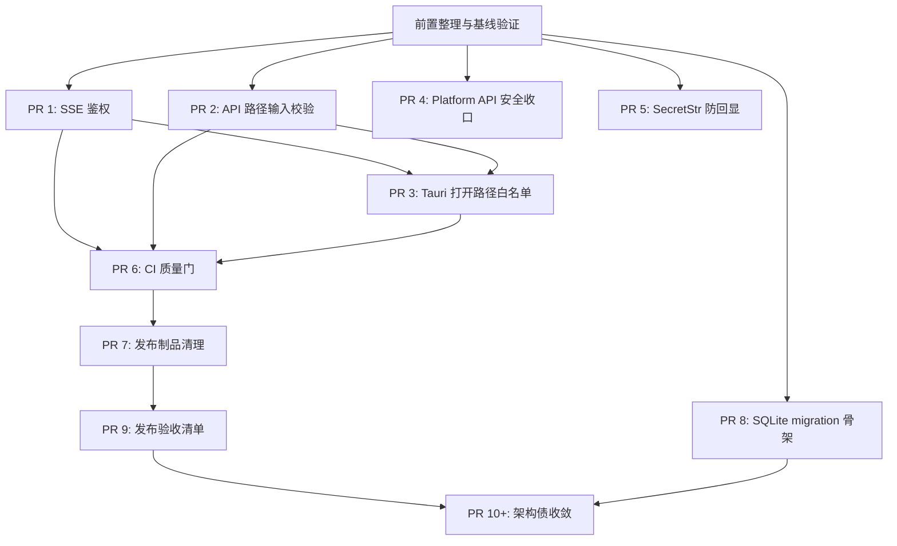

# MINOS-CORE 安全加固与发布整改蓝图

**日期**: 2026-06-17
**范围**: MINOS-CORE 当前桌面端、FastAPI sidecar、核心三表生成链路、CI、发布制品与 SQLite 本地数据层
**性质**: 审计证据版整改计划，不包含代码改动
**目标状态**: 达到可安全内测 / 小范围交付状态，再进入架构债收敛

---

## 1. 背景与目标

当前 MINOS-CORE 已经形成完整主链路：

```text
图纸 PDF/图片
  -> OCR / 多模态图纸识别
  -> PFD
  -> PFMEA
  -> CP
  -> 质量门
  -> Excel 导出
```

当前主要问题不是主链路缺失，而是发布前的工程边界还不够硬：

- 本地 SSE 进度流没有鉴权。
- 桌面 API 对图纸路径、输出目录、导出目录等边界校验不够统一。
- Tauri Rust 命令可直接打开前端传入路径。
- CI 目前偏 Python，缺少前端和 Rust 发布前质量门。
- release 安装包和诊断 PDF 已被 Git 追踪，发布制品管理需要收口。
- 桌面 SQLite 仍以 `CREATE TABLE IF NOT EXISTS` 为主，缺少显式 schema version / migration 框架。
- `DesktopRunService` 等模块过大，但这属于发布后架构债，不应和安全止血混在一轮。

本蓝图按“先安全、再质量门、再发布面、再迁移骨架、最后架构债”的顺序推进。

### 1.1 判断口径

本文件区分两类内容：

- **已核实现状**：来自源码、Git 状态或本地低成本实跑，可以作为整改输入。
- **推荐改法**：当前建议的实现路径，允许在 PR 内根据代码约束微调，但不能绕开对应成功标准。

### 1.2 已核实现状与证据

| 主题 | 核查结论 | 证据 |
| --- | --- | --- |
| 主链路 | 已存在，不是本轮主要缺口。 | `minos_core/pipeline/orchestration.py:148` 的 `generate_three_tables_from_drawing()` 串起图纸分析、PFD、PFMEA、CP、质量门和导出。 |
| SSE | 无鉴权属实。 | `minos_desktop/api/app.py:58` 给普通 router 挂 Bearer 依赖；`app.py:76` 单独 include SSE router 并标注 no auth；无 token 访问 SSE 本地实跑返回 200。 |
| API 路径校验 | 能力存在，但桌面 API 未统一调用。 | `minos_core/validation.py:300` 有 `InputValidator`；`routes_projects.py:20`、`routes_settings.py:26`、`routes_exports.py:17` 未做统一路径校验；不存在图纸路径本地实跑仍可创建项目。 |
| Tauri 打开路径 | 可直接打开前端传入路径。 | `apps/desktop-tauri/src-tauri/src/lib.rs:90` 起的 `open_output_dir` / `open_path` / `reveal_file` 未做 canonicalize 或 allowlist。 |
| Platform API | token 可选，交付环境风险属实。 | `minos_platform/app.py:35` 无 token 只 warning；`app.py:56` 的 CORS 包含 `localhost:*`。 |
| SecretStr | Pydantic 序列化会回显明文。 | `minos_desktop/security/secret_str.py:75` 的 serializer 返回 `get_secret_value()`；本地实跑 `model_dump()` / `model_dump_json()` 输出明文。 |
| CI | 当前偏 Python。 | `.github/workflows/ci.yml:10` 只有 Python offline tests 和 real API acceptance，未覆盖前端 build、Rust check、发布制品检查。 |
| 发布制品 | release 制品已被 Git 追踪。 | `git ls-files release` 显示 3 个约 94MB 安装包和 `release/diagnostic-run6-replay/input.pdf`；`scripts/build_release.ps1:42` 仍复制安装包到 `release/`。 |
| 桌面 SQLite | 缺显式 migration 版本。 | `minos_desktop/services/sqlite_store.py:40` 直接 `CREATE TABLE IF NOT EXISTS`；未发现 `CURRENT_SCHEMA_VERSION` 或桌面 `schema_version` 表。 |
| Platform SQLite | 已有独立 schema marker。 | `minos_platform/db.py:93` 已有 `ppap_schema_version`，所以 PR 8 只针对桌面 SQLite。 |
| 架构债 | 发布后处理的判断属实。 | `minos_desktop/services/run_service.py` 当前约 2083 行；`docs/plugins.md:5` 明确插件主流水线尚未自动消费；`minos_core/ai_resilience` 存在但主 adapter 未接入。 |

---

## 2. 总体成功标准

完成本蓝图前 9 个 PR 后，应满足：

- 未授权本机进程不能订阅链式生成 SSE。
- 图纸输入必须是存在的 PDF/PNG/JPG/JPEG，且通过扩展名与 magic number 校验。
- 用户指定输出目录、导出目录、默认输出目录必须通过安全目录校验。
- Tauri `open_path` / `reveal_file` / `open_output_dir` 只能打开白名单内路径。
- CI 同时覆盖 Python、前端 build、Rust check、依赖一致性检查。
- Git 仓库不再追踪安装包、诊断 PDF、敏感输入样本等发布制品。
- 桌面 SQLite 本地库有显式 schema version 和幂等迁移骨架。
- 发布前有一份可执行验收清单。

完成后再处理架构债：`DesktopRunService` 拆分、AI resilience 接入、插件主链路消费。

---

## 3. 前置整理

### 3.1 当前工作区风险

当前分支已有未跟踪计划文件：

```text
?? docs/superpowers/specs/2026-06-11-code-audit-remediation-plan.md
?? docs/superpowers/specs/2026-06-17-minos-core-hardening-blueprint.md
```

因此正式动手前，先确认当前分支状态，避免把新整改混进旧大 diff：

```powershell
git status --short --branch
git diff --stat origin/main...HEAD
```

如果 `git diff --stat origin/main...HEAD` 因大型 release 制品内存失败，改用更窄的核查命令：

```powershell
git status --short --branch
git ls-files release
git diff --name-status origin/main...HEAD -- . ":(exclude)release"
```

### 3.2 基线验证

整改前先跑一轮基线，记录当前失败点。推荐命令：

```powershell
python -m pytest tests -q -m "not real_api"
python -m unittest discover -s tests -v
python scripts/check_repo_hygiene.py
cd apps\desktop-tauri
npm run build
cd src-tauri
cargo check --locked
```

如果基线失败，先记录失败，不要在本整改计划里顺手改无关问题。

---

## 4. 依赖顺序图



---

## 5. PR 1 — SSE 鉴权

### 目标

修掉链式生成进度 SSE 无鉴权问题。当前 SSE router 被排除在 protected dependencies 之外，本机任意进程理论上可订阅 run 进度。

### 现状证据

- `minos_desktop/api/app.py:58` 只给普通 API router 挂 `Depends(require_api_token)`。
- `minos_desktop/api/app.py:76` 明确写着 `SSE router — no auth required`，并直接 `include_router(sse_router)`。
- `apps/desktop-tauri/src/api/sse-client.ts:75` 直接拼接 `/api/runs/{runId}/chain/{stage}/stream`，没有 token。
- 本地 ASGI 实跑：无 Authorization 访问 SSE 返回 200。

### 关键文件

- `minos_desktop/api/app.py`
- `minos_desktop/api/auth.py`
- `minos_desktop/api/routes_sse.py`
- `minos_desktop/api/sse.py`
- `apps/desktop-tauri/src/api/sse-client.ts`
- `apps/desktop-tauri/src/api/client.ts`
- `apps/desktop-tauri/src/api/types.ts`
- `apps/desktop-tauri/src-tauri/src/lib.rs`

### 推荐设计

不要把长期 Bearer token 直接放进 SSE URL。因为浏览器 `EventSource` 不能稳定带自定义 Authorization header，所以使用短期 `stream_token`。

推荐实现：

1. Rust sidecar 启动时仍生成主 API token。
2. 后端基于主 token 派生短期 stream token。
3. 前端 bootstrap 获得 `streamToken`。
4. `subscribeToChainStream()` 拼接：

```text
/api/runs/{runId}/chain/{stage}/stream?stream_token=...
```

5. 后端 SSE 入口校验 token，失败返回 401。
6. `app.py` 中不能再写 “SSE no auth required”，改为说明 “SSE uses query stream token”。

### 测试要求

新增：`tests/desktop/api/test_sse_auth.py`

覆盖：

- 无 token 订阅返回 401。
- 错 token 返回 401。
- 正确 token 可订阅。
- 过期 token 被拒绝。
- 前端静态测试确认 SSE URL 不再裸连。

### 验证命令

```powershell
python -m pytest tests/desktop/api/test_sse_auth.py tests/desktop/test_sse_chain_resilience.py -q
cd apps\desktop-tauri
npm run build
```

### 回滚方式

只回滚 SSE token 相关改动，不影响普通 REST API Bearer 鉴权。

---

## 6. PR 2 — API 路径输入统一校验

### 目标

把图纸路径、组件图纸路径、输出目录、导出目录、默认输出目录全部纳入统一边界校验。

### 现状证据

- `minos_core/validation.py:300` 已有 `InputValidator`，支持扩展名、magic number、大小和路径穿越校验。
- `minos_desktop/api/routes_projects.py:20` 创建项目时直接保存 `drawing_path`、`component_drawings`、`output_dir`。
- `minos_desktop/api/routes_settings.py:26` 默认输出目录直接写入 store。
- `minos_desktop/api/routes_exports.py:17` 导出目录直接来自 payload 或默认拼接。
- 本地 ASGI 实跑：不存在的 `.pdf` / `.png` 路径仍可创建项目，返回 201。

### 关键文件

- `minos_core/validation.py`
- `minos_desktop/api/schemas.py`
- `minos_desktop/api/routes_projects.py`
- `minos_desktop/api/routes_settings.py`
- `minos_desktop/api/routes_exports.py`
- `minos_desktop/services/project_store.py`

### 校验规则

#### drawing_path / component_drawings

必须满足：

- 路径存在。
- 是文件。
- 扩展名只允许：`.pdf`、`.png`、`.jpg`、`.jpeg`。
- PDF/PNG/JPG/JPEG 必须通过 magic number 校验。
- 文件大小不得超过既定上限，默认可沿用 `InputValidator.DEFAULT_MAX_FILE_SIZE`。

#### output_dir / export output_dir / default_output_dir

必须满足：

- 可以为空；为空时走默认目录。
- 非空必须可解析为绝对路径。
- 不允许 null byte。
- 不允许指向系统根目录、用户 home 根目录、仓库根目录等高风险目录。
- 不允许是文件。
- 可创建目录时必须确保父目录安全存在。

### 推荐实现

在 `minos_core/validation.py` 增加专用 helper：

```text
validate_drawing_input_file(path)
validate_output_directory(path)
validate_user_selected_directory(path)
```

API 层只调用 helper，不在 route 里散落校验逻辑。

### 测试要求

新增：`tests/desktop/api/test_path_validation.py`

覆盖：

- 非法扩展被拒。
- 扩展名伪装被拒。
- null byte 被拒。
- 不存在文件被拒。
- 输出目录是文件时被拒。
- 多组件图纸中任意一个非法时整体被拒。
- 合法 PDF/PNG/JPG 通过。

### 验证命令

```powershell
python -m pytest tests/desktop/api/test_path_validation.py tests/test_desktop_api_sidecar.py -q
```

### 回滚方式

回滚 API 校验 helper 和 route 调用点即可；数据库 schema 不变。

---

## 7. PR 3 — Tauri 打开路径白名单

### 目标

收紧 Rust 侧路径打开能力，避免前端传任意路径给：

- `open_output_dir`
- `open_path`
- `reveal_file`

### 现状证据

- `apps/desktop-tauri/src-tauri/src/lib.rs:90` 的 `open_output_dir` 直接 `app.opener().open_path(path, ...)`。
- `apps/desktop-tauri/src-tauri/src/lib.rs:98` 的 `open_path` 同样直接打开传入路径。
- `apps/desktop-tauri/src-tauri/src/lib.rs:105` 的 `reveal_file` 直接 `reveal_item_in_dir(path)`。
- 当前未发现 Rust 侧 canonicalize、allowlist 或用户选择路径记录。

### 关键文件

- `apps/desktop-tauri/src-tauri/src/lib.rs`
- `tests/test_desktop_tauri_app_state.py`

### 推荐设计

Rust 侧维护 allowlist：

- app local data dir。
- app output dir。
- 用户通过 `select_drawing_file` 选过的图纸。
- 用户通过 `select_component_drawings` 选过的图纸。
- 用户通过 `select_output_dir` 选过的目录。

所有打开路径前：

1. `canonicalize`。
2. Windows 路径规范化。
3. 判断是否在 allowlist 或允许根目录下。
4. 不在白名单则返回错误。

### 测试要求

- 静态测试确认三个命令都调用白名单校验函数。
- 如果可行，补 Rust 单测覆盖 allow / deny。

### 验证命令

```powershell
cd apps\desktop-tauri\src-tauri
cargo check --locked
cd ..\..\..
python -m pytest tests/test_desktop_tauri_app_state.py -q
```

### 回滚方式

只回滚 Rust command 白名单逻辑，不影响后端 API。

---

## 8. PR 4 — Platform API 安全收口

### 目标

让 `minos_platform` 不再以“未设置 token 也可开放访问”的方式进入交付环境。

### 现状证据

- `minos_platform/app.py:35` 读取 `MINOS_PLATFORM_API_TOKEN`。
- `minos_platform/app.py:36` 在 token 缺失时只记录 warning，不阻止启动和请求。
- `minos_platform/app.py:56` 的 CORS 允许 `http://127.0.0.1:*` 和 `http://localhost:*`。
- `tests/platform` 当前覆盖业务路由较多，但未发现 auth required / CORS 收口专项测试。

### 关键文件

- `minos_platform/app.py`
- `minos_platform/config.py`
- `tests/platform/*`

### 推荐设计

新增环境变量：

```text
MINOS_PLATFORM_AUTH_REQUIRED=1
```

行为：

- 开发默认仍可本机无 token 运行，但必须只适用于非交付环境。
- `MINOS_PLATFORM_AUTH_REQUIRED=1` 时，如果没有 `MINOS_PLATFORM_API_TOKEN`，启动失败或所有请求 401。
- 内测 / 交付启动脚本必须显式设置 `MINOS_PLATFORM_AUTH_REQUIRED=1`。
- CORS 从宽泛 `localhost:*` 收敛为显式列表或 `allow_origin_regex`。

### 测试要求

- auth required 且 token 缺失时拒绝。
- token 正确时通过。
- token 错误时拒绝。
- CORS 只允许预期来源。
- CI 至少覆盖一组 `MINOS_PLATFORM_AUTH_REQUIRED=1` 的启动或请求测试。

### 验证命令

```powershell
python -m pytest tests/platform -q
```

---

## 9. PR 5 — SecretStr 防回显

### 目标

避免未来有人误把 `SecretStr` 放进响应模型时，Pydantic serializer 输出明文。

### 现状证据

- `minos_desktop/security/secret_str.py:41` / `:45` 的 `repr()` 和 `str()` 已脱敏。
- `minos_desktop/security/secret_str.py:75` 的 Pydantic serializer 当前返回 `instance.get_secret_value()`。
- 本地实跑：`BaseModel(api_key=SecretStr("plain-secret")).model_dump()` 输出 `{"api_key": "plain-secret"}`。
- `tests/desktop/security/test_secret_str.py` 覆盖了 `str()` / `repr()`，但未覆盖 `model_dump()` / `model_dump_json()`。

### 关键文件

- `minos_desktop/security/secret_str.py`
- `tests/desktop/security/test_secret_str.py`
- `tests/test_desktop_api_sidecar.py`

### 推荐设计

- `str()` / `repr()` 保持脱敏。
- Pydantic serializer 默认输出 `**********`。
- 明文只能通过 `get_secret_value()` 获取。
- API request 仍能接收明文，不能影响设置页保存 API key。

### 测试要求

- `model_dump()` 不输出明文。
- `model_dump_json()` 不输出明文。
- `get_secret_value()` 仍能拿到明文。
- settings API 不回显 API key。

### 验证命令

```powershell
python -m pytest tests/desktop/security/test_secret_str.py tests/test_desktop_api_sidecar.py -q
```

---

## 10. PR 6 — CI 质量门补齐

### 目标

CI 不只跑 Python，也覆盖桌面前端和 Rust。

### 现状证据

- `.github/workflows/ci.yml:11` 当前 `offline-tests` 只安装 Python 依赖并跑 pytest / unittest。
- `.github/workflows/ci.yml:35` 的 real acceptance 也只覆盖 Python。
- 当前 CI 未运行 `npm ci`、`npm run build`、`cargo check --locked`、发布制品 / 敏感文件检查。

### 关键文件

- `.github/workflows/ci.yml`

### 推荐新增 job

#### Python dependency check

在 Python install 后加入：

```powershell
python -m pip check
```

#### Desktop frontend

```yaml
- name: Install frontend dependencies
  working-directory: apps/desktop-tauri
  run: npm ci

- name: Build frontend
  working-directory: apps/desktop-tauri
  run: npm run build
```

#### Desktop Rust

```yaml
- name: Cargo check
  working-directory: apps/desktop-tauri/src-tauri
  run: cargo check --locked
```

#### 大文件 / 发布制品防回归

增加统一脚本，并在本地和 CI 复用：

```text
scripts/check_repo_hygiene.py
```

脚本检查：

- 禁止 `release/*.exe`。
- 禁止未授权 PDF 样本进入 `release/`。
- 禁止 `.env`、`auth.json`、`credentials.json` 等敏感文件。
- 禁止超过约定阈值的大型二进制被 Git 追踪。

CI 调用：

```yaml
- name: Repository hygiene
  run: python scripts/check_repo_hygiene.py
```

### 验证命令

```powershell
python -m pip check
python scripts/check_repo_hygiene.py
cd apps\desktop-tauri
npm ci
npm run build
cd src-tauri
cargo check --locked
```

---

## 11. PR 7 — 发布制品清理

### 目标

让 Git 仓库只保存源码、测试、文档和小型 fixture，不保存安装包和诊断输入。

### 现状证据

- `git ls-files release` 当前列出：
  - `release/MINOS-CORE_3.5.0_x64-setup.exe`
  - `release/MINOS-CORE_3.6.0_x64-setup.exe`
  - `release/MINOS-CORE_3.8.5_x64-setup.exe`
  - `release/diagnostic-run6-replay/input.pdf`
- `.gitignore` 当前没有 `release/` 忽略规则。
- `scripts/build_release.ps1:42` 会把安装包复制到 `release/`，导致后续容易误提交。

### 关键文件

- `.gitignore`
- `scripts/build_release.ps1`
- `docs/superpowers/plans/2026-06-08-lean-special-characteristic-locator.md`
- `release/*`

### 推荐改动

- `.gitignore` 增加：

```text
release/
!release/.gitkeep
```

- 从 Git 移除：

```text
release/MINOS-CORE_*.exe
release/diagnostic-run6-replay/input.pdf
```

- `scripts/build_release.ps1` 不再复制到 `release/`，统一输出到 `dist/build/out` 或其他明确制品目录。
- 文档中如果引用诊断 PDF，改成合成 fixture 或说明“本地自行提供脱敏样本”。
- 新增或复用 `scripts/check_repo_hygiene.py`，确保清理后不会回归。

### 验证命令

```powershell
git status --short
git diff --stat
```

确认 diff 中没有 `.exe`、未授权 PDF、真实客户资料。

---

## 12. PR 8 — SQLite migration 骨架

### 目标

让本地 SQLite 具备显式 schema version 和幂等迁移框架，避免后续桌面升级靠隐式 `CREATE TABLE IF NOT EXISTS` 碰运气。

本 PR 只针对 `minos_desktop` 本地 SQLite。`minos_platform` 已有 `ppap_schema_version`，不在本 PR 重复处理。

### 现状证据

- `minos_desktop/services/sqlite_store.py:40` 的 `_migrate()` 直接执行多段 `CREATE TABLE IF NOT EXISTS`。
- 当前未发现桌面侧 `CURRENT_SCHEMA_VERSION` 或 `schema_version` 表。
- `minos_platform/db.py:93` 已有 `ppap_schema_version`，说明该问题不是全仓库 SQLite 的统一缺口。

### 关键文件

- `minos_desktop/services/sqlite_store.py`
- `tests/desktop/services/test_sqlite_store_migration.py`

### 推荐设计

新增表：

```sql
CREATE TABLE IF NOT EXISTS schema_version (
    id INTEGER PRIMARY KEY CHECK (id = 1),
    version INTEGER NOT NULL,
    updated_at TEXT NOT NULL
);
```

迁移流程：

```text
_migrate()
  -> create schema_version table if needed
  -> read current version
  -> if version < 1: _migrate_to_v1()
  -> write version = CURRENT_SCHEMA_VERSION
```

当前版本先设为：

```text
CURRENT_SCHEMA_VERSION = 1
```

### 测试要求

- 空库初始化后 version = 1。
- 旧库没有 `schema_version` 时可补齐。
- 重复初始化幂等。
- 原有 project/run/settings/knowledge_rules 表仍存在。

### 验证命令

```powershell
python -m pytest tests/desktop/services/test_sqlite_store_migration.py tests/desktop/services -q
```

---

## 13. PR 9 — 发布验收清单

### 目标

新增一份真正能执行的发布前 checklist。

### 现状证据

- 当前未发现 `docs/release-checklist.md`。
- 仓库已有零散 release / NSIS 计划和测试，但没有一份汇总到 Python、前端、Rust、sidecar smoke、安装卸载、Excel 打开验证和签名状态的发布前清单。

### 建议文件

```text
docs/release-checklist.md
```

### 必须包含

- Python 非真实 API 全量测试。
- unittest 全量测试。
- 前端 build。
- Rust check。
- sidecar smoke。
- 合成图纸生成。
- `accept-three-tables` 检查。
- NSIS 安装包生成。
- 人工安装 / 卸载。
- 真实 Excel 打开四个 xlsx。
- 签名状态说明：如果仍使用 `--no-sign`，明确标记为“内测包，不作为正式可信发布”。

### 推荐验收命令

```powershell
python -m pytest tests -q -m "not real_api"
python -m unittest discover -s tests -v
cd apps\desktop-tauri
npm run build
cd src-tauri
cargo check --locked
cd ..\..\..
python -m minos_core.cli write-demo-drawing --output out\desktop_acceptance\safe_demo_drawing.png
python -m minos_core.cli generate-three-tables --input out\desktop_acceptance\safe_demo_drawing.png --output-dir out\desktop_acceptance\cli_smoke
python -m minos_core.cli accept-three-tables --result out\desktop_acceptance\cli_smoke\three_table_generation_result.json
```

---

## 14. PR 10+ — 发布后架构债收敛

这些不应该和前 9 个安全/发布整改混在一起。

### 14.1 拆分 DesktopRunService

当前 `minos_desktop/services/run_service.py` 过大，建议拆为：

```text
minos_desktop/services/run_persistence.py
minos_desktop/services/chain_run_service.py
minos_desktop/services/run_export_service.py
minos_desktop/services/undo_redo_manager.py
```

`DesktopRunService` 保留 facade，避免一次性改动所有 API route。

### 14.2 AI resilience 接入

分两步：

1. 先修 `minos_core/ai_resilience/*` 内部测试和边界问题。
2. 再接入 `OpenAIResponsesMultimodalDrawingAnalyzer` / text LLM adapter。

验证：

```powershell
python -m pytest tests/test_openai_multimodal_adapter.py tests/ai_resilience/test_ai_resilience.py -q
```

### 14.3 插件主链路消费

当前插件机制已存在，但文档写明主流水线尚未自动消费插件。

推荐：

- OCR engine 先查内置，再查 plugin registry。
- knowledge source 仅在显式配置启用时消费插件。
- `doctor` 显示插件发现数量。

验证：

```powershell
python -m pytest tests/test_plugins_registry.py tests/test_plugins_entrypoints.py tests/test_pipeline_ocr_first.py -q
```

---

## 15. PR 拆分总表

| PR | 主题 | 风险 | 是否可独立回滚 | 主要验证 |
| --- | --- | --- | --- | --- |
| 1 | SSE 鉴权 | 中 | 是 | SSE auth + frontend build |
| 2 | API 路径校验 | 中 | 是 | path validation + sidecar tests |
| 3 | Tauri 路径白名单 | 中 | 是 | cargo check + static tests |
| 4 | Platform API 安全收口 | 低 | 是 | tests/platform |
| 5 | SecretStr 防回显 | 低 | 是 | secret/security tests |
| 6 | CI 质量门 | 低 | 是 | GitHub Actions + repo hygiene |
| 7 | 发布制品清理 | 低 | 是 | git status + repo hygiene |
| 8 | 桌面 SQLite migration 骨架 | 中 | 是 | desktop services tests |
| 9 | 发布验收清单 | 低 | 是 | 文档检查 |
| 10+ | 架构债 | 中高 | 分拆回滚 | 聚焦测试 + 全量测试 |

---

## 16. 每个 PR 的通用交付规则

每个 PR 必须满足：

- 改动范围只覆盖当前 PR 主题。
- 不顺手重构邻近代码。
- 安全修复必须有回归测试。
- 每个 PR 的“现状证据”如果发现已过期，先更新证据再改代码。
- 推荐改法可以微调，但不能降低对应成功标准。
- 文档只更新与当前改动直接相关的内容。
- 不能提交真实密钥、真实客户图纸、安装包、大型二进制制品。
- 完成后至少运行对应聚焦测试。
- 发布相关 PR 需要运行前端 build / Rust check。
- PR 6 之后的发布相关 PR 必须运行 `python scripts/check_repo_hygiene.py`。

---

## 17. 最终整体验收

前 9 个 PR 合并后，运行：

```powershell
python -m pytest tests -q -m "not real_api"
python -m unittest discover -s tests -v
python scripts/check_repo_hygiene.py
cd apps\desktop-tauri
npm run build
cd src-tauri
cargo check --locked
cd ..\..\..
python -m minos_core.cli write-demo-drawing --output out\desktop_acceptance\safe_demo_drawing.png
python -m minos_core.cli generate-three-tables --input out\desktop_acceptance\safe_demo_drawing.png --output-dir out\desktop_acceptance\cli_smoke
python -m minos_core.cli accept-three-tables --result out\desktop_acceptance\cli_smoke\three_table_generation_result.json
```

如果要做正式对外交付，还必须补：

- 安装包代码签名。
- 人工安装 / 卸载验证。
- 真实 Excel 打开验证。
- 使用脱敏或合成图纸做端到端试跑。
- 确认 Git diff 不含 release 二进制和敏感样本。

---

## 18. 不在本轮做的事

以下内容先不做，避免扩大范围：

- 不做完整 PPAP 18 项平台扩展。
- 不接客户门户、审批流、签核流。
- 不做多租户权限系统。
- 不把安全止血和 `DesktopRunService` 大拆分混在同一 PR。
- 不在没有测试保护的情况下重写 AI prompt。
- 不把真实客户图纸放进仓库。
