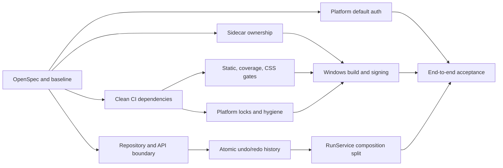

# Design: v3.8.7 Production Readiness Remediation

## Invariants

1. **Sidecar ownership**：Rust 只保存自己 spawn 的 child、PID 和端口；禁止按可执行文件名调用 `taskkill`/`pkill`。
2. **Lifecycle serialization**：检查现有 child、readiness、spawn、登记和清理由同一个状态锁串行化；旧 termination event 只能清理同 PID 的 slot。
3. **Readiness truth**：managed bootstrap 只有在带 bearer token 的 HTTP health status/body 校验通过后才成功；失败返回错误，不回退到死端口。
4. **Auth fail-closed**：Platform 未设置 `MINOS_PLATFORM_AUTH_REQUIRED` 时视为 required；只有显式 `0/false/no/off` 才允许开发模式。
5. **Dependency source**：`pyproject.toml` 是抽象依赖唯一来源；requirements lock 是按平台生成、可漂移检查的产物，不是第二套手写声明。
6. **Quality gates**：Ruff、mypy、pytest、coverage、frontend build、Cargo check 的失败不能通过 `continue-on-error` 隐藏。
7. **Release separation**：unsigned 只用于内部 artifact；tag 正式发布先构建、签名、安装验证，再创建或发布 GitHub Release。
8. **Repository boundary**：HTTP route 通过 request-scoped dependency 获取 service；后台任务自带 service/repository，不共享跨请求可变对象。
9. **History atomicity**：用户编辑的快照、undo/redo 方向迁移、run 更新、裁剪在同一 SQLite transaction；连接启用 `PRAGMA foreign_keys=ON`。
10. **Rollback**：schema v2 migration 前生成可恢复 schema1 备份；旧二进制回滚使用备份，不假设普通代码 revert 能降级数据库。

## Dependency Locks And Cleanup

- `pyproject.toml` 是唯一抽象依赖源；`requirements/locks/*-py311.txt` 只是可重新生成的部署解析结果。
- 使用 `uv pip compile --python-platform linux/windows --python-version 3.11` 显式解析目标平台，避免在 Windows 主机上把 Windows marker 结果冒充 Linux lock。
- CI 在 Linux 与 Windows runner 分别重生成目标 lock 并以 Git diff 阻断漂移；安装过程先读 lock，再以 `pip install -e . --no-deps` 安装本项目。
- 清理脚本只处理固定规范路径的构建目录，默认预演并拒绝 symlink/reparse point；不执行 Git GC 或历史重写。

## Workstream Order

## Data And Failure Boundaries

- Tauri `get_bootstrap` owns the managed process boundary and returns a dynamic base URL/token only after readiness.
- FastAPI dependencies construct lightweight services per request from immutable database configuration.
- `RunRepository` owns SQLite transaction boundaries; `DesktopHistoryStore` operates on the repository's current connection.
- Core pipeline remains UI-agnostic and is not moved into Desktop API modules.
- CI uses separate quality, test, frontend/Rust and Windows release jobs; a published release is never the first point at which a package is built.
