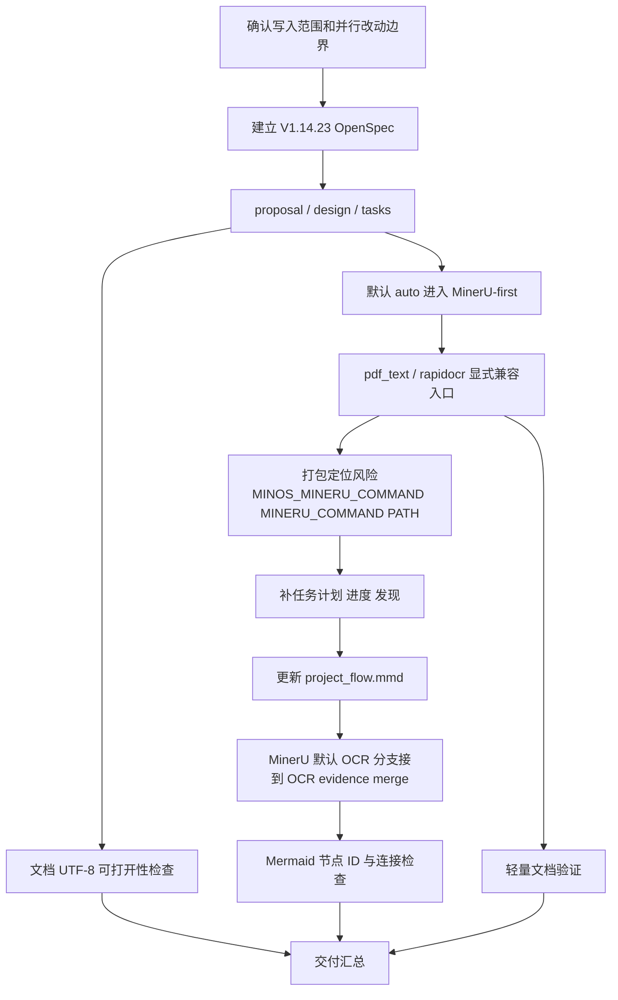
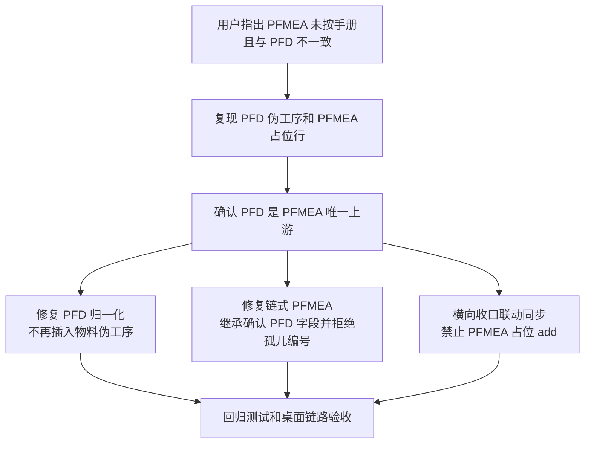
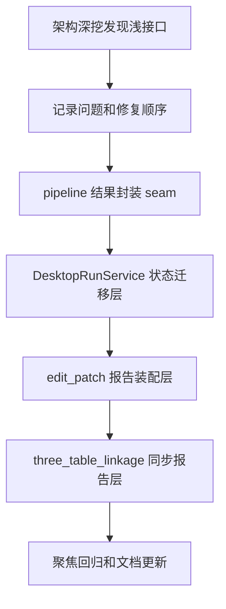
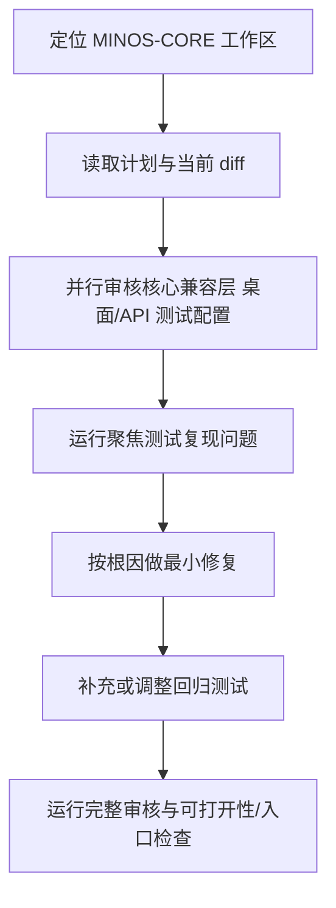
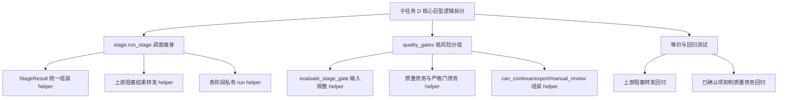
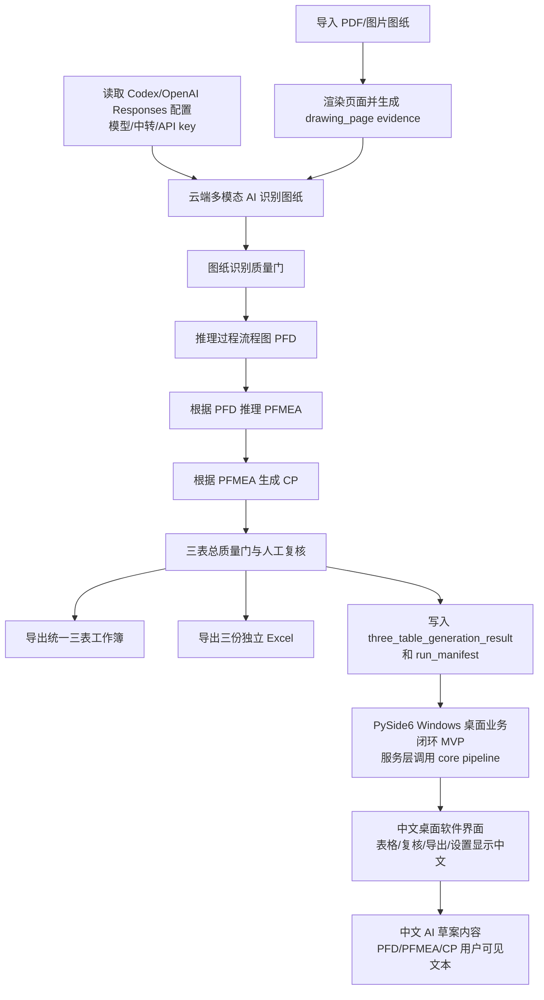
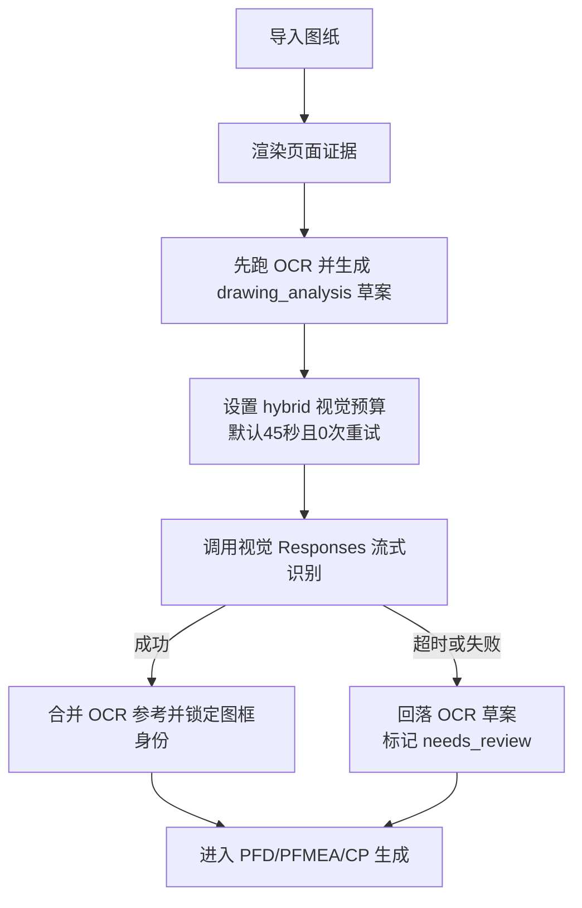

# MINOS-CORE 重建任务计划

## V1.14.23 MinerU 默认 OCR 引擎：OpenSpec、流程文档和发布风险同步

### 目标
本轮把 V1.14.23 文档收口为“MinerU 替代默认 OCR 解析层”。默认 `auto` 进入 MinerU-first；旧 PyMuPDF/文字层 `pdf_text` 和 RapidOCR `rapidocr` 作为显式兼容入口保留，不再是默认。MinerU 只替代 OCR 解析层，不替代 MINOS domain extraction、证据追溯、drawing_analysis、零件族、PFD、PFMEA、CP、质量门、人工复核和导出门。

/// 1. 意图：确认写入边界并保护并行 worker 改动；输入：`git status --short` 和用户指定文件清单；输出：只改 OpenSpec、流程文档、进度/发现记录和 Mermaid；验证：最终 diff 不包含运行代码或非负责文件。
/// 2. 意图：更新 `proposal.md` 的产品结论；输入：旧 OCR 引擎文案和用户新要求；输出：MinerU-first 默认、legacy 显式兼容、MINOS 业务边界；验证：proposal 明确 `auto` 默认进入 MinerU-first。
/// 3. 意图：更新 `design.md` 的流程和运行时边界；输入：OCR engine 选择、evidence merge、发布封装风险；输出：默认 MinerU、`pdf_text`/`rapidocr` explicit legacy、MinerU 命令定位顺序；验证：design 写明不能依赖 Codex 私有路径。
/// 4. 意图：更新 `tasks.md` 的执行步骤；输入：本轮文档动作；输出：每步包含意图、输入、输出和验证点的 `///` 记录；验证：tasks 中没有旧结论。
/// 5. 意图：更新根计划、进度和发现；输入：`task_plan.md`、`progress.md`、`findings.md` 当前 V1.14.23 小节；输出：MinerU 替代默认 OCR、旧引擎显式兼容、封装风险；验证：V1.14.23 小节不再写 optional-only。
/// 6. 意图：更新 `project_flow.mmd`；输入：现有 OCR-first 分支 PL170-PL186；输出：MinerU 位于默认 OCR 分支，PyMuPDF/RapidOCR 位于 compatibility fallback / explicit legacy branch；验证：MinerU 和 legacy 分支都连接到 `PL174` OCR evidence merge。
/// 7. 意图：检查文档 UTF-8；输入：本轮负责 Markdown/Mermaid 文件；输出：UTF-8 读取结果；验证：PowerShell 读取不报错。
/// 8. 意图：检查 Mermaid 节点 ID；输入：`project_flow.mmd`；输出：节点 ID 去重结果；验证：无重复节点 ID。
/// 9. 意图：检查 diff 空白和冲突标记；输入：本轮负责文件；输出：`git diff --check -- <files>` 结果；验证：命令通过。

### OpenSpec 四步闭环

1. Define：定义 MinerU 替代默认 OCR 解析层，但不替代 MINOS 业务链路。
2. Specify：`auto` 默认 MinerU-first；`pdf_text` / `rapidocr` 是显式兼容入口；MinerU 输出只作为 OCR evidence。
3. Implement：本轮只同步 OpenSpec、任务计划、进度、发现和流程图，不改运行代码或打包脚本。
4. Verify：用 UTF-8 读取、Mermaid 节点 ID 去重、关键边检查和负责文件 `git diff --check` 作为本轮可验证证据。

## 当前任务：PFMEA 必须按确认后的 PFD 推理生成

目标是修复 PFMEA 与 PFD 不一致的问题：PFD 不能把零件/物料名伪造成工序；PFMEA 的工序编号、工序名称、功能字段必须从已确认 PFD 继承；任何联动同步入口都不能用“待工程人员填写失效模式”占位行冒充正式 PFMEA。

/// 1. 用回归测试锁定 `default_input_material` 不得生成 PFD 伪工序，只能作为首道真实工序输入。
/// 2. 用回归测试锁定链式 PFMEA 必须继承确认 PFD 的 `operation`、`process_step`、`structure_process_step`、`function_process_step`。
/// 3. 用回归测试锁定 PFMEA 引用不存在的 PFD `process_step_id` 时必须失败暴露。
/// 4. 用桌面 API 回归测试锁定联动同步不得生成 `PFMEA-SYNC-*` 或 PFMEA 占位行。
/// 5. 横向排查 `live_linkage` 与 `three_table_linkage`，禁止 PFD 缺 PFMEA 时自动创建占位 PFMEA。
/// 6. 运行三表生成、联动同步、桌面表格和 shell 回归，再做前端构建与可启动检查。
/// 7. 修复历史 run 读取：如果 `current_result.pfmea.rows` 只剩 `PFMEA-SYNC-*` / “待工程人员填写失效模式”占位，桌面 API 必须隐藏这些行，并把 PFMEA 阶段还原为失败。
/// 8. 修复 Tauri 三表工作台：阶段状态优先读取 API 顶层 `chain_stages`，PFMEA 表按 AIAG-VDA 核心字段显示，不再使用“过程/特性/风险”泛化列冒充 PFMEA。

### OpenSpec 四步闭环

1. Define：本轮只修复 PFD/PFMEA/CP 链路可信度，不引入新的生成模式。
2. Specify：PFMEA 行必须来自确认后的 PFD；缺 PFMEA 是待重新推理的问题，不是可机械补占位行的问题。
3. Implement：最小修改 PFD 归一化、链式 PFMEA 后处理、桌面联动同步与 live linkage 同步建议。
4. Verify：回归测试覆盖 PFD 伪工序、PFMEA 孤儿编号、PFMEA 字段继承、PFMEA 占位同步入口和桌面链式流程。

## 当前任务：架构深挖问题修复

目标是按架构深挖结果低风险修复三个浅接口问题：先抽出图纸到三表结果封装 seam，再抽出桌面链式状态迁移层，然后把 edit patch 与三表联动里的报告装配和核心规则分开。当前只做行为等价的组织拆分，不新增产品功能。

/// 1. 记录 `generate_three_tables_from_drawing` 同时承担链路推进、结果封装、manifest、人工复核摘要和导出视图的架构问题。
/// 2. 通过测试锁定三表结果 envelope 字段不漂移，再把 `_three_table_generation_envelope` 与人工复核/manifest helper 抽到专门模块。
/// 3. 记录 `DesktopRunService` 同时承担运行生命周期、SQLite 持久化、链式状态迁移和 edit patch 失效传播的架构问题。
/// 4. 通过测试锁定 PFD/PFMEA 编辑后的下游失效规则，再把链式状态迁移 helper 抽到专门模块。
/// 5. 记录 `edit_patch` 同时承担补丁内核、导出门、review dashboard、workbook 导出和刷新视图的架构问题。
/// 6. 通过测试锁定 edit patch 刷新后的 review dashboard、manual_review、linkage_map 行为，再把报告装配 helper 抽出。
/// 7. 记录 `three_table_linkage` 同时承担 linkage map 规则和 sync UI report 的架构问题。
/// 8. 通过测试锁定 sync_snapshot / sync_issues / sync_suggestions 行为，再把同步报告装配 helper 抽出。
/// 9. 运行 pipeline、desktop、edit_patch、three_table_linkage 聚焦回归，确认只改变模块深度，不改变用户可见输出。

### OpenSpec 四步闭环

1. Define：本轮是架构深挖后的低风险修复，不改变三表生成业务语义。
2. Specify：公共入口、JSON 字段、质量门、桌面链式状态和导出行为必须保持兼容。
3. Implement：按顺序抽出结果封装、链式状态迁移、edit patch 报告装配和 linkage sync 报告装配。
4. Verify：运行聚焦测试和 `git diff --check`，记录通过项和剩余风险。

### 当前完成状态

/// 已完成 `three_table_result.py`，三表结果 envelope 与人工复核摘要不再藏在 `pipeline.py`。
/// 已完成 `chain_state.py`，桌面链式阶段状态迁移不再藏在 `services.py`。
/// 已完成 `edit_patch_reports.py`，编辑后的 review dashboard 与 manual review payload 不再藏在补丁内核里。
/// 已完成 `three_table_linkage_reports.py`，同步快照、同步问题和同步建议不再藏在 linkage gap 核心里。
/// 已新增 `tests/test_architecture_seams.py`，用架构 seam 测试防止后续把这些逻辑又塞回大文件。

## 当前任务：MINOS-CORE 调查审核与问题修复

目标是先对当前脏工作区做核心审核，找出会让 MINOS-CORE 直接崩溃、入口失效或公开契约漂移的问题，再做最小修复并验证。

/// 1. 确认实际工作区为 `D:\MINOS-CORE`，并保护现有未提交改动，不回滚用户或其他代理的修改。
/// 2. 先审查 `minos_core/stage`、`minos_core/quality_gates` 从单文件拆为包后的公开导入兼容性。
/// 3. 同步审查 `minos_desktop`/`minos_platform` 入口是否仍引用已删除的旧 Qt/CLI/preflight 文件。
/// 4. 同步审查测试配置、README、OpenSpec/计划与当前文件结构是否不一致。
/// 5. 通过聚焦测试复现明确问题；命令失败时记录原始现象和影响判断，但按当前全局 AGENTS 口径继续推进可验证主线。
/// 6. 对明确根因做最小代码修复，不做顺手重构。
/// 7. 修复后运行相关测试和入口检查，再更新 `progress.md`、`findings.md` 与 `project_flow.mmd`。

### OpenSpec 四步闭环

1. Define：当前目标是修复审核发现的真实缺陷，不扩展新产品能力。
2. Specify：公开导入、CLI entry point、桌面 API 入口、三表质量门与测试发现路径必须与当前文件结构一致。
3. Implement：只改导致失败的最小文件，保留 `stage`/`quality_gates` 包化后的兼容导出。
4. Verify：运行聚焦测试、必要回归和入口导入检查；若出现失败，先记录真实输出和影响范围，再决定是否继续。

## MINOS v1.8.1 子任务 D：核心巨型逻辑拆分低风险实施

目标是在不改变行为的前提下，优先拆小 `stage.run_stage` 的阶段调度和结果组装；`quality_gates.py` 只做低风险 helper 分组，不做规则迁移或大爆炸重构。

/// 1. 先读取现有 `stage.py`、`quality_gates.py` 和相关测试，确认公开契约。
/// 2. 把 `run_stage` 中重复的 `StageResult` 构造、证据转换和上游 blocked 转发抽为私有 helper。
/// 3. 把每个生成阶段拆为私有 `_run_*_stage` helper，主函数只保留阶段路由。
/// 4. `quality_gates.py` 仅拆 `evaluate_stage_gate` 的外围计算：输入转换、债务收集、严格门债务、是否继续、是否允许导出、人工复核项组装。
/// 5. 补充回归测试，验证拆分后阻塞转发和 review confirmation 抑制行为不变。
/// 6. 运行聚焦测试和必要回归，确认没有行为漂移。

## 当前主目标：AI 图纸驱动三表生成工具

本阶段起，产品目标从“完整 PPAP 平台”收口为“AI 图纸驱动 PFD/PFMEA/CP 三表生成工具”。第一版只支持 PDF/PNG/JPG 图纸输入，不做完整 PPAP 18 项、不做客户门户、不做审批流、不做 DWG/DXF 原生解析。

/// 1. 先把图纸输入变成可追溯页面证据，不做假 PDF 渲染；渲染器缺失时必须直接失败。
/// 2. 多模态 AI 输出只能是结构化 JSON，非法 JSON、缺 evidence ref 或引用不存在证据时直接失败。
/// 3. 图纸识别结果必须经过质量门，高风险、低置信度、证据不足内容进入人工复核。
/// 4. PFD、PFMEA、CP 都保留 AI 推理标记、置信度、证据引用和 needs_confirmation。
/// 5. 第一版输出统一三表工作簿和三份独立 Excel，不扩展完整 PPAP 18 项。
/// 6. AI 配置优先读显式 MINOS/OPENAI 环境变量；当 Codex provider 要求 OpenAI auth 时，复用 `%USERPROFILE%\.codex\config.toml` 与 `auth.json`，并按 Codex 的 responses endpoint 调用；当前第一推荐模型固定为 `gpt-5.5`；密钥不写文件、不打印。
/// 7. 后端闭环通过 `generate_three_tables_from_drawing(...)` 和 `generate-three-tables` CLI 提供给桌面端复用。
/// 8. 桌面端第一版作为可选依赖 `.[desktop]`，业务逻辑只调用 core pipeline，不绕平台 HTTP 层。
/// 9. 桌面端和交付给用户查看的摘要、表头、AI 识别内容、PFD/PFMEA/CP 草案业务文本默认使用中文；内部 JSON 字段名保持稳定，不作为 UI 表头直接展示。

## Hybrid 图纸识别超时修复流程
目标是解决真实图纸 `JLV03000500` 在 `hybrid` 模式下长期卡在视觉识别的问题：OCR 先产生可复核草案，视觉识别只允许占用有限预算，超过预算必须回落到 OCR，而不是等外层命令超时。

/// 1. 定位 `hybrid` 的执行顺序：OCR 成功后再调用视觉识别。
/// 2. 给默认视觉 analyzer 设置 `hybrid_vision_timeout_seconds` 和 `hybrid_vision_max_retries`。
/// 3. 给 Responses SSE 流式读取增加总时限，避免连接一直挂住。
/// 4. 视觉超时按现有异常路径记录 `analysis_errors`，并回落 OCR。
/// 5. 补单元测试覆盖默认预算、上下文覆盖预算和流式读取超时。
/// 6. 用 `JLV03000500` 重新跑真实链路，检查是否能返回 OCR 草案和门铰链分类。

## 桌面中文化执行流程
/// 1. 三表编辑器保留英文内部字段名，但增加中文列名映射，Qt 表格只显示中文列名。
/// 2. 布尔值在界面显示为“是/否”，仍兼容解析 true/false/yes/no。
/// 3. 设置页、导出页、人工复核页只展示中文摘要键名，不输出明文 API key。
/// 4. 导出动作完成后的结果摘要使用中文键名和“草案/正式”模式名称。
/// 5. 用户打开的三表 Excel 表头避免 `PFMEA ID`、`CP ID` 这类英文显示，改为中文编号。
/// 6. AI prompt 明确要求模型返回中文业务内容；本地工艺库、PFMEA 风险模板和 CP 控制模板也必须输出中文。
/// 7. 对 AI 返回的中文工序名做归一化，保证“落料/冲孔/注塑/装配”等中文工序仍能识别工艺族并补齐 PFD。

## 桌面中文化 OpenSpec 四步闭环
1. Define：目标是用户可见软件语言为中文，不改变内部数据契约。
2. Specify：表格表头、文件选择器、设置摘要、复核摘要、导出摘要、Excel 表头、AI 识别和三表草案业务内容均应中文显示。
3. Implement：新增显示层映射、中文摘要构造函数、中文 AI prompt、中文工艺/风险/控制模板，保留服务层/API 原始字段名。
4. Verify：运行桌面 helper/table editor 测试和完整回归。

## 下一阶段：桌面业务闭环 MVP

本阶段目标是在不扩展完整 PPAP 平台、不接客户门户、不做 18 项 PPAP 管理的前提下，把 Windows 桌面端从“界面骨架”推进到可记录、可复核、可导出的本地业务闭环。桌面端仍服务于 AI 图纸驱动 PFD/PFMEA/CP 三表生成工具。

## 桌面业务闭环 MVP 执行流程
/// 1. 新增 `minos_desktop/services.py`，把桌面项目、设置、运行记录和 core pipeline 调用收敛到服务层。
/// 2. 默认使用 SQLite `out/desktop/minos_desktop.sqlite3` 保存桌面项目、运行状态和导出记录。
/// 3. 通过 `DesktopSettingsStore` 管理 AI 配置状态和默认输出目录；设置页不得显示或保存明文 API key。
/// 4. 通过 `DesktopProjectStore` 创建和更新项目，避免 Qt UI 直接操作持久化细节。
/// 5. 通过 `DesktopRunService` 后台调用 `generate_three_tables_from_drawing(...)`，保存 `DesktopRunState`、`DesktopRunRecord` 和 `DesktopExportRecord`。
/// 6. Qt UI 从服务层刷新 AI 识别、PFD、PFMEA、CP、人工复核和导出页面。
/// 7. 失败报告必须包含原始错误、原因判断和三种处理方案，且三种方案中必须包含“放弃任务”。
/// 8. PySide6 继续保持可选依赖和懒加载，未安装时不影响 core、platform 和非桌面测试。

## 桌面业务闭环 MVP OpenSpec 四步闭环
1. Define：目标是桌面本地三表生成闭环，不是完整 PPAP 平台。
2. Specify：桌面端必须通过服务层调用 core pipeline，持久化项目、run 和 export 状态；不得保存明文 key。
3. Implement：新增桌面服务层，Qt UI 只负责交互和刷新，不复制业务生成逻辑。
4. Verify：运行 `python -m unittest tests.test_desktop_shell tests.test_qt_app_helpers -v`。

## 真实桌面试跑与交付验收：桌面/CLI 自检

本阶段目标是在不调用真实 AI 网络、不要求安装 Qt 的默认环境中，提供可重复的桌面交付验收脚本。验收脚本只检查本地前置条件：PySide6 是否安装、AI 配置是否存在、默认输出目录和 SQLite DB 是否可写、桌面入口是否可导入。

## 真实桌面试跑与交付验收执行流程
/// 1. 新增 `minos_desktop/preflight.py`，所有检查保持 UI-neutral，不导入或启动 QApplication。
/// 2. 默认 smoke 只做 preflight，不调用真实 AI 网络；缺 API key 记录 warning，显式 `--require-ai-config` 时才作为失败。
/// 3. 输出 JSON 风格结构，包含 `status`、`checks`、`warnings`、`recommendations`。
/// 4. AI 配置只输出 key 是否配置和来源，不输出明文 API key、模型密钥或 auth 文件中的 secret。
/// 5. 输出目录和 SQLite DB 做真实本地写入检查，检查完清理临时写入内容。
/// 6. 失败检查必须包含原始错误、原因判断和三种处理方案，且包含“放弃任务”。
/// 7. 在 `minos_desktop/cli.py` 增加 `--smoke`、`--output-dir`、`--db-path`、`--require-ai-config`。
/// 8. 补无 Qt 单元测试覆盖缺 PySide6、SQLite 可写、AI key 脱敏和失败格式。

## 真实桌面试跑与交付验收 OpenSpec 四步闭环
1. Define：目标是交付前置条件验收，不是真实 AI 生成试跑。
2. Specify：默认不访问外网，结构化输出，失败透明，密钥脱敏。
3. Implement：新增非 Qt preflight 模块，并通过 `minos-desktop --smoke` 暴露 CLI。
4. Verify：运行 `python -m unittest tests.test_desktop_preflight tests.test_desktop_shell tests.test_qt_app_helpers -v`。

## 桌面业务闭环 MVP 非目标
- 不新增完整 PPAP 18 项管理。
- 不接客户门户、审批流、签核流或自动提交。
- 不让桌面端绕过 core quality gate。
- 不把 API key 写入 SQLite、日志或界面。
- 不要求未安装 PySide6 的环境运行桌面 UI。

## 下一阶段：真实桌面试跑与交付验收

本阶段目标是在代码子任务完成后，用真实 Windows 桌面环境验证三表工具能从安全 demo 图纸完成一次交付试跑。验收对象仍然是 AI 图纸驱动 PFD/PFMEA/CP 三表生成工具，不扩展完整 PPAP 18 项，不接客户门户、审批流、签核流或自动提交。

## 真实桌面试跑与交付验收执行流程
/// 1. 通过 `python -m minos_core.cli write-demo-drawing --output out\desktop_acceptance\safe_demo_drawing.png` 生成 safe demo drawing；不得提交真实客户图纸。
/// 2. 通过 `python -m minos_core.cli accept-three-tables --result ...` 检查结果 JSON、manifest、exports、AI evidence refs、PFD/PFMEA/CP 内容和 xlsx zip 可打开性。
/// 3. 运行 `python -m minos_core.cli ai-config`，确认模型、中转地址和 key 配置状态可诊断，且不输出明文 key。
/// 4. 运行 `python -m minos_core.cli generate-three-tables --input out\desktop_acceptance\safe_demo_drawing.png --output-dir out\desktop_acceptance\cli_smoke`，作为后端 CLI smoke。
/// 5. 运行 `python -m minos_desktop.cli --smoke --output-dir out\desktop_acceptance\preflight --db-path out\desktop_acceptance\preflight\minos_desktop.sqlite3`，检查 PySide6、SQLite 输出目录、AI 配置状态、默认导出目录和本地权限。
/// 6. 安装 `.[desktop]` 后运行 `minos-desktop` 人工桌面试跑，完成导入 demo 图纸、生成 AI 识别/PFD/PFMEA/CP、人工复核、导出。
/// 7. 对统一三表工作簿和三份独立 Excel 做 xlsx openability check，先确认 OpenXML zip 结构可读；真实 Excel 打开验证仍通过人工验收补齐。
/// 8. 运行 `python -m unittest discover -s tests -v` 和 `pytest`，记录通过、失败或未配置 pytest 的真实状态。

## 真实桌面试跑与交付验收 OpenSpec 四步闭环
1. Define：目标是真实桌面试跑和交付验收，不是新增 PPAP 平台能力。
2. Specify：验收必须覆盖 preflight、safe demo drawing、CLI smoke、desktop manual acceptance、xlsx openability check、unittest/pytest；其中 xlsx openability check 是基础结构体检，不替代真实 Excel 打开验证。
3. Implement：本轮只同步文档和流程图；代码脚本由对应子任务完成后再把占位命令替换为最终命令。
4. Verify：最终交付前必须审核导出的 xlsx 可打开、demo 输入无真实客户敏感信息、测试命令结果有记录。

## 真实桌面试跑与交付验收非目标
- 不提交、不保存、不上传真实客户图纸。
- 不把 demo 图纸当成客户正式 PPAP 输入。
- 不扩展完整 PPAP 18 项。
- 不接客户门户、审批流、签核流或自动提交。
- 不绕过 AI 草案人工复核和质量门。

## 任务 2：generate-draft CLI/API 入口
本阶段目标是在现有 Evidence -> generated pipeline 基础上，新增一个明确的草案入口。入口只生成 APQPChain draft JSON，并同时输出质量门和人工复核信息；它不等同正式导出，不写 Excel，不绕过 export gate。

## 任务 2 执行流程
/// 1. 复用现有 `ingest -> analyze -> generate_pfd -> brainstorm_failure_modes -> generate_pfmea -> generate_control_plan -> assemble_generated_apqp_chain -> validate` 阶段。
/// 2. 在 `pipeline.py` 暴露 `generate_draft(evidence, output_path=None)` API，返回 draft envelope。
/// 3. draft envelope 必须包含 `draft_is_formal_export=False`、草案声明、APQPChain draft、quality gate、manual review 和 stage results。
/// 4. 在 `cli.py` 新增 `generate-draft` 子命令，并保留 `run-pipeline` 别名，不影响已有 list/validate/audit/export/convert-legacy。
/// 5. 在 `stage.py` 支持 `run_stage(..., stage="generate_draft")`，作为 API 外壳入口。
/// 6. 补 CLI/API 针对性测试，覆盖 JSON 输出、保存文件、别名和“草案不等同正式导出”声明。

## 任务 2 OpenSpec 四步闭环
1. Define：新增草案生成入口，不新增正式导出入口。
2. Specify：草案结果必须显式携带质量门和人工复核信息，且 `allow_user_export` 可为 false 时仍能返回 draft。
3. Implement：只复用 pipeline/stage 现有生成链路，不引入外部依赖，不安装依赖。
4. Verify：运行 targeted unittest 和 CLI smoke，确认旧 CLI 命令兼容。

## 第十二阶段：AI analyze 增强
本阶段目标是在 `analyze` 阶段接入可选 LLM adapter，把 Evidence bundle 增强为更完整的 `analysis_bundle`。本阶段不接真实外部服务，不生成下游 APQP 三表。

## 第十二阶段执行流程
/// 1. 保留 `keyword_rules` 作为默认基础路径。
/// 2. 通过 LLM adapter 生成 drawing / characteristic / process_clue 候选。
/// 3. AI 结果必须引用已有 evidence，并标记 `ai_inferred` 和 `needs_confirmation`。
/// 4. 合并规则结果与 AI 结果，不覆盖确定证据。
/// 5. analyze gate 继续检查 source_ref、AI-only、有效 Pxx route clue。
/// 6. 补测试并跑完整 unittest 与 CLI smoke。

## 第十二阶段 OpenSpec 四步闭环
1. Define：增强 analyze，不生成下游 APQP 三表。
2. Specify：analysis bundle 字段不破坏旧契约，新增 metadata 标记 AI 使用情况。
3. Implement：只通过 adapter 边界接入，不把 SDK/key 写进 core。
4. Verify：旧 keyword 测试不退化，AI-only 仍不能作为正式放行依据。

## 第十一阶段：PFMEA 与控制计划生成闭环
本阶段目标是在不搬目录、不接 LLM 的前提下，把 `brainstorm_failure_modes -> generate_pfmea -> generate_control_plan` 接通。

## 第十一阶段执行流程
/// 1. 新增薄规则 `generate_pfmea_from_candidates`，把失效模式候选转成正式 PFMEA bundle。
/// 2. 新增薄规则 `generate_control_plan_from_pfmea`，把 PFMEA row 转成控制计划 bundle。
/// 3. 在 `stage.py` 接入 `generate_pfmea` 和 `generate_control_plan`，保持旧 `validate/export` API 不变。
/// 4. 在 `quality_gates.py` 增加 PFMEA bundle 与控制计划 bundle 质量门。
/// 5. 区分上游待复核字段和本阶段硬缺字段：上游 pending 可继续生成草案，但本阶段缺证据、缺关键字段、AI-only 仍阻断。
/// 6. 补阶段契约测试并运行完整 unittest 与 CLI smoke。

## 第十一阶段 OpenSpec 四步闭环
1. Define：目标是补齐 APQP 生成链路，不做目录迁移。
2. Specify：用 unittest 固定 PFMEA/控制计划阶段的输入输出、证据引用和阻断行为。
3. Implement：新增两个 generator，接入 stage 和 quality gate。
4. Verify：运行 `python -m unittest discover -s tests -v`、CLI validate/audit/export smoke。

## 第二阶段：真实样本迁移
本阶段目标是把三个真实 Excel 源转换为 MINOS-CORE 标准 fixture，并用同一条核心链路验收：

- legacy Excel adapter 只负责读取旧 workbook 并输出标准 `process_flow.json`、`pfmea.json`、`control_plan.json`。
- core 仍只认标准 fixture/domain，不直接依赖 Excel、OCR、LLM 或本地知识库路径。
- OCR/LLM 后续继续作为 adapter 外挂，输出同样的标准 fixture，不进入 `domain`、`validation`、`exporters` 的核心边界。
- 测试输出必须写入 `tempfile`，不得恢复旧的固定 `output/` 目录。

真实源：
- `C:\Users\fgtan\Desktop\知识库种子\门铰链\JLH01000300-门铰链.xlsx`
- `C:\Users\fgtan\Desktop\知识库种子\冲压件\1004258-冲压件.xlsx`
- `C:\Users\fgtan\Desktop\知识库种子\限位器\XWQ01000100-限位器.xlsx`

## 当前职责
本轮只负责真实样本迁移的测试和文档，不写 `minos_core` adapter 或业务代码，不删除文件，不回退其他 worker 的改动。

允许写入范围：
- `tests/test_legacy_excel_adapter.py`
- `rebuild_manifest.md`
- `task_plan.md`
- `progress.md`
- `findings.md`

## 目标
在 clean baseline 之后增加真实样本验收门，让 adapter worker 输出的 fixture 必须能进入现有 validation 和 exporter 链路。

本轮交付内容：
- 新增 `tests/test_legacy_excel_adapter.py`。
- 测试 `convert_legacy_workbook(workbook_path, fixture_dir)` 能把三个真实 Excel 源转换为临时 fixture 目录。
- 每套转换后的 fixture 必须通过 `minos_core.validation.validate_chain`。
- 每套 fixture 必须能通过 `minos_core.pipeline.export_fixture` 导出 5 张固定 sheet 的中文 APQP workbook。
- 更新文档说明第二阶段目标和 adapter 边界。

## 成功标准
- 测试只写 `TemporaryDirectory`，不写固定输出目录。
- 三个真实样本都生成 `process_flow.json`、`pfmea.json`、`control_plan.json`。
- 三类 fixture JSON 都可解析，并且每类至少包含有效行。
- `validate_chain` 对三个真实样本全部通过。
- 导出的 workbook zip 结构完整，sheet 顺序固定为：摘要、过程流程图、PFMEA、控制计划、三表追溯矩阵。

## 执行流程
/// 1. 只读扫描现有 unittest、domain、validation、pipeline、exporter 接口。
/// 2. 编写真实 Excel adapter 契约测试，只依赖 `convert_legacy_workbook` 公开函数。
/// 3. 对每个真实样本使用 tempfile 生成 fixture。
/// 4. 对转换结果执行 JSON 解析、domain loader、validation、export 和 xlsx 打开性检查。
/// 5. 更新 `task_plan.md`、`progress.md`、`findings.md`、`rebuild_manifest.md`。
/// 6. 审核写入范围，确认未触碰 adapter 实现和其他 worker 文件。

## OpenSpec 四步闭环
1. Define：第二阶段验收对象是真实 Excel 样本转标准 fixture。
2. Specify：用 unittest 明确 adapter、validation、exporter 的公开契约。
3. Implement：只新增测试和文档，不实现 adapter。
4. Verify：adapter 就绪后运行真实样本测试；如 adapter 未就绪，测试应清楚暴露缺失接口。

## 非目标
- 不实现 `minos_core.adapters`。
- 不改变 domain、validation、pipeline、exporter。
- 不删除旧文件。
- 不把 OCR/LLM 逻辑接进 core。
- 不把真实样本输出写入固定 `output/`。

## 当前假设
- adapter worker 会暴露 `convert_legacy_workbook(workbook_path, fixture_dir)`。
- `convert_legacy_workbook` 返回值可以是 fixture 路径、包含 `fixture_dir` 的对象/dict，或 `None`；测试会以传入的 `fixture_dir` 作为默认结果目录。
- 当前 core 已暴露 `load_apqp_chain`、`validate_chain`、`export_fixture`。

## 第三阶段：质量审计
本阶段目标不是再增加硬校验，而是在 validation 已能确认结构闭环之后，继续识别内容可靠性风险。换句话说：

- validation 回答“PFD、PFMEA、CP 是否闭环，必控项是否有控制计划覆盖”。
- quality audit 回答“闭环内容是否可信，是否存在机械逻辑薄弱、控制方法太弱、需要人工复核的问题”。
- audit 发现问题不等同于 validate 失败；它应输出审计报告和人工复核项，帮助区分“结构闭环”和“内容可靠”。

## 第三阶段当前职责
本轮只负责质量审计的测试和文档，不写 `minos_core/audit.py`，不写 CLI，不删除文件，不回退其他 worker 的改动。

允许写入范围：
- `tests/test_quality_audit.py`
- `task_plan.md`
- `progress.md`
- `findings.md`
- `rebuild_manifest.md`

## 第三阶段目标
新增 unittest，约束 audit worker 的公开契约：

- `audit_chain` 能对 `tests/fixtures/apqp_chain`、`door_hinge`、`stamping`、`limiter` 运行。
- audit report 必须包含 `counts`。
- audit report 必须包含 `manual_review_items`。
- 构造最小弱链接样本，验证 audit 能发现 mechanical / weak / manual review 问题。
- 同一个最小弱链接样本仍应通过 `validate_chain`，证明 audit 是质量审计，不是硬校验替代品。

## 第三阶段执行流程
/// 1. 只读扫描现有 fixture、validation、domain、CLI 和当前 audit 状态。
/// 2. 新增 `tests/test_quality_audit.py`，只依赖未来 audit worker 的公开 `audit_chain` 契约。
/// 3. 对四套标准 fixture 执行 audit smoke contract，检查报告包含 `counts` 和 `manual_review_items`。
/// 4. 构造最小弱链接链路：PFD/PFMEA/CP 仍闭环，但控制规格、方法、频次、反应计划明显不足。
/// 5. 同时运行 `validate_chain` 与 `audit_chain`：validate 必须通过，audit 必须提出 manual review。
/// 6. 更新 `task_plan.md`、`progress.md`、`findings.md`、`rebuild_manifest.md`。
/// 7. 审核写入范围，确认未触碰 `minos_core/audit.py`、CLI 或其他 worker 文件。

## 第三阶段 OpenSpec 四步闭环
1. Define：第三阶段验收对象是质量审计报告，不是结构硬校验。
2. Specify：用 unittest 固定 `audit_chain` 的报告字段和弱链接识别行为。
3. Implement：本轮只新增测试和文档；audit/CLI 实现由另一个 worker 完成。
4. Verify：audit worker 就绪后运行 `python -m unittest tests.test_quality_audit -v`。

## 第三阶段非目标
- 不实现 `minos_core/audit.py`。
- 不实现或修改 CLI audit 命令。
- 不改变 `validation.py` 的硬校验语义。
- 不把 audit 问题伪装成 validate 失败。
- 不更新 `project_flow.mmd`，因为本轮用户限定的写入范围不包含该文件。

## 第四阶段：限位器 legacy 链接质量收口
本阶段目标是只针对 `limiter` 真实样本降低机械挂接和弱链接数量，不扩大到 `door_hinge`、`stamping`，也不改变 core 的硬校验语义。

## 第四阶段目标
- 读取并对照 `tests/fixtures/limiter/pfmea.json`、`tests/fixtures/limiter/control_plan.json` 与 `audit --input tests\fixtures\limiter` 输出。
- 改进 legacy 转换器的 PFMEA/CP 匹配规则，减少只靠 `linked_control_plan_id` 的机械覆盖。
- 只重新生成 `tests/fixtures/limiter`。
- 补 limiter 审计回归门槛：`mechanical_links <= 3`、`weak_links <= 10`、`manual_review_items <= 18`。

## 第四阶段执行流程
/// 1. 只读定位 limiter 的 mechanical links、weak links 和反向 `pfmea_id` 错挂模式。
/// 2. 在 legacy adapter 中加入质量工程业务词、特殊特性优先、同工序多 CP 分配和必要的一对多派生控制行。
/// 3. 在 audit 文本判定中使用相同的质量工程业务词，避免“同义但字面不同”的有效控制被误判为 weak。
/// 4. 只运行 `convert-legacy --profile limiter` 重建 `tests/fixtures/limiter`。
/// 5. 运行 limiter validate、limiter audit 和完整 unittest。
/// 6. 更新流程图和重建文档，提交第四阶段改动。

## 第四阶段 OpenSpec 四步闭环
1. Define：第四阶段验收对象是 limiter 的 PFMEA/CP 链接质量，不是全样本重构。
2. Specify：用 `tests/test_quality_audit.py` 固定 limiter 阶段性审计门槛。
3. Implement：改 legacy 链接规则、audit 业务词判定，并只重建 limiter fixture。
4. Verify：运行 `python -m minos_core.cli validate --input tests\fixtures\limiter`、`python -m minos_core.cli audit --input tests\fixtures\limiter`、`python -m unittest discover -s tests -v`。

## 第四阶段非目标
- 不重建 `door_hinge` 和 `stamping` fixture。
- 不把质量审计问题变成 validation 硬失败。
- 不接入 OCR/LLM。
- 不追求 limiter 审计零问题，本阶段只要求明显变好并守住回归门槛。

## 第五阶段：四层架构边界落地
本阶段目标是把 MINOS-CORE 明确分成四层，并先用最小改动修正依赖方向，不做大规模搬目录。

四层定义：
- Domain Core：只管业务对象，包括 `Product`、`Drawing`、`Characteristic`、`ProcessStep`、`FailureMode`、`ControlItem`、`Evidence`、`TraceLink`。
- Pipeline：只管流程，包括 `ingest`、`analyze`、`generate_pfd`、`brainstorm_failure_modes`、`generate_pfmea`、`generate_control_plan`、`validate`、`export`。
- Adapters：只管外部依赖，包括 OCR、LLM、Excel 读取、Excel 导出、文件系统。
- Quality Gates：每一步判断证据是否足够、字段是否待确认、内容是否来自 AI 推断、是否能进入下一阶段、是否允许导出给用户。

## 第五阶段执行流程
/// 1. 把 fixture JSON 文件读取移出 `domain.py`，由 `minos_core.adapters.fixture_json` 承担。
/// 2. 保留 `domain.load_apqp_chain` 兼容 wrapper，但 Domain Core 不再拥有 `_read_json` 文件 IO。
/// 3. 在 `pipeline.py` 暴露固定 `PIPELINE_STAGES`，并统一调用 fixture adapter 读取输入。
/// 4. 抽出 `quality_matching.py`，让 legacy adapter 和 audit 使用同一套质量工程业务词。
/// 5. 新增 `quality_gates.py`，表达阶段质量门：证据、待确认字段、AI 推断、是否可继续、是否可导出。
/// 6. 补回归测试，锁住四层边界。

## 第五阶段 OpenSpec 四步闭环
1. Define：目标是架构边界和依赖方向，不是新增业务生成能力。
2. Specify：用测试约束 Domain Core 无文件 IO、Pipeline 阶段顺序、Adapter 负责 fixture IO、Quality Gate 暴露阶段准入。
3. Implement：新增 `fixture_json.py`、`quality_matching.py`、`quality_gates.py`，并最小调整现有导入。
4. Verify：运行完整 unittest，确认 legacy 转换、limiter gate、CLI、导出均保持可用。

## 第六阶段：阶段流转、证据追溯与交付增强
本阶段目标是在四层边界稳定后，把 pipeline 从普通函数调用升级为可追踪的阶段结果，同时让证据引用进入核心对象，并让导出的 Excel 带上质量门状态和人工复核清单。

## 第六阶段执行流程
/// 1. 新增 `StageContext` / `StageResult`，保留旧 `validate_fixture` / `export_fixture` 返回契约不变。
/// 2. 给 `ProcessStep`、`FailureMode`、`ControlItem`、`TraceLink` 增加 `evidence_refs`，兼容旧 fixture 缺省为空列表。
/// 3. APQP workbook 从 5 张 sheet 扩展为 7 张，新增 `质量门状态` 和 `人工复核清单`。
/// 4. 新增 OCR / LLM adapter 占位协议、fake adapter 和 not-configured adapter，不接真实外部服务。
/// 5. 增加回归测试，覆盖阶段结果、证据引用、导出 sheet、adapter 边界。
/// 6. 运行完整 unittest、CLI validate/audit/export smoke 后提交。

## 第六阶段 OpenSpec 四步闭环
1. Define：目标是可追溯阶段流转和可复核交付，不是接入真实 AI 服务。
2. Specify：StageResult 必须包含 `stage/status/output/evidence/pending_fields/ai_inferred_items/quality_gate`。
3. Implement：新增 `stage.py`、`adapters/ocr.py`、`adapters/llm.py`，并增强 domain/exporter。
4. Verify：完整测试必须通过，导出 workbook 必须包含 7 张固定 sheet。

## 第七阶段：Evidence 文件化与证据覆盖质量门
本阶段目标是把证据从内存 payload 推进到标准 fixture 文件，并让 Quality Gate 真正检查证据覆盖，而不是只检查三表结构存在。

## 第七阶段执行流程
/// 1. `fixture_json` 目录加载时可选读取 `evidence.json`，旧三文件 fixture 不受影响。
/// 2. 为 `tests/fixtures/apqp_chain` 新增 `evidence.json`，并给 PFD/PFMEA/CP 写入 `evidence_refs`。
/// 3. `quality_gates.py` 增加 evidence coverage report，检查未覆盖对象、缺失引用、AI 推断证据、待确认证据。
/// 4. Excel `质量门状态` sheet 增加证据覆盖率、未覆盖对象、缺失引用、AI 推断和待确认证据统计。
/// 5. 增加回归测试，确认新 fixture 有证据覆盖、旧 fixture 兼容、缺失/AI 证据会阻断阶段流转。

## 第七阶段 OpenSpec 四步闭环
1. Define：目标是 Evidence 闭环，不是 OCR/LLM 接入。
2. Specify：有 `evidence.json` 时，所有 PFD/PFMEA/CP 对象必须引用有效证据；AI 推断或待确认证据不能直接放行。
3. Implement：新增 fixture 证据文件、证据引用和 coverage gate。
4. Verify：完整 unittest、CLI validate/audit/export smoke 必须通过。

## 第八阶段：ingest 阶段落地
本阶段目标是把 `ingest` 从 pipeline 阶段名落成真实入口，让文件、manual JSON、fixture evidence 和 fake OCR 文本统一进入 Evidence bundle。

## 第八阶段执行流程
/// 1. 新增 `minos_core/ingest.py`，统一把输入资料归一化为 `evidence_bundle`。
/// 2. `run_stage(..., stage="ingest")` 提前执行 ingest，不要求输入已经是完整 APQPChain。
/// 3. 支持 `evidence_bundle` JSON、manual `content/text` JSON、fixture 目录 `evidence.json`、只有 `evidence.json` 的目录、fake OCR 文本和 FakeOCRAdapter。
/// 4. `quality_gates.py` 增加 stage-aware 策略：`ingest/analyze` 使用轻量 Evidence 入口门，`validate/export` 保持三表 evidence_refs 覆盖门。
/// 5. 增加 `tests/test_ingest_stage.py`，覆盖正向 ingest、AI-only 阻断、空 evidence 阻断、mixed AI/待确认提示。
/// 6. 运行完整 unittest、CLI validate/audit/export smoke 后提交。

## 第八阶段 OpenSpec 四步闭环
1. Define：目标是输入资料进入 Evidence，不生成 PFD/PFMEA/CP。
2. Specify：ingest 的 `StageResult.output` 必须是 `evidence_bundle`，`can_continue` 表示可进入 analyze。
3. Implement：新增 ingest 模块、stage 分支和 ingest/analyze 轻量质量门。
4. Verify：完整 unittest 必须通过，validate/export 行为不得退化。

## 第九阶段：analyze 阶段落地
本阶段目标是把 Evidence bundle 转成结构化分析结果，为后续 `generate_pfd` 提供输入线索，但不生成正式 PFD/PFMEA/CP。

## 第九阶段执行流程
/// 1. 新增 `minos_core/analyze.py`，用稳定关键词规则抽取 drawing、characteristic、process_clue、pending field 和 AI/待确认项。
/// 2. `run_stage(..., stage="analyze")` 支持 evidence_bundle、fixture dir、manual JSON、OCR text，必要时先执行 ingest。
/// 3. 新增 `evaluate_analysis_bundle_gate`，判断 analysis bundle 是否可进入 `generate_pfd`。
/// 4. analyze 质量门不允许用户导出，只表达是否可进入下一阶段。
/// 5. 增加 `tests/test_analyze_stage.py`，覆盖 fixture、manual JSON、OCR text、AI/待确认项、pending fields、validate/export 不退化。
/// 6. 运行完整 unittest、CLI validate/audit/export smoke 后提交。

## 第九阶段 OpenSpec 四步闭环
1. Define：目标是证据理解层，不是三表生成层。
2. Specify：analysis bundle 必须包含 `drawings`、`characteristics`、`process_clues`、`pending_fields`、`ai_inferred_items`。
3. Implement：只用规则抽取，不接 LLM，不猜 PFMEA/CP。
4. Verify：完整 unittest 必须通过，apqp_chain 可抽出至少 1 个 drawing、2 个 characteristic、2 个 process clue。

## 第十阶段：generate_pfd 阶段落地
本阶段目标是把 `analysis_bundle.process_clues` 转成正式 `process_flow`，形成可追溯的 PFD 基础，但不生成 PFMEA/CP。

## 第十阶段执行流程
/// 1. 新增 `minos_core/generate_pfd.py`，从 analysis bundle 生成 `process_flow`。
/// 2. 有明确 `Pxx` 的 process clue 才生成 `ProcessStep`，无 step id 的 clue 进入 `pending_fields`，不猜编号。
/// 3. 按 P 后数字排序生成步骤，并按相邻步骤生成 `TraceLink`。
/// 4. 每个 step/link 保留 `evidence_refs`，不填 PFMEA/CP output refs。
/// 5. 新增 `evaluate_pfd_bundle_gate`，判断是否可进入 `brainstorm_failure_modes`。
/// 6. `run_stage(..., stage="generate_pfd")` 支持 analysis bundle、evidence bundle、fixture、manual JSON、OCR text。
/// 7. 增加 `tests/test_generate_pfd_stage.py`，覆盖 P10/P20/P30、links、evidence_refs、manual/OCR 输入、AI-only 阻断、validate/export 不退化。

## 第十阶段 OpenSpec 四步闭环
1. Define：目标是生成 PFD，不是生成 PFMEA/CP。
2. Specify：生成结果必须是 `process_flow`，包含 `steps`、`links`、`evidence_refs`。
3. Implement：只从明确 process clues 生成步骤和顺序，不猜工序编号。
4. Verify：完整 unittest、CLI validate/audit/export smoke 必须通过。

## Phase 6 真实项目试运行（第 6 阶段重入：input_package 与人工复核链路）
本阶段目标是把 `input_package` fixture（evidence_bundle + review_patch）接进 `generate_draft`，并让 `review-template` 和 `apply-review` 形成完整的人工复核链路。

### Phase 6 pilot 执行流程
/// 1. 新增 `tests/fixtures/real_project_input_package_template/`：脱敏真实项目 input_package 模板 fixture，包含 input_package.json、evidence.json、review_patch.json（模板态）、source_index.json。
/// 2. 新增 `tests/test_phase6_pilot_workflow.py`：覆盖 `input_package -> generate_draft -> review-template -> 人工填写 review_patch -> apply-review -> export` 完整链路，以及 `unreviewed draft` 不能导出 final workbook 的负向测试。
/// 3. 新增 `minos_core/review_patch.py`：`build_review_patch_template(draft_result)` 从 draft envelope 生成待人工填写模板，`apply_review_patch(payload, patch)` 应用复核 patch。
/// 4. `review_patch_template` 必须有 `template_status: "requires_human_review_before_apply_review"`；`apply_review_patch` 发现此字段则拒绝，保证模板不能被误当成已批准 review patch。
/// 5. 在 `minos_core/cli.py` 新增 `review-template` 和 `apply-review` 子命令。
/// 6. 在 `minos_core/__init__.py` 导出 `build_review_patch_template`。
/// 7. `run_manifest` 的 `inputs`/`outputs` 字段收紧为固定 object 格式（`_dump_json_object`），非 dict 值包装为 `{"value": ...}`。
/// 8. 补 `tests/test_review_patch.py` 覆盖：确认 evidence/rows、纠正 pending field、拒绝缺失 evidence_ref、显式 manual_confirmation_event、模板不能直接 apply、CLI review-template 写文件。

### Phase 6 pilot OpenSpec 四步闭环
1. Define：目标是 input_package 接入 generate_draft，并确保人工复核 gate 不能被绕过。
2. Specify：模板必须携带 `template_status`，`apply_review_patch` 拒绝携带此字段的 patch；unreviewed draft 不能导出 final。
3. Implement：新增 review_patch 模块、CLI 命令、fixture 模板、单元测试和 pilot workflow 测试。
4. Verify：195 项 unittest 全部通过；`review-template` 能生成模板；模板 apply 失败；unreviewed draft export 失败。

### Phase 6 pilot 非目标
- 不接真实 OCR、真实 AI、客户门户、审批流或自动 PPAP 提交。
- 不把模板 fixture 当成已批准 review patch 使用。

### Phase 6 pilot 下一步：真实试运行包最小闭环
- 准备一个已脱敏、非客户敏感的 filled input package 示例。
- 跑通 `generate-draft -> review-template -> 人工填写 review_patch -> apply-review -> export` 全链路。
- 记录哪些字段仍需人工补齐、哪些质量门提示最影响工程人员使用。

## 真实样本闭环验收与最小修复：已完成项
- 已完成三类真实图纸后端试跑：
  - `1004258-冲压件.pdf`
  - `JLH01000300-门铰链.pdf`
  - `XWQ01000100-限位器.pdf`
- 三类样本均已生成：
  - `three_table_generation_result.json`
  - `run_manifest.json`
  - `三表总工作簿.xlsx`
  - `三表独立文件\过程流程图.xlsx`
  - `三表独立文件\PFMEA.xlsx`
  - `三表独立文件\控制计划.xlsx`
- `accept-three-tables` 已完成三类样本的 OpenXML 结构验收，当前未发现损坏的 `.xlsx`。
- 已修复 MINOS 默认模型漂移，当前默认模型固定为 `gpt-5.5`。
- 已安装 `PySide6`，桌面 smoke preflight 已从 `warning` 升级为 `ready`。
- 已修复 `PySide6` 导入异常时 preflight 直接崩溃的问题。

## 下一阶段：降低复核负担并补齐桌面真实操作验收
本阶段目标不是再扩功能，而是把现有闭环从“能跑通”推进到“更像一个可交给工程人员试用的工具”。

### 执行流程
/// 1. 读取三类真实样本 `three_table_generation_result.json`，按 `manual_review.items` 聚类最常见的复核原因。
/// 2. 优先修复最稳定、最不依赖客户工艺知识的高频问题，例如缺少规格来源、测量方法占位过弱、过程名称不够具体。
/// 3. 为真实 PDF 增加一条桌面服务层回归：通过 `DesktopRunService` 保存项目、执行真实三表生成、回读 run record。
/// 4. 做一次人工桌面点击验收，至少确认：空路径提示、选择真实图纸、成功生成后页面刷新、导出页展示、打开输出目录。
/// 5. 记录桌面端仍无法自动验证的环节，把“自动验证”和“人工验收”边界写清楚。
/// 6. 回归运行 `python -m unittest discover -s tests -v` 与 `python -m pytest tests/platform -q`。

### OpenSpec 四步闭环
1. Define：目标是减少工程人员第一轮复核负担，并补齐桌面真实操作验收，不新增完整 PPAP 平台能力。
2. Specify：三类真实样本仍允许 `needs_review`，但要尽量减少明显可自动补足的 review 项；桌面侧至少要有一条真实运行记录和一份人工点击验收记录。
3. Implement：只改真实高频问题对应的推理/归一化/桌面服务层薄弱点，不放宽质量门，不伪造正式结论。
4. Verify：真实样本重跑结果保持可导出、`.xlsx` 可打开、回归测试通过、桌面 smoke 继续为 `ready`。

## 复核负担压缩阶段：已完成项
- 已完成 `manual_review.items` 去重归一化：
  - 同一结构化 `item_id` 不重复展示。
  - 裸字符串与结构化项重复时优先保留结构化项。
  - `failure_mode:PFMEA-xxx` 与 `PFMEA-xxx` 视为同一 PFMEA 复核目标。
  - `control_item:CP-xxx` 与 `CP-xxx` 视为同一 CP 复核目标。
  - `process_step:Pxx` 与 `Pxx` 视为同一 PFD 复核目标。
- 已收窄 PFD 空特殊特性复核：
  - 普通工序 `special_characteristics=[]` 不再刷复核项。
  - 工序 `needs_confirmation=True` 时仍保留 `special_characteristics` 复核。
- 已通过三类真实结果离线验证：
  - 冲压件：122 -> 40。
  - 门铰链：203 -> 70。
  - 限位器：112 -> 35。
- 已确认压缩后正式导出仍被质量门阻止，不改变 `needs_review` 的草案定位。

## 下一步：进一步降低真实工程复核量
/// 1. 分析压缩后剩余 145 条复核项，按图纸识别低置信度、PFMEA 高风险、CP 控制缺口继续聚类。
/// 2. 优先把“同一图纸识别字段多处低置信度”合并成字段级复核摘要，而不是逐条散落。
/// 3. 对特殊特性存在但未分配到工序的情况，增加单条聚合复核项，避免每道工序重复提示。
/// 4. 继续保持 final export gate 不放宽，所有低置信度和高风险项仍需人工确认。

## 复核负担压缩追加：特殊特性映射聚合
- 已完成 `process_flow.characteristics.unmapped` 聚合复核项。
- 已保留 `unmapped_special_characteristics` 明细，方便桌面端和导出端展示具体未映射的特殊特性。
- 已新增 PFD gate 回归：未映射特殊特性只提示一次；已映射特殊特性不误报。
- 下一步仍按原计划继续压缩图纸识别低置信度字段和 CP 控制缺口，但不能让 final export gate 自动放行。

## AI 风险推理增强：已完成项
- PFMEA 已从“一工序一条泛化风险”升级为“一工序多风险草案”，不再硬限制每道工序最多 5 条，风险数量由工序复杂度、特殊特性和可识别风险决定。

## AI 风险条数规则修正
/// 1. 去掉 PFMEA 生成逻辑里的固定 5 条上限，避免 AI/规则识别出第 6 条有效风险时被静默截断。
/// 2. 测试验收从“最多 5 条”改为“每道工序至少有风险、风险行结构完整、同一工序 failure_mode 不重复”。
/// 3. 更新流程图、进度和发现记录，明确后续优化重点是风险质量与复核边界，不是人为控制行数。
/// 4. 回归运行 AI 三表工作流测试、完整 unittest 和 platform pytest。

## Responses 流式与图纸预处理修正
/// 1. 对齐 Codex Responses 请求形态：从 Codex 配置读取 `disable_response_storage`、`model_reasoning_effort`，并发送 `store:false`、`reasoning.effort` 和 Codex 风格 User-Agent。
/// 2. 把 MINOS 多模态图纸分析调用改为 Responses streaming，避免真实图片请求长期同步等待且无中间事件。
/// 3. 增加 SSE 事件解析，处理 `response.output_text.delta`、`response.completed`、`response.failed` 和 `error`。
/// 4. 后续图纸分析质量优化优先评估 PaddleOCR/PP-Structure、Docling 等本地预处理工具，用于 OCR、版面区域切分、表格/标题/图形区域识别，再把结构化片段交给 VLM。

## 中文交付与复核清单聚合
/// 1. 用户可见输出默认中文，三表草案 warning 和 manual_review 摘要不再输出英文说明。
/// 2. `manual_review.items` 改为中文分组摘要，只展示图纸识别、过程流程图、PFMEA、控制计划、草案确认等高层类别。
/// 3. 完整明细保留在 `manual_review.raw_items`，并提供 `raw_count` 与 `summary`，避免丢失质量门证据。
/// 4. 正式导出质量门不放宽；这次只降低用户阅读负担，不把 AI 草案伪装成已完成。
/// 5. CLI、桌面摘要、桌面人工复核页、三表结果 envelope 增加中文状态和中文复核摘要展示。
/// 6. 统一工作簿的“人工复核清单”优先展示中文摘要项，质量门明细数量仍保留为内部审计指标。

## 人机协同三表编辑器第一版
/// 1. Core 新增 `edit_patch`：支持 add/update/soft_delete/confirm，不覆盖 AI 原稿。
/// 2. 正式导出前增加逐行确认门禁：PFD/PFMEA/CP 未软删除行必须全部 `已确认`。
/// 3. 软删除行保留在 JSON 审计记录中，但不进入 chain 和 Excel 导出。
/// 4. 桌面端三表页从 JSON 查看升级为可编辑表格，支持添加行、软删除、确认行、保存修改。
/// 5. 桌面服务层保存 original/current/edit_patch，关闭后可回读继续编辑。
/// 6. 导出页提供草案导出和正式导出入口；正式导出失败时按失败透明规则显示原因。

## Core 三表联动实现
本阶段目标是把 core 内 PFD/PFMEA/CP 的继承关系做实：PFD 保留关键工序字段，PFMEA 只能来自 PFD 工序，CP 只能来自 PFMEA 风险，并在质量门/validate 中暴露断链。

### 执行流程
/// 1. PFD step 保留工序目的、产品特性、过程特性、设备、工装、检具、文件、流程类型。
/// 2. PFMEA 从 PFD/候选包继承工序编号、工序名称、功能和特性；候选工序不在 PFD 中时不生成 PFMEA 行。
/// 3. CP 从 PFMEA 的失效原因、预防控制、探测控制、特殊特性和高风险标记生成，并保留 `source_pfmea_id` 等来源字段。
/// 4. 质量门和 validate 覆盖 PFD 有工序但 PFMEA 无风险、PFMEA 高风险 CP 无控制、特殊特性未贯穿、CP 工序不在 PFD、检具/频率/反应计划缺失。
/// 5. 补 PFD/PFMEA/CP 阶段测试和 validate 一致性测试。

### OpenSpec 四步闭环
1. Define：目标是三表联动，不新增 UI 或新生成入口。
2. Specify：PFD 是工序来源，PFMEA 不允许脱离 PFD，CP 必须保留 PFMEA 来源。
3. Implement：最小改动 domain、generator、quality gate、validation 和必要测试。
4. Verify：运行相关阶段测试和完整回归。

## 桌面三表字段/UI 补齐
/// 1. PFD 编辑表展示并支持编辑工序编号、顺序、工序名称、工序目的/过程功能、产品特性、过程特性、设备、工装、检具、文件、流程类型、证据和待确认。
/// 2. PFMEA 编辑表显示来自 PFD 的工序编号、工序名称、过程功能、产品/过程特性，作为风险行复核上下文。
/// 3. CP 编辑表显示 PFMEA 来源、失效模式、特性、规格、测量方法、频次、反应计划、检具等控制计划字段。
/// 4. 人工新增、修改、软删除、逐行确认继续统一保存为 `edit_patch`；无实际修改时不提交空 patch。
/// 5. UI 表头和提示文案保持中文，内部 JSON 字段名继续保持稳定。

## 桌面三表字段/UI OpenSpec 四步闭环
1. Define：目标是让工程人员在桌面端直接审阅和编辑 PFD/PFMEA/CP 的关键业务字段。
2. Specify：三表显示层必须补齐上游继承信息，但未编辑的继承显示值不能制造多余 update patch。
3. Implement：扩展 `table_editor` 字段规格、中文列名、继承显示模型，并在 Qt 保存入口拦截空 patch。
4. Verify：运行桌面表格、edit_patch、桌面服务和 schema 相关测试。
- PFMEA 行已补齐 S/O/D/AP、预防控制、探测控制、建议措施、AI 理由和置信度。
- CP 已从 PFMEA 风险反推规格/控制意图、测量方法、样本容量、频次、控制方法和反应计划。
- 质量门已调整为只让高风险、特殊特性、低置信度、证据不足或明确不确定项进入人工复核。
- 普通 AI 草案仍保留 `ai_inferred_items`，不会误放行 final export。

## AI 风险推理增强：下一步
/// 1. 用三类真实样本重跑，统计 PFMEA 行数、CP 行数、manual_review 数量和质量门状态。
/// 2. 检查新增 PFMEA 风险是否对工艺有帮助，优先修正明显泛化或重复的风险模板。
/// 3. 检查 CP 草案中的 draft control intent 是否足够可审阅，必要时按工艺类型细化测量方法和频次。
/// 4. 继续保持 draft 可导出、final export 需人工复核后放行。

## MINOS-CORE v1.5 AIAG-VDA PFMEA 专业化增强
本阶段目标是把 MINOS 的三表编辑闭环升级为 AIAG-VDA 风格：AP 作为默认风险判定，PFMEA 行具备措施闭环字段，变更影响和知识库推荐进入人工确认，但不误伤旧 fixture/legacy 导出链路。

### 执行流程
/// 1. 新增 AIAG-VDA PFMEA 字段归一化：过程项、过程步骤、过程工作要素、功能/要求、S/O/D/AP、RPN、推荐措施、责任人、目标日期、措施后 S/O/D/AP。
/// 2. 新增 AP/RPN 计算能力，正式门以 AP 为主，RPN 只作为辅助显示字段。
/// 3. 新增措施闭环检查：高 AP 必须有推荐措施，中高 AP 必须有责任人和目标日期，完成后必须填写措施后评价。
/// 4. 新增变更管理基础能力：字段级 before/after diff、下游影响项和影响状态。
/// 5. 新增轻量本地知识库推荐：按工序、特殊特性、高 AP 风险给出待确认建议，采纳/忽略都记录 patch。
/// 6. 扩展 edit_patch：支持推荐采纳、推荐忽略、变更影响处理，并把字段级修改写入审计历史。
/// 7. 扩展桌面 PFMEA 表格和 Excel 导出列，显示 AIAG-VDA 关键字段和中文表头。
/// 8. 拆分质量门范围：`strict_three_table_linkage` 只表示三表一致性；`strict_aiag_vda_pfmea_gate` 才启用 v1.5 AP/措施/推荐/变更严格门。
/// 9. 保持用户可见内容中文，知识库推荐归并到 PFMEA 复核摘要，避免复核展示项膨胀。

### OpenSpec 四步闭环
1. Define：目标是 AIAG-VDA PFMEA 专业化增强，不做审批流和 AIAG 第四版完整模板。
2. Specify：正式导出必须满足三表一致性、逐行确认、AP 措施闭环、变更影响处理和知识库推荐处理。
3. Implement：新增 core 能力模块，扩展 quality gate、edit_patch、生成链路、桌面表格和导出列。
4. Verify：运行 v1.5 专项测试、三表生成测试、旧 fixture/legacy 导出测试和完整 unittest 回归。

## MINOS v1.6 桌面专业闭环
本阶段目标是把 v1.5 的 AP、措施闭环、变更影响和知识库推荐能力接入桌面软件，让工程人员能在同一桌面流程中处理措施、推荐、变更，并完成正式导出前的质量门闭环。

### 执行流程
/// 1. 桌面导航增加“措施管理”“变更影响”“知识库推荐”三个中文页面。
/// 2. PFMEA 页面增加筛选：全部、AP 高、AP 中、逾期、待措施、待措施后评价、待确认、知识库推荐待处理、变更影响待处理。
/// 3. `table_editor` 增加 UI-neutral helper：措施管理模型、PFMEA 筛选、变更影响模型、知识库推荐模型、推荐/变更 patch item builder。
/// 4. `services` 增加 SQLite 本地知识库表，启动时写入默认种子规则，并支持查看、新增、停用、从推荐沉淀规则。
/// 5. 桌面服务层新增推荐采纳/忽略、变更影响处理方法，并修正 `edit_patch` 累计保存和回读。
/// 6. Qt 页面支持采纳/忽略知识库推荐、处理/忽略变更影响；忽略必须填写原因。
/// 7. 继续保留草案/正式导出分流，正式导出仍由现有质量门和逐行确认门禁控制。

### OpenSpec 四步闭环
1. Define：目标是桌面专业闭环，不做审批流、电子签核、多用户权限和云端协同。
2. Specify：后端 schema 不改中文，用户可见页面和按钮中文；所有推荐/变更操作都变成 `edit_patch` 并可恢复。
3. Implement：最小改动桌面 helper、SQLite 服务层、Qt 页面和知识库读取能力。
4. Verify：运行桌面专项、三表生成/导出兼容测试、完整 unittest 和桌面 smoke preflight。

## MINOS v1.7 导出与验收实现
本阶段目标是只在 core 导出和验收测试范围内打磨 AIAG-VDA PFMEA 工作簿：字段顺序更接近工程审核顺序，草案必须显眼标记，正式 Excel 必须带可追溯审计页，并补齐导出阻断和 Excel 可打开测试。

### 执行流程
/// 1. 梳理三表统一导出、拆分导出、编辑后导出和 demo acceptance 的现有行为，确认不改桌面 UI。
/// 2. 调整 PFMEA 导出列顺序，优先展示 AIAG-VDA 七步结构、风险评价、措施闭环、措施后评价、证据和 AI/复核信息。
/// 3. 强化草案标记：统一工作簿和拆分工作簿首行都明确 `draft_only`、`requires_engineering_review`、`not for customer submission`。
/// 4. 正式统一工作簿增加审计页，汇总质量门、人工确认、edit_patch 历史和软删除摘要。
/// 5. 补充 final export 阻断、正式审计页内容和 xlsx zip 可打开测试。

### OpenSpec 四步闭环
1. Define：目标是 MINOS v1.7 导出与验收，不触碰桌面 UI 和无关生成链路。
2. Specify：final export 必须先过质量门；draft export 明显不可提交；final Excel 必须能审计质量门、人工确认、edit_patch 和软删除。
3. Implement：只改 `minos_core/exporters/*`、必要的 core export 入口和相关测试。
4. Verify：运行导出模式、edit_patch、AI 图纸三表和 demo acceptance 相关测试，并确认 xlsx zip 可打开。

## MINOS v1.8.1 子任务 B：真实 API 与端到端验收入口
本阶段目标是在默认测试不触网的前提下，提供一个显式开启的真实验收入口。开启后必须走真实 OpenAI/Ark Responses 流式路径和真实图纸文件，缺 API key 或缺图纸路径都必须失败，不能跳过。

### 执行流程
/// 1. 新增 `tests/acceptance/` 真实验收测试入口，默认 `MINOS_RUN_REAL_ACCEPTANCE` 未设为 `1` 时跳过。
/// 2. 显式开启后检查真实 Responses 配置、API key 和 `MINOS_REAL_DRAWING_PATH`，缺任一项直接失败。
/// 3. 复用 `OpenAIResponsesMultimodalDrawingAnalyzer` 和 `generate_three_tables_from_drawing(...)`，不写 fake adapter。
/// 4. 验证真实请求 payload 使用 `stream=true`，并通过真实图纸生成 PFD/PFMEA/CP 和统一/拆分三表 Excel。
/// 5. 复用 `build_automation_review(...)` 做 AI 预审入口验证。
/// 6. 额外复用 `export_three_table_workbook(..., export_mode="final", require_gate=False)` 生成 AIAG-VDA 结构验收工作簿，检查 Excel 可打开且包含“正式导出审计”页。

### OpenSpec 四步闭环
1. Define：目标是真实 API 与真实图纸端到端验收入口，不是默认 CI 真实联网测试。
2. Specify：默认跳过；显式开启后缺 key 或缺真实图纸必须失败；真实路径必须覆盖流式 API、三表生成、AI 预审和审计页 Excel。
3. Implement：新增 acceptance 测试入口，复用现有 adapter、pipeline、automation review 和 workbook exporter。
4. Verify：默认运行验收入口应 skip；真实运行需设置 `MINOS_RUN_REAL_ACCEPTANCE=1`、真实 API key 和 `MINOS_REAL_DRAWING_PATH`。

## MINOS v1.8.1 子任务 C：静默错误与覆盖缺口
本阶段目标是补齐静默错误和低风险测试缺口：domain 非 mapping 输入必须显性失败；图纸置信度解析异常必须可追踪；导出器、质量匹配、平台 artifacts/router utils、AI 预审空建议和 `quality_gate=None` 路径都要有回归覆盖。

### 执行流程
/// 1. 收紧 `domain.from_mapping` 的非 mapping 输入处理，统一抛出带类名和实际类型的 `TypeError`。
/// 2. 在 `drawing_analysis` 归一化时记录不可解析的 `confidence`，并把它带入质量门 evidence coverage 与人工复核项。
/// 3. 补 xlsx writer sheet 名清洗/去重、导出器 `quality_gate=None`、pipeline final gate、quality_matching alias、platform artifacts/utils 和 AI 预审空建议测试。
/// 4. 对 `quality_gate.review_issues` 接入桌面 AI 预审模型，避免后端 review issue 在桌面入口丢失。
/// 5. UI/预检保留透明错误包装；这些路径的宽泛 except 用于向用户展示原始错误，不在本子任务中收窄。

### OpenSpec 四步闭环
1. Define：目标是消除静默吞错和补测试缺口，不做大规模异常体系重构。
2. Specify：非 mapping domain 输入必须失败；坏 confidence 必须在 bundle/gate/manual review 中可追踪；正式导出质量门不能被 `None` 绕过。
3. Implement：只改 domain、drawing_analysis 和桌面 AI 预审的最小逻辑，其余以回归测试锁定现有行为。
4. Verify：运行子任务 C 目标测试和完整桌面 table editor 测试。

---

## MINOS v1.9 三表联动 + FMEA 知识库增强

本阶段目标是在 v1.5 AIAG-VDA 基础上，借鉴 Relyence 三表联动和 APIS IQ-FMEA 知识库思路，把 MINOS 从"生成三张表"升级为"联动检查 -> 变更影响 -> 知识库推荐 -> 人工复核 -> 可控导出"。

### 第 0 步：流程文档与 OpenSpec
/// 1. 更新 task_plan.md、progress.md、findings.md、project_flow.mmd。
/// 2. 新增 OpenSpec 变更说明，change id: `add-three-table-linkage-and-fmea-knowledge`。

### 第 1 步：three_table_linkage.py
/// 1. 新增 `minos_core/three_table_linkage.py`，实现 `build_three_table_linkage_map()`、`evaluate_three_table_linkage()`、`find_linkage_gaps()`。
/// 2. 输出 linkage_map 包含 links、gaps、summary。
/// 3. 优先复用现有 EntityType、TraceLinkType、process_step_id、pfmea_id、control_plan_id、characteristic_refs、evidence_refs。
/// 4. 新增 `tests/test_three_table_linkage.py`。

### 第 2 步：质量门接入 linkage gaps
/// 1. 在 `quality_gates/__init__.py` 的 `evaluate_stage_gate()` 中接入 linkage_report。
/// 2. linkage blocker 阻止 final export，warning 进入 manual_review_items。
/// 3. `StageQualityGate.model_dump()` 增加 linkage_gaps、linkage_summary。
/// 4. 现有质量门测试不回退。

### 第 3 步：characteristic_registry.py
/// 1. 新增 `minos_core/characteristic_registry.py`，实现 `build_characteristic_registry()`、`attach_characteristics_to_three_tables()`。
/// 2. 从 drawing_analysis 的 dimensions、special_characteristics、technical_requirements、inspection_requirements 生成 registry。
/// 3. 去重：同名 + 同规格 + 同 evidence_ref。
/// 4. 新增 `tests/test_characteristic_registry.py`。

### 第 4 步：知识库 schema 和默认规则
/// 1. 新增 `configs/knowledge/fmea_rules.zh-CN.json`，至少覆盖冲压、焊接、铆接、装配、涂油/涂胶、表面处理、热处理、尺寸检验、外观检验、包装/标识/追溯、特殊特性、高 AP 风险。
/// 2. 扩展 `knowledge_recommendation.py`，支持新规则格式：process_terms、characteristic_terms、special_characteristic_required、risk、rating_hint、recommended_controls。
/// 3. 扩展推荐类型：failure_mode、failure_cause、prevention_control、detection_control、control_plan、reaction_plan、rating_hint、action_closure。
/// 4. 新增 `tests/test_fmea_knowledge_rules.py`。

### 第 5 步：知识推荐与 edit_patch 闭环
/// 1. 确认 `edit_patch.py` 的 accept_recommendation、ignore_recommendation 行为完整。
/// 2. 未处理推荐阻止 final export。
/// 3. 忽略推荐必须有 ignore_reason。
/// 4. edit history 记录 before/after。

### 第 6 步：baseline 对比
/// 1. 在 `change_management.py` 新增 `compare_three_table_baseline(before, after)`。
/// 2. 新增 `analyze_linked_change_impacts()`，基于 linkage map 分析变更。
/// 3. 比较 PFD/PFMEA/CP 新增、删除、关键字段修改。
/// 4. 新增 `tests/test_three_table_baseline_compare.py`。

### 第 7 步：CLI/导出可见性
/// 1. 在 three_table_generation_result 中增加 linkage_map、characteristic_registry、knowledge_recommendations。
/// 2. Excel 导出扩展 sheet：三表追溯矩阵、人工复核清单、知识库推荐、变更影响清单。
/// 3. 验收命令：unittest + pytest + CLI smoke。

### 测试计划
新增测试：test_three_table_linkage.py、test_characteristic_registry.py、test_fmea_knowledge_rules.py、test_three_table_baseline_compare.py。
增强测试：test_aiag_vda_v15.py、test_edit_patch.py、test_quality_audit.py、test_ai_drawing_three_table_workflow.py。

### OpenSpec 四步闭环
1. Define：目标是三表联动检查 + FMEA 知识库推荐，不做完整 PPAP 18 项、不做客户门户、不做数据库依赖。
2. Specify：所有新字段只新增不改名，旧 fixture 和旧测试保持兼容。draft 可导出，final 必须通过质量门。
3. Implement：新增 linkage、registry、knowledge 模块，增强 quality_gate、change_management、edit_patch、CLI/导出。
4. Verify：运行完整 unittest + pytest + CLI smoke。

---

## MINOS v1.9.1 三表联动与 FMEA 知识库稳定化

本轮目标不是继续扩功能，而是把已实现的联动和知识库接进主流程，修掉阻断旧导出链路的回归问题。

### 当前已确认问题
1. 机械 trace link（TL-PFD-PFMEA-* / TL-PFMEA-CP-* / TL-STEP-CANDIDATE-*）进入 needs_confirmation_items，导致 review patch 确认表格行后仍有 33 条待确认项阻塞 final export。
2. pyproject.toml 手工 packages 列表未覆盖 `minos_core.quality_gates`、`minos_core.stage` 等新目录。
3. PFMEA `_needs_confirmation()` 置信度阈值在 0.85，低风险高置信的行仍待确认。
4. 三表联动孤儿 CP 仅为 warning，应改为 blocker。
5. evaluate_three_table_linkage 异常被静默吞掉，linkage_gaps 返回空。
6. knowledge_recommendation 默认使用内置 3 条种子规则，未读取 fmea_rules.zh-CN.json。
7. 推荐项各维度字段混写，采纳 rating_hint 会顺手写入 failure_mode。
8. characteristic_registry 只生成不参与三表挂接。

### 实施步骤
/// 1. 修 trace link 导出债务：质量门收集确认项时跳过机械生成链路。
/// 2. 修 pyproject.toml：改为 package discovery。
/// 3. 修 PFMEA 生成：置信度阈值 0.75，ai_reasoning 保持中文。
/// 4. 孤儿 CP 从 warning 改为 blocker。
/// 5. 三表联动异常生成 blocker gap 而非静默吞掉。
/// 6. 默认知识库规则读取 fmea_rules.zh-CN.json。
/// 7. 拆分推荐字段写入：每类推荐只带对应字段。
/// 8. 特性注册表接入 PFD->PFMEA->CP 生成链路。

### 验收命令
- python -m pytest tests/test_three_table_linkage.py tests/test_characteristic_registry.py tests/test_fmea_knowledge_rules.py tests/test_three_table_baseline_compare.py tests/test_edit_patch.py tests/test_review_patch.py tests/test_quality_audit.py tests/test_tracelink_generation.py -v
- python -m pytest tests/test_ai_drawing_three_table_workflow.py tests/test_input_package.py tests/test_phase6_pilot_workflow.py -v
- python -m pytest tests/platform -q
- python -m unittest discover -s tests -v

---

## MINOS v1.10 工程试用打磨目标：Relyence 联动体验 + APIS 知识复用

本阶段目标是把 MINOS-CORE 从“功能联调版三表草案引擎”推进到“可控工程内测版”。方向上短期优先借鉴 Relyence PFMEA 的三表联动、行级追溯和正式导出门禁；中期吸收 APIS IQ-Software 的结构化 FMEA 知识复用、评分目录和失效链沉淀。MINOS 的差异化仍是 AI 图纸入口、证据化生成和人工复核闭环，不做传统 FMEA 软件的完整复制。

### 阶段判断
- 当前已具备图纸 -> PFD -> PFMEA -> CP -> 质量门 -> 人工编辑/复核 -> 导出的核心闭环。
- 当前仍偏“生成三表 + 检查 gap”，还不是工程师修改一处后能自然看到下游影响、补行建议和导出阻断原因的联动工作台。
- 当前知识库已有 16 条规则和推荐闭环，但仍是规则提示库，不是 APIS/CARM 式可治理的结构化 FMEA 模块库。

### 最高优先级
/// 1. 正式导出必须只有一个强门入口。`export_mode="final"` 时如果 `allow_user_export=false`，不得写出看起来像正式文件的 workbook；桌面端必须显示阻断原因和待处理清单，只允许草案导出。
/// 2. 清零 known failures，并补齐 final export 旁路、generated/human-edited evidence bypass、platform final export、split workbook final mode 的回归测试。
/// 3. 把人工复核页从只读摘要升级为可处理任务清单：按图纸识别、PFD、PFMEA、CP、知识库、变更影响分组，支持双击跳转目标行，处理后刷新状态。
/// 4. 把 `linkage_map` 做成桌面联动视图：按 PFD 工序展示 PFMEA 风险、CP 控制、gap、特殊特性贯穿状态，并支持跳转和筛选。
/// 5. 把 `characteristic_registry` 升级为特性主数据页：统一显示特性 ID、名称、规格、分类、证据来源、已挂接的 PFD/PFMEA/CP，并支持人工修正后回写三表。
/// 6. 增强导出追溯矩阵：Excel 中清楚展示 PFD->PFMEA->CP 链路、gap 清单、特性贯穿状态、人工确认状态、软删除摘要和知识推荐处理状态。

### 工程试用能力
/// 1. PFD 修改后，系统能提示受影响的 PFMEA/CP 行，并生成待处理变更影响。
/// 2. 高 AP 或特殊特性 PFMEA 缺 CP 时，系统能一键生成 CP 草案或补行建议。
/// 3. 工程师选中 PFD 行时，PFMEA/CP 页面能高亮或筛出相关行；从 PFMEA/CP 也能反向定位 PFD。
/// 4. 表格批量编辑不再要求输入英文字段名，改为中文字段下拉；列表/字典字段提供更友好的编辑方式。
/// 5. 保存前展示差异预览，保存后说明新增、修改、确认、软删除的行数。
/// 6. 导出完成后显示草案/正式、是否允许正式、阻断项数量、审计页状态、xlsx 可打开检查状态。

### 中期 APIS 式知识复用
/// 1. 把知识库从单条 rule 升级为 FMEA 模块：工序类型、功能/要求、特性、失效模式、后果、原因、预防控制、探测控制、CP 控制、S/O/D/AP、适用条件、来源项目、版本、审批状态。
/// 2. 增加可配置 S/O/D/AP catalog，支持 AIAG-VDA PFMEA、客户特殊规则和工厂自定义评分说明。
/// 3. 在数据层建立轻量功能链/失效链：function -> requirement -> failure_mode -> effect -> cause -> control/action，再由图结构生成 PFMEA 表格。
/// 4. 推荐引擎从关键词命中升级为相似模块检索 + 规则过滤，推荐时给出匹配依据、适用条件、冲突提示和来源项目。
/// 5. 建立“采纳后沉淀知识”闭环：人工采纳或修正后的内容进入知识候选池，审核后发布到组织知识库。

### 验收命令
- `python -m pytest tests/test_quality_audit.py tests/test_stage_result.py tests/test_export_modes.py tests/test_run_manifest.py -q`
- `python -m pytest tests/test_edit_patch.py tests/test_review_issues.py tests/test_aiag_vda_v15.py tests/test_three_table_linkage.py -q`
- `python -m pytest tests/platform -q`
- `python -m unittest discover -s tests -v`
- `python -m unittest discover -s tests\acceptance -v`

### OpenSpec 四步闭环
1. Define：目标是工程内测稳定化，不是复制完整 Relyence/APIS，也不是扩展完整 PPAP 18 项。
2. Specify：正式导出不得旁路质量门；复核项必须可定位可处理；三表联动必须可视化；知识库先从可治理模块模型开始。
3. Implement：先修导出强门和回归，再做复核任务化、联动视图、特性主数据和导出矩阵，最后推进知识模块库。
4. Verify：以 final export 负向测试、桌面复核任务流、linkage view、真实脱敏样例和全量回归作为验收。

---

## V1.10 Professional Three-Table Review Loop

### 目标
把 MINOS 从"AI 生成三表草案"升级为"工程人员可编辑、可复核、可确认、可正式导出的专业三表工具"。

### 参考
- Relyence PFMEA：PFD/PFMEA/CP 一体同步。
- APIS IQ-Software：结构树、功能网、失效网、行动跟踪、审计追踪。

### 非目标
- 不做完整 PPAP 18 项。
- 不做客户门户、审批流、PLM/ERP/MES 集成。

### 工作包
A. 基线收口 --> B. sync_snapshot/sync_issues --> C. risk_structure --> D. recommendation lifecycle --> E. review_dashboard --> F. final export gate --> G. 桌面接入 --> H. 文档验收

### 关键新增
- sync_snapshot/sync_issues/sync_suggestions (three_table_linkage)
- risk_structure (新模块)
- review_dashboard (edit_patch/pipeline)
- recommendation lifecycle (proposed/accepted/ignored/applied)
- 收紧 final export gate

---

## V1.12 Knowledge Reuse and Action Closure Loop

### 目标
把现有"知识推荐"和"PFMEA 措施字段"升级成可复用、可处理、可关闭、可审计的工程闭环。

### 范围
- 知识库 v2：标准化知识对象，category 枚举，inactive 过滤
- 推荐生命周期：proposed/accepted/applied/ignored/expired
- 行动项对象：从 PFMEA 行派生独立 action item
- 关闭证据：close/ignore action 需要 evidence 或 reason
- 导出门：未处理推荐、未关闭行动阻断 final export
- 桌面最小接入：推荐/行动列表、应用/忽略/关闭按钮
- Excel 审计页：知识推荐与行动闭环 sheet

### 非目标
- 不做多人协作、权限系统、云知识库
- 不做 PLM/ERP/MES 集成、客户审批流
- 不做数据库迁移（action items 保留在 metadata）

### 已有基础
- knowledge_recommendation.py（规则加载、推荐生成）
- configs/knowledge/fmea_rules.zh-CN.json（16 条规则）
- action_closure.py（AP 措施检查）
- edit_patch.py（accept/ignore recommendation）
- 桌面端知识推荐模型和措施管理雏形

### 工作包序列
A（基线）→ B（知识库 v2）→ C（接入 v2）→ D（accept/apply 拆分）→ E（行动项对象）→ F（行动项刷新）→ G（resolve_action_item）→ H（质量门收紧）→ I（桌面闭环）→ J（Excel 导出）→ K（文档验收）

---

## V1.13 Tauri + React Apple 风格桌面工作台迁移目标

### 目标
把 MINOS-CORE 的桌面体验从 PySide6 功能拼装界面迁移到 Tauri + React 的 Apple 风格桌面工作台。新桌面端聚焦工程师日常处理：选择图纸、生成三表、编辑三表、刷新联动预览、处理闭环任务和导出文件。

### 架构边界
- PySide6 冻结为 legacy，只保留维护、烟测和历史对照价值，不继续作为 V1.13 新能力主路径。
- `minos_core` 继续保持纯核心能力，不引入 React、Tauri、Node、WebView 或其他前端依赖。
- `minos_platform` 不作为本次桌面主后端；本次桌面主路径优先通过 Tauri command / 本地服务边界调用 core 能力。
- 新桌面工作台不得绕过 edit patch、质量门、闭环任务和导出规则。

### OpenSpec 四步闭环
1. Define：V1.13 是桌面体验迁移和产品化，不是 core 业务模型重写，也不是平台后端改造。
2. Specify：明确 Tauri + React + Apple 风格工作台、PySide6 legacy、core 零前端依赖、platform 非本次主后端。
3. Implement：先搭壳和调用边界，再接图纸选择、三表生成/编辑、联动预览、闭环任务、导出。
4. Verify：用真实桌面工作流和 1280x800 视口检查收口。

### 开发步骤
/// 1. 建立 `v1.13-tauri-apple-desktop` OpenSpec，写清迁移目标、边界和验收。
/// 2. 更新流程记录，把 V1.13 新桌面链路接到 V1.12 闭环能力之后。
/// 3. 搭建 Tauri + React 桌面壳，保留 PySide6 legacy 路径。
/// 3.1 安装前端依赖并验证 `npm run build`，确保 React/Vite/TypeScript 可编译。
/// 3.2 安装 Rustup 和 Visual Studio Build Tools C++ 工具链，确保 Tauri/Rust `cargo check` 可通过。
/// 3.3 补齐 Tauri Rust 标准结构和 Windows 图标资源，避免 manifest/resource 阶段失败。
/// 4. 接入图纸选择，保证工程师能从本地选择 PDF/PNG/JPG 图纸。
/// 5. 接入三表生成，输出 PFD、PFMEA、CP。
/// 6. 接入三表编辑，所有修改形成可审计 edit patch。
/// 7. 接入联动预览刷新，展示 PFD -> PFMEA -> CP 链路、gap 和特殊特性贯穿状态。
/// 8. 接入闭环任务处理，覆盖复核项、知识推荐和行动项。
/// 9. 接入导出入口，显示草案/正式状态、阻断原因和导出结果。
/// 10. 做 1280x800 可用性检查，确保主要控件和文字无重叠。

### 明确验收
- 图纸可选择。
- PFD、PFMEA、CP 三表可生成。
- PFD、PFMEA、CP 三表可编辑。
- 联动预览可刷新。
- 复核、知识推荐、行动项等闭环任务可处理。
- 导出可用，草案/正式边界清楚。
- 1280x800 下主要控件和文字无重叠。

---

## V1.14 Drawing Knowledge Linkage Closure

### 目标
把图纸识别、知识复用、三表联动和行动闭环连成一条可追溯、可处理、可导出的工程链路。图纸事实不只用于生成草案，还要驱动知识推荐、三表一致性检查、行动项闭环和正式导出质量门。

### 范围
- 图纸事实层：尺寸、公差、GD&T、特殊特性、材料、注释、引用标准和工艺暗示。
- 知识复用：按图纸事实、工序上下文、历史采纳知识和本地规则推荐 PFMEA/CP 内容。
- 三表联动：PFD -> PFMEA -> CP 的稳定 ID、联动快照、gap、孤儿行、弱关联、特殊特性贯穿和变更影响。
- 行动闭环：低置信图纸事实、联动问题、未处理推荐和高风险行进入行动项。
- 导出门：草案可带问题，正式导出必须被未闭环关键问题阻断。
- 桌面/导出可见性：V1.13 工作台和 Excel 审计页都能看到来源、状态和阻断原因。

### 非目标
- 不重写 OCR、视觉识别或 CAD 解析引擎。
- 不新增云知识库、多人审批、PLM/ERP/MES 集成。
- 不把 AI 推荐当作自动批准结果。
- 不替换现有 PFD、PFMEA、CP 顶层 schema。

### OpenSpec 四步闭环
1. Define：V1.14 是图纸事实到工程闭环的基线，不是视觉引擎重写。
2. Specify：定义图纸事实、知识对象、三表联动、行动项和正式导出质量门边界。
3. Implement：按 schema/派生视图/core/desktop/export 的顺序逐步接入。
4. Verify：用脱敏样例确认事实可追溯、推荐可处理、gap 可见、行动可关闭、正式导出可阻断。

### 开发步骤
/// 1. 建立 `v1.14-drawing-knowledge-linkage-closure` OpenSpec，写清 proposal、design、tasks。
/// 2. 定义图纸事实层，覆盖尺寸、公差、GD&T、特殊特性、材料、注释、引用标准和工艺暗示。
/// 3. 把图纸事实接入 `characteristic_registry`，保证特性稳定 ID、证据和三表挂接状态一致。
/// 4. 扩展知识复用对象，记录 knowledge_id、version、category、适用条件、推荐字段、来源和状态。
/// 5. 按图纸事实、工序上下文、历史采纳知识和本地规则生成可解释推荐。
/// 6. 保持 accept/apply 拆分，采纳推荐不直接写字段，应用必须形成 edit patch。
/// 7. 强化 `linkage_map` 和 `sync_snapshot`，覆盖 PFD -> PFMEA -> CP 的 gap、孤儿行、弱关联和特殊特性贯穿。
/// 8. 把联动 gap、低置信图纸事实、未处理推荐和高风险行转为行动项。
/// 9. 收紧正式导出质量门，读取知识推荐、联动问题和行动项闭环状态。
/// 10. 在 V1.13 桌面工作台显示图纸事实、知识推荐、联动预览、行动项和导出阻断原因。
/// 11. 在 Excel/导出审计页展示图纸证据、知识推荐处理状态、联动问题和行动闭环记录。
/// 12. 用脱敏样例做完整验收，确认图纸事实可追溯、推荐可处理、三表 gap 可见、行动项可关闭、正式导出可阻断。

---

## V1.14.1 OCR-first Drawing Analysis

### 目标
V1.14.1 在 V1.14 图纸事实到工程闭环的基础上，把图纸入口调整为 OCR-first / hybrid：先通过 PDF 渲染、PDF 文字层和 RapidOCR 建立可追溯 OCR 事实，再生成 OCR `drawing_analysis`；GPT 视觉只作为可选增强层。真实 GPT 视觉出现 `stream_read_error` 时，不能让已经成功的 OCR-first 三表草案链路整体失败。

### 非目标
- 不重写 V1.14 的知识复用、三表联动、行动项和导出门。
- 不把 GPT 视觉输出当作唯一事实来源。
- 不做 DWG/DXF 原生 CAD 解析。
- 不静默隐藏 AI 增强失败；失败必须进入运行记录、质量门或人工复核。
- 不绕过人工复核、闭环任务和正式导出门。

### OpenSpec 四步闭环
1. Define：建立 OCR-first/hybrid 图纸分析基线，降低 GPT 视觉流式错误对整体链路的影响。
2. Specify：定义 PDF 渲染、PDF 文字层、RapidOCR、OCR `drawing_analysis`、可选 AI 增强和追溯字段。
3. Implement：先完成文档与流程基线，再由代码子任务接入 OCR evidence、OCR 分析器、hybrid 增强和质量门记录。
4. Verify：验证 OCR-only 可生成三表草案，AI `stream_read_error` 被记录但不整体失败，OCR 事实全部可追溯。

### 开发步骤
/// 1. 新增 OpenSpec 变更 `v1.14.1-ocr-first-drawing-analysis`，写清 proposal、design、tasks。
/// 2. 定义 PDF 渲染 evidence：页码、图像、文件 hash、渲染状态和页面 evidence ref。
/// 3. 定义 PDF 文字层 evidence：文本块、页码、位置线索、来源 PDF ref。
/// 4. 定义 RapidOCR evidence：OCR 文本、bbox、confidence、OCR 引擎版本和父页面 ref。
/// 5. 定义 OCR `drawing_analysis`：尺寸、公差、材料、注释、引用标准、特殊特性和工艺线索必须引用 OCR evidence。
/// 6. 定义 hybrid AI 增强：GPT 视觉/文本只能补充候选事实、纠错建议、置信度解释和复核建议。
/// 7. 规定 GPT 视觉 `stream_read_error`、超时或非法 JSON 不得覆盖 OCR-first 基线；必须记录为 `ai_enhancement_issue`。
/// 8. 把 OCR-first `drawing_analysis` 接到零件族识别，再进入 PFD、PFMEA、CP 三表。
/// 9. 把低置信 OCR、冲突 OCR、AI 增强失败和无证据事实接入 V1.14 闭环任务。
/// 10. 让草案导出清楚展示 OCR/AI 待复核问题，正式导出继续由关键未闭环问题阻断。
/// 11. 用含文字层 PDF、扫描 PDF/图片和模拟 `stream_read_error` 三类样例验收 OCR-first/hybrid 行为。
/// 12. 交付前审核 OpenSpec、计划、进度、发现和流程图均可打开，中文无乱码。

---

## V1.14.2 Title Block Family Knowledge

### 目标
解决“图框写的是尾门铰链，但系统像命中了衬套”的识别偏差：零件族识别必须先看图框/标题栏里的整件名称，再用技术要求、组件词、工艺线索和历史知识做辅助判断。门铰链、限位器、冲压件的识别知识要补充到能识别常见结构、功能词和 OCR 错词。

### 非目标
- 不新增独立“衬套”零件族。
- 不重写 V1.14/V1.14.1 的三表闭环和 OCR-first 架构。
- 不让标题栏识别绕过人工复核；低置信 OCR 仍需确认。
- 不删除组件词在 PFMEA/CP 中的价值，只降低它们对“整件零件族”的误导。

### OpenSpec 四步闭环
1. Define：问题本质是“整件名称”和“局部组件/特性”混在一起打分。
2. Specify：标题栏/`drawing_identity` 是强证据；技术要求和组件词是辅助证据。
3. Implement：分类器加字段权重，OCR 补无标签标题栏提取，视觉 prompt 强化标题栏优先，知识规则补齐三类零件族。
4. Verify：用尾门铰链+衬套、单独衬套、无标签 OCR 图框和知识库加载测试验证。

### 开发步骤
/// 1. 新增 OpenSpec 变更 `v1.14.2-title-block-family-knowledge`，写清 proposal、design、tasks。
/// 2. 修改 `part_family_classifier.py`：标题栏字段加权，证据路径记录加权得分，衬套类组件词降权。
/// 3. 修改 `drawing_ocr_analysis.py`：标签提取失败时，从短标题栏行中提取门铰链/限位器/冲压件零件名。
/// 4. 修改视觉 prompt：要求先读图框，不把局部组件名覆盖成整件零件名。
/// 5. 扩充知识规则：补门铰链、限位器、冲压件的结构/功能/工艺线索。
/// 6. 修改 `pipeline.py`：hybrid 视觉成功后，如果 OCR/标题栏高置信给出整件身份和零件族，则锁定 `drawing_identity` 与零件族上下文；视觉只能补充结构/组件/工艺线索。
/// 7. 增加测试：标题栏尾门铰链压过衬套、单独衬套不判门铰链、OCR 无标签图框抽取、知识规则加载、hybrid 视觉“衬套”不能覆盖 OCR “尾门较链”。
/// 8. 运行定向测试并审核文档、流程图可打开，中文无乱码。

---

## V1.14.3 Process Inference Knowledge Integration

### 目标
把用户新增的 `configs/knowledge/process_inference/*.json` 接入实际代码链路，让门铰链、限位器、冲压件的工艺变体和特征到工序映射能参与 PFD 推导；同时移除偏系统级/方法论级 FMEA 规则，避免推荐结果变泛。

### 开发步骤
/// 1. 删除 `KR-STAMPING-AP-METHODOLOGY-063` 和 `KR-DOOR-SYSTEM-INTEGRATION-FMEA-066`，保留具体制造工序/特性规则。
/// 2. 修改 `part_family_knowledge.py`：默认零件族知识加载时自动读取同族 `process_inference`，并将工艺变体转换为 PFD 路线模板。
/// 3. 修改 `drawing_to_pfd.py`：从多个 `process_inference` 变体中根据图纸文本选择最相关路线，不一次性展开所有变体。
/// 4. 保留 `process_inference` 中的细工序名称，例如“级进模冲压(12工位)”“焊接/压铆螺母”“压装衬套+销轴铆接”。
/// 5. 增加测试：默认族知识包含 `process_inference`；PFD 能选中门铰链级进模变体；临时 JSON 路径不会被全局 `process_inference` 污染。
/// 6. 运行知识库、PFD、推荐、分类和 pipeline 族上下文定向测试，并检查 JSON 可解析。

---

## V1.14.4 Desktop Interaction State Hardening

### 目标
修复桌面端“没导入图纸也显示生成中”、上传后界面未响应、按钮点了没反应、最近结果污染当前项目等交互状态问题。桌面 UI 必须明确区分“只读查看最近结果”和“当前可生成图纸项目”。

### 开发步骤
/// 1. 拆分最近结果恢复和当前可生成项目：自动恢复只读结果，不设置 `current_project_id`。
/// 2. 生成入口统一校验当前项目、图纸路径、文件存在和后缀格式，失败前不进入“生成中”。
/// 3. 生成任务放到后台线程，运行中锁住导入、生成、打开最近、编辑、保存、导出等入口。
/// 4. 新导入图纸时清空旧结果，失败后顶部状态和项目/图纸页显示真实失败状态。
/// 5. 项目页、图纸页和设置页显示真实本地状态，避免静态假状态误导用户。
/// 6. 空回调按钮禁用；三表筛选接入真实行隐藏；复核页证据按钮和跳转按钮分开。
/// 7. 增加桌面回归测试：自动恢复不可直接生成、打开最近项目才可重跑、设置页默认输出目录可保存。
/// 8. 运行桌面相关测试并重启软件，确认窗口可打开。
/// 9. 横向补齐导出质量门、只读结果文案、设置页运行中锁、复核闭环按钮和导出阻塞项展示，避免 UI 状态再次误导用户。
/// 10. Tauri 图纸导入页在导航切换时保持挂载，仅隐藏非当前页面，避免生成中的链式状态和异步请求被 React 卸载重置。
/// 11. 增加 Tauri App 静态回归测试，禁止重新把 `DrawingImportPage` 改回条件卸载。

---

## V1.14.5 Staged Three-table Confirmation

### 目标
把桌面主生成路线改为分阶段确认：AI 先基于图纸推理 PFD，人工确认 PFD 后再推理 PFMEA，人工确认 PFMEA 后再推理 CP。每一张下游表都必须基于已确认的上游结果。

### OpenSpec 四步闭环
1. Define：目标是提高三表继承关系稳定性，不是重写三表 schema。
2. Specify：链式入口只做图纸识别和 PFD；PFD/PFMEA 失败不 fallback；上游编辑使下游失效。
3. Implement：抽出图纸分析阶段，文本 LLM 统一 Responses，桌面服务记录链式状态，Tauri 固定走链式入口。
4. Verify：运行链式服务、sidecar、OCR/Pipeline 和 Tauri build 验证。

### 开发步骤
/// 1. 新增 `analyze_drawing_for_three_table_chain(...)`，供链式入口复用图纸识别但不生成完整三表。
/// 2. 修改 `DesktopRunService.start_chain_run`，只分析图纸并调用 PFD LLM；PFD 失败必须记录失败状态和原始错误。
/// 3. 修改文本 LLM adapter，使用 Responses API 和 `text.format=json_schema`，不再走 `/v1/chat/completions`。
/// 4. 把零件族和 `process_inference` 路线摘要注入 PFD 推理上下文。
/// 5. 编辑 PFD 时清空 PFMEA/CP 并重置下游阶段；编辑 PFMEA 时清空 CP。
/// 6. Tauri 图纸导入页移除“一次性生成”模式，开始生成固定启动链式确认。
/// 7. 增加测试覆盖 Responses 文本 LLM、PFD 失败不 fallback、PFD/PFMEA 编辑后下游失效。
/// 8. 验证 Python 定向测试和 Tauri 前端构建。
/// 9. 收口旧桌面兼容入口：`POST /api/projects/{id}/runs`、`jobs.run_project(...)`、`DesktopRunService.run_project(...)` 全部委托链式流程。
/// 10. 删除 Tauri client 旧 `createProjectRun(...)`，防止前端误调用旧一次性入口。
/// 11. 修复链式阶段确认/重生成持久化：阶段失败写入 `failure_message`，DB 和磁盘结果都保留 `chain_stages`。
/// 12. 确认 PFD/PFMEA/CP 时同步行级 `needs_confirmation=false`，并在失败后重生成成功时清掉旧失败状态。
/// 13. 重新验证 sidecar、OCR 模式、桌面服务、Pipeline、edit/export/stage 和 Tauri build。
/// 14. 文本 LLM 链路默认使用 `high` 推理强度生成 PFD/PFMEA/CP JSON，避免继承 Codex `xhigh` 导致桌面链式生成超时；保留环境变量覆盖。
/// 15. Tauri 导入页根据业务 run 状态显示 PFD 成功或失败，不把 201 返回误判为 PFD 已生成。
/// 16. 用真实 `JLV03000500` 图纸重跑链式 PFD，确认能生成可人工确认的 PFD 草案。
/// 17. Tauri 三表工作台支持选中 PFD 行后直接确认，若输入框有修改则先应用 `edit_patch` 再确认；确认时修改上游表必须清空旧下游结果和阶段状态。
/// 18. 将 PFD 从“工艺路线清单”升级为标准过程流程图数据：补流程符号、输入、输出、前后节点、运输/存储/外协/返工表达，并在 Tauri 中渲染节点和箭头。
/// 19. PFD 标准化只在缺失流向时补线性前后节点；若 LLM 或知识库已给出分支、返工或外协回路，必须保留原始 `previous_step_ids` / `next_step_ids`。
/// 20. Tauri PFD 图节点显示标准流程符号区，区分加工、检验、运输、存储、返工和外协，不再只靠表格或文字标签表达。
/// 21. 清除 PFD 图残余风险：Tauri PFD 图必须根据 `next_step_ids` 生成 SVG 拓扑连线，区分主线、分支、回路和返工边，不能只按数组相邻节点横向画箭头。

---

## 发布前完整验收

### 目标
在发布前用可复现命令验证 MINOS-CORE 的 Python 核心、平台 CLI、桌面 API、Tauri 前端/Rust、Python wheel 和 Windows 安装包链路，并明确哪些验收仍需要真实图纸、真实 API 或人工桌面操作。

### OpenSpec 四步闭环
1. Define：目标是发布前验收，不新增产品功能。
2. Specify：自动化验收覆盖测试、CLI smoke、合成三表导出、sidecar 健康检查、前端/Rust 构建、wheel 构建和 Windows NSIS 安装包。
3. Implement：只修复验收中暴露的发布配置问题；不重构业务代码。
4. Verify：所有命令必须有本轮输出证据；未具备条件的真实 API/人工验收必须记录为剩余风险。

### 开发步骤
/// 1. 运行非真实 API 全量 pytest、完整 unittest 和 acceptance 入口。
/// 2. 运行 core/platform/desktop API CLI help smoke。
/// 3. 用合成安全图纸跑 `write-demo-drawing -> generate-three-tables --mode ocr_only -> accept-three-tables`。
/// 4. 运行桌面 API 聚焦测试，并短暂启动 sidecar 验证 `/api/health` 后关闭进程。
/// 5. 运行 Tauri `npm run build`、Rust `cargo check`、Python `pip check` 和 wheel 构建。
/// 6. 验证 Tauri 发布安装包链路；若默认 all targets 不收口，只收口到当前 Windows 发布所需的 NSIS 目标。
/// 7. 更新 `progress.md`、`findings.md`、`project_flow.mmd`，记录通过项、跳过项和剩余风险。
/// 8. 修复发布版桌面启动时弹出命令行窗口：主 Tauri exe 使用 Windows GUI 子系统，Python sidecar 使用 `CREATE_NO_WINDOW` 隐藏控制台，并重新构建 NSIS 安装包。
/// 9. 横向收口 Tauri 桌面中文化：风险、状态、阶段、检查器、本地服务、流程图符号、导入/导出页标题均显示中文；过程流程图支持一键确认全部可见行，并显示已确认/待确认进度。
/// 10. 修复链式失效模式分析等待体验：保持文本模型默认 `medium` 推理强度，确认后轮询 run 状态并及时展示 504/失败，避免整批 PFMEA 请求让用户长时间无反馈。
/// 11. 修复 PFMEA 最新版格式：按 AIAG-VDA First Edition 2019 七步法/Form C 收口结构、功能、失效、风险、优化字段；PFMEA 输出和导出不再使用旧 RPN 列，AP 为主字段。
/// 12. 修复旧失败 run 自动恢复：Tauri 启动不再把 `blocked_stage=pfmea` 的失败运行自动当作当前最新工作台结果；工作台提供“重新生成失效模式分析”入口。
/// 13. 修复 PFMEA 生成 504 处理：Responses 文本链路把 504 Gateway Time-out 纳入临时上游错误重试，并给桌面失败文案明确提示上游模型/中转超时。
/// 14. 修复 PFMEA 批量请求过重：基于已确认 PFD 的每个工序分别调用文本 LLM 生成 PFMEA，再统一归一化继承 PFD 字段，避免整张 PFD 一次性请求触发上游 504。
/// 15. 文本 Responses 链路默认启用 `stream=true` 并解析 SSE 输出；流式不减少模型总推理量，但能让中转更早收到输出片段，降低长时间空闲导致的网关超时风险。

---

## V1.14.8 PFD 排序与三表总审核收口

### 目标
修复 Tauri 工作台里 PFD 拖拽排序不可靠的问题，并把 AI 审核收口到“控制计划确认之后的三表总审核”。AI 只给建议，人工判断优先。

### OpenSpec 四步闭环
1. Define：目标是修复真实交互和审核时机，不新增新的审批流程。
2. Specify：PFD 行必须能通过整行拖拽和上移/下移调整顺序；AI 审核只能在 CP 确认后生成和执行。
3. Implement：让 PFD 行和手柄都可拖拽，保留上移/下移兜底；后端旧批量确认入口增加 CP 后审核门禁。
4. Verify：运行桌面服务、Tauri 状态、自动审核、闭环任务和前端构建，并重启发布版桌面软件。

### 开发步骤
/// 1. 复现 PFD 排序入口脆弱：原实现依赖表格行拖拽，且筛选状态曾关闭排序。
/// 2. 增加回归测试，要求 PFD 支持整行拖拽、拖拽手柄拖拽、上移/下移按钮和 sequence patch。
/// 3. 修改 Tauri 表格：行和拖拽手柄都写入 drag data；上移/下移直接调用同一排序保存入口。
/// 3.1 用户确认上移/下移可用但左侧手柄不可拖后，把手柄从 HTML5 `draggable` 改为 pointer 拖动兜底，避免 WebView 事件冲突。
/// 3.2 用户确认上方 PFD 图箭头仍不对后，把手动排序 patch 从只写 `sequence` 扩展为同步写 `previous_step_ids` / `next_step_ids`，让图和表使用同一条主流程顺序。
/// 4. 增加服务层行为测试，确认 CP 未确认时旧 AI 批量确认入口不改任何行。
/// 5. 修改 CP 确认：确认后生成 `automation_review.review_stage=after_control_plan` 且 `human_decision_priority=True`。
/// 6. 收紧旧批量确认入口：只有 CP confirmed 且存在 after-control-plan 审核结果时才允许执行。
/// 7. 修改桌面审核模型：显式读取 `batch_confirm_candidates`，并让可批量确认候选优先于同目标普通人工任务。
/// 8. 运行 Python 聚焦测试、Tauri 构建、发布版构建和软件可打开性检查。
/// 9. 继续修复 PFMEA 504：用真实 run 验证单工序 PFMEA 可生成，确认 2 个以上工序批量请求会被中转 504 后，把链式 PFMEA 改成按 PFD 工序拆分请求，并同步启用文本 Responses 流式。
/// 10. 修复 CP 生成 502：确认 CP 仍一次性请求全部高/中 AP PFMEA 后，将链式 CP 改成每条 PFMEA 单独请求并合并，校验返回 `pfmea_id` / `process_step_id` 不得串行。
/// 11. 修复旧 sidecar 端口复用：Tauri 默认必须启动自己托管的 sidecar；如果 `8000` 被旧进程占用，自动改用 `8001-8020` 的空闲端口，并将实际 `api_base_url` 回传给前端。

---

## V1.14.10 CP 过程控制可用性增强

### 目标
把控制计划从“偏结果检验的检查表”补成现场可用的控制计划：每条 CP 行必须同时表达过程参数、参数规格/设定范围、过程控制方法、首件/换型确认、防错验证、过程记录，以及原有的测量方法、抽样频次和反应计划。

### OpenSpec 四步闭环
1. Define：问题不是 CP 没有结果检验，而是缺少现场稳定过程所需的过程控制字段。
2. Specify：过程控制字段必须从 PFMEA 失效原因、预防控制、PFD/PFMEA 过程特性继承或派生；结果检验字段不能替代过程控制。
3. Implement：最小扩展 CP schema、规则生成、链式 LLM prompt/schema、桌面表格和 Excel 导出。
4. Verify：先写红灯测试，再验证后端生成、归一化、导出、Tauri 表格和相邻质量门测试。

### 开发步骤
/// 1. 写红灯测试：CP 行必须包含 `process_parameter`、`parameter_specification`、`process_control_method`、`setup_verification`、`poka_yoke_device`、`poka_yoke_verification`、`process_record`。
/// 2. 修改规则 CP 生成：从 PFMEA `process_characteristic`、`failure_cause`、`prevention_control` 派生过程参数、参数规格和过程控制方法。
/// 3. 修改链式 CP LLM schema/prompt：要求单条 PFMEA 生成时明确区分过程控制层和结果检验层。
/// 4. 修改 CP 归一化和 `ControlItem`，确保旧数据兼容且新增字段能稳定穿透。
/// 5. 修改桌面后端表格、Tauri 工作台和两处 Excel 导出，显示过程参数、参数规格、过程控制方法、首件/换型确认、防错和过程记录。
/// 6. 修复日期脆弱测试：措施管理测试注入固定 today，避免真实日期变化导致状态断言漂移。
/// 7. 运行 CP、桌面表格、Tauri 状态、质量门、联动和前端构建验证。

---

## V1.14.11 PFMEA 控制逻辑增强

### 目标
PFMEA 不做成第二张控制计划，但必须把风险控制逻辑写清楚：每条 PFMEA 行要说明失效原因对应的过程参数/工装/材料状态，预防控制控制什么、何时控制，探测控制探测什么、何时探测，并给出控制逻辑复核摘要。这样 CP 可以从 PFMEA 继承更可靠的过程控制依据。

### OpenSpec 四步闭环
1. Define：问题不是 PFMEA 缺字段数量，而是“失效原因、预防控制、探测控制”没有清楚分层，导致 CP 难以继承过程控制。
2. Specify：PFMEA 增加 `cause_process_parameter`、`prevention_control_target`、`prevention_control_timing`、`detection_control_target`、`detection_control_timing`、`control_logic_review`；高 AP 或特殊特性行若预防控制偏结果检查，应标记需要人工复核。
3. Implement：按 TDD 最小扩展 PFMEA 标准化、规则生成、链式 LLM prompt/schema、桌面表格、Excel 导出、变更影响和 CP 继承。
4. Verify：先确认红灯测试，再运行 PFMEA/CP/桌面/联动/质量门和 Tauri 前端构建。

### 开发步骤
/// 1. 写红灯测试：PFMEA 归一化、规则生成、链式 LLM schema/prompt、Excel 导出、Tauri PFMEA 表格和桌面表格都必须包含控制逻辑字段。
/// 2. 修改 PFMEA 标准化：从 PFD/PFMEA 过程特性推导原因过程参数；从失效原因、预防控制和探测控制推导控制对象、控制时机和复核摘要。
/// 3. 修改规则 PFMEA 生成：每条风险行写入原因过程参数、预防控制对象/时机、探测对象/时机和控制逻辑复核。
/// 4. 修改链式 PFMEA LLM schema/prompt：要求预防控制必须控制失效原因或原因过程参数，探测控制必须单独说明对象和时机。
/// 5. 修改桌面后端表格、Tauri PFMEA 表格和两处 Excel 导出，显示并可编辑 PFMEA 控制逻辑字段。
/// 6. 修改 CP 继承路径：规则 CP、链式 CP、桌面继承显示和联动新增 CP 建议均优先使用 PFMEA `cause_process_parameter`。
/// 7. 子代理做只读审核，主代理修复审核指出的 CP 继承显示和联动建议漏口。
/// 8. 运行后端聚焦回归、质量门/联动回归、py_compile、Tauri `npm run build` 和 `git diff --check`。

---

## V1.14.15 PFMEA 生成中断韧性修复

### 目标
修复确认 PFD 后 PFMEA 生成期间 SSE 断线、空闲无心跳、单工序失败整批中止和部分结果丢失的问题。后端生成任务要继续跑，前端要自动重连并清楚显示“继续生成中”，已经生成的 PFMEA 行要及时落库和写盘。

### OpenSpec 四步闭环
1. Define：目标是让链式 PFMEA 在长耗时和局部失败下可恢复，不新增新的生成模式。
2. Specify：SSE 必须有心跳和重连；单步失败只能标记该工序失败；部分 PFMEA 行必须以 `partial` checkpoint 保存。
3. Implement：补齐 ProgressChannel loop 绑定、heartbeat、前端重连、新事件处理和服务层 PFMEA checkpoint。
4. Verify：运行 SSE/桌面状态回归、前端构建和 Python 编译检查。

### 开发步骤
/// 1. 读取 `minos-core-pfmea-plan-scalable-eclipse.md`，确认本轮只处理 PFMEA 生成中断与 SSE 韧性。
/// 2. 修复后端 SSE channel：创建后立即绑定运行 loop，空闲时发送 heartbeat，fallback emit 失败写日志。
/// 3. 修复链式 PFMEA：单个 PFD 工序生成失败时发送 `step_failed` 并继续，只有全部失败才让阶段失败。
/// 4. 修复前端 SSE client：传输层断线自动重连，应用层 error 不重连；支持 `heartbeat`、`step_failed` 和连接状态回调。
/// 5. 修复工作台和导入页状态：断线显示“正在自动重连”，单步失败显示“继续生成中”，不再把断线误报为已拿到最终状态。
/// 6. 修复服务层 checkpoint：PFMEA 每个 `step_complete` 的 `new_rows` 立即写入 run 和 `three_table_generation_result.json`，标记 `chain_stage_status=partial`。
/// 7. 验证新增回归测试、Tauri build、`py_compile` 和 `git diff --check`。

---

## V1.14.16 独立 Windows 安装包封装

### 目标
把 MINOS-CORE 桌面端从“依赖用户机器 Python”改成“安装包自带 Python 后端 sidecar”。Tauri NSIS 安装包内置 PyInstaller one-folder 后端、OCR 依赖和 configs 资源，运行时数据写到用户本地数据目录。

### OpenSpec 四步闭环
1. Define：当前桌面壳通过 `python -m uvicorn` 启动后端，安装后没有仓库源码和 Python 环境就无法运行。
2. Specify：Python 端需要可识别冻结资源根与用户数据目录；Tauri 端需要通过 sidecar 启动 exe，并把 `_internal` 放到 sidecar 可加载的位置。
3. Implement：新增路径 helper、PyInstaller spec、构建脚本、Tauri `externalBin`/权限/Rust sidecar 启动和图标资源。
4. Verify：跑资源路径与桌面服务回归、Python 编译、Rust `cargo check`、Tauri 前端构建和 diff 检查。

### 开发步骤
/// 1. 读取 `minos-core-exe-declarative-papert.md`，确认本轮只处理自包含 Windows 安装包封装。
/// 2. 新增 `minos_core/_paths.py`，集中处理 `resource_root()`、`configs_dir()`、`user_data_dir()`。
/// 3. 改造 configs 读取路径：samples、知识库、知识推荐和零件族知识均走 lazy `configs_dir()`。
/// 4. 改造桌面默认 DB/output：默认写入用户本地数据目录，避免安装目录或仓库 `out/desktop`。
/// 5. 新增 PyInstaller spec、sidecar/release 构建脚本和 binaries gitkeep，并忽略 sidecar 构建产物。
/// 6. 改造 Tauri：配置 `externalBin` 和 `_internal` 资源映射，新增 shell 权限和插件依赖，Rust 端用 shell sidecar 启动后端。
/// 7. 生成 Tauri 图标尺寸，补资源路径与桌面默认路径测试。
/// 8. 验证 Python 回归、`py_compile`、Rust `cargo check`、Tauri `npm run build`、PyInstaller sidecar 构建、NSIS 打包和 `git diff --check`。
/// 9. 修复 PyInstaller 入口：禁止直接把 `minos_desktop/api/cli.py` 作为脚本入口，改用外部启动器调用包模块 `minos_desktop.api.cli.main()`，避免冻结环境相对导入失败。
/// 10. 修复 PyInstaller 分析路径和 windowed 日志：spec 显式加入仓库根 `pathex`，启动器在无 stdout/stderr 时写入本地 bootstrap 日志。
/// 11. 修复打包后 OCR 动态导入缺失：`minos-desktop-api.spec` 用 `collect_submodules("minos_core")` 和 `collect_submodules("minos_desktop")` 收齐业务包子模块，覆盖 `drawing_ocr_analysis`、`adapters.ocr` 等 `importlib`/延迟导入链路。
/// 12. 验证运行时路径回归、桌面服务回归、PyInstaller TOC、one-folder sidecar `/api/health` 和 NSIS 安装包重建。

---

## V1.14.17 删除右侧检查器面板

### 目标
删除桌面端右侧固定 300px 检查器面板，把空间还给三表工作台、图纸导入、评审闭环、导出和设置主内容区。底部 `PreviewRail` 选中行摘要继续保留。

### OpenSpec 四步闭环
1. Define：右侧检查器信息与主表格、底部选中行摘要、阶段操作和顶部服务状态重复。
2. Specify：删除 `InspectorPanel` 组件、`AppShell` 的 inspector 槽位和三列网格，不动底部 `PreviewRail`、健康检查状态和后端逻辑。
3. Implement：按计划只改 `App.tsx`、`AppShell.tsx`、删除 `InspectorPanel.tsx`，并更新静态回归测试。
4. Verify：运行桌面 Tauri 状态测试、前端 `npm run build` 和 `git diff --check`。

### 开发步骤
/// 1. 写红灯测试：确认 App 不再注入 InspectorPanel，AppShell 不再有 inspector prop 和 300px 第三列，同时 PreviewRail 仍存在。
/// 2. 删除 `InspectorPanel.tsx`。
/// 3. 删除 `AppShell` inspector prop、渲染槽位和 `grid-cols-[236px_minmax(620px,1fr)_300px]`。
/// 4. 删除 `App.tsx` 的 `InspectorPanel` import 和 `inspector={...}` 块，保留 `selectedRow`、`health`、`bootstrap` state。
/// 5. 运行聚焦测试、Tauri 状态测试、前端构建和 diff 检查。

---

## V1.14.18 AI 默认 URL 切换

### 目标
按用户要求把 MINOS-CORE 默认 AI Responses 地址切换为 `https://cx.allincoding.cc/`，同时保留显式环境变量覆盖能力和 Codex auth 复用能力。

### OpenSpec 四步闭环
1. Define：本轮只改变默认 AI base URL，不改变模型、密钥存储或三表生成业务逻辑。
2. Specify：`MINOS_OPENAI_BASE_URL`、`OPENAI_BASE_URL`、`ARK_BASE_URL` 仍优先；无显式环境变量时默认使用 `https://cx.allincoding.cc`，Responses endpoint path 为 `responses`。
3. Implement：集中修改 `minos_core.ai_config` 默认配置，桌面设置状态同步显示 `default` 来源，并补回归测试锁定 Codex base URL 不再覆盖 MINOS 默认地址。
4. Verify：运行 AI 配置、桌面状态、Responses adapter、Tauri 状态和前端构建验证。

### 开发步骤
/// 1. 新增默认 AI Responses base URL 常量 `https://cx.allincoding.cc`。
/// 2. 修改 `load_openai_responses_config()`：显式环境变量优先，否则使用 MINOS 默认 URL；Codex 继续只提供 auth、wire_api、store、reasoning 和 user-agent。
/// 3. 默认 `responses_path` 收口为 `responses`，避免新中转被拼成 `/v1/responses`。
/// 4. 桌面设置页的 base URL 来源在无显式环境变量时显示为 `default`。
/// 5. 增加回归测试覆盖无 Codex、存在 Codex base URL、环境变量覆盖三种路径。
/// 6. 运行聚焦测试、Tauri 前端构建、运行时配置检查和 `git diff --check`。
