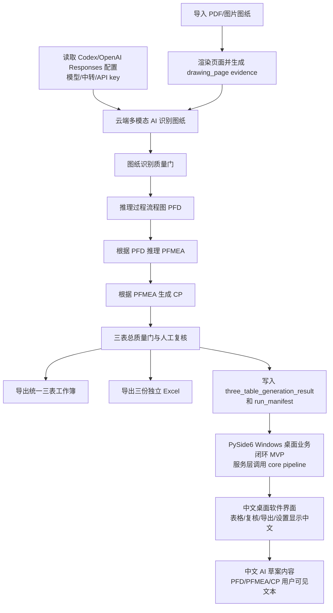

# MINOS-CORE 重建任务计划

## 当前主目标：AI 图纸驱动三表生成工具

本阶段起，产品目标从“完整 PPAP 平台”收口为“AI 图纸驱动 PFD/PFMEA/CP 三表生成工具”。第一版只支持 PDF/PNG/JPG 图纸输入，不做完整 PPAP 18 项、不做客户门户、不做审批流、不做 DWG/DXF 原生解析。

/// 1. 先把图纸输入变成可追溯页面证据，不做假 PDF 渲染；渲染器缺失时必须直接失败。
/// 2. 多模态 AI 输出只能是结构化 JSON，非法 JSON、缺 evidence ref 或引用不存在证据时直接失败。
/// 3. 图纸识别结果必须经过质量门，高风险、低置信度、证据不足内容进入人工复核。
/// 4. PFD、PFMEA、CP 都保留 AI 推理标记、置信度、证据引用和 needs_confirmation。
/// 5. 第一版输出统一三表工作簿和三份独立 Excel，不扩展完整 PPAP 18 项。
/// 6. AI 配置优先读显式 MINOS/OPENAI 环境变量；当 Codex provider 要求 OpenAI auth 时，复用 `%USERPROFILE%\.codex\config.toml` 与 `auth.json`，并按 Codex 的 responses endpoint 调用；当前第一推荐模型固定为 `gpt-5.4`；密钥不写文件、不打印。
/// 7. 后端闭环通过 `generate_three_tables_from_drawing(...)` 和 `generate-three-tables` CLI 提供给桌面端复用。
/// 8. 桌面端第一版作为可选依赖 `.[desktop]`，业务逻辑只调用 core pipeline，不绕平台 HTTP 层。
/// 9. 桌面端和交付给用户查看的摘要、表头、AI 识别内容、PFD/PFMEA/CP 草案业务文本默认使用中文；内部 JSON 字段名保持稳定，不作为 UI 表头直接展示。

## 桌面中文化执行流程
/// 1. 三表编辑器保留英文内部字段名，但增加中文列名映射，Qt 表格只显示中文列名。
/// 2. 布尔值在界面显示为“是/否”，仍兼容解析 true/false/yes/no。
/// 3. 设置页、导出页、人工复核页只展示中文摘要键名，不输出明文 API key。
/// 4. 导出动作完成后的结果摘要使用中文键名和“草案/正式”模式名称。
/// 5. 用户打开的三表 Excel 表头避免 `PFMEA ID`、`CP ID` 这类英文显示，改为中文编号。
/// 6. AI prompt 明确要求模型返回中文业务内容；本地工艺库、PFMEA 风险模板和 CP 控制模板也必须输出中文。
/// 7. 对 AI 返回的中文工序名做归一化，保证“落料/冲孔/注塑/装配”等中文工序仍能识别工艺族并补齐 PFD。

## 桌面中文化 OpenSpec 四步闭环
1. Define：目标是用户可见软件语言为中文，不改变内部数据契约。
2. Specify：表格表头、文件选择器、设置摘要、复核摘要、导出摘要、Excel 表头、AI 识别和三表草案业务内容均应中文显示。
3. Implement：新增显示层映射、中文摘要构造函数、中文 AI prompt、中文工艺/风险/控制模板，保留服务层/API 原始字段名。
4. Verify：运行桌面 helper/table editor 测试和完整回归。

## 下一阶段：桌面业务闭环 MVP

本阶段目标是在不扩展完整 PPAP 平台、不接客户门户、不做 18 项 PPAP 管理的前提下，把 Windows 桌面端从“界面骨架”推进到可记录、可复核、可导出的本地业务闭环。桌面端仍服务于 AI 图纸驱动 PFD/PFMEA/CP 三表生成工具。

## 桌面业务闭环 MVP 执行流程
/// 1. 新增 `minos_desktop/services.py`，把桌面项目、设置、运行记录和 core pipeline 调用收敛到服务层。
/// 2. 默认使用 SQLite `out/desktop/minos_desktop.sqlite3` 保存桌面项目、运行状态和导出记录。
/// 3. 通过 `DesktopSettingsStore` 管理 AI 配置状态和默认输出目录；设置页不得显示或保存明文 API key。
/// 4. 通过 `DesktopProjectStore` 创建和更新项目，避免 Qt UI 直接操作持久化细节。
/// 5. 通过 `DesktopRunService` 后台调用 `generate_three_tables_from_drawing(...)`，保存 `DesktopRunState`、`DesktopRunRecord` 和 `DesktopExportRecord`。
/// 6. Qt UI 从服务层刷新 AI 识别、PFD、PFMEA、CP、人工复核和导出页面。
/// 7. 失败报告必须包含原始错误、原因判断和三种处理方案，且三种方案中必须包含“放弃任务”。
/// 8. PySide6 继续保持可选依赖和懒加载，未安装时不影响 core、platform 和非桌面测试。

## 桌面业务闭环 MVP OpenSpec 四步闭环
1. Define：目标是桌面本地三表生成闭环，不是完整 PPAP 平台。
2. Specify：桌面端必须通过服务层调用 core pipeline，持久化项目、run 和 export 状态；不得保存明文 key。
3. Implement：新增桌面服务层，Qt UI 只负责交互和刷新，不复制业务生成逻辑。
4. Verify：运行 `python -m unittest tests.test_desktop_shell tests.test_qt_app_helpers -v`。

## 真实桌面试跑与交付验收：桌面/CLI 自检

本阶段目标是在不调用真实 AI 网络、不要求安装 Qt 的默认环境中，提供可重复的桌面交付验收脚本。验收脚本只检查本地前置条件：PySide6 是否安装、AI 配置是否存在、默认输出目录和 SQLite DB 是否可写、桌面入口是否可导入。

## 真实桌面试跑与交付验收执行流程
/// 1. 新增 `minos_desktop/preflight.py`，所有检查保持 UI-neutral，不导入或启动 QApplication。
/// 2. 默认 smoke 只做 preflight，不调用真实 AI 网络；缺 API key 记录 warning，显式 `--require-ai-config` 时才作为失败。
/// 3. 输出 JSON 风格结构，包含 `status`、`checks`、`warnings`、`recommendations`。
/// 4. AI 配置只输出 key 是否配置和来源，不输出明文 API key、模型密钥或 auth 文件中的 secret。
/// 5. 输出目录和 SQLite DB 做真实本地写入检查，检查完清理临时写入内容。
/// 6. 失败检查必须包含原始错误、原因判断和三种处理方案，且包含“放弃任务”。
/// 7. 在 `minos_desktop/cli.py` 增加 `--smoke`、`--output-dir`、`--db-path`、`--require-ai-config`。
/// 8. 补无 Qt 单元测试覆盖缺 PySide6、SQLite 可写、AI key 脱敏和失败格式。

## 真实桌面试跑与交付验收 OpenSpec 四步闭环
1. Define：目标是交付前置条件验收，不是真实 AI 生成试跑。
2. Specify：默认不访问外网，结构化输出，失败透明，密钥脱敏。
3. Implement：新增非 Qt preflight 模块，并通过 `minos-desktop --smoke` 暴露 CLI。
4. Verify：运行 `python -m unittest tests.test_desktop_preflight tests.test_desktop_shell tests.test_qt_app_helpers -v`。

## 桌面业务闭环 MVP 非目标
- 不新增完整 PPAP 18 项管理。
- 不接客户门户、审批流、签核流或自动提交。
- 不让桌面端绕过 core quality gate。
- 不把 API key 写入 SQLite、日志或界面。
- 不要求未安装 PySide6 的环境运行桌面 UI。

## 下一阶段：真实桌面试跑与交付验收

本阶段目标是在代码子任务完成后，用真实 Windows 桌面环境验证三表工具能从安全 demo 图纸完成一次交付试跑。验收对象仍然是 AI 图纸驱动 PFD/PFMEA/CP 三表生成工具，不扩展完整 PPAP 18 项，不接客户门户、审批流、签核流或自动提交。

## 真实桌面试跑与交付验收执行流程
/// 1. 通过 `python -m minos_core.cli write-demo-drawing --output out\desktop_acceptance\safe_demo_drawing.png` 生成 safe demo drawing；不得提交真实客户图纸。
/// 2. 通过 `python -m minos_core.cli accept-three-tables --result ...` 检查结果 JSON、manifest、exports、AI evidence refs、PFD/PFMEA/CP 内容和 xlsx zip 可打开性。
/// 3. 运行 `python -m minos_core.cli ai-config`，确认模型、中转地址和 key 配置状态可诊断，且不输出明文 key。
/// 4. 运行 `python -m minos_core.cli generate-three-tables --input out\desktop_acceptance\safe_demo_drawing.png --output-dir out\desktop_acceptance\cli_smoke`，作为后端 CLI smoke。
/// 5. 运行 `python -m minos_desktop.cli --smoke --output-dir out\desktop_acceptance\preflight --db-path out\desktop_acceptance\preflight\minos_desktop.sqlite3`，检查 PySide6、SQLite 输出目录、AI 配置状态、默认导出目录和本地权限。
/// 6. 安装 `.[desktop]` 后运行 `minos-desktop` 人工桌面试跑，完成导入 demo 图纸、生成 AI 识别/PFD/PFMEA/CP、人工复核、导出。
/// 7. 对统一三表工作簿和三份独立 Excel 做 xlsx openability check，先确认 OpenXML zip 结构可读；真实 Excel 打开验证仍通过人工验收补齐。
/// 8. 运行 `python -m unittest discover -s tests -v` 和 `pytest`，记录通过、失败或未配置 pytest 的真实状态。

## 真实桌面试跑与交付验收 OpenSpec 四步闭环
1. Define：目标是真实桌面试跑和交付验收，不是新增 PPAP 平台能力。
2. Specify：验收必须覆盖 preflight、safe demo drawing、CLI smoke、desktop manual acceptance、xlsx openability check、unittest/pytest；其中 xlsx openability check 是基础结构体检，不替代真实 Excel 打开验证。
3. Implement：本轮只同步文档和流程图；代码脚本由对应子任务完成后再把占位命令替换为最终命令。
4. Verify：最终交付前必须审核导出的 xlsx 可打开、demo 输入无真实客户敏感信息、测试命令结果有记录。

## 真实桌面试跑与交付验收非目标
- 不提交、不保存、不上传真实客户图纸。
- 不把 demo 图纸当成客户正式 PPAP 输入。
- 不扩展完整 PPAP 18 项。
- 不接客户门户、审批流、签核流或自动提交。
- 不绕过 AI 草案人工复核和质量门。

## 任务 2：generate-draft CLI/API 入口
本阶段目标是在现有 Evidence -> generated pipeline 基础上，新增一个明确的草案入口。入口只生成 APQPChain draft JSON，并同时输出质量门和人工复核信息；它不等同正式导出，不写 Excel，不绕过 export gate。

## 任务 2 执行流程
/// 1. 复用现有 `ingest -> analyze -> generate_pfd -> brainstorm_failure_modes -> generate_pfmea -> generate_control_plan -> assemble_generated_apqp_chain -> validate` 阶段。
/// 2. 在 `pipeline.py` 暴露 `generate_draft(evidence, output_path=None)` API，返回 draft envelope。
/// 3. draft envelope 必须包含 `draft_is_formal_export=False`、草案声明、APQPChain draft、quality gate、manual review 和 stage results。
/// 4. 在 `cli.py` 新增 `generate-draft` 子命令，并保留 `run-pipeline` 别名，不影响已有 list/validate/audit/export/convert-legacy。
/// 5. 在 `stage.py` 支持 `run_stage(..., stage="generate_draft")`，作为 API 外壳入口。
/// 6. 补 CLI/API 针对性测试，覆盖 JSON 输出、保存文件、别名和“草案不等同正式导出”声明。

## 任务 2 OpenSpec 四步闭环
1. Define：新增草案生成入口，不新增正式导出入口。
2. Specify：草案结果必须显式携带质量门和人工复核信息，且 `allow_user_export` 可为 false 时仍能返回 draft。
3. Implement：只复用 pipeline/stage 现有生成链路，不引入外部依赖，不安装依赖。
4. Verify：运行 targeted unittest 和 CLI smoke，确认旧 CLI 命令兼容。

## 第十二阶段：AI analyze 增强
本阶段目标是在 `analyze` 阶段接入可选 LLM adapter，把 Evidence bundle 增强为更完整的 `analysis_bundle`。本阶段不接真实外部服务，不生成下游 APQP 三表。

## 第十二阶段执行流程
/// 1. 保留 `keyword_rules` 作为默认基础路径。
/// 2. 通过 LLM adapter 生成 drawing / characteristic / process_clue 候选。
/// 3. AI 结果必须引用已有 evidence，并标记 `ai_inferred` 和 `needs_confirmation`。
/// 4. 合并规则结果与 AI 结果，不覆盖确定证据。
/// 5. analyze gate 继续检查 source_ref、AI-only、有效 Pxx route clue。
/// 6. 补测试并跑完整 unittest 与 CLI smoke。

## 第十二阶段 OpenSpec 四步闭环
1. Define：增强 analyze，不生成下游 APQP 三表。
2. Specify：analysis bundle 字段不破坏旧契约，新增 metadata 标记 AI 使用情况。
3. Implement：只通过 adapter 边界接入，不把 SDK/key 写进 core。
4. Verify：旧 keyword 测试不退化，AI-only 仍不能作为正式放行依据。

## 第十一阶段：PFMEA 与控制计划生成闭环
本阶段目标是在不搬目录、不接 LLM 的前提下，把 `brainstorm_failure_modes -> generate_pfmea -> generate_control_plan` 接通。

## 第十一阶段执行流程
/// 1. 新增薄规则 `generate_pfmea_from_candidates`，把失效模式候选转成正式 PFMEA bundle。
/// 2. 新增薄规则 `generate_control_plan_from_pfmea`，把 PFMEA row 转成控制计划 bundle。
/// 3. 在 `stage.py` 接入 `generate_pfmea` 和 `generate_control_plan`，保持旧 `validate/export` API 不变。
/// 4. 在 `quality_gates.py` 增加 PFMEA bundle 与控制计划 bundle 质量门。
/// 5. 区分上游待复核字段和本阶段硬缺字段：上游 pending 可继续生成草案，但本阶段缺证据、缺关键字段、AI-only 仍阻断。
/// 6. 补阶段契约测试并运行完整 unittest 与 CLI smoke。

## 第十一阶段 OpenSpec 四步闭环
1. Define：目标是补齐 APQP 生成链路，不做目录迁移。
2. Specify：用 unittest 固定 PFMEA/控制计划阶段的输入输出、证据引用和阻断行为。
3. Implement：新增两个 generator，接入 stage 和 quality gate。
4. Verify：运行 `python -m unittest discover -s tests -v`、CLI validate/audit/export smoke。

## 第二阶段：真实样本迁移
本阶段目标是把三个真实 Excel 源转换为 MINOS-CORE 标准 fixture，并用同一条核心链路验收：

- legacy Excel adapter 只负责读取旧 workbook 并输出标准 `process_flow.json`、`pfmea.json`、`control_plan.json`。
- core 仍只认标准 fixture/domain，不直接依赖 Excel、OCR、LLM 或本地知识库路径。
- OCR/LLM 后续继续作为 adapter 外挂，输出同样的标准 fixture，不进入 `domain`、`validation`、`exporters` 的核心边界。
- 测试输出必须写入 `tempfile`，不得恢复旧的固定 `output/` 目录。

真实源：
- `C:\Users\fgtan\Desktop\知识库种子\门铰链\JLH01000300-门铰链.xlsx`
- `C:\Users\fgtan\Desktop\知识库种子\冲压件\1004258-冲压件.xlsx`
- `C:\Users\fgtan\Desktop\知识库种子\限位器\XWQ01000100-限位器.xlsx`

## 当前职责
本轮只负责真实样本迁移的测试和文档，不写 `minos_core` adapter 或业务代码，不删除文件，不回退其他 worker 的改动。

允许写入范围：
- `tests/test_legacy_excel_adapter.py`
- `rebuild_manifest.md`
- `task_plan.md`
- `progress.md`
- `findings.md`

## 目标
在 clean baseline 之后增加真实样本验收门，让 adapter worker 输出的 fixture 必须能进入现有 validation 和 exporter 链路。

本轮交付内容：
- 新增 `tests/test_legacy_excel_adapter.py`。
- 测试 `convert_legacy_workbook(workbook_path, fixture_dir)` 能把三个真实 Excel 源转换为临时 fixture 目录。
- 每套转换后的 fixture 必须通过 `minos_core.validation.validate_chain`。
- 每套 fixture 必须能通过 `minos_core.pipeline.export_fixture` 导出 5 张固定 sheet 的中文 APQP workbook。
- 更新文档说明第二阶段目标和 adapter 边界。

## 成功标准
- 测试只写 `TemporaryDirectory`，不写固定输出目录。
- 三个真实样本都生成 `process_flow.json`、`pfmea.json`、`control_plan.json`。
- 三类 fixture JSON 都可解析，并且每类至少包含有效行。
- `validate_chain` 对三个真实样本全部通过。
- 导出的 workbook zip 结构完整，sheet 顺序固定为：摘要、过程流程图、PFMEA、控制计划、三表追溯矩阵。

## 执行流程
/// 1. 只读扫描现有 unittest、domain、validation、pipeline、exporter 接口。
/// 2. 编写真实 Excel adapter 契约测试，只依赖 `convert_legacy_workbook` 公开函数。
/// 3. 对每个真实样本使用 tempfile 生成 fixture。
/// 4. 对转换结果执行 JSON 解析、domain loader、validation、export 和 xlsx 打开性检查。
/// 5. 更新 `task_plan.md`、`progress.md`、`findings.md`、`rebuild_manifest.md`。
/// 6. 审核写入范围，确认未触碰 adapter 实现和其他 worker 文件。

## OpenSpec 四步闭环
1. Define：第二阶段验收对象是真实 Excel 样本转标准 fixture。
2. Specify：用 unittest 明确 adapter、validation、exporter 的公开契约。
3. Implement：只新增测试和文档，不实现 adapter。
4. Verify：adapter 就绪后运行真实样本测试；如 adapter 未就绪，测试应清楚暴露缺失接口。

## 非目标
- 不实现 `minos_core.adapters`。
- 不改变 domain、validation、pipeline、exporter。
- 不删除旧文件。
- 不把 OCR/LLM 逻辑接进 core。
- 不把真实样本输出写入固定 `output/`。

## 当前假设
- adapter worker 会暴露 `convert_legacy_workbook(workbook_path, fixture_dir)`。
- `convert_legacy_workbook` 返回值可以是 fixture 路径、包含 `fixture_dir` 的对象/dict，或 `None`；测试会以传入的 `fixture_dir` 作为默认结果目录。
- 当前 core 已暴露 `load_apqp_chain`、`validate_chain`、`export_fixture`。

## 第三阶段：质量审计
本阶段目标不是再增加硬校验，而是在 validation 已能确认结构闭环之后，继续识别内容可靠性风险。换句话说：

- validation 回答“PFD、PFMEA、CP 是否闭环，必控项是否有控制计划覆盖”。
- quality audit 回答“闭环内容是否可信，是否存在机械逻辑薄弱、控制方法太弱、需要人工复核的问题”。
- audit 发现问题不等同于 validate 失败；它应输出审计报告和人工复核项，帮助区分“结构闭环”和“内容可靠”。

## 第三阶段当前职责
本轮只负责质量审计的测试和文档，不写 `minos_core/audit.py`，不写 CLI，不删除文件，不回退其他 worker 的改动。

允许写入范围：
- `tests/test_quality_audit.py`
- `task_plan.md`
- `progress.md`
- `findings.md`
- `rebuild_manifest.md`

## 第三阶段目标
新增 unittest，约束 audit worker 的公开契约：

- `audit_chain` 能对 `tests/fixtures/apqp_chain`、`door_hinge`、`stamping`、`limiter` 运行。
- audit report 必须包含 `counts`。
- audit report 必须包含 `manual_review_items`。
- 构造最小弱链接样本，验证 audit 能发现 mechanical / weak / manual review 问题。
- 同一个最小弱链接样本仍应通过 `validate_chain`，证明 audit 是质量审计，不是硬校验替代品。

## 第三阶段执行流程
/// 1. 只读扫描现有 fixture、validation、domain、CLI 和当前 audit 状态。
/// 2. 新增 `tests/test_quality_audit.py`，只依赖未来 audit worker 的公开 `audit_chain` 契约。
/// 3. 对四套标准 fixture 执行 audit smoke contract，检查报告包含 `counts` 和 `manual_review_items`。
/// 4. 构造最小弱链接链路：PFD/PFMEA/CP 仍闭环，但控制规格、方法、频次、反应计划明显不足。
/// 5. 同时运行 `validate_chain` 与 `audit_chain`：validate 必须通过，audit 必须提出 manual review。
/// 6. 更新 `task_plan.md`、`progress.md`、`findings.md`、`rebuild_manifest.md`。
/// 7. 审核写入范围，确认未触碰 `minos_core/audit.py`、CLI 或其他 worker 文件。

## 第三阶段 OpenSpec 四步闭环
1. Define：第三阶段验收对象是质量审计报告，不是结构硬校验。
2. Specify：用 unittest 固定 `audit_chain` 的报告字段和弱链接识别行为。
3. Implement：本轮只新增测试和文档；audit/CLI 实现由另一个 worker 完成。
4. Verify：audit worker 就绪后运行 `python -m unittest tests.test_quality_audit -v`。

## 第三阶段非目标
- 不实现 `minos_core/audit.py`。
- 不实现或修改 CLI audit 命令。
- 不改变 `validation.py` 的硬校验语义。
- 不把 audit 问题伪装成 validate 失败。
- 不更新 `project_flow.mmd`，因为本轮用户限定的写入范围不包含该文件。

## 第四阶段：限位器 legacy 链接质量收口
本阶段目标是只针对 `limiter` 真实样本降低机械挂接和弱链接数量，不扩大到 `door_hinge`、`stamping`，也不改变 core 的硬校验语义。

## 第四阶段目标
- 读取并对照 `tests/fixtures/limiter/pfmea.json`、`tests/fixtures/limiter/control_plan.json` 与 `audit --input tests\fixtures\limiter` 输出。
- 改进 legacy 转换器的 PFMEA/CP 匹配规则，减少只靠 `linked_control_plan_id` 的机械覆盖。
- 只重新生成 `tests/fixtures/limiter`。
- 补 limiter 审计回归门槛：`mechanical_links <= 3`、`weak_links <= 10`、`manual_review_items <= 18`。

## 第四阶段执行流程
/// 1. 只读定位 limiter 的 mechanical links、weak links 和反向 `pfmea_id` 错挂模式。
/// 2. 在 legacy adapter 中加入质量工程业务词、特殊特性优先、同工序多 CP 分配和必要的一对多派生控制行。
/// 3. 在 audit 文本判定中使用相同的质量工程业务词，避免“同义但字面不同”的有效控制被误判为 weak。
/// 4. 只运行 `convert-legacy --profile limiter` 重建 `tests/fixtures/limiter`。
/// 5. 运行 limiter validate、limiter audit 和完整 unittest。
/// 6. 更新流程图和重建文档，提交第四阶段改动。

## 第四阶段 OpenSpec 四步闭环
1. Define：第四阶段验收对象是 limiter 的 PFMEA/CP 链接质量，不是全样本重构。
2. Specify：用 `tests/test_quality_audit.py` 固定 limiter 阶段性审计门槛。
3. Implement：改 legacy 链接规则、audit 业务词判定，并只重建 limiter fixture。
4. Verify：运行 `python -m minos_core.cli validate --input tests\fixtures\limiter`、`python -m minos_core.cli audit --input tests\fixtures\limiter`、`python -m unittest discover -s tests -v`。

## 第四阶段非目标
- 不重建 `door_hinge` 和 `stamping` fixture。
- 不把质量审计问题变成 validation 硬失败。
- 不接入 OCR/LLM。
- 不追求 limiter 审计零问题，本阶段只要求明显变好并守住回归门槛。

## 第五阶段：四层架构边界落地
本阶段目标是把 MINOS-CORE 明确分成四层，并先用最小改动修正依赖方向，不做大规模搬目录。

四层定义：
- Domain Core：只管业务对象，包括 `Product`、`Drawing`、`Characteristic`、`ProcessStep`、`FailureMode`、`ControlItem`、`Evidence`、`TraceLink`。
- Pipeline：只管流程，包括 `ingest`、`analyze`、`generate_pfd`、`brainstorm_failure_modes`、`generate_pfmea`、`generate_control_plan`、`validate`、`export`。
- Adapters：只管外部依赖，包括 OCR、LLM、Excel 读取、Excel 导出、文件系统。
- Quality Gates：每一步判断证据是否足够、字段是否待确认、内容是否来自 AI 推断、是否能进入下一阶段、是否允许导出给用户。

## 第五阶段执行流程
/// 1. 把 fixture JSON 文件读取移出 `domain.py`，由 `minos_core.adapters.fixture_json` 承担。
/// 2. 保留 `domain.load_apqp_chain` 兼容 wrapper，但 Domain Core 不再拥有 `_read_json` 文件 IO。
/// 3. 在 `pipeline.py` 暴露固定 `PIPELINE_STAGES`，并统一调用 fixture adapter 读取输入。
/// 4. 抽出 `quality_matching.py`，让 legacy adapter 和 audit 使用同一套质量工程业务词。
/// 5. 新增 `quality_gates.py`，表达阶段质量门：证据、待确认字段、AI 推断、是否可继续、是否可导出。
/// 6. 补回归测试，锁住四层边界。

## 第五阶段 OpenSpec 四步闭环
1. Define：目标是架构边界和依赖方向，不是新增业务生成能力。
2. Specify：用测试约束 Domain Core 无文件 IO、Pipeline 阶段顺序、Adapter 负责 fixture IO、Quality Gate 暴露阶段准入。
3. Implement：新增 `fixture_json.py`、`quality_matching.py`、`quality_gates.py`，并最小调整现有导入。
4. Verify：运行完整 unittest，确认 legacy 转换、limiter gate、CLI、导出均保持可用。

## 第六阶段：阶段流转、证据追溯与交付增强
本阶段目标是在四层边界稳定后，把 pipeline 从普通函数调用升级为可追踪的阶段结果，同时让证据引用进入核心对象，并让导出的 Excel 带上质量门状态和人工复核清单。

## 第六阶段执行流程
/// 1. 新增 `StageContext` / `StageResult`，保留旧 `validate_fixture` / `export_fixture` 返回契约不变。
/// 2. 给 `ProcessStep`、`FailureMode`、`ControlItem`、`TraceLink` 增加 `evidence_refs`，兼容旧 fixture 缺省为空列表。
/// 3. APQP workbook 从 5 张 sheet 扩展为 7 张，新增 `质量门状态` 和 `人工复核清单`。
/// 4. 新增 OCR / LLM adapter 占位协议、fake adapter 和 not-configured adapter，不接真实外部服务。
/// 5. 增加回归测试，覆盖阶段结果、证据引用、导出 sheet、adapter 边界。
/// 6. 运行完整 unittest、CLI validate/audit/export smoke 后提交。

## 第六阶段 OpenSpec 四步闭环
1. Define：目标是可追溯阶段流转和可复核交付，不是接入真实 AI 服务。
2. Specify：StageResult 必须包含 `stage/status/output/evidence/pending_fields/ai_inferred_items/quality_gate`。
3. Implement：新增 `stage.py`、`adapters/ocr.py`、`adapters/llm.py`，并增强 domain/exporter。
4. Verify：完整测试必须通过，导出 workbook 必须包含 7 张固定 sheet。

## 第七阶段：Evidence 文件化与证据覆盖质量门
本阶段目标是把证据从内存 payload 推进到标准 fixture 文件，并让 Quality Gate 真正检查证据覆盖，而不是只检查三表结构存在。

## 第七阶段执行流程
/// 1. `fixture_json` 目录加载时可选读取 `evidence.json`，旧三文件 fixture 不受影响。
/// 2. 为 `tests/fixtures/apqp_chain` 新增 `evidence.json`，并给 PFD/PFMEA/CP 写入 `evidence_refs`。
/// 3. `quality_gates.py` 增加 evidence coverage report，检查未覆盖对象、缺失引用、AI 推断证据、待确认证据。
/// 4. Excel `质量门状态` sheet 增加证据覆盖率、未覆盖对象、缺失引用、AI 推断和待确认证据统计。
/// 5. 增加回归测试，确认新 fixture 有证据覆盖、旧 fixture 兼容、缺失/AI 证据会阻断阶段流转。

## 第七阶段 OpenSpec 四步闭环
1. Define：目标是 Evidence 闭环，不是 OCR/LLM 接入。
2. Specify：有 `evidence.json` 时，所有 PFD/PFMEA/CP 对象必须引用有效证据；AI 推断或待确认证据不能直接放行。
3. Implement：新增 fixture 证据文件、证据引用和 coverage gate。
4. Verify：完整 unittest、CLI validate/audit/export smoke 必须通过。

## 第八阶段：ingest 阶段落地
本阶段目标是把 `ingest` 从 pipeline 阶段名落成真实入口，让文件、manual JSON、fixture evidence 和 fake OCR 文本统一进入 Evidence bundle。

## 第八阶段执行流程
/// 1. 新增 `minos_core/ingest.py`，统一把输入资料归一化为 `evidence_bundle`。
/// 2. `run_stage(..., stage="ingest")` 提前执行 ingest，不要求输入已经是完整 APQPChain。
/// 3. 支持 `evidence_bundle` JSON、manual `content/text` JSON、fixture 目录 `evidence.json`、只有 `evidence.json` 的目录、fake OCR 文本和 FakeOCRAdapter。
/// 4. `quality_gates.py` 增加 stage-aware 策略：`ingest/analyze` 使用轻量 Evidence 入口门，`validate/export` 保持三表 evidence_refs 覆盖门。
/// 5. 增加 `tests/test_ingest_stage.py`，覆盖正向 ingest、AI-only 阻断、空 evidence 阻断、mixed AI/待确认提示。
/// 6. 运行完整 unittest、CLI validate/audit/export smoke 后提交。

## 第八阶段 OpenSpec 四步闭环
1. Define：目标是输入资料进入 Evidence，不生成 PFD/PFMEA/CP。
2. Specify：ingest 的 `StageResult.output` 必须是 `evidence_bundle`，`can_continue` 表示可进入 analyze。
3. Implement：新增 ingest 模块、stage 分支和 ingest/analyze 轻量质量门。
4. Verify：完整 unittest 必须通过，validate/export 行为不得退化。

## 第九阶段：analyze 阶段落地
本阶段目标是把 Evidence bundle 转成结构化分析结果，为后续 `generate_pfd` 提供输入线索，但不生成正式 PFD/PFMEA/CP。

## 第九阶段执行流程
/// 1. 新增 `minos_core/analyze.py`，用稳定关键词规则抽取 drawing、characteristic、process_clue、pending field 和 AI/待确认项。
/// 2. `run_stage(..., stage="analyze")` 支持 evidence_bundle、fixture dir、manual JSON、OCR text，必要时先执行 ingest。
/// 3. 新增 `evaluate_analysis_bundle_gate`，判断 analysis bundle 是否可进入 `generate_pfd`。
/// 4. analyze 质量门不允许用户导出，只表达是否可进入下一阶段。
/// 5. 增加 `tests/test_analyze_stage.py`，覆盖 fixture、manual JSON、OCR text、AI/待确认项、pending fields、validate/export 不退化。
/// 6. 运行完整 unittest、CLI validate/audit/export smoke 后提交。

## 第九阶段 OpenSpec 四步闭环
1. Define：目标是证据理解层，不是三表生成层。
2. Specify：analysis bundle 必须包含 `drawings`、`characteristics`、`process_clues`、`pending_fields`、`ai_inferred_items`。
3. Implement：只用规则抽取，不接 LLM，不猜 PFMEA/CP。
4. Verify：完整 unittest 必须通过，apqp_chain 可抽出至少 1 个 drawing、2 个 characteristic、2 个 process clue。

## 第十阶段：generate_pfd 阶段落地
本阶段目标是把 `analysis_bundle.process_clues` 转成正式 `process_flow`，形成可追溯的 PFD 基础，但不生成 PFMEA/CP。

## 第十阶段执行流程
/// 1. 新增 `minos_core/generate_pfd.py`，从 analysis bundle 生成 `process_flow`。
/// 2. 有明确 `Pxx` 的 process clue 才生成 `ProcessStep`，无 step id 的 clue 进入 `pending_fields`，不猜编号。
/// 3. 按 P 后数字排序生成步骤，并按相邻步骤生成 `TraceLink`。
/// 4. 每个 step/link 保留 `evidence_refs`，不填 PFMEA/CP output refs。
/// 5. 新增 `evaluate_pfd_bundle_gate`，判断是否可进入 `brainstorm_failure_modes`。
/// 6. `run_stage(..., stage="generate_pfd")` 支持 analysis bundle、evidence bundle、fixture、manual JSON、OCR text。
/// 7. 增加 `tests/test_generate_pfd_stage.py`，覆盖 P10/P20/P30、links、evidence_refs、manual/OCR 输入、AI-only 阻断、validate/export 不退化。

## 第十阶段 OpenSpec 四步闭环
1. Define：目标是生成 PFD，不是生成 PFMEA/CP。
2. Specify：生成结果必须是 `process_flow`，包含 `steps`、`links`、`evidence_refs`。
3. Implement：只从明确 process clues 生成步骤和顺序，不猜工序编号。
4. Verify：完整 unittest、CLI validate/audit/export smoke 必须通过。

## Phase 6 真实项目试运行（第 6 阶段重入：input_package 与人工复核链路）
本阶段目标是把 `input_package` fixture（evidence_bundle + review_patch）接进 `generate_draft`，并让 `review-template` 和 `apply-review` 形成完整的人工复核链路。

### Phase 6 pilot 执行流程
/// 1. 新增 `tests/fixtures/real_project_input_package_template/`：脱敏真实项目 input_package 模板 fixture，包含 input_package.json、evidence.json、review_patch.json（模板态）、source_index.json。
/// 2. 新增 `tests/test_phase6_pilot_workflow.py`：覆盖 `input_package -> generate_draft -> review-template -> 人工填写 review_patch -> apply-review -> export` 完整链路，以及 `unreviewed draft` 不能导出 final workbook 的负向测试。
/// 3. 新增 `minos_core/review_patch.py`：`build_review_patch_template(draft_result)` 从 draft envelope 生成待人工填写模板，`apply_review_patch(payload, patch)` 应用复核 patch。
/// 4. `review_patch_template` 必须有 `template_status: "requires_human_review_before_apply_review"`；`apply_review_patch` 发现此字段则拒绝，保证模板不能被误当成已批准 review patch。
/// 5. 在 `minos_core/cli.py` 新增 `review-template` 和 `apply-review` 子命令。
/// 6. 在 `minos_core/__init__.py` 导出 `build_review_patch_template`。
/// 7. `run_manifest` 的 `inputs`/`outputs` 字段收紧为固定 object 格式（`_dump_json_object`），非 dict 值包装为 `{"value": ...}`。
/// 8. 补 `tests/test_review_patch.py` 覆盖：确认 evidence/rows、纠正 pending field、拒绝缺失 evidence_ref、显式 manual_confirmation_event、模板不能直接 apply、CLI review-template 写文件。

### Phase 6 pilot OpenSpec 四步闭环
1. Define：目标是 input_package 接入 generate_draft，并确保人工复核 gate 不能被绕过。
2. Specify：模板必须携带 `template_status`，`apply_review_patch` 拒绝携带此字段的 patch；unreviewed draft 不能导出 final。
3. Implement：新增 review_patch 模块、CLI 命令、fixture 模板、单元测试和 pilot workflow 测试。
4. Verify：195 项 unittest 全部通过；`review-template` 能生成模板；模板 apply 失败；unreviewed draft export 失败。

### Phase 6 pilot 非目标
- 不接真实 OCR、真实 AI、客户门户、审批流或自动 PPAP 提交。
- 不把模板 fixture 当成已批准 review patch 使用。

### Phase 6 pilot 下一步：真实试运行包最小闭环
- 准备一个已脱敏、非客户敏感的 filled input package 示例。
- 跑通 `generate-draft -> review-template -> 人工填写 review_patch -> apply-review -> export` 全链路。
- 记录哪些字段仍需人工补齐、哪些质量门提示最影响工程人员使用。

## 真实样本闭环验收与最小修复：已完成项
- 已完成三类真实图纸后端试跑：
  - `1004258-冲压件.pdf`
  - `JLH01000300-门铰链.pdf`
  - `XWQ01000100-限位器.pdf`
- 三类样本均已生成：
  - `three_table_generation_result.json`
  - `run_manifest.json`
  - `三表总工作簿.xlsx`
  - `三表独立文件\过程流程图.xlsx`
  - `三表独立文件\PFMEA.xlsx`
  - `三表独立文件\控制计划.xlsx`
- `accept-three-tables` 已完成三类样本的 OpenXML 结构验收，当前未发现损坏的 `.xlsx`。
- 已修复 MINOS 默认模型漂移，当前默认模型固定为 `gpt-5.4`。
- 已安装 `PySide6`，桌面 smoke preflight 已从 `warning` 升级为 `ready`。
- 已修复 `PySide6` 导入异常时 preflight 直接崩溃的问题。

## 下一阶段：降低复核负担并补齐桌面真实操作验收
本阶段目标不是再扩功能，而是把现有闭环从“能跑通”推进到“更像一个可交给工程人员试用的工具”。

### 执行流程
/// 1. 读取三类真实样本 `three_table_generation_result.json`，按 `manual_review.items` 聚类最常见的复核原因。
/// 2. 优先修复最稳定、最不依赖客户工艺知识的高频问题，例如缺少规格来源、测量方法占位过弱、过程名称不够具体。
/// 3. 为真实 PDF 增加一条桌面服务层回归：通过 `DesktopRunService` 保存项目、执行真实三表生成、回读 run record。
/// 4. 做一次人工桌面点击验收，至少确认：空路径提示、选择真实图纸、成功生成后页面刷新、导出页展示、打开输出目录。
/// 5. 记录桌面端仍无法自动验证的环节，把“自动验证”和“人工验收”边界写清楚。
/// 6. 回归运行 `python -m unittest discover -s tests -v` 与 `python -m pytest tests/platform -q`。

### OpenSpec 四步闭环
1. Define：目标是减少工程人员第一轮复核负担，并补齐桌面真实操作验收，不新增完整 PPAP 平台能力。
2. Specify：三类真实样本仍允许 `needs_review`，但要尽量减少明显可自动补足的 review 项；桌面侧至少要有一条真实运行记录和一份人工点击验收记录。
3. Implement：只改真实高频问题对应的推理/归一化/桌面服务层薄弱点，不放宽质量门，不伪造正式结论。
4. Verify：真实样本重跑结果保持可导出、`.xlsx` 可打开、回归测试通过、桌面 smoke 继续为 `ready`。

## 复核负担压缩阶段：已完成项
- 已完成 `manual_review.items` 去重归一化：
  - 同一结构化 `item_id` 不重复展示。
  - 裸字符串与结构化项重复时优先保留结构化项。
  - `failure_mode:PFMEA-xxx` 与 `PFMEA-xxx` 视为同一 PFMEA 复核目标。
  - `control_item:CP-xxx` 与 `CP-xxx` 视为同一 CP 复核目标。
  - `process_step:Pxx` 与 `Pxx` 视为同一 PFD 复核目标。
- 已收窄 PFD 空特殊特性复核：
  - 普通工序 `special_characteristics=[]` 不再刷复核项。
  - 工序 `needs_confirmation=True` 时仍保留 `special_characteristics` 复核。
- 已通过三类真实结果离线验证：
  - 冲压件：122 -> 40。
  - 门铰链：203 -> 70。
  - 限位器：112 -> 35。
- 已确认压缩后正式导出仍被质量门阻止，不改变 `needs_review` 的草案定位。

## 下一步：进一步降低真实工程复核量
/// 1. 分析压缩后剩余 145 条复核项，按图纸识别低置信度、PFMEA 高风险、CP 控制缺口继续聚类。
/// 2. 优先把“同一图纸识别字段多处低置信度”合并成字段级复核摘要，而不是逐条散落。
/// 3. 对特殊特性存在但未分配到工序的情况，增加单条聚合复核项，避免每道工序重复提示。
/// 4. 继续保持 final export gate 不放宽，所有低置信度和高风险项仍需人工确认。

## 复核负担压缩追加：特殊特性映射聚合
- 已完成 `process_flow.characteristics.unmapped` 聚合复核项。
- 已保留 `unmapped_special_characteristics` 明细，方便桌面端和导出端展示具体未映射的特殊特性。
- 已新增 PFD gate 回归：未映射特殊特性只提示一次；已映射特殊特性不误报。
- 下一步仍按原计划继续压缩图纸识别低置信度字段和 CP 控制缺口，但不能让 final export gate 自动放行。

## AI 风险推理增强：已完成项
- PFMEA 已从“一工序一条泛化风险”升级为“一工序多风险草案”，不再硬限制每道工序最多 5 条，风险数量由工序复杂度、特殊特性和可识别风险决定。

## AI 风险条数规则修正
/// 1. 去掉 PFMEA 生成逻辑里的固定 5 条上限，避免 AI/规则识别出第 6 条有效风险时被静默截断。
/// 2. 测试验收从“最多 5 条”改为“每道工序至少有风险、风险行结构完整、同一工序 failure_mode 不重复”。
/// 3. 更新流程图、进度和发现记录，明确后续优化重点是风险质量与复核边界，不是人为控制行数。
/// 4. 回归运行 AI 三表工作流测试、完整 unittest 和 platform pytest。

## Responses 流式与图纸预处理修正
/// 1. 对齐 Codex Responses 请求形态：从 Codex 配置读取 `disable_response_storage`、`model_reasoning_effort`，并发送 `store:false`、`reasoning.effort` 和 Codex 风格 User-Agent。
/// 2. 把 MINOS 多模态图纸分析调用改为 Responses streaming，避免真实图片请求长期同步等待且无中间事件。
/// 3. 增加 SSE 事件解析，处理 `response.output_text.delta`、`response.completed`、`response.failed` 和 `error`。
/// 4. 后续图纸分析质量优化优先评估 PaddleOCR/PP-Structure、Docling 等本地预处理工具，用于 OCR、版面区域切分、表格/标题/图形区域识别，再把结构化片段交给 VLM。

## 中文交付与复核清单聚合
/// 1. 用户可见输出默认中文，三表草案 warning 和 manual_review 摘要不再输出英文说明。
/// 2. `manual_review.items` 改为中文分组摘要，只展示图纸识别、过程流程图、PFMEA、控制计划、草案确认等高层类别。
/// 3. 完整明细保留在 `manual_review.raw_items`，并提供 `raw_count` 与 `summary`，避免丢失质量门证据。
/// 4. 正式导出质量门不放宽；这次只降低用户阅读负担，不把 AI 草案伪装成已完成。
/// 5. CLI、桌面摘要、桌面人工复核页、三表结果 envelope 增加中文状态和中文复核摘要展示。
/// 6. 统一工作簿的“人工复核清单”优先展示中文摘要项，质量门明细数量仍保留为内部审计指标。

## 人机协同三表编辑器第一版
/// 1. Core 新增 `edit_patch`：支持 add/update/soft_delete/confirm，不覆盖 AI 原稿。
/// 2. 正式导出前增加逐行确认门禁：PFD/PFMEA/CP 未软删除行必须全部 `已确认`。
/// 3. 软删除行保留在 JSON 审计记录中，但不进入 chain 和 Excel 导出。
/// 4. 桌面端三表页从 JSON 查看升级为可编辑表格，支持添加行、软删除、确认行、保存修改。
/// 5. 桌面服务层保存 original/current/edit_patch，关闭后可回读继续编辑。
/// 6. 导出页提供草案导出和正式导出入口；正式导出失败时按失败透明规则显示原因。

## Core 三表联动实现
本阶段目标是把 core 内 PFD/PFMEA/CP 的继承关系做实：PFD 保留关键工序字段，PFMEA 只能来自 PFD 工序，CP 只能来自 PFMEA 风险，并在质量门/validate 中暴露断链。

### 执行流程
/// 1. PFD step 保留工序目的、产品特性、过程特性、设备、工装、检具、文件、流程类型。
/// 2. PFMEA 从 PFD/候选包继承工序编号、工序名称、功能和特性；候选工序不在 PFD 中时不生成 PFMEA 行。
/// 3. CP 从 PFMEA 的失效原因、预防控制、探测控制、特殊特性和高风险标记生成，并保留 `source_pfmea_id` 等来源字段。
/// 4. 质量门和 validate 覆盖 PFD 有工序但 PFMEA 无风险、PFMEA 高风险 CP 无控制、特殊特性未贯穿、CP 工序不在 PFD、检具/频率/反应计划缺失。
/// 5. 补 PFD/PFMEA/CP 阶段测试和 validate 一致性测试。

### OpenSpec 四步闭环
1. Define：目标是三表联动，不新增 UI 或新生成入口。
2. Specify：PFD 是工序来源，PFMEA 不允许脱离 PFD，CP 必须保留 PFMEA 来源。
3. Implement：最小改动 domain、generator、quality gate、validation 和必要测试。
4. Verify：运行相关阶段测试和完整回归。

## 桌面三表字段/UI 补齐
/// 1. PFD 编辑表展示并支持编辑工序编号、顺序、工序名称、工序目的/过程功能、产品特性、过程特性、设备、工装、检具、文件、流程类型、证据和待确认。
/// 2. PFMEA 编辑表显示来自 PFD 的工序编号、工序名称、过程功能、产品/过程特性，作为风险行复核上下文。
/// 3. CP 编辑表显示 PFMEA 来源、失效模式、特性、规格、测量方法、频次、反应计划、检具等控制计划字段。
/// 4. 人工新增、修改、软删除、逐行确认继续统一保存为 `edit_patch`；无实际修改时不提交空 patch。
/// 5. UI 表头和提示文案保持中文，内部 JSON 字段名继续保持稳定。

## 桌面三表字段/UI OpenSpec 四步闭环
1. Define：目标是让工程人员在桌面端直接审阅和编辑 PFD/PFMEA/CP 的关键业务字段。
2. Specify：三表显示层必须补齐上游继承信息，但未编辑的继承显示值不能制造多余 update patch。
3. Implement：扩展 `table_editor` 字段规格、中文列名、继承显示模型，并在 Qt 保存入口拦截空 patch。
4. Verify：运行桌面表格、edit_patch、桌面服务和 schema 相关测试。
- PFMEA 行已补齐 S/O/D/AP、预防控制、探测控制、建议措施、AI 理由和置信度。
- CP 已从 PFMEA 风险反推规格/控制意图、测量方法、样本容量、频次、控制方法和反应计划。
- 质量门已调整为只让高风险、特殊特性、低置信度、证据不足或明确不确定项进入人工复核。
- 普通 AI 草案仍保留 `ai_inferred_items`，不会误放行 final export。

## AI 风险推理增强：下一步
/// 1. 用三类真实样本重跑，统计 PFMEA 行数、CP 行数、manual_review 数量和质量门状态。
/// 2. 检查新增 PFMEA 风险是否对工艺有帮助，优先修正明显泛化或重复的风险模板。
/// 3. 检查 CP 草案中的 draft control intent 是否足够可审阅，必要时按工艺类型细化测量方法和频次。
/// 4. 继续保持 draft 可导出、final export 需人工复核后放行。

## MINOS-CORE v1.5 AIAG-VDA PFMEA 专业化增强
本阶段目标是把 MINOS 的三表编辑闭环升级为 AIAG-VDA 风格：AP 作为默认风险判定，PFMEA 行具备措施闭环字段，变更影响和知识库推荐进入人工确认，但不误伤旧 fixture/legacy 导出链路。

### 执行流程
/// 1. 新增 AIAG-VDA PFMEA 字段归一化：过程项、过程步骤、过程工作要素、功能/要求、S/O/D/AP、RPN、推荐措施、责任人、目标日期、措施后 S/O/D/AP。
/// 2. 新增 AP/RPN 计算能力，正式门以 AP 为主，RPN 只作为辅助显示字段。
/// 3. 新增措施闭环检查：高 AP 必须有推荐措施，中高 AP 必须有责任人和目标日期，完成后必须填写措施后评价。
/// 4. 新增变更管理基础能力：字段级 before/after diff、下游影响项和影响状态。
/// 5. 新增轻量本地知识库推荐：按工序、特殊特性、高 AP 风险给出待确认建议，采纳/忽略都记录 patch。
/// 6. 扩展 edit_patch：支持推荐采纳、推荐忽略、变更影响处理，并把字段级修改写入审计历史。
/// 7. 扩展桌面 PFMEA 表格和 Excel 导出列，显示 AIAG-VDA 关键字段和中文表头。
/// 8. 拆分质量门范围：`strict_three_table_linkage` 只表示三表一致性；`strict_aiag_vda_pfmea_gate` 才启用 v1.5 AP/措施/推荐/变更严格门。
/// 9. 保持用户可见内容中文，知识库推荐归并到 PFMEA 复核摘要，避免复核展示项膨胀。

### OpenSpec 四步闭环
1. Define：目标是 AIAG-VDA PFMEA 专业化增强，不做审批流和 AIAG 第四版完整模板。
2. Specify：正式导出必须满足三表一致性、逐行确认、AP 措施闭环、变更影响处理和知识库推荐处理。
3. Implement：新增 core 能力模块，扩展 quality gate、edit_patch、生成链路、桌面表格和导出列。
4. Verify：运行 v1.5 专项测试、三表生成测试、旧 fixture/legacy 导出测试和完整 unittest 回归。

## MINOS v1.6 桌面专业闭环
本阶段目标是把 v1.5 的 AP、措施闭环、变更影响和知识库推荐能力接入桌面软件，让工程人员能在同一桌面流程中处理措施、推荐、变更，并完成正式导出前的质量门闭环。

### 执行流程
/// 1. 桌面导航增加“措施管理”“变更影响”“知识库推荐”三个中文页面。
/// 2. PFMEA 页面增加筛选：全部、AP 高、AP 中、逾期、待措施、待措施后评价、待确认、知识库推荐待处理、变更影响待处理。
/// 3. `table_editor` 增加 UI-neutral helper：措施管理模型、PFMEA 筛选、变更影响模型、知识库推荐模型、推荐/变更 patch item builder。
/// 4. `services` 增加 SQLite 本地知识库表，启动时写入默认种子规则，并支持查看、新增、停用、从推荐沉淀规则。
/// 5. 桌面服务层新增推荐采纳/忽略、变更影响处理方法，并修正 `edit_patch` 累计保存和回读。
/// 6. Qt 页面支持采纳/忽略知识库推荐、处理/忽略变更影响；忽略必须填写原因。
/// 7. 继续保留草案/正式导出分流，正式导出仍由现有质量门和逐行确认门禁控制。

### OpenSpec 四步闭环
1. Define：目标是桌面专业闭环，不做审批流、电子签核、多用户权限和云端协同。
2. Specify：后端 schema 不改中文，用户可见页面和按钮中文；所有推荐/变更操作都变成 `edit_patch` 并可恢复。
3. Implement：最小改动桌面 helper、SQLite 服务层、Qt 页面和知识库读取能力。
4. Verify：运行桌面专项、三表生成/导出兼容测试、完整 unittest 和桌面 smoke preflight。

## MINOS v1.7 导出与验收实现
本阶段目标是只在 core 导出和验收测试范围内打磨 AIAG-VDA PFMEA 工作簿：字段顺序更接近工程审核顺序，草案必须显眼标记，正式 Excel 必须带可追溯审计页，并补齐导出阻断和 Excel 可打开测试。

### 执行流程
/// 1. 梳理三表统一导出、拆分导出、编辑后导出和 demo acceptance 的现有行为，确认不改桌面 UI。
/// 2. 调整 PFMEA 导出列顺序，优先展示 AIAG-VDA 七步结构、风险评价、措施闭环、措施后评价、证据和 AI/复核信息。
/// 3. 强化草案标记：统一工作簿和拆分工作簿首行都明确 `draft_only`、`requires_engineering_review`、`not for customer submission`。
/// 4. 正式统一工作簿增加审计页，汇总质量门、人工确认、edit_patch 历史和软删除摘要。
/// 5. 补充 final export 阻断、正式审计页内容和 xlsx zip 可打开测试。

### OpenSpec 四步闭环
1. Define：目标是 MINOS v1.7 导出与验收，不触碰桌面 UI 和无关生成链路。
2. Specify：final export 必须先过质量门；draft export 明显不可提交；final Excel 必须能审计质量门、人工确认、edit_patch 和软删除。
3. Implement：只改 `minos_core/exporters/*`、必要的 core export 入口和相关测试。
4. Verify：运行导出模式、edit_patch、AI 图纸三表和 demo acceptance 相关测试，并确认 xlsx zip 可打开。
